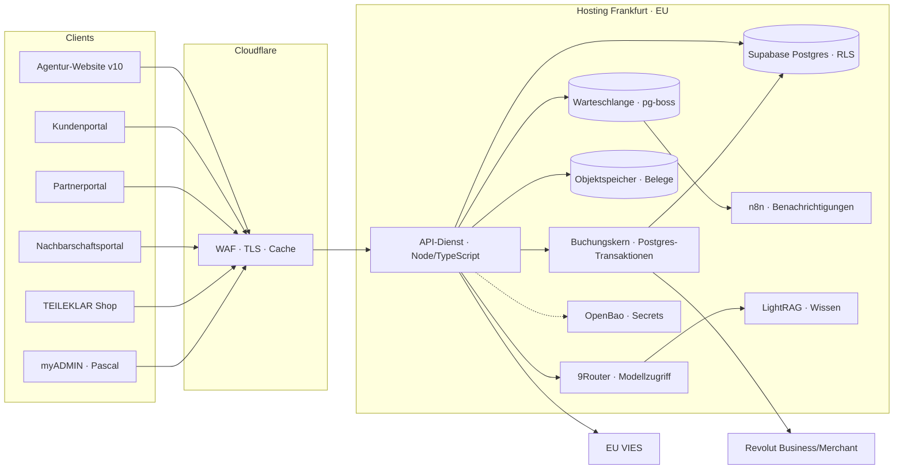

# Backend-Architektur · NeXifyAI · Stand 27.09.2026

Status: **Plan, nicht implementiert.** Grundlage: `backend-und-datenbank.md`, `auth-und-rollen.md`, `nexifyai-api-abrechnungskonzept.md`, Code-Review R-04/R-07, Skills Senior-Architekt, Workflow-Architektur, TDD-Governance.

## 1 · Systembild (C4 Ebene 2)

## 2 · Stack-Entscheidungen

| Schicht | Wahl | Begründung | Verworfen |
|---|---|---|---|
| Web | Next.js / TypeScript | NeXifyAI-Standard, Übergabe der Entwürfe | – |
| API | Node/TypeScript (Fastify) | teilt Rechenkern `lib/rechenkern.js` 1:1 mit der Oberfläche | FastAPI (zweite Sprache nur für Modell-Training) |
| Daten | Supabase Postgres, RLS je Mandant | vorhanden, Apache-2.0, selbst hostbar | NeonDB (proprietär) |
| Buchungen | eigener Dienst, Postgres-Transaktionen, Idempotenz-Tabelle | Geld braucht durable Execution | Buchung in n8n |
| Jobs | pg-boss | Postgres-basiert, kein Redis | Redis |
| Automationen | n8n (bestehend) | nur Benachrichtigung, kein Geld | – |
| Secrets | OpenBao | Standard | Vault |
| IaC | OpenTofu | Standard | Terraform (BUSL) |
| CI/CD | GitLab CI, `glab` | selbst gehostet | GitHub Actions |

## 3 · Endpunkte (Vertrag)

Alle unter `/v1`, JSON, Auth per HttpOnly-Session-Cookie (Portale) bzw. `Authorization: Bearer nx_…` (API-Kunden). Jeder schreibende Aufruf verlangt `Idempotency-Key`.

| Methode | Pfad | Rolle | Pflichtfelder | Fehlerfälle |
|---|---|---|---|---|
| POST | auth/login | alle | email, passwort | 401 falsch, 429 zu viele Versuche |
| POST | auth/register | partner, nachbarschaftskunde | email, passwort, name, einwilligung | 409 existiert, 422 Validierung |
| POST | offers/accept | kunde | angebotId | 409 abgelaufen |
| POST | billing/pay | kunde, partner | rechnungId | 402 abgelehnt, 409 bezahlt |
| POST | crosssell/order | alle | produktId | 422 |
| GET | documents/download | alle | dokumentId | 403 fremder Mandant |
| PATCH | partner/appointments/status | partner | terminId, status | 409 Statusfolge |
| POST | partner/vouchers/order | partner | vorlage, menge | 422 Menge > 5.000 |
| PUT | partner/profile | partner | firma, adresse | 422 |
| POST | customer/appointments/create | nachbarschaftskunde | partnerId, slot | 409 belegt |
| PATCH | customer/appointments/status | nachbarschaftskunde | terminId, status | 409 |
| POST | customer/vouchers/redeem | nachbarschaftskunde | code | 404, 410 abgelaufen (90 Tage), 409 eingelöst |
| POST | account/data-rights | alle | art (auskunft/berichtigung/loeschung/uebertragung) | 202 angenommen |
| POST | api/v1/requests | api-kunde | modell, eingabe, kostenstelle | 402 Guthaben, 429 |
| GET | api/v1/usage | kunde | zeitraum | – |
| POST | api/v1/credit/topup | kunde | betrag | 402 |
| GET/POST | api/v1/keys | kunde | kostenstelle | 403 |
| GET/PUT | api/v1/cost-centers | kunde | name, budget | 422 |

## 4 · Flows mit Sicherungen

**Anfrage über API:** Schlüssel prüfen → Kostenstelle + Budget (`guthabenStufe`) → Kostenschätzung → 9Router (Timeout 60 s, Backoff 1/2/4 s, max. 3) → Buchung mit Idempotenz-Schlüssel = Request-ID → Antwort. Stopp bei 100 % bricht keine laufende Anfrage ab.

**Aufladung:** Revolut-Zahlung anlegen (Idempotenz-Schlüssel) → Webhook signiert prüfen → Buchung → Beleg in Objektspeicher (nur Referenz im Workflow) → n8n-Mail. Webhook doppelt = keine zweite Gutschrift.

**Rechnung:** Monatsschnitt → Preis nur über Rechenkern → Steuer (`steuer`, VIES serverseitig, Ergebnis mit Zeitstempel gespeichert) → PDF → Versand. Storno nur als Gegenbuchung, nie Löschung (GoBD).

**Termin/Gutschein:** Statusfolge als Zustandsmaschine; ungültige Übergänge 409; Code-Einlösung in einer Transaktion mit Zeilensperre.

## 5 · Teststrategie (TDD-Governance)

- **Schule:** Chicago (Zustand) für Rechenkern und Buchungskern; London (Doubles) nur an Grenzen zu Revolut, VIES, 9Router.
- **Ebenen:** Unit (Vitest) → Vertrag (Contract-Tests gegen Abschnitt 3) → E2E auf Vorschau-Stufe (Playwright).
- **Pflichtfälle je Endpunkt:** Positiv, Negativ (Fehlercode benannt), Grenzwert, Rücknahme. Vorbild: `lib/rechenkern.js` FAELLE (18/18 grün).
- **Mutationstests** (Stryker) nur für Rechen- und Buchungskern.
- **Gate in GitLab CI:** Merge nur bei grüner Suite; Test-Commit vor Implementierungs-Commit wird geprüft.
- **Metriken:** Zeit Rot→Grün, Mutationsscore Rechenkern ≥ 80 %, keine Coverage-Zahl als Selbstzweck.

## 6 · Reihenfolge

1. Repository in GitLab, Rechenkern + Tests übernehmen (fertig in diesem Paket).
2. Vorschau-Stufe (Einzelfreigabe DNS).
3. Auth + RLS, dann Buchungskern, dann Portale-Endpunkte, dann API-Abrechnung.
4. Je Schritt: Freigabe-Nachweis nach `docs/04-betrieb/freigabe-nachweis-2026-09-27.md`.
