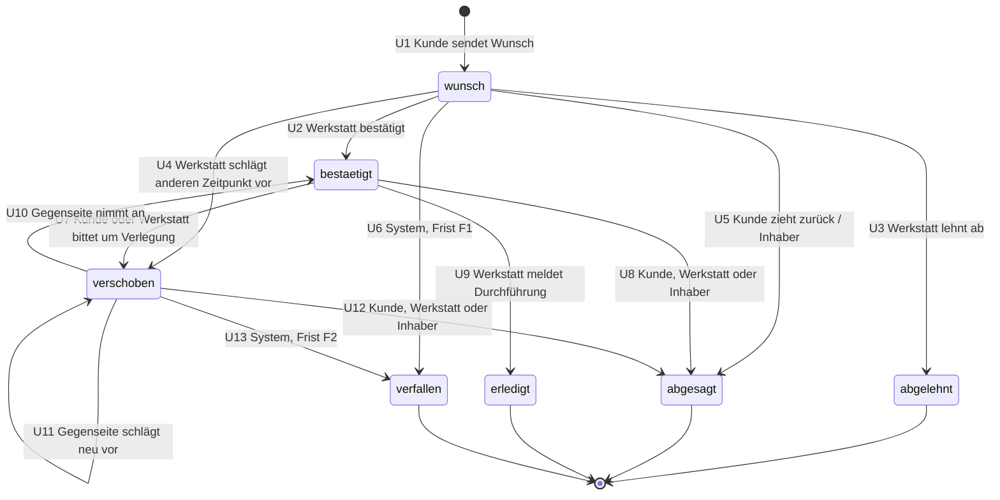

# Werkstattservice TEILEKLAR: Terminlogik (Spezifikation, Paket J-1 / Baustein W4)

Stand: 14.11.2026, Repository `origin/main` auf `2b8da63`. Entwurf zur Bestätigung durch den Inhaber. Dieses Dokument ist eine Spezifikation: kein Produktcode, keine Konfiguration, kein Test wurde geändert, kein Formular abgeschickt.

Fassung 2 vom 22.11.2026: Befunde der automatischen Prüfungen am PR 187 vom 15.11.2026 eingearbeitet (Empfänger im Ereignisschlüssel, Nachrichtenabsicht im selben Schreibvorgang, Reihenfolge von Frist, Version und Übergang, Belegungseintrag gegen parallele Bestätigung, Grund bei U12, Prüfung von `vorgaenger_id`, Liste für Kunden mit Konto, Zugriffsprotokoll, Name der Werkstattrolle offen, Verhalten nach F5 als Pflichtwert). Die Zeilenbelege wurden an `2b8da63` erhoben; von den zitierten Dateien haben die sechs Commits auf `main` bis `9c9c806` nur `apps/shop-api/shop/accounts_api.py` geändert, und die dort zitierten Zeilen (`:55`, `:129`, `:175-176`, `:188`) stimmen an `9c9c806` unverändert.

Bezug: `docs/04-betrieb/werkstattservice-und-suite-ist-soll-2026-11-14.md`, Abschnitt 3.3 (W4, W5, W6) und Abschnitt 5 (J-1); Register OA-085. Priorität laut Auftrag der koordinierenden Sitzung: Inhaber Pascal Courbois, 14.11.2026, Fertigstellung von Shop und Werkstattservice.

Kennzeichnung: **SOLL** = gültige Entscheidung, führender Plan oder Festlegung dieser Spezifikation, die aus einem solchen Plan folgt · **IST** = heute im Repository gelesen (Datei und Zeile) · **ANNAHME** = begründeter Vorschlag dieser Spezifikation, nicht bestätigt · **OFFEN** = fehlt, widersprüchlich oder Entscheidung des Inhabers. Ein Wert, der eine Geschäftsentscheidung ist, steht hier nie als Zahl.

Keine Rechtsberatung. Fragen zu Datenschutz, Vermittlerrolle, Stornierung und Aufbewahrung sind als offene Punkte für Inhaber und Rechtsberatung geführt (Abschnitt 8), nicht entschieden.

„Buchbar“ heißt (SOLL, `werkstattservice-und-suite-ist-soll-2026-11-14.md:90`): Ein Kunde sendet einen Terminwunsch an eine Partnerwerkstatt, die Werkstatt bestätigt oder lehnt ab, der Kunde erhält die Antwort.

## 1. Ergebnis in Kürze

1. **SOLL:** Ein Termin ist ein eigener Datensatz mit sieben Zuständen und dreizehn erlaubten Übergängen (Abschnitt 2). Die Werkstatt entscheidet; das System bestätigt nie selbst (`docs/01-konzept/myadmin-gesamtplan.md:64`, Spalte Freigabe „Werkstatt“).
2. **IST:** Nichts davon ist gebaut. Es gibt eine Werkstattanfrage ohne Zustandsfolge, ohne Idempotenz und ohne Nachricht an die Werkstatt (`apps/shop-api/shop/workshops_api.py:103-125`). Die Rolle „Partner“ und ein Partnermerkmal am Betrieb gibt es auf `main` nicht (`workshops_api.py:48`, `apps/shop-api/shop/auth.py:28`, `:43`).
3. **OFFEN:** Sechzehn Entscheidungen des Inhabers (Abschnitt 8.1), darunter jede Frist. Die Zustandsmaschine, die Schnittstelle und die Tests lassen sich trotzdem sofort bauen, wenn jede Frist ein Pflichtwert der Konfiguration ohne Vorgabe ist und die Funktion ohne diese Werte geschlossen bleibt (Abschnitt 8.2).

## 2. Zustände und Übergänge

### 2.1 Zustände (SOLL)

Technische Namen klein, ohne Umlaute, nach dem Muster der Statuswerte im Entwurf `partner_policy.json` (PR 122, offen, nur gelesen).

| Zustand | Bedeutung | Endzustand |
|---|---|---|
| `wunsch` | Der Kunde hat einen Terminwunsch gesendet. Es besteht kein Termin. | nein |
| `bestaetigt` | Die Werkstatt hat einen bestimmten Zeitpunkt zugesagt (oder die Gegenseite hat einen Vorschlag angenommen). Nur dieser Zustand ist ein Termin. | nein |
| `verschoben` | Es liegt ein Vorschlag für einen anderen Zeitpunkt vor, auf den die Gegenseite noch nicht geantwortet hat. `vorschlag_von` nennt die Seite, die vorgeschlagen hat. | nein |
| `abgelehnt` | Die Werkstatt hat den Wunsch abgelehnt, ohne einen anderen Zeitpunkt vorzuschlagen. | ja |
| `abgesagt` | Eine Seite hat den Wunsch, den Vorschlag oder den bestätigten Termin zurückgenommen. `abgesagt_von` nennt die Seite. | ja |
| `erledigt` | Die Werkstatt hat gemeldet, dass der Termin stattgefunden hat. | ja |
| `verfallen` | Eine Antwortfrist ist ohne Antwort abgelaufen. | ja |

Aus einem Endzustand führt kein Übergang heraus. Ein neuer Anlauf ist ein neuer Termin-Datensatz mit `vorgaenger_id`.

Vorbehalten, nicht Teil des ersten Baus (SOLL aus Abnahmepaket P14, `config/acceptance-coverage.json:4117-4119`): `nicht_erschienen` (Meldung der Werkstatt, Widerspruch des Kunden). Dieser Zustand hat nur Sinn zusammen mit Konditionen und Abrechnung (W3); er wird erst spezifiziert, wenn E-14 entschieden ist.

### 2.2 Erlaubte Übergänge (SOLL)

Auslöser: **K** = Kunde, **W** = Werkstatt (Partnerbetrieb, dem der Termin gehört), **S** = System (nur Fristablauf), **I** = Inhaber (Rolle `admin`). „Gegenseite“ ist bei `verschoben` die Seite, die den Vorschlag **nicht** gemacht hat.

| Nr. | Von | Nach | Auslöser | Bedingung | Benachrichtigung (Abschnitt 4) |
|---|---|---|---|---|---|
| U1 | (neu) | `wunsch` | K | Betrieb ist freigeschalteter Partner; Pflichtfelder gültig; Wunschzeit liegt im erlaubten Vorlauf (F3, F4) | N1, N2 |
| U2 | `wunsch` | `bestaetigt` | W | zugesagter Zeitpunkt liegt in der Zukunft und im Wunschfenster des Kunden | N3 |
| U3 | `wunsch` | `abgelehnt` | W | Grund aus fester Liste | N4 |
| U4 | `wunsch` | `verschoben` | W | vorgeschlagener Zeitpunkt liegt in der Zukunft und außerhalb des Wunschfensters | N5 |
| U5 | `wunsch` | `abgesagt` | K, I | – (I: Grund Pflicht) | N6 |
| U6 | `wunsch` | `verfallen` | S | Antwortfrist F1 abgelaufen oder Ende des Wunschfensters erreicht | N7 |
| U7 | `bestaetigt` | `verschoben` | K, W | neuer Zeitpunkt liegt in der Zukunft; Verlegung noch zulässig (F5) | N5 |
| U8 | `bestaetigt` | `abgesagt` | K, W, I | – (W und I: Grund Pflicht) | N6 |
| U9 | `bestaetigt` | `erledigt` | W | bestätigter Zeitpunkt liegt in der Vergangenheit | N10 (OFFEN, E-11) |
| U10 | `verschoben` | `bestaetigt` | Gegenseite | vorgeschlagener Zeitpunkt liegt noch in der Zukunft | N3 |
| U11 | `verschoben` | `verschoben` | Gegenseite | neuer Vorschlag; Zahl der Runden unter der Grenze F11 | N5 |
| U12 | `verschoben` | `abgesagt` | K, W, I | – (W und I: Grund Pflicht) | N6 |
| U13 | `verschoben` | `verfallen` | S | Antwortfrist F2 abgelaufen oder vorgeschlagener Zeitpunkt erreicht | N7 |

Alles, was nicht in dieser Tabelle steht, ist verboten und antwortet mit 409 `appointment_transition_forbidden` (Abschnitt 9). Insbesondere:

- Das System bestätigt, lehnt ab und erledigt nie. Der Inhaber bestätigt und lehnt nicht im Namen der Werkstatt ab („die Werkstatt entscheidet“, `myadmin-gesamtplan.md:64`). Ob der Inhaber `erledigt` als Korrektur setzen darf, ist OFFEN (E-15).
- Wer bei `verschoben` den Vorschlag gemacht hat, kann ihn nicht selbst annehmen (U10) und keinen zweiten nachschieben (U11); er kann nur absagen (U12).
- Der Auslöser wird aus der geprüften Sitzung oder dem geprüften Zugriffsnachweis abgeleitet, nie aus einem Feld der Anfrage.

ANNAHME zu U7: Mit dem Vorschlag einer Verlegung ist der bisherige Zeitpunkt nicht mehr zugesagt. Das hält die Maschine einfach (ein Zustand, ein gültiger Zeitpunkt). Die Alternative, den alten Termin bis zur Annahme des neuen zu halten, braucht einen zusätzlichen Zustand oder einen zweiten Zeitpunkt am Datensatz. OFFEN, E-05.

### 2.3 Zustandsdiagramm

## 3. Fristen und Verhalten ohne Antwort

### 3.1 Fristen

Jede Frist ist ein benannter Pflichtwert der Konfiguration **ohne Vorgabe im Code**. Fehlt einer der Werte F1 bis F5 oder F11, bleibt die Terminfunktion geschlossen (503 `appointments_not_configured`). So kann gebaut und getestet werden, ohne dass ein erfundener Wert in den Betrieb gelangt.

| Nr. | Frist | Wirkung | Wert |
|---|---|---|---|
| F1 | Antwortfrist der Werkstatt auf einen Wunsch | danach U6 | **OFFEN (E-01)** |
| F2 | Antwortfrist der Gegenseite auf einen Vorschlag | danach U13 | **OFFEN (E-01)** |
| F3 | Mindestvorlauf: frühester wünschbarer Zeitpunkt ab Absenden | U1 sonst 422 | **OFFEN (E-03)** |
| F4 | Höchstvorlauf: spätester wünschbarer Zeitpunkt ab Absenden | U1 sonst 422 | **OFFEN (E-03)** |
| F5 | Bis wann vor dem Termin der Kunde absagen oder verlegen kann, und was danach gilt | U7, U8 | **OFFEN (E-04)**: Grenze **und** Verhalten danach, beides Pflichtwerte ohne Vorgabe (Abschnitt 8.2, B2); hängt an Konditionen (W3) und Rechtstexten (W9) |
| F6 | Erinnerung an die Werkstatt vor Ablauf von F1 | N8 | **OFFEN (E-11)** |
| F7 | Erinnerung an den Kunden vor dem bestätigten Termin | N9 | **OFFEN (E-11)** |
| F8 | Nachfrage an die Werkstatt nach dem Termin, wenn `erledigt` nicht gemeldet ist; und was ohne Meldung geschieht | N11 | **OFFEN (E-11, E-14)** |
| F9 | Aufbewahrung der Termindaten nach einem Endzustand | Archiv, Löschung | **OFFEN (E-10)**, Inhaber und Rechtsberatung |
| F10 | Gültigkeit des Zugriffsnachweises des Kunden (Abschnitt 5.3) | danach nur Lesen des Endzustands oder 404 | ANNAHME: gültig bis zum Endzustand des Termins plus F9; kein eigener Geschäftswert |
| F11 | Höchstzahl der Vorschlagsrunden (U11) | danach nur U10 oder U12 | **OFFEN (E-05)** |

Zusätzlich OFFEN (E-01): ob F1 und F2 in Kalenderstunden oder in Öffnungszeiten der Werkstatt laufen. IST: Öffnungszeiten liegen nur als freier Text im Verzeichnis vor (`hours` in `workshops_api.py:16`), eine Berechnung in Öffnungszeiten ist damit heute nicht möglich. ANNAHME: Der erste Bau rechnet in Kalenderzeit, weil nur das aus den vorhandenen Daten eindeutig berechenbar ist.

Feste technische Regel (SOLL, keine Geschäftsentscheidung): Eine Antwortfrist endet spätestens mit dem Zeitpunkt, um den es geht (Ende des Wunschfensters bei `wunsch`, vorgeschlagener Zeitpunkt bei `verschoben`). Ein Termin in der Vergangenheit kann nicht mehr bestätigt werden.

### 3.2 Was ohne Antwort der Werkstatt geschieht

SOLL (Festlegung dieser Spezifikation):

1. Schweigen ist nie Zustimmung. Ohne Antwort entsteht kein Termin.
2. Mit Ablauf von F1 wird der Wunsch `verfallen` (U6). Der Kunde erhält N7 mit dem ehrlichen Satz, dass die Werkstatt nicht geantwortet hat und kein Termin besteht.
3. Der Verfall wird **beim Lesen und bei jedem Übergangsversuch** festgestellt: Ist die Frist am Datensatz überschritten, gilt er als `verfallen`, wird so gespeichert und eine verspätete Bestätigung antwortet mit 409 `appointment_expired`. Der Zustand hängt damit nicht davon ab, ob ein Hintergrundlauf pünktlich war.
4. Der Hintergrundlauf ist nur für die Nachrichten N7 bis N9 und N11 nötig.

IST zum Hintergrundlauf: Der einzige Wiederholungslauf im Shop-Dienst ist eine Schleife im Prozess (`apps/shop-api/shop/mailer.py:107-109`, gestartet in `apps/shop-api/shop/main.py:46`). Der Vercel-Einstieg lädt die Router ohne `shop.main` und dessen Start (`apps/shop-api/vercel_app.py:194`); `vercel.json` enthält keinen Zeitplan. **OFFEN:** In der Auslieferung ist damit kein laufender Zeitgeber belegt. Verfallsnachricht und Erinnerungen brauchen einen nachweisbar laufenden Auslöser; bis dahin gilt nur Punkt 3 als gesichert.

OFFEN (E-02), nicht vorentschieden: Was dem Kunden nach Verfall oder Ablehnung angeboten wird. Möglich sind: nur die Auskunft; ein Verweis auf die Werkstattsuche; eine Meldung an den Inhaber zur persönlichen Nachverfolgung. Ein Vorschlag anderer Betriebe in derselben Nachricht berührt die Grenze zur Werbung (Abschnitt 4.3).

## 4. Benachrichtigungen

### 4.1 IST

- Eine Werkstattanfrage erzeugt genau eine Nachricht: die Eingangsbestätigung an den Anfragenden (`workshops_api.py:123-124`, Vorlage `apps/shop-api/shop/mail_templates.py:103-106`, Test `tests/test_teileklar_shop_api.py:239-243`). **Die Werkstatt wird nicht benachrichtigt.**
- Das Verzeichnis führt keine E-Mail-Adresse des Betriebs (Felder in `workshops_api.py:16`: Name, Anschrift, Telefon, Website, Öffnungszeiten, Koordinaten, Markt).
- Versandweg ist die Warteschlange mit einem Datensatz je Ereignisschlüssel (`mailer.py:35-44`); ein zweites Einreihen mit demselben Schlüssel sendet nicht erneut.
- Die allgemeine Anfrage meldet zusätzlich intern an `MAIL_INTERNAL_TO` (`apps/shop-api/shop/requests_api.py:33-38`); die Werkstattanfrage tut das auf `main` nicht.

### 4.2 SOLL: wer wann worüber

Kanal im ersten Bau ist E-Mail über die vorhandene Warteschlange; Ereignisschlüssel `appointment:<id>:<nachricht>:<version>:<empfaengerrolle>` mit `empfaengerrolle` aus `kunde`, `werkstatt`, `inhaber`: **ein Eintrag der Warteschlange je Empfänger**, damit jede Nachricht je Zustandswechsel und Empfänger höchstens einmal entsteht. Die Warteschlange speichert genau eine Adresse je Schlüssel und gibt beim zweiten Einreihen den vorhandenen Eintrag zurück (`mailer.py:35-44`); ohne die Empfängerrolle im Schlüssel bekäme bei N3, N6 und N7 nur die erste Seite eine Nachricht. Haben zwei Rollen dieselbe Adresse, geht trotzdem je Rolle eine Nachricht hinaus (die Inhalte sind je Sicht verschieden). Zweiter Kanal ist die Anzeige im Partnerportal (W7) und im Kundenkonto, sobald es sie gibt. SMS, Messenger und Telefon sind nicht vorgesehen; im Repository gibt es dafür keinen Adapter.

| Nr. | Ereignis | Empfänger | Inhalt (nur Sachstand) | Einordnung |
|---|---|---|---|---|
| N1 | U1 | Kunde | Wunsch ist eingegangen; es besteht **noch kein Termin**; Werkstatt, Wunschzeit, Verwaltungslink | transaktional |
| N2 | U1 | Werkstatt | neuer Terminwunsch; Daten nach Abschnitt 5.2; Weg zum Antworten | transaktional |
| N3 | U2, U10 | Kunde; bei U10 auch die Seite, deren Vorschlag angenommen wurde | Termin bestätigt mit Zeitpunkt in Ortszeit der Werkstatt, Anschrift, Verwaltungslink | transaktional |
| N4 | U3 | Kunde | Werkstatt hat abgelehnt; kein Termin | transaktional |
| N5 | U4, U7, U11 | Gegenseite | Vorschlag für einen anderen Zeitpunkt; Antwortfrist F2 als Datum | transaktional |
| N6 | U5, U8, U12 | die jeweils andere Seite; bei Auslöser I beide | Absage, bei bestätigtem Termin mit dem abgesagten Zeitpunkt | transaktional |
| N7 | U6, U13 | Kunde; bei U13 auch die Werkstatt | Frist abgelaufen; kein Termin | transaktional |
| N8 | vor Ablauf F1 (F6) | Werkstatt | offener Wunsch läuft ab | transaktional (ANNAHME); OFFEN E-11 |
| N9 | vor bestätigtem Termin (F7) | Kunde | Erinnerung an den eigenen Termin | transaktional (ANNAHME); OFFEN E-11 |
| N10 | U9 | Kunde | Werkstatt hat den Termin als durchgeführt gemeldet | OFFEN E-11: nur senden, wenn fachlich nötig (zum Beispiel für einen Widerspruch nach P14) |
| N11 | nach Termin ohne Meldung (F8) | Werkstatt | Bitte um Meldung „durchgeführt“ oder „abgesagt“ | transaktional (ANNAHME); OFFEN E-11 |
| N12 | jeder Wechsel | Inhaber (intern, `MAIL_INTERNAL_TO`) | Vorgangsnummer und Zustand, ohne Freitext des Kunden | OFFEN E-16 |

Regeln (SOLL):

- Eine Nachricht sagt nur, was der Code getan hat. Solange N2 nicht nachweisbar an die Werkstatt ging, steht in N1 nicht, die Werkstatt sei informiert. (Dieselbe Regel verfolgt PR 122 mit dem Feld `workshop_notified`; `apps/web/components/shop/WorkshopDetail.tsx:13` liest dieses Feld bereits.)
- Ein Fehler beim Versand ändert den Zustand des Termins nicht und macht den Übergang nicht rückgängig (Muster `mailer.py:1`, `requests_api.py:107-114`). Der Versandstatus ist am Termin lesbar; die Oberfläche fordert nie zum erneuten Absenden auf.
- N2, N5 bis N8 und N11 gehen nur an Betriebe mit bestätigter Partnerschaft und hinterlegter Kontaktadresse aus der Partneraufnahme. An einen Verzeichnisbetrieb ohne Vereinbarung geht keine E-Mail (Register OA-086, zitiert in `werkstattservice-und-suite-ist-soll-2026-11-14.md:64`; Akzeptanzkriterium W5, `:98`).
- Sprache der Nachricht: Sprache der Seite, auf der der Kunde gebucht hat, für den Kunden; Sprache des Partnerprofils für die Werkstatt. IST: `mail_templates.py` ist einsprachig deutsch. OFFEN E-12.
- Zeitangaben stehen immer in Ortszeit der Werkstatt mit Nennung der Zeitzone (Abschnitt 6.3).

### 4.3 Transaktional oder Werbung

ANNAHME dieser Spezifikation, **von der Rechtsberatung zu bestätigen**: Transaktional ist eine Nachricht, die der Empfänger durch seinen eigenen Terminvorgang ausgelöst hat und die er braucht, um diesen Vorgang zu kennen oder abzuschließen. Das trifft auf N1 bis N7 zu. N8, N9 und N11 sind Erinnerungen zum selben Vorgang und hier als transaktional vorgeschlagen; ob das trägt, ist offen (E-11).

Werbung wäre, und **bleibt draußen**:

- Bewertungs- oder Empfehlungsaufforderungen nach dem Termin,
- Hinweise auf Teile, Gutscheine oder Angebote in einer Terminnachricht,
- Vorschläge anderer Betriebe in N4 oder N7 (OFFEN E-02; im ersten Bau nicht enthalten),
- Hinweise an Verzeichnisbetriebe, Partner zu werden, aus Anlass einer Anfrage,
- jede Nachricht an Empfänger, die keinen eigenen Terminvorgang haben.

Die Terminnachrichten enthalten deshalb nur Sachstand, Vorgangsnummer, Verwaltungsweg und die Pflichtangaben des Absenders. Absenderadresse: OFFEN E-12 (IST: `RESEND_FROM` beziehungsweise `RESEND_FROM_ADDRESS`, `mailer.py:27-32`; Werte nicht gelesen).

## 5. Daten je Termin

### 5.1 Datenklassen

ANNAHME: Im Repository gibt es kein festes Verzeichnis von Datenklassen (gesucht nach „Datenklasse“; Treffer nur als Begriff, etwa `docs/operating-model/NEXIFY-GESAMTSYSTEM.md:149`). Diese Spezifikation benutzt: **A** öffentlich · **B** betrieblich, nicht personenbezogen · **C** personenbezogen · **D** personenbezogener Freitext (kann ungefragt weitere Angaben enthalten) · **E** Geheimnis (nur als Prüfsumme gespeichert, nie ausgegeben).

### 5.2 Felder (SOLL)

| Feld | Pflicht | Klasse | Sichtbar für | Anmerkung |
|---|---|---|---|---|
| `id` | ja | B | K, W, I | vom Server vergeben; aus dem Idempotenzschlüssel abgeleitet (Abschnitt 6.1) |
| `nummer` | ja | B | K, W, I | lesbare Vorgangsnummer für Nachrichten und Rückfragen |
| `marke` | ja | B | I | fest `teileklar` |
| `werkstatt_id` | ja | B | K, W, I | Mandantenschlüssel; unveränderlich |
| `werkstatt_name`, `werkstatt_anschrift` | ja | A | K, W, I | Abbild zum Zeitpunkt des Wunsches |
| `zustand` | ja | B | K, W, I | Abschnitt 2.1 |
| `version` | ja | B | K, W, I | ganze Zahl, steigt mit jedem Übergang („Terminversion“, `acceptance-coverage.json:4117`) |
| `wunsch_von`, `wunsch_bis` | ja | B | K, W, I | Wunschfenster als Zeitpunkte in UTC |
| `zeitzone` | ja | B | K, W, I | IANA-Name der Werkstatt, zum Beispiel `Europe/Berlin` |
| `ortszeit_eingabe` | ja | B | I | Eingabe des Kunden, wie getippt, zur Nachvollziehbarkeit |
| `termin_am`, `dauer_minuten` | bei `bestaetigt` | B | K, W, I | zugesagter Beginn in UTC; Dauer optional, nur von der Werkstatt |
| `vorschlag_am`, `vorschlag_von`, `vorschlag_runde` | bei `verschoben` | B | K, W, I | |
| `antwort_bis` | bei `wunsch`, `verschoben` | B | K, W, I | berechnet aus F1 oder F2 beim Übergang, danach unveränderlich |
| `kunde_name` | ja | C | W, I | |
| `kunde_email` | ja | C | I; W nur wenn E-09 das vorsieht | Empfänger von N1 bis N7 |
| `kunde_telefon` | nein | C | wie `kunde_email` | |
| `kunde_user_id` | nein | C | I | gesetzt, wenn der Kunde angemeldet war (Muster `requests_api.py:41-44`, `:89`) |
| `fahrzeug` | nein | C | W, I | IST: freier Text bis 160 Zeichen (`workshops_api.py:98`) |
| `anliegen` | ja | D | W, I | IST: 10 bis 2.000 Zeichen (`workshops_api.py:99`, `:113`) |
| `bestellung_id`, `artikel` | nein | C | W, I | nur wenn der Termin aus einer Bestellung entsteht; OFFEN, ob Teil des ersten Baus (Übergabepaket nach `docs/04-betrieb/betriebslogik-und-prozesse.md:104`) |
| `einwilligung` | ja | C | I | Zeitpunkt, Fassung des Einwilligungstextes, Sprache; IST wird nur `consent: true` gespeichert (`workshops_api.py:100`, `:120`) |
| `seite`, `sprache` | ja | B | I | Herkunftsseite und Sprache für die Nachrichten |
| `grund_code`, `grund_text` | bei U3, bei U5/U8/U12 durch W oder I | B / D | K, W, I | Code aus fester Liste; Freitext optional und kurz |
| `abgesagt_von` | bei `abgesagt` | B | K, W, I | `kunde`, `werkstatt`, `inhaber` |
| `verlauf[]` | ja | B (Akteur als Rolle, nicht als Name) | I; K und W die eigenen Einträge und alle Zustandswechsel | je Übergang: Nummer U1 bis U13, von, nach, Auslöser, Zeit, Version, Idempotenzschlüssel als Prüfsumme, Art des Aufrufs und Prüfsumme seiner Nutzlast (Abschnitt 6.1) |
| `zugriff_kunde` | ja | E | niemand | Prüfsumme des Verwaltungslinks (Abschnitt 5.3) |
| `nutzlast_pruefsumme` | ja | B | I | für die Wiederholungsprüfung (Abschnitt 6.1) |
| `benachrichtigungen[]` | ja | B | I | Ereignisschlüssel und Versandstatus je Nachricht |
| `vorgaenger_id` | nein | B | K, W, I | Verweis auf einen früheren Termin desselben Anlaufs; nur nach Prüfung (Abschnitt 5.3) |
| `erstellt_am`, `geaendert_am` | ja | B | K, W, I | UTC |

**OFFEN (E-09), nicht entschieden:** welche dieser Felder die Werkstatt erhält und auf welcher Grundlage. Die Tabelle zeigt den sparsamsten Zuschnitt, mit dem die Werkstatt entscheiden kann (Name, Fahrzeug, Anliegen, Wunschzeit); die Kontaktdaten des Kunden sind als eigene Stufe ausgewiesen. Dazu gehört auch die Frage, ob die E-Mail N2 das Anliegen im Klartext enthält oder nur auf das Portal verweist. Heute sagt die Eingangsbestätigung, die Werkstatt sei „kein TEILEKLAR-Vertragspartner“ (`mail_templates.py:105`); Rolle von TEILEKLAR bei der Vermittlung und Weitergabe der Anfragedaten sind als W9 beim Inhaber (`werkstattservice-und-suite-ist-soll-2026-11-14.md:102`).

### 5.3 Mandanten- und Rollenbindung

IST:

- Rollen im Shop-Dienst: `admin` und `customer` (`auth.py:28`, `:39-45`; `apps/shop-api/shop/accounts_api.py:55`, `:129`). Eine Rolle für Werkstätten und eine Zuordnung Konto → Betrieb gibt es nicht.
- Jeder Betrieb wird öffentlich als `partner: False` ausgegeben (`workshops_api.py:48`); die Anfrage prüft keine Partnerschaft (`:103-107`). Ein Partnermerkmal (`partner_kind`) und der Fehler 409 `workshop_not_partner` stehen nur in PR 122 (offen); die Oberfläche behandelt diesen Fehler schon (`WorkshopDetail.tsx:40-42`).
- Werkstattanfragen liest auf `main` kein Code wieder aus; es gibt keinen Lese- oder Verwaltungsweg dafür (Suche nach `workshop_requests` in `apps/shop-api`: außer dem Schreiben und Zurücklesen in `workshops_api.py:120-122` nur die Sammlungsliste in `vercel_app.py:38`).

SOLL:

| Rolle | Darf | Bindung |
|---|---|---|
| Kunde ohne Konto | eigenen Termin lesen, U5, U7, U8, U10 bis U12 | Verwaltungslink mit Zugriffsnachweis; in der Datenbank nur als Prüfsumme (Muster `accounts_api.py:175-176`); Vergleich in konstanter Zeit |
| Kunde mit Konto | wie oben, zusätzlich Liste der eigenen Termine (`GET /api/workshops/appointments/mine`) | `kunde_user_id` gleich Sitzungsnutzer |
| Werkstatt (Werkstattrolle; technischer Name OFFEN, siehe unten) | Termine des eigenen Betriebs lesen; U2 bis U4, U7 bis U12 | Sitzung **und** Mitgliedschaft im Betrieb `werkstatt_id`; nie über ein Feld der Anfrage |
| Inhaber (Rolle `admin`) | alles lesen; U5, U8, U12 mit Grund | `require_admin` (`auth.py:39-45`); jeder schreibende Eingriff im `verlauf`, jeder lesende Zugriff im Zugriffsprotokoll (siehe unten) |
| System | U6, U13, Nachrichten | kein Zugriff über die öffentliche Schnittstelle |

- Fremder Betrieb, falscher Zugriffsnachweis und unbekannte Kennung antworten gleich: 404 `appointment_not_found` (keine Existenzauskunft; SOLL aus `docs/03-backend/auth-und-rollen.md:92`).
- **Name der Werkstattrolle, OFFEN (für W7):** `docs/03-backend/auth-und-rollen.md:79` nennt die Rolle `werkstatt`, der Seitenplan führt für das Partnerportal `partner` (`werkstattservice-und-suite-ist-soll-2026-11-14.md:120`). Der Dienst gibt gespeicherte Rollennamen unverändert zurück (`auth.py:28`), eine Zuordnung zwischen beiden Namen gibt es nicht. Diese Spezifikation legt den Namen nicht fest; B1 und B2 prüfen gegen **einen** Konfigurationswert, und W7 entscheidet ihn zusammen mit der Mitgliedschaft. Ein Test (Abschnitt 10, Nr. 79) hält fest, dass der jeweils andere Name keinen Zugriff gibt.
- **Zugriffsprotokoll für den Inhaber (SOLL aus `auth-und-rollen.md:91`, `:95`):** Jeder lesende Zugriff des Inhabers auf Termine (Einzelabruf und Liste) schreibt einen unveränderlichen Eintrag mit Akteur (Nutzerkennung, nicht nur Rolle), Ziel (Terminkennungen beziehungsweise Filter der Liste), Grund und Zeit. Der `verlauf` ist dafür nicht geeignet, weil er nur Übergänge kennt und den Akteur als Rolle führt. Wiederverwendbar ist das Muster `apps/shop-api/shop/nexify_api.py:81-82`. ANNAHME: Der Grund kommt als Pflichtangabe des Aufrufs (`grund`), sonst 422 `reason_required`; ob das für jeden Lesezugriff gelten soll, gehört zu E-15. Aufbewahrung des Protokolls: OFFEN E-10 (der Plan nennt in `auth-und-rollen.md:95` einen Wert; er wird hier nicht übernommen).
- **`vorgaenger_id` (SOLL):** Wird nur angenommen, wenn der Aufrufer den Zugriff auf den Vorgänger mit demselben Nachweis oder derselben Sitzung belegt, der Vorgänger in einem Endzustand ist und Betrieb und E-Mail-Adresse des Kunden übereinstimmen. Sonst 404 `appointment_not_found` wie bei jedem fremden Termin, und es wird nichts gespeichert. So kann niemand mit einer erratenen Kennung eine Verbindung zu einem fremden Termin herstellen, die danach Kunde und Werkstatt sehen.
- Nach D-013 (`DECISIONS.md:100-105`) liegt der Termin im Zielbild in PostgreSQL mit Zeilensicherheit je `werkstatt_id`. IST ist MongoDB; dort setzt der Dienst die Bindung in jeder Abfrage (Betrieb immer im Filter). Der Zugriff wird über die Zugriffsschicht des Shops geführt, sobald sie auf `main` liegt (PR 150, offen), damit die Umstellung den Termin nicht noch einmal anfasst.
- **Abweichung vom Plan, OFFEN (E-08):** `auth-und-rollen.md:25` verlangt für Werkstattpartner Passwort und zweiten Faktor, `:12` schließt „wer den Link hat, darf“ aus. Eine Antwort der Werkstatt per Link aus der E-Mail, ohne Anmeldung, wäre damit eine bewusste Ausnahme. Diese Spezifikation sieht sie **nicht** vor: Die Werkstatt antwortet angemeldet. Folge: Der erste echte Durchlauf braucht die Partneranmeldung (W7) oder die ausdrückliche Entscheidung des Inhabers für eine Übergangslösung.
- **Abweichung vom Plan, OFFEN (E-07):** Für Kunden kennt der Plan den signierten Link nur zum Lesen der eigenen Bestellung (`auth-und-rollen.md:75`). Absagen und Annehmen per Link geht darüber hinaus. ANNAHME: zulässig, weil der Kunde sonst für eine Terminanfrage ein Konto bräuchte und das Formular heute ohne Konto arbeitet; ein Link, der beim Öffnen nichts ändert (nur `GET`), und eine Änderung erst nach ausdrücklichem Absenden (`POST`), damit Vorabrufe durch Mailprogramme nichts auslösen.

## 6. Technische Regeln

### 6.1 Idempotenz bei doppeltem Absenden

IST: Die Werkstattanfrage vergibt eine zufällige Kennung (`workshops_api.py:119`) und kennt keinen Idempotenzschlüssel. Ein doppelter Klick erzeugt zwei Anfragen und zwei Nachrichten. Die allgemeine Anfrage macht es richtig (`requests_api.py:59`, `:73-104`; Tests `tests/test_contact_http.py:52-73`).

SOLL, wie `requests_api.py`:

- Jeder schreibende Aufruf verlangt den Kopf `Idempotency-Key` (16 bis 128 Zeichen aus `[A-Za-z0-9_-]`, `requests_api.py:73`); sonst 400 `idempotency_key_required`. (Deckt sich mit dem Plan `docs/03-backend/backend-architektur.md:60`.)
- Anlegen (U1): Kennung des Termins = Prüfsumme des Schlüssels (`requests_api.py:79`). Derselbe Schlüssel mit derselben Nutzlast liefert die gespeicherte Antwort mit 200 und erzeugt nichts Neues; mit anderer Nutzlast 409 `idempotency_conflict` (`requests_api.py:101-104`). Der Wettlauf zweier gleichzeitiger Aufrufe wird über den eindeutigen Schlüssel der Datenbank entschieden (`requests_api.py:90-96`).
- Übergänge durch einen Aufruf (U2 bis U5, U7 bis U12): Im `verlauf` stehen Schlüssel, Art des Aufrufs (`confirm`, `decline`, …), Prüfsumme der Nutzlast und Ergebnis. Derselbe Schlüssel mit derselben Art und Nutzlast liefert das gespeicherte Ergebnis. Derselbe Schlüssel mit anderer Art oder anderer Nutzlast (anderer Zeitpunkt, anderer Grund) antwortet 409 `idempotency_conflict` und ändert nichts. Ein **neuer** Schlüssel wird wie jeder neue Aufruf geprüft, also gegen Version und Übergangstabelle (Reihenfolge in Abschnitt 9): Ein zweites `confirm` auf einen schon bestätigten Termin scheitert, weil es aus `bestaetigt` keinen Übergang `confirm` gibt, nicht weil der Zielzustand schon erreicht wäre. U11 (`verschoben` → `verschoben`) ist deshalb ausdrücklich erlaubt.
- Übergänge des Systems (U6, U13) haben keinen Aufrufer und keinen Kopf. Ihr Schlüssel wird gebildet: `system:<id>:<U6|U13>:<version vor dem Übergang>`. Lesender Abruf und Hintergrundlauf bilden damit denselben Schlüssel; der bedingte Schreibvorgang (Abschnitt 6.2) lässt genau einen gewinnen, und der `verlauf` trägt genau einen Eintrag.
- Nachrichtenabsicht (SOLL, Muster `requests_api.py:88-89`, `:107-121`): Der bedingte Schreibvorgang eines Übergangs schreibt im selben Datensatz die fälligen Nachrichten nach `benachrichtigungen[]` mit Status `ausstehend`. Erst danach wird eingereiht. Bricht der Prozess dazwischen ab, bleibt die Absicht stehen und wird nachgeholt: bei jedem späteren Lesen oder Schreiben dieses Termins, bei der Wiederholung mit demselben Schlüssel und im Hintergrundlauf. Das Einreihen ist je Ereignisschlüssel wirkungsgleich wiederholbar, es entsteht also keine zweite Nachricht. **OFFEN:** Greift niemand auf den Termin zu und läuft kein Zeitgeber (Abschnitt 3.2), bleibt die Nachricht liegen. Die Benachrichtigung der Werkstatt (N2) ist deshalb erst zugesagt, wenn ein laufender Auslöser belegt ist.
- Nachrichten: höchstens eine je Ereignisschlüssel, und der Schlüssel enthält die Empfängerrolle (Abschnitt 4.2).
- Mengenbegrenzung je E-Mail-Adresse nach dem Muster `requests_api.py:16`, `:83-85` (429 `rate_limited`). Der Grenzwert ist ein Schutzwert; ob der dortige Wert übernommen wird, entscheidet der Bau, nicht diese Spezifikation.

### 6.2 Gleichzeitige Bearbeitung

SOLL:

- Jeder Übergang nennt die `version`, auf die er sich bezieht (Kopf `If-Match` oder Feld `version`). Die Änderung ist ein einziger bedingter Schreibvorgang „wo `id`, `werkstatt_id`, `zustand` und `version` passen“, der `version` um eins erhöht (Muster des bedingten Schreibens: `accounts_api.py:188`, `apps/shop-api/shop/checkout_api.py:222`, `mailer.py:49`).
- Trifft die Bedingung nicht, hat jemand anderes zuerst geschrieben: 409 `appointment_version_conflict` mit aktuellem Zustand und aktueller Version. Kein automatisches Wiederholen mit neuer Version.
- Beispiel: Die Werkstatt bestätigt, während der Kunde zurückzieht. Genau einer gewinnt; der andere erhält 409 und sieht den neuen Stand. Es gehen nie beide Nachrichten N3 und N6 für dieselbe Version hinaus.
- Der Fristablauf (U6, U13) benutzt denselben bedingten Schreibvorgang; eine Bestätigung im selben Augenblick gewinnt oder verliert eindeutig.

### 6.3 Zeitzonen und Sommerzeit

IST: Der Dienst schreibt Zeitpunkte als UTC-Text (`apps/shop-api/shop/db.py:11-12`) und ordnet nur solche sicher (`mailer.py:91-92`). Märkte des Verzeichnisses laut Plan: DE, AT, NL, BE, CH, LU (`werkstattservice-und-suite-ist-soll-2026-11-14.md:63`).

SOLL:

- Gespeichert wird jeder Zeitpunkt als UTC, dazu die Zeitzone der Werkstatt als IANA-Name und die Eingabe des Kunden in Ortszeit. Fristen werden auf UTC gerechnet.
- Maßgeblich ist die Ortszeit **der Werkstatt**, nicht die des Geräts des Kunden. Jede Anzeige und jede Nachricht nennt Datum, Uhrzeit und Zeitzone.
- Die Zeitzone kommt aus dem Partnerprofil. IST führt das Verzeichnis nur den Markt (`workshops_api.py:16`, `:38`). ANNAHME: Für die sechs Märkte lässt sich die Zeitzone aus dem Markt ableiten; sie wird trotzdem am Termin gespeichert, damit eine spätere Regeländerung alte Termine nicht verschiebt.
- Umstellung auf Sommerzeit: Eine Ortszeit, die es an dem Tag nicht gibt, wird abgewiesen (422 `time_not_existent`), nicht stillschweigend verschoben.
- Umstellung auf Winterzeit: Eine Ortszeit, die es zweimal gibt, wird abgewiesen (422 `time_ambiguous`), sofern die Anfrage keinen eindeutigen Versatz mitliefert.
- Erinnerungen, die „am Vortag“ oder zu einer Tageszeit gemeint sind (F6, F7), werden in Ortszeit der Werkstatt berechnet, nicht als feste Zahl von Stunden; sonst wandern sie über eine Umstellung um eine Stunde.
- Die Serverzeit ist maßgeblich; eine Uhrzeit aus dem Browser wird nie als „jetzt“ verwendet.

### 6.4 Doppelbuchung eines Zeitfensters

SOLL laut Plan: „Buchung → Slot sperren → Bestätigung“ (`myadmin-gesamtplan.md:64`), „409 belegt“ (`backend-architektur.md:73`), Prüfung von „Fristlaufkonkurrenz“ (`acceptance-coverage.json:4119`).

IST: Es gibt keine Kalender, keine freien Zeiten und keine Angabe zur Kapazität eines Betriebs. Öffnungszeiten sind freier Text (`workshops_api.py:16`).

Daraus folgt, in zwei Stufen:

- **Stufe 1 (erster buchbarer Termin), ANNAHME, weicht vom Plan ab, OFFEN E-06:** Der Kunde nennt ein Wunschfenster; es wird nichts gesperrt. Mehrere Wünsche für dasselbe Fenster sind erlaubt, weil die Werkstatt ihren Kalender selbst führt und entscheidet. Beim Bestätigen (U2, U10) prüft der Dienst, ob für denselben Betrieb schon ein Termin im Zustand `bestaetigt` denselben Beginn hat, und verlangt dann eine ausdrückliche zweite Bestätigung (`ueberschneidung_bestaetigt: true`), sonst 409 `appointment_overlap`. Das verhindert die versehentliche Doppelbestätigung, ohne eine Kapazität zu erfinden. Die Prüfung darf keine vorherige Abfrage sein, denn die Versionsprüfung aus 6.2 schützt nur einen Termin, nicht zwei verschiedene: Zwei gleichzeitige Bestätigungen verschiedener Termine fänden beide nichts. Deshalb legt jede Bestätigung zuerst einen Belegungseintrag mit eindeutigem Schlüssel aus Betrieb, Beginn und laufender Nummer an. Ohne `ueberschneidung_bestaetigt` ist nur die Nummer 0 zulässig; scheitert das Anlegen am eindeutigen Schlüssel, antwortet der Dienst 409 `appointment_overlap`. Mit dem Feld wird die nächste freie Nummer belegt. Der Eintrag verweist auf den Termin und fällt weg, sobald dieser `bestaetigt` verlässt; scheitert der anschließende Schreibvorgang am Termin, wird er sofort zurückgenommen, und ein Eintrag, dessen Termin nicht `bestaetigt` mit diesem Beginn ist, gilt als nicht vorhanden.
- **Stufe 2 (Sperren von Zeitfenstern), SOLL laut Plan, nicht Teil des ersten Baus:** setzt gepflegte Zeiten und eine Kapazität je Betrieb voraus. Dann gilt: ein eindeutiger Schlüssel der Datenbank über Betrieb, Beginn und Platz für Termine in `wunsch`, `verschoben` und `bestaetigt`; der zweite Schreibversuch scheitert an der Datenbank (409 `appointment_slot_taken`), nicht an einer vorherigen Abfrage. Eine Sperre fällt mit jedem Endzustand weg.
- Derselbe Kunde: Ein zweiter offener Wunsch derselben E-Mail-Adresse beim selben Betrieb mit überlappendem Fenster wird abgewiesen (409 `appointment_duplicate`), unabhängig vom Idempotenzschlüssel. ANNAHME; schützt die Werkstatt vor Mehrfachanfragen nach einem Neuladen der Seite.

## 7. Abgleich mit dem Bestand

### 7.1 Was es gibt (IST)

| Aussage | Fundstelle |
|---|---|
| Anfrage an einen Betrieb: prüft Name, E-Mail, Anliegen, Einwilligung; speichert in `workshop_requests`; ein fester Statustext „Anfrage gesendet – noch kein Termin“; keine Zustandsfolge | `workshops_api.py:15`, `:94-100`, `:103-125` |
| Keine Idempotenz, zufällige Kennung `WA-…` | `workshops_api.py:119` |
| Nachricht nur an den Anfragenden | `workshops_api.py:123-124`; `mail_templates.py:103-106`; Test `tests/test_teileklar_shop_api.py:227`, `:239-243` (einziger Test der Werkstattanfrage) |
| Kein Partnermerkmal, jeder Betrieb ist Verzeichnisbetrieb | `workshops_api.py:1`, `:48` |
| Allgemeine Anfrage mit Idempotenz, Mengenbegrenzung, Nachholen der internen Nachricht; Art `booking` ist zugelassen, hat aber keine eigene Logik | `requests_api.py:16`, `:26`, `:59-98`, `:101-121`; Tests `tests/test_contact_http.py:52-73`, `tests/test_contact_recovery.py`, `tests/test_teileklar_shop_api.py:305-313` |
| Warteschlange für E-Mails, einmal je Ereignisschlüssel, mit Wiederaufnahme | `mailer.py:35-44`, `:47-78`, `:89-104` |
| Rollen `admin`, `customer`; Gastkennung per Cookie | `auth.py:12-28`, `:39-45` |
| Schreibende Aufrufe unter `/api/workshops` nur von der eigenen Herkunft; Antworten ohne Zwischenspeicher | `main.py:59-64`; `vercel_app.py:274` |
| `/api/workshops/…` wird an den Shop-Dienst geleitet | `vercel.json:88` |
| Der Vercel-Einstieg lässt nur bekannte Sammlungen und Pflichtindizes zu | `vercel_app.py:36-38`, `:42-47`, `:136-158` |
| Seite `/teileklar/termine` ist ein Eintrag im Seitenplan mit Hinweis „noch nicht“; kein eigener Seitenordner | `config/site-map.json:6036-6037`; `apps/web/components/shop/PhaseNotice.tsx:8`; `apps/web/app/teileklar/termine` existiert nicht |
| Formular auf der Terminseite ist das allgemeine Anfrageformular an `/api/requests` | `apps/web/components/ContactRequestForm.tsx:48`; `werkstattservice-und-suite-ist-soll-2026-11-14.md:52` |
| Plan: Termin mit Slot, Bestätigung, Erinnerung, Durchführung; Werkstatt entscheidet | `myadmin-gesamtplan.md:64`; Portale `:171-172`; Kriterien der Freischaltung offen `:187` |
| Plan: Routen `partner/appointments/status`, `customer/appointments/create`, `customer/appointments/status`; Statusfolge als Zustandsmaschine, ungültig = 409 | `backend-architektur.md:70`, `:73-74`, `:91` (Status des Dokuments: „Plan, nicht implementiert“, `:3`) |
| Plan: Leadstatus Anfrage → Angebot → Termin bestätigt → Arbeit ausgeführt → abgerechnet → bewertet | `betriebslogik-und-prozesse.md:102` |
| Abnahme P12: Stadt → Betrieb → Anfrage und zurück | `acceptance-coverage.json:4075-4079` |
| Abnahme P13: Verzeichnisbetrieb bleibt ohne Vertrag Nichtpartner; suspendiertes Profil, Änderung, Widerruf | `acceptance-coverage.json:4095-4099` |
| Abnahme P14: Terminversion, Gegenseite, Teilnahmebehauptung, Widerspruch; No-show, Fristlaufkonkurrenz, Änderung/Storno, Kalendereintrag, Empfängerprüfung | `acceptance-coverage.json:4115-4119` |
| P12 bis P14: Status `not_accepted` | `acceptance-coverage.json:4088`, `:4108`, `:4128` |

### 7.2 Wo die Spezifikation vom Bestand und vom Plan abweicht

| Nr. | Abweichung | Gegenüber | Begründung |
|---|---|---|---|
| A1 | Der Termin ist ein eigener Datensatz, nicht eine Erweiterung von `workshop_requests` | IST `workshops_api.py:120-121` | Die Anfrage hat keine Version, keinen Zeitpunkt und keinen Verlauf; ein Umbau träfe Bestandsdaten und zwei offene PRs (122, 150), die dieselbe Datei ändern |
| A2 | Buchbar nur bei freigeschalteten Partnern; Verzeichnisbetriebe erhalten keinen Terminwunsch | IST nimmt Anfragen an jeden Betrieb an (`workshops_api.py:103-107`) | Definition „buchbar“ nennt die Partnerwerkstatt; P13 (`acceptance-coverage.json:4099`); OFFEN E-13 |
| A3 | Idempotenzschlüssel Pflicht | IST keine (`workshops_api.py:119`) | Regel „Idempotenz auf allen Buchungen“ (`AGENTS.md`, Verbindliche Regeln, Sicherheit); `backend-architektur.md:60` |
| A4 | Die Werkstatt wird benachrichtigt | IST nicht (`workshops_api.py:123-124`) | ohne das kann sie nicht antworten; Baustein W5 |
| A5 | Kein Sperren eines Zeitfensters im ersten Bau | Plan `myadmin-gesamtplan.md:64`, `backend-architektur.md:73` | es fehlen Zeiten und Kapazität; OFFEN E-06 |
| A6 | Zustände und Routen heißen anders als im Plan vom 27.09.2026; ein Aufruf je Übergang statt `PATCH …/status` mit freiem Zielzustand | `backend-architektur.md:70`, `:74` | Ein Aufruf je Übergang macht Rollenprüfung und Tests je Übergang eindeutig; die Regel „ungültiger Übergang = 409“ (`:91`) bleibt |
| A7 | „Angebot“, „abgerechnet“ und „bewertet“ aus dem Leadstatus sind nicht Teil des Termins | `betriebslogik-und-prozesse.md:102` | gehören zu Konditionen (W3) und Abrechnung (P14); Bewertungsaufforderungen sind Werbung (Abschnitt 4.3) |
| A8 | `nicht_erschienen`, Widerspruch, Kalendereintrag sind vorbehalten | P14 (`acceptance-coverage.json:4117-4119`) | hängen an E-14; P14 ist mit dem ersten Bau **nicht** erfüllbar und wird nicht als erfüllt gemeldet |
| A9 | Kunde verwaltet per Link ohne Konto; Werkstatt nur angemeldet | `auth-und-rollen.md:12`, `:25`, `:75` | Abschnitt 5.3; OFFEN E-07, E-08 |
| A10 | Der feste Statustext der Anfrage wird für Termine nicht wiederverwendet | `workshops_api.py:15` | Der Zustand ist ein technischer Wert; der Satz für den Kunden entsteht je Sprache daraus |

### 7.3 Was wiederverwendet werden kann

| Baustein | Fundstelle | Verwendung |
|---|---|---|
| Idempotenz mit Schlüsselprüfung, Nutzlastprüfsumme, Wiederholung, Konflikt, Wettlauf über eindeutigen Schlüssel | `requests_api.py:73-104` | U1 unverändert als Muster |
| Antwortform der Fehler `{"detail": {"error": …, "fields": …}}` | `workshops_api.py:118`; `requests_api.py:72`; Test `tests/test_contact_http.py:73` | alle Fehler in Abschnitt 9 |
| Feldprüfungen Name, E-Mail, Anliegen, Einwilligung und ihre Fehlercodes `required`, `invalid`, `too_short` | `workshops_api.py:108-118` | U1; die Oberfläche kennt die Codes (`WorkshopDetail.tsx:10`, `:17-24`) |
| Warteschlange für E-Mails mit Ereignisschlüssel | `mailer.py:35-44` | N1 bis N12 |
| Nachholen nicht versandter Nachrichten | `requests_api.py:107-121`; `mailer.py:107-109` | Muster; in der Auslieferung ohne belegten Zeitgeber (Abschnitt 3.2) |
| Einmal- und Fristnachweis als Prüfsumme mit bedingtem Schreiben | `accounts_api.py:175-176`, `:188` | Zugriffsnachweis des Kunden |
| `require_admin` | `auth.py:39-45` | Wege des Inhabers |
| Bindung an angemeldeten Nutzer, wenn vorhanden | `requests_api.py:41-44`, `:89` | `kunde_user_id` |
| Mengenbegrenzung je E-Mail-Adresse | `requests_api.py:16`, `:83-85` | U1 |
| Herkunftsprüfung für schreibende Aufrufe und Weiterleitung `/api/workshops/…` | `main.py:59-64`; `vercel_app.py:274`; `vercel.json:88` | Routen unter `/api/workshops/…` brauchen keine neue Weiterleitung |
| Testaufbau mit Speicher im Arbeitsspeicher und nachgestelltem HTTP-Aufruf | `tests/test_contact_http.py`, `tests/test_contact_recovery.py` | Tests aus Abschnitt 10 ohne Datenbank |
| Anzeige des Versandstatus ohne Aufforderung zum erneuten Senden | `ContactRequestForm.tsx:48-60` | Oberfläche der Terminseite |
| Partnermerkmal `partner_kind`, Antwortfelder `state`, `workshop_notified`, `appointment`, Fehler `workshop_not_partner` | PR 122 (offen), `workshops_api.py` dort; gelesen als Diff, nicht geprüft | Voraussetzung für A2; **erst nutzbar, wenn PR 122 entschieden ist** |
| Zugriffsschicht `shop/store/workshops.py` | PR 150 (offen); gelesen als Diff, nicht geprüft | Ort für die Speicherzugriffe des Termins, sobald auf `main` |

## 8. Entscheidungen und sofort Baubares

### 8.1 Vor dem Betrieb zu entscheiden (Inhaber)

Jeder Punkt in einem Satz; nichts davon ist hier vorentschieden.

| Nr. | Entscheidung | Braucht Rechtsberatung |
|---|---|---|
| E-01 | Wie lange hat die Werkstatt Zeit zu antworten (F1), wie lange die Gegenseite auf einen Vorschlag (F2), und zählen dabei nur Öffnungszeiten? | nein |
| E-02 | Was wird dem Kunden nach Verfall oder Ablehnung angeboten: nur Auskunft, Verweis auf die Suche, oder persönliche Nachverfolgung durch den Inhaber? | ja, falls andere Betriebe vorgeschlagen werden |
| E-03 | Wie früh und wie weit im Voraus darf ein Termin gewünscht werden (F3, F4)? | nein |
| E-04 | Bis wann kann der Kunde absagen oder verlegen, und hat eine späte Absage eine Folge (F5)? | ja |
| E-05 | Bleibt bei einer Verlegung der alte Termin bis zur Annahme des neuen bestehen, und wie viele Vorschlagsrunden sind erlaubt (F11)? | nein |
| E-06 | Reicht für den ersten Termin das Wunschfenster ohne Sperre, oder muss vor dem Start ein Kalender mit Kapazität je Betrieb stehen? | nein |
| E-07 | Darf der Kunde ohne Konto buchen und seinen Termin per Link verwalten? | ja (Zugriffsschutz) |
| E-08 | Antwortet die Werkstatt nur angemeldet im Partnerportal (dann wartet der erste Durchlauf auf W7), oder gibt es übergangsweise einen anderen Weg? | ja (Zugriffsschutz) |
| E-09 | Welche Angaben des Kunden erhält die Werkstatt, auf welcher Grundlage, mit welchem Einwilligungstext, und steht das Anliegen in der E-Mail oder nur im Portal? | ja |
| E-10 | Wie lange werden Termindaten nach Abschluss aufbewahrt, und wer löscht oder archiviert (F9)? | ja |
| E-11 | Welche Erinnerungen gibt es (F6 bis F8, N8 bis N11), und gelten sie als Teil des Vorgangs? | ja |
| E-12 | Von welcher Absenderadresse und in welchen Sprachen gehen Terminnachrichten hinaus? | nein |
| E-13 | Sind Termine nur bei freigeschalteten Partnern buchbar, und was sieht der Kunde bei einem Verzeichnisbetrieb? | nein |
| E-14 | Gibt es im ersten Schritt eine Meldung „nicht erschienen“ und eine Abrechnung je Termin, oder kommt das erst mit den Konditionen (W3)? | ja |
| E-15 | Darf der Inhaber Termine absagen und als erledigt korrigieren, und unter welchen Anlässen (zum Beispiel gesperrter Partner)? | nein |
| E-16 | Erhält der Inhaber zu jedem Terminvorgang eine interne Meldung? | nein |

Abhängigkeiten außerhalb dieser Spezifikation (unverändert aus `werkstattservice-und-suite-ist-soll-2026-11-14.md:94-103`): W1 Datenbank für den Shop-Dienst, W3 Partnervertrag und Konditionen, W7 Partneranmeldung, W9 Rechtstexte. Ohne W1 antwortet jede Route mit 503.

### 8.2 Sofort baubar (Vorschlag für W6, hinter Schalter)

Voraussetzung ist nur die Bestätigung von Abschnitt 2 durch den Inhaber. Alles andere bleibt Konfiguration ohne Vorgabe.

| Teil | Inhalt | Dateien (Vorschlag) |
|---|---|---|
| B1 | Zustandsmaschine als reine Funktion ohne Datenbank und ohne Uhr: Tabelle aus 2.2, Rollenprüfung, Fristberechnung mit übergebenem „jetzt“, Zeitzonenprüfung | neu `apps/shop-api/shop/appointments.py` |
| B2 | Schnittstelle nach Abschnitt 9 mit Idempotenz und bedingtem Schreiben; Schalter `TEILEKLAR_APPOINTMENTS` aus = 404; Fristen fehlen = 503. U7 und U8 durch den Kunden nach der Grenze F5: Das Verhalten ist ein Pflichtwert ohne Vorgabe mit genau zwei gebauten Möglichkeiten, `immer_erlaubt` oder `gesperrt_nach_grenze` (409 `appointment_change_closed` mit Verweis auf den direkten Kontakt zur Werkstatt); fehlt der Wert, 503. Weitere Folgen einer späten Absage (etwa Kosten) werden nicht gebaut | neu `apps/shop-api/shop/appointments_api.py` |
| B3 | Nachrichten N1 bis N7 als Vorlagen, deutsch, nur Sachstand; Versand an Werkstätten zusätzlich hinter eigenem Schalter (W5) | neu `apps/shop-api/shop/appointment_mails.py` (eigene Datei, weil PR 122 `mail_templates.py` ändert) |
| B4 | Tests aus Abschnitt 10 gegen Speicher im Arbeitsspeicher | neu `tests/test_appointments_state.py`, `tests/test_appointments_http.py` |
| B5 | Einbinden: Router, Sammlung und Indizes | `apps/shop-api/shop/main.py`, `apps/shop-api/shop/db.py`, `apps/shop-api/vercel_app.py` (`COLLECTIONS`, `INDEXES`, `MODULES`) – berührt PR 122 und PR 150; erst nach deren Entscheidung oder in Absprache mit der koordinierenden Sitzung. Achtung: Ein neuer Pflichtindex schließt den Einstieg, bis er in der Datenbank existiert (`vercel_app.py:136-158`) |
| B6 | Oberfläche `/teileklar/termine` und Texte in vier Sprachen | nach E-07, E-09, E-13; Baustein W11; nicht Teil von W6 Stufe 1 |

B1 bis B4 berühren keine bestehende Datei und kollidieren mit keinem offenen PR. B2 erfindet damit keine Regel für späte Absagen: Welcher der beiden Werte gilt und wo die Grenze liegt, entscheidet E-04, und ohne diese Entscheidung bleibt die Funktion geschlossen. Nicht baubar ohne Entscheidung: Versand an Werkstätten (E-08, E-09, W3), Erinnerungen (E-11), alles zu P14 (E-14).

## 9. Schnittstellenentwurf (ohne Code)

Präfix `/api/workshops`, weil diese Adresse schon an den Shop-Dienst geleitet und von der Herkunftsprüfung erfasst wird (`vercel.json:88`, `main.py:59`, `vercel_app.py:53`). Alle Antworten `Cache-Control: no-store`. Alle schreibenden Aufrufe: `Idempotency-Key` Pflicht; Übergänge zusätzlich `version`.

| Methode und Pfad | Rolle | Übergang | Erfolg |
|---|---|---|---|
| `POST /api/workshops/{werkstatt_id}/appointments` | Kunde | U1 | 201 (neu), 200 (Wiederholung) |
| `GET /api/workshops/appointments/{id}` | Kunde (Nachweis oder Sitzung), Werkstatt, Inhaber | – | 200 |
| `GET /api/workshops/appointments/mine?zustand=&seite=` | Kunde mit Konto (Sitzung Pflicht) | – | 200; nur Termine mit `kunde_user_id` gleich Sitzungsnutzer. Die Route wird vor `…/{id}` angemeldet |
| `POST /api/workshops/appointments/{id}/confirm` | Werkstatt | U2 | 200 |
| `POST /api/workshops/appointments/{id}/decline` | Werkstatt | U3 | 200 |
| `POST /api/workshops/appointments/{id}/propose` | Werkstatt, Kunde | U4, U7, U11 | 200 |
| `POST /api/workshops/appointments/{id}/accept` | Gegenseite | U10 | 200 |
| `POST /api/workshops/appointments/{id}/cancel` | Kunde, Werkstatt, Inhaber | U5, U8, U12 | 200 |
| `POST /api/workshops/appointments/{id}/complete` | Werkstatt | U9 | 200 |
| `GET /api/workshops/{werkstatt_id}/appointments?zustand=&von=&bis=&seite=` | Werkstatt des Betriebs, Inhaber | – | 200 |
| `GET /api/admin/appointments?zustand=&werkstatt_id=&seite=` | Inhaber | – | 200; schreibt einen Eintrag ins Zugriffsprotokoll (5.3) |

U6 und U13 haben keine Route; sie entstehen beim Lesen, beim Übergangsversuch und im Hintergrundlauf (Abschnitt 3.2).

Der Zugriffsnachweis des Kunden wird als Kopf übertragen, nicht als Teil der Adresse des Schnittstellenaufrufs, damit er nicht in Protokollen der Zugriffe landet. Im Link der E-Mail steht er im Fragment der Seitenadresse.

Antwort (alle erfolgreichen Aufrufe): der Termin in der Sicht der aufrufenden Rolle (Abschnitt 5.2), dazu `zustand`, `version`, `antwort_bis`, `erlaubte_aktionen[]` (aus 2.2 für diese Rolle berechnet) und `benachrichtigung` (Versandstatus der zuletzt ausgelösten Nachricht).

Fehler, alle in der Form `{"detail": {"error": "<code>", …}}`:

| Status | Code | Wann |
|---|---|---|
| 400 | `idempotency_key_required` | Kopf fehlt oder hat die falsche Form |
| 401 | `authentication_required` | Route verlangt eine Sitzung, keine vorhanden |
| 403 | `origin_rejected` | schreibender Aufruf von fremder Herkunft (IST `main.py:60-61`) |
| 403 | `admin_required` | Weg des Inhabers ohne Rolle `admin` (IST `auth.py:43-44`) |
| 404 | `workshop_not_found` | Betrieb unbekannt oder gesperrt (IST `workshops_api.py:107`) |
| 404 | `appointment_not_found` | unbekannt, fremder Betrieb, falscher Nachweis, Schalter aus |
| 409 | `workshop_not_partner` | Betrieb ist kein freigeschalteter Partner (Name wie in PR 122 und `WorkshopDetail.tsx:42`); nichts wird gespeichert |
| 409 | `idempotency_conflict` | gleicher Schlüssel, andere Nutzlast |
| 409 | `appointment_transition_forbidden` | Übergang nicht in 2.2 oder Rolle darf ihn nicht; Antwort nennt `zustand`, `version` |
| 409 | `appointment_version_conflict` | `version` veraltet; Antwort nennt `zustand`, `version` |
| 409 | `appointment_expired` | Frist abgelaufen; Termin ist `verfallen` |
| 409 | `appointment_overlap` | Bestätigung ohne `ueberschneidung_bestaetigt` bei gleichem Beginn (6.4) |
| 409 | `appointment_duplicate` | zweiter offener Wunsch derselben Adresse beim selben Betrieb mit überlappendem Fenster |
| 409 | `appointment_slot_taken` | nur Stufe 2 (6.4) |
| 409 | `appointment_change_closed` | Kunde verlegt oder sagt ab nach der Grenze F5, wenn `gesperrt_nach_grenze` gilt |
| 422 | `appointment_invalid` | Feldfehler in `fields`: `required`, `invalid`, `too_short`, `too_early` (F3), `too_late` (F4), `in_past`, `time_not_existent`, `time_ambiguous`, `window_invalid`, `reason_required`, `version_required` |
| 429 | `rate_limited` | Mengenbegrenzung |
| 503 | `appointments_not_configured` | Pflichtwert F1 bis F5 oder F11 fehlt |
| 503 | `runtime_binding_unavailable` | Laufzeitsperre des Shop-Dienstes (IST, `werkstattservice-und-suite-ist-soll-2026-11-14.md:42-45`) |

Reihenfolge der Prüfungen (SOLL): Schalter → Herkunft → Anmeldung und Rolle → Auffinden mit Mandantenbindung (404) → Idempotenzschlüssel → Wiederholung erkannt? (gleicher Schlüssel: gespeichertes Ergebnis oder 409 `idempotency_conflict`) → Feldprüfung (422) → Frist: Ist der Termin `verfallen` oder verfällt er durch diese Prüfung, 409 `appointment_expired` → Version (409 `appointment_version_conflict`) → Übergang für diese Rolle erlaubt (409 `appointment_transition_forbidden`) → Belegungseintrag bei Bestätigung (409 `appointment_overlap`) → bedingtes Schreiben von Zustand, Verlauf und Nachrichtenabsicht in einem Schritt → Nachricht einreihen. Die Version steht vor der Übergangsprüfung, damit ein veralteter Aufruf als veraltet gemeldet wird und nicht als verboten; die Frist steht vor der Version, weil der Verfall selbst die Version erhöht und der Aufrufer sonst nie erführe, dass die Frist der Grund war. Bei 409 `workshop_not_partner` wird nichts gespeichert, auch keine Kontaktdaten.

## 10. Testfälle

Alle Tests laufen gegen einen Speicher im Arbeitsspeicher mit übergebener Uhr („jetzt“ ist ein Parameter). Fristen sind im Test gesetzte Beispielwerte, keine Vorgaben für den Betrieb. `P` = freigeschalteter Partnerbetrieb, `P2` = zweiter Partnerbetrieb, `V` = Verzeichnisbetrieb. Je Test: Ausgangszustand herstellen, Aufruf, dann Status, Fehlercode, gespeicherter Zustand, Version und Zahl der Nachrichten je Empfänger prüfen.

**Anlegen (U1)**

1. Gültiger Wunsch an `P` mit Schlüssel → 201; Zustand `wunsch`, Version 1, `antwort_bis` = jetzt + F1; genau eine N1 an den Kunden, genau eine N2 an `P`.
2. Derselbe Aufruf mit demselben Schlüssel → 200; dieselbe `id`; kein zweiter Datensatz; keine weitere Nachricht.
3. Derselbe Schlüssel, anderes Anliegen → 409 `idempotency_conflict`; Datensatz unverändert.
4. Zwei gleichzeitige Aufrufe mit demselben Schlüssel → genau ein Datensatz; beide Antworten nennen dieselbe `id`.
5. Ohne `Idempotency-Key` → 400 `idempotency_key_required`; nichts gespeichert. Ebenso mit Schlüssel aus 15 Zeichen und mit Leerzeichen.
6. Wunsch an `V` → 409 `workshop_not_partner`; nichts gespeichert; keine Nachricht an irgendwen.
7. Unbekannte `werkstatt_id` → 404 `workshop_not_found`.
8. Je ein Aufruf ohne Name, mit ungültiger E-Mail, mit Anliegen aus 9 Zeichen, ohne Einwilligung → 422 `appointment_invalid` mit dem Feld und dem Code `required`, `invalid`, `too_short`, `required`.
9. Wunschfenster beginnt vor jetzt + F3 → 422, Feld `wunsch_von`: `too_early`. Beginnt nach jetzt + F4 → `too_late`. Ende vor Beginn → `window_invalid`.
10. Zweiter Wunsch derselben E-Mail an `P` mit überlappendem Fenster und neuem Schlüssel, während der erste `wunsch` ist → 409 `appointment_duplicate`. Nach Endzustand des ersten → 201.
11. Mehr Wünsche derselben E-Mail in einer Stunde als der Schutzwert → 429 `rate_limited`.
12. Schreibender Aufruf mit fremder `Origin` → 403 `origin_rejected`.
13. Schalter aus → 404; Schalter an, F1 nicht gesetzt → 503 `appointments_not_configured`.
14. Angemeldeter Kunde → `kunde_user_id` gesetzt; nicht angemeldet → leer; in beiden Fällen 201.

**Aus `wunsch`**

15. `P` bestätigt mit Zeitpunkt im Wunschfenster (U2) → 200; `bestaetigt`, Version 2, `termin_am` gesetzt; genau eine N3 an den Kunden.
16. `P` bestätigt mit Zeitpunkt in der Vergangenheit → 422 `in_past`; Zustand bleibt `wunsch`.
17. `P` bestätigt mit Zeitpunkt außerhalb des Wunschfensters → 422 mit Hinweis auf `propose`; Zustand bleibt.
18. `P` lehnt ab mit Grundcode (U3) → `abgelehnt`; N4 an den Kunden. Ohne Grundcode → 422 `reason_required`.
19. `P` schlägt anderen Zeitpunkt vor (U4) → `verschoben`, `vorschlag_von` = `werkstatt`, `vorschlag_runde` = 1, `antwort_bis` = jetzt + F2; N5 an den Kunden.
20. Kunde zieht zurück (U5) → `abgesagt`, `abgesagt_von` = `kunde`; N6 an `P`.
21. Inhaber sagt ab mit Grund (U5) → `abgesagt`, `abgesagt_von` = `inhaber`; N6 an Kunde und `P`. Ohne Grund → 422.
22. Uhr auf `antwort_bis` + 1 Sekunde, dann `GET` → Zustand `verfallen` (U6), gespeichert; N7 an den Kunden genau einmal, auch bei zweitem `GET`.
23. Uhr hinter `antwort_bis`, `P` bestätigt → 409 `appointment_expired`; Zustand `verfallen`; keine N3.
24. `antwort_bis` läge hinter dem Ende des Wunschfensters → gespeichert ist das Ende des Wunschfensters.
25. Verboten aus `wunsch`: Kunde bestätigt, Kunde lehnt ab, Kunde nimmt an (`accept`), `P` meldet `complete`, Inhaber bestätigt, Inhaber lehnt ab → jeweils 409 `appointment_transition_forbidden`; Zustand und Version unverändert; keine Nachricht.

**Aus `bestaetigt`**

26. `P` meldet `complete` nach `termin_am` (U9) → `erledigt`.
27. `P` meldet `complete` vor `termin_am` → 409 `appointment_transition_forbidden`.
28. Kunde bittet um Verlegung (U7) → `verschoben`, `vorschlag_von` = `kunde`; N5 an `P`. `termin_am` ist nicht mehr als zugesagt ausgewiesen (ANNAHME zu U7).
29. `P` bittet um Verlegung (U7) → `verschoben`, `vorschlag_von` = `werkstatt`; N5 an den Kunden.
30. Kunde sagt ab (U8) → `abgesagt`; N6 an `P` mit dem abgesagten Zeitpunkt.
31. `P` sagt ab mit Grund (U8) → `abgesagt`; N6 an den Kunden. Ohne Grund → 422.
32. Kunde verlegt oder sagt ab nach der Grenze F5: mit `gesperrt_nach_grenze` → 409 `appointment_change_closed`, Zustand unverändert; mit `immer_erlaubt` → wie Nr. 28 und 30; Verhalten nicht gesetzt → 503 `appointments_not_configured`. Werkstatt und Inhaber sind von der Grenze nicht betroffen. (Welcher Wert im Betrieb gilt, entscheidet E-04; der Test prüft beide.)
33. Verboten aus `bestaetigt`: `confirm`, `decline`, `accept` durch jede Rolle; `complete` durch Kunde oder Inhaber → 409.
34. Uhr weit hinter `termin_am`, `GET` → Zustand bleibt `bestaetigt` (kein automatisches `erledigt`, kein Verfall).

**Aus `verschoben`**

35. Vorschlag von `P`, Kunde nimmt an (U10) → `bestaetigt`, `termin_am` = `vorschlag_am`; N3 an Kunde und `P`.
36. Vorschlag von `P`, `P` ruft `accept` → 409 `appointment_transition_forbidden`.
37. Vorschlag vom Kunden, `P` nimmt an (U10) → `bestaetigt`.
38. Vorschlag von `P`, Kunde schlägt neu vor (U11) → `verschoben`, `vorschlag_von` = `kunde`, Runde 2, neues `antwort_bis`; N5 an `P`.
39. Vorschlag von `P`, `P` schlägt erneut vor → 409.
40. Runde = F11, Gegenseite schlägt neu vor → 409 `appointment_transition_forbidden`; `accept` und `cancel` bleiben möglich.
41. Kunde sagt ab (U12) → `abgesagt`; N6 an `P`. `P` sagt ab mit Grund → N6 an den Kunden; `P` oder Inhaber ohne Grund → 422 `reason_required`.
42. Uhr hinter `antwort_bis` → `verfallen` (U13); N7 an Kunde und `P`, je genau einmal.
43. Uhr hinter `vorschlag_am`, Gegenseite nimmt an → 409 `appointment_expired`.
44. Verboten aus `verschoben`: `confirm`, `decline`, `complete` → 409.

**Endzustände**

45. Für `abgelehnt`, `abgesagt` und `erledigt`: jeder der sechs schreibenden Aufrufe auf einen bestehenden Termin (`confirm`, `decline`, `propose`, `accept`, `cancel`, `complete`) durch jede Rolle mit aktueller Version → 409 `appointment_transition_forbidden`. Für `verfallen`: dieselben Aufrufe → 409 `appointment_expired`. In allen Fällen Zustand, Version und Verlauf unverändert; keine Nachricht.
46. Neuer Wunsch nach `abgelehnt` mit `vorgaenger_id` → 201, eigener Datensatz; der alte bleibt unverändert. Mit der Kennung eines fremden Termins, eines Termins bei `P2`, eines Termins mit anderer E-Mail-Adresse oder eines noch offenen Termins als `vorgaenger_id` → 404 `appointment_not_found`; nichts gespeichert.

**Idempotenz und Gleichzeitigkeit der Übergänge**

47. `confirm` zweimal mit demselben Schlüssel → zweimal 200 mit derselben Antwort; Version nur einmal erhöht; eine N3.
48. `confirm` ein zweites Mal mit neuem Schlüssel und aktueller Version → 409 `appointment_transition_forbidden`; keine zweite N3.
49. `confirm` mit Version 1, während der Termin Version 2 hat → 409 `appointment_version_conflict` mit `zustand` und `version` (nicht `appointment_transition_forbidden`, obwohl der Termin nicht mehr `wunsch` ist).
50. Übergang ohne `version` → 422 `version_required`.
51. Gleichzeitig `confirm` durch `P` und `cancel` durch den Kunden, beide mit Version 1 → genau einer 200, der andere 409; Endstand ist der des Gewinners; nur dessen Nachricht entsteht.
52. Gleichzeitig Fristablauf und `confirm` → Endstand entweder `bestaetigt` mit N3 oder `verfallen` mit N7, nie beides.
53. Versand schlägt fehl (nachgestellter Fehler des Anbieters) → Übergang bleibt 200 und gespeichert; `benachrichtigung` nennt den Status; kein zweiter Datensatz in der Warteschlange bei Wiederholung.

**Mandant und Rolle**

54. Konto von `P2` liest oder ändert einen Termin von `P` → 404 `appointment_not_found`; Termin unverändert.
55. Kunde mit Nachweis von Termin A ruft Termin B auf → 404. Ohne Nachweis und ohne Sitzung → 404.
56. Falscher Nachweis und unbekannte `id` liefern dieselbe Antwort (Status und Rumpf gleich).
57. `GET /api/workshops/{P}/appointments` als `P` → nur Termine von `P`; als `P2` → 404; als Kunde → 404; ohne Sitzung → 401.
58. `GET /api/admin/appointments` ohne Sitzung → 401 `authentication_required`; als Kunde oder Partner → 403 `admin_required`; als Inhaber mit `grund` → 200 und genau ein Eintrag im Zugriffsprotokoll mit Nutzerkennung, Filter, Grund und Zeit; ebenso beim Einzelabruf mit der Terminkennung als Ziel; ohne `grund` → 422 `reason_required` und kein Eintrag. Jeder schreibende Eingriff des Inhabers steht danach mit Grund im Verlauf des Termins.
59. Sicht der Werkstatt enthält keine Felder, die nach 5.2 nicht für W sichtbar sind (Test gegen eine feste Feldliste; bei E-09 anzupassen).
60. Sicht des Kunden enthält keinen `zugriff_kunde`, keine `nutzlast_pruefsumme` und keine internen Verlaufseinträge.
61. Ein Feld `rolle`, `werkstatt_id` oder `abgesagt_von` im Rumpf der Anfrage ändert den Auslöser nicht.
62. Partner wird nach dem Wunsch gesperrt, dann `confirm` → Verhalten nach E-15 (bis zur Entscheidung als übersprungen geführt).

**Zeit**

63. Betrieb in `Europe/Berlin`, Wunsch „30.03.2027 10:00“ → gespeichert als UTC mit Versatz +02:00; Anzeige und N1 nennen 10:00 und die Zeitzone.
64. Derselbe Wunsch für „10.11.2027 10:00“ → Versatz +01:00.
65. Ortszeit in der ausgelassenen Stunde der Umstellung auf Sommerzeit (28.03.2027, 02:30) → 422 `time_not_existent`.
66. Ortszeit in der doppelten Stunde der Umstellung auf Winterzeit (31.10.2027, 02:30) ohne Versatz → 422 `time_ambiguous`; mit Versatz → 201.
67. Termin am Tag nach einer Umstellung, Erinnerung „am Vortag zur selben Uhrzeit“ → Zeitpunkt der Erinnerung liegt 23 oder 25 Stunden vor dem Termin, nicht 24. (Gehört zu E-11; die Berechnung ist trotzdem jetzt testbar.)
68. Gerät des Kunden in anderer Zeitzone → gespeicherter Zeitpunkt unverändert; maßgeblich ist die Zeitzone der Werkstatt.
69. Alle gespeicherten Zeitpunkte haben die Form mit `+00:00`.

**Doppelbestätigung (Stufe 1)**

70. `P` hat einen Termin `bestaetigt` um T; `confirm` eines zweiten Wunsches mit demselben Beginn T ohne `ueberschneidung_bestaetigt` → 409 `appointment_overlap`; mit dem Feld → 200.
71. Derselbe Beginn bei `P2` → kein Konflikt.
72. Der erste Termin ist `abgesagt` → kein Konflikt.

**Nachrichten**

73. Kein Test erzeugt eine Nachricht an einen Betrieb ohne freigeschaltete Partnerschaft (Zählung über alle Tests).
74. Schalter für den Versand an Werkstätten aus → U1 bleibt 201; keine N2; N1 sagt nicht, die Werkstatt sei informiert; `benachrichtigung` weist das aus.
75. Jede Vorlage N1 bis N7: enthält Vorgangsnummer und Zustand; N3 enthält Datum, Uhrzeit, Zeitzone, Anschrift; keine enthält einen Hinweis auf Angebote, Gutscheine, Bewertungen oder andere Betriebe (Prüfung gegen eine Sperrwortliste).

**Nachträge aus der Prüfung des Entwurfs (15.11.2026)**

76. U13 mit zwei Empfängern: genau zwei Einträge in der Warteschlange mit verschiedenen Schlüsseln (`…:kunde`, `…:werkstatt`), je einer je Adresse. Ebenso N3 nach U10 und N6 nach Absage durch den Inhaber.
77. Abbruch zwischen Schreiben und Einreihen (nachgestellt: Einreihen wirft nach gespeichertem Übergang): Zustand ist gespeichert, `benachrichtigungen[]` trägt `ausstehend`. Danach ein `GET`, alternativ die Wiederholung mit demselben Schlüssel, alternativ der Hintergrundlauf → die Nachricht wird genau einmal eingereiht, auch wenn alle drei nacheinander laufen. Für U1 gilt das für N1 und N2.
78. Zwei gleichzeitige `confirm` für **verschiedene** Wünsche bei `P` mit demselben Beginn T, beide ohne `ueberschneidung_bestaetigt` → genau einer 200, der andere 409 `appointment_overlap`; genau ein Belegungseintrag. Danach wird der erste Termin abgesagt → `confirm` des zweiten ohne das Feld gelingt.
79. Rollenname: Mit dem konfigurierten Namen der Werkstattrolle gelingt Nr. 15; ein Konto mit dem jeweils anderen Namen (`werkstatt` beziehungsweise `partner`) erhält 404 wie jeder Fremde.
80. `GET /api/workshops/appointments/mine` ohne Sitzung → 401; als Kunde A → nur Termine mit dessen `kunde_user_id`, keiner von Kunde B und keiner, den A ohne Anmeldung mit derselben E-Mail-Adresse angelegt hat; eine Kennung `mine` wird nicht als Terminkennung behandelt.
81. Derselbe Schlüssel für `propose` mit anderem Zeitpunkt, für `cancel` mit anderem Grund und für `decline` statt `confirm` → jeweils 409 `idempotency_conflict`; Zustand und Version unverändert.
82. Gleichzeitig `GET` und Hintergrundlauf nach Fristablauf → genau ein Eintrag U6 im `verlauf` mit dem Schlüssel `system:<id>:U6:<version>`; Version genau einmal erhöht; N7 je Empfänger genau einmal.
83. Gegenvorschlag (U11) mit neuem Schlüssel und aktueller Version → 200, obwohl Ausgangs- und Zielzustand `verschoben` sind (Gegenprobe zu Nr. 48).

## 11. Nicht geprüft

- Kein Code ausgeführt außer den Gates; die Spezifikation ist nicht gegen eine Datenbank erprobt.
- PR 122 und PR 150 nur als Diff der Dateien `workshops_api.py`, `partner_policy.json` und `store/workshops.py` gelesen (14.11.2026); `partners_api.py` und die zugehörigen Tests nicht gelesen. Ob und wie dort eine Kontaktadresse des Partners gespeichert wird, ist nicht belegt.
- Inhalt der laufenden Datenbank und Verhalten in der Auslieferung: nicht gemessen (kein Zugang; laut Bezugsdokument 503).
- Ob in der Auslieferung irgendein Zeitgeber läuft, ist nicht belegt (Abschnitt 3.2).
- `docs/03-backend/backend-und-datenbank.md`, `docs/09-final/08-recht-und-compliance.md` und `docs/09-final/14-gesamtsystem-und-portale.md` nicht auf Terminbezug durchgelesen; die genannten Planstellen stammen aus einer Stichwortsuche.
- Sprachfassungen und Oberfläche der Terminseite: nicht Gegenstand.
- Die Zeilennummern gelten für den Commit `2b8da63`.
