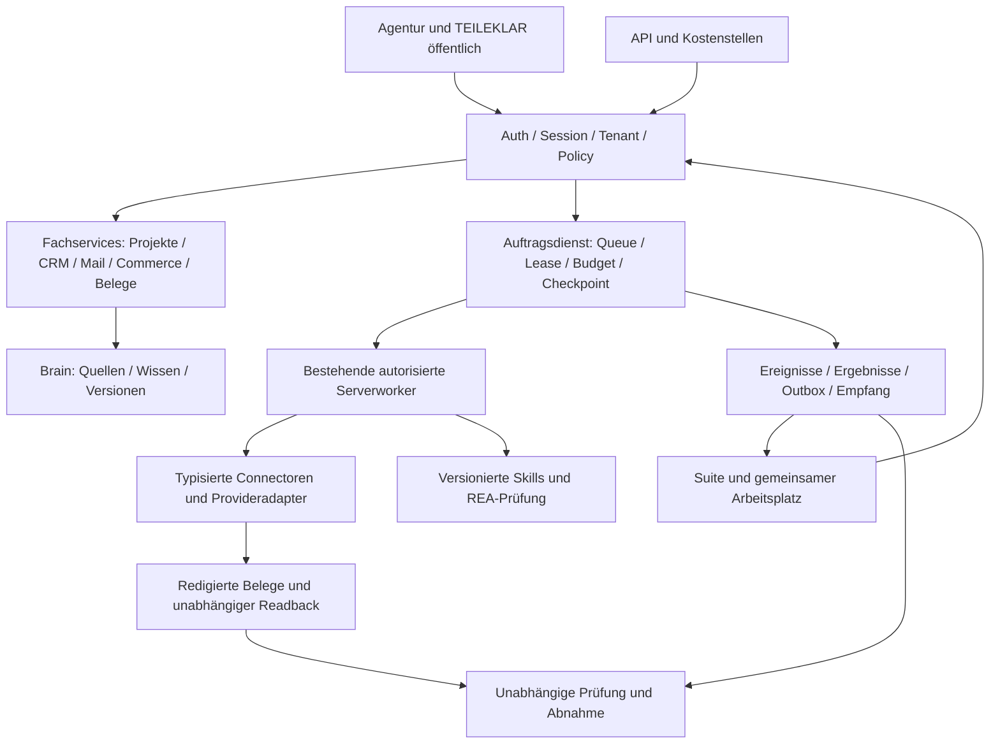
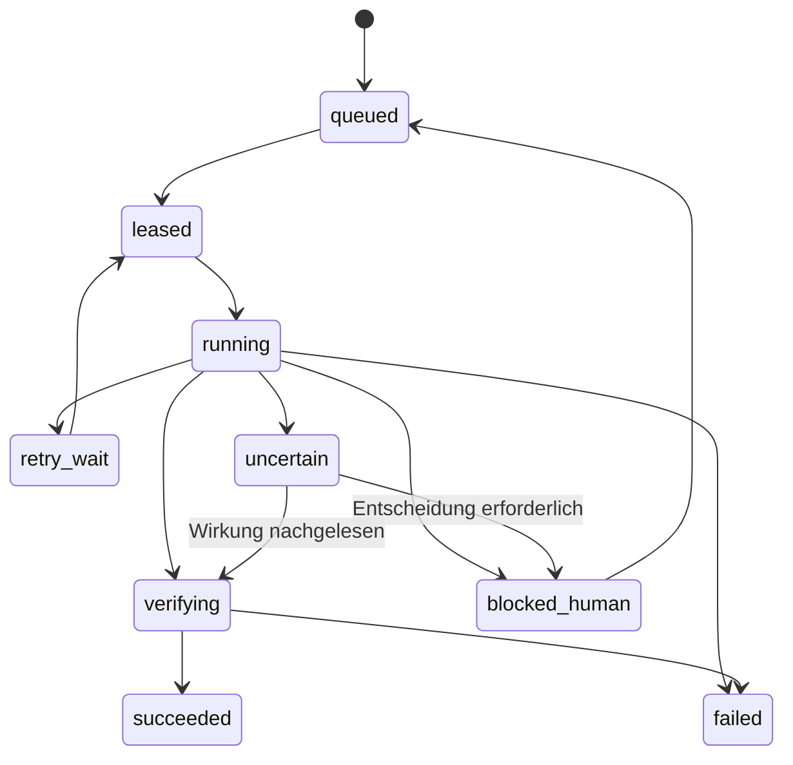

# NeXify AI — Mastervorgabe für Unternehmen, Plattform, Gestaltung und Betrieb

**Konsolidierter Masterauftrag · 29. Oktober 2026 · Version 1.0**  
**Auftraggeber und fachlicher Entscheider:** Pascal  
**Dokumenttyp:** umsetzbare Soll-, Integrations- und Abnahmevorgabe in einer eigenständig lesbaren Markdown-Datei  
**Geltung:** Agentur, NeX2fly Suite, NeX Agentic AI, one/one+, AI Fly Oracle, API, Arbeitsplatz, Kunden- und Partnerportale, TEILEKLAR, Mail, kaufmännische Abläufe, Marketing, Wissensbasis, Skills, Agentenbetrieb und Qualitätssicherung.

> **Der Auftrag lautet: das vorhandene NeXify-Gesamtsystem zu einem zusammenhängenden, hochwertigen und tatsächlich funktionierenden Unternehmen mit digitalen Produkten vervollständigen.** Vorhandene Lösungen werden überprüft, wiederverwendet und sauber verbunden. Bauanweisungen werden in Funktionen umgesetzt — nicht als Kundentexte veröffentlicht. Dieses Dokument definiert das vollständige Ziel und den Weg zur Abnahme; es behauptet keine bereits erreichte Gesamtfertigstellung.

## Inhaltsverzeichnis

1. [Auftragskern und Verbindlichkeit](#1-auftragskern-und-verbindlichkeit)
2. [Unternehmen, Marken und Produkte](#2-unternehmen-marken-und-produkte)
3. [Rollen, Verantwortlichkeiten und Zusammenarbeit](#3-rollen-verantwortlichkeiten-und-zusammenarbeit)
4. [Geschäftsprozesse und Projektaufnahme](#4-geschäftsprozesse-und-projektaufnahme)
5. [Designsystem und gemeinsame Komponenten](#5-designsystem-und-gemeinsame-komponenten)
6. [Layout, Navigation, Chat und Arbeitsplatz](#6-layout-navigation-chat-und-arbeitsplatz)
7. [Öffentliche Seiten und Kundeninhalte](#7-öffentliche-seiten-und-kundeninhalte)
8. [Grafiken, Figuren, Videos und Szenenproduktion](#8-grafiken-figuren-videos-und-szenenproduktion)
9. [Konto, NeX2fly Suite und Agentenfunktionen](#9-konto-nex2fly-suite-und-agentenfunktionen)
10. [API, Prepaid und Kostenkontrolle](#10-api-prepaid-und-kostenkontrolle)
11. [TEILEKLAR: vollständiger Shop und Backend](#11-teileklar-vollständiger-shop-und-backend)
12. [Kunden-, Werkstatt-, Partner- und Affiliateportale](#12-kunden-werkstatt-partner--und-affiliateportale)
13. [Mail und Kommunikation im Arbeitsplatz](#13-mail-und-kommunikation-im-arbeitsplatz)
14. [Belege, Buchhaltung und Unternehmenssteuerung](#14-belege-buchhaltung-und-unternehmenssteuerung)
15. [Marketing, Recherche und Vertrieb](#15-marketing-recherche-und-vertrieb)
16. [Brain, Agent Memory und LightRAG](#16-brain-agent-memory-und-lightrag)
17. [Skills, REA und kooperierendes Engineering](#17-skills-rea-und-kooperierendes-engineering)
18. [Zielarchitektur und unabhängiger Serverbetrieb](#18-zielarchitektur-und-unabhängiger-serverbetrieb)
19. [Verbindliche Datenverträge](#19-verbindliche-datenverträge)
20. [Umsetzungs-SOP, Wiederaufnahme und Rückwege](#20-umsetzungs-sop-wiederaufnahme-und-rückwege)
21. [Sicherheit, Recht, Betrieb und Messbarkeit](#21-sicherheit-recht-betrieb-und-messbarkeit)
22. [Arbeitspakete und Phasenplan](#22-arbeitspakete-und-phasenplan)
23. [Anforderungs- und Abnahmematrix](#23-anforderungs--und-abnahmematrix)
24. [Eingangsbedingungen und gezielte Blockaden](#24-eingangsbedingungen-und-gezielte-blockaden)
25. [Zeitgebundener Tatsachenanhang](#25-zeitgebundener-tatsachenanhang)
26. [Quellenregister und Abschlussregel](#26-quellenregister-und-abschlussregel)

---

## 1. Auftragskern und Verbindlichkeit

### 1.1 Verbindliches Ergebnis

NeXify soll als ein gemeinsames System erlebbar und betreibbar werden: öffentlich verständlich, intern geordnet, technisch nachvollziehbar und fachlich zuverlässig. Der Besucher findet einen konkreten Einstieg; ein Kunde erhält einen eigenen geschützten Arbeitsbereich; Projekte, Kommunikation, Dokumente und Abnahmen bleiben zusammenhängend; automatisierte Arbeit besitzt echte Zustände, Kostenkontrolle und überprüfbare Ergebnisse. TEILEKLAR erhält einen echten Handels- und Serviceprozess innerhalb derselben Gestaltung und Integrationsarchitektur, ohne seine eigene Marke oder seine fachlichen Grenzen zu verlieren.

Der Gesamtauftrag umfasst **Frontend und Backend**. Ein schöner Bildschirm, eine umgeschriebene Anleitung, eine simulierte Antwort, ein grüner Build oder ein erreichbarer Endpunkt ersetzt keine fertige Funktion.

### 1.2 Quellenrang und Konfliktregel

1. Neueste ausdrückliche Entscheidung von Pascal zu derselben Sache.
2. Bestätigte aktuelle Fach-, Marken-, Preis-, Betreiber- und Vertragsquellen innerhalb ihres jeweiligen Geltungsbereichs.
3. Diese konsolidierte Mastervorgabe einschließlich ausdrücklich gekennzeichneter technischer Abnahmeanforderungen.
4. Bestehende Original-Handoffs, Funktionsskripte und deren quellengebundene Auswertungen.
5. Historische Prototypen und Beispiele als Funktionsreferenz, **nicht** als Nachweis heutiger Preise, Rechte, Daten oder Produktivfähigkeit.

Laufzeitbeobachtungen beantworten die Frage **„Was ist zu einem bestimmten Zeitpunkt tatsächlich vorhanden?“**, nicht **„Was ist fachlich geschuldet?“**. Deshalb bleiben Soll und Ist getrennt. Eine fehlende Funktion wird nicht durch die Umbenennung ihres Buttons oder ihre Streichung aus der Navigation erledigt.

Konflikte werden als Entscheidung mit betroffener Anforderung, kollidierenden Quellen, zuständigem Owner, belastbarem Ermittlungsschritt und begrenzter Blockadewirkung geführt. Nicht betroffene Arbeiten laufen weiter. Unbelegte Werte werden nicht geraten.

### 1.3 Übergreifende Regeln

- Bestehende Code-, Daten-, Design- und Integrationsstrukturen zuerst lesen und wiederverwenden. Kein Neuaufbau allein wegen unvollständiger Dokumentation.
- Ein bestätigter technischer Writer je physischem Arbeitsbereich beziehungsweise eindeutig abgegrenzter Ressource. Analyse, Medien und unabhängige Prüfung können parallel erfolgen; konkurrierende Änderungen an denselben Dateien nicht.
- Neuere Livefunktionen dürfen nicht durch einen älteren Git-Stand ersetzt werden. Vor jeder Änderung aktuelle Quelle und Deployment-Zuordnung feststellen.
- Ein Dokument, Prompt, Skill oder Agentenname erteilt keine neuen Zugänge, Rollen, Veröffentlichungs-, Versand-, Zahlungs- oder Budgetrechte.
- Bestehende erlaubte lokale Entwicklungs-, Test-, Dokumentations- und Versionierungsarbeiten werden im klaren Auftrag ohne erneute pauschale Rückfrage ausgeführt. Aktive Writer, Sicherheitsgrenzen und Kostenlimits bleiben maßgeblich.
- Nutzerdateien, gespeicherte Nutzerdaten, Repositories und Konten werden nicht durch Agenten gelöscht. Eine tatsächlich benötigte Löschung nimmt Pascal selbst vor. Sicheres wiederherstellbares Archivieren ist nur nach Zuständigkeits-, Abhängigkeits-, Sicherungs- und Aufbewahrungsprüfung zulässig.
- Persönliche NeXify-Skills dürfen im bereits autorisierten Rahmen mit dem offiziellen Skill-Creator gepflegt werden; System- und Plugin-Skills sowie ihre Originale werden nicht überschrieben.
- Technische Aufträge, Quellen und Prüfbelege dürfen im bestehenden autorisierten Auftrags-/Wissenssystem gepflegt werden, wenn Projekt, Tenant, Owner und Ziel eindeutig sind. Keine Geheimnisse oder unnötigen personenbezogenen Daten eintragen.
- Anbieter und laufende Dienste bleiben erhalten, solange ihre Entbehrlichkeit nicht nachgewiesen ist. **Unbekannt ist nicht entbehrlich.** Kein Kündigungs- oder Löschauftrag entsteht aus dieser Vorgabe.

### 1.4 Einheitliches Statusvokabular

| Status | Zulässige Aussage |
|---|---|
| Spezifiziert | Anforderung und Abnahme sind beschrieben. |
| Gebaut | Implementierung liegt an einer benannten Quellversion vor. |
| Lokal geprüft | Genannte Tests liefen mit Ergebnis in einer benannten lokalen Umgebung. |
| Verbunden | Konkreter Dienst, Account und Adapter sind nachweisbar zugeordnet; dies allein ist noch keine Funktionsabnahme. |
| In Preview geprüft | Nutzerweg ist am benannten Preview-Release überprüft. |
| Live geprüft | Konkreter Weg wurde am benannten Produktionsrelease mit zulässigen Testdaten geprüft. |
| Abgenommen | Fachliche und technische Kriterien sind mit unabhängiger Prüfung erfüllt. |
| Blockiert / unbekannt / teilweise | Fehlender Beleg oder fehlende Voraussetzung ist präzise benannt; kein Ersatz durch Grün oder Null. |

---

## 2. Unternehmen, Marken und Produkte

### 2.1 Unternehmenskonzept

**NeXify AI** verbindet Beratung, Websites, Portale, KI-gestützte Arbeitsabläufe, Integrationen und betreibbare digitale Produkte. Der Schwerpunkt liegt auf konkreten Geschäftsabläufen in vorhandenen Systemen: verstehen, strukturieren, umsetzen, nachweisen, betreiben und verbessern.

**Slogan:** „Chat it. Automate it.“  
**Darstellungsprinzip:** persönlich durch Pascal, NeX und AI Fly Oracle; technisch souverän, ohne künstliche Mitarbeiter-, Kunden-, Umsatz- oder Erfolgsgeschichten.

Die Agentur bietet folgende zusammenhängende Leistungen:

| Leistung | Fachliches Ergebnis |
|---|---|
| Beratung und Audit | Istprozess, Systeme, Quellen, Risiken, Zielbild und priorisierter Umsetzungsauftrag. |
| Websites und Shoplösungen | Klarer Auftritt mit echten Anfragen oder Transaktionen, passenden Inhalten, SEO und notwendigen Informations-/Consentpfaden. |
| Kundenportale und Dashboards | Rollenbezogene Zusammenarbeit an realen Vorgängen, Dokumenten, Zuständen und Entscheidungen. |
| KI- und Workflowintegration | Definierte Eingaben, zugelassene Werkzeuge, persistente Aufträge, Freigaben, Fehler- und Wiederaufnahmewege. |
| Betrieb und Pflege | Vereinbarter Betriebsumfang, beobachtbare Systeme, Änderungen, Support und dokumentierte Rückwege. |
| Marketing und Wissen | Belegte Inhalte, qualifizierte Recherche, Kampagnenvorbereitung und nachvollziehbare Nachfrageprozesse. |

Rechtsform, Betreiberidentität und geschäftliche Angaben stammen ausschließlich aus bestätigten Rechts-/Unternehmensdokumenten. Die Marke ist kein Rechtsformnachweis.

### 2.2 Produkt- und Kontextlandkarte

| Kontext | Ziel und Grenzen |
|---|---|
| **NeXify Agentur** | Interesse → Briefing → qualifizierte Anfrage → Angebot → bestätigter Auftrag → Umsetzung → Abnahme → Betrieb. Ein Rechner oder PDF ist nicht automatisch ein Vertrag. |
| **NeX2fly Suite** | Eigener Workspace mit Chat, Aufgaben, Projekten, Dokumenten und kontrollierter Ausführung. Transparenter Test-, Nutzungs- und Upgradepfad. |
| **NeX Agentic AI / one / one+** | Gemeinsame Produktfamilie. Antworten und Entwürfe von tatsächlichen Toolaktionen unterscheiden; historische Produktnamen vor Außenverwendung gegen aktuelle Produktzuordnung abgleichen. Kein „Autopilot“ als pauschale Vollmacht. |
| **AI Fly Oracle** | Sichtbarer Koordinator für Aufgaben, Zuständigkeiten, Blocker und bestätigte Ergebnisse. Grafikfigur, Rolle und reale Laufzeitinstanz sind unterschiedliche Dinge. |
| **API** | Tenant- und kostenstellengebundener Zugang mit Schätzung, Limits, Budget, Usage, Prepaid-Ledger und nachvollziehbarer Abrechnung; bevorzugt in die Suite integriert. |
| **Arbeitsplatz / myADMIN / Leitstand** | Unterschiedliche Sichten auf gemeinsame autoritative Daten: operative Arbeit, kaufmännische Vorgänge, System- und Prüfstatus. Keine konkurrierenden Masterdatenbestände. |
| **TEILEKLAR** | Eigene erkennbare Marke für Teilehandel, Fahrzeugkontext, Werkstätten, Partner, Support, Kauf und Nachkaufprozesse. Slogan: „TEILEKLAR — Na KLAR!“ |
| **NeXify-Shoplösung** | Wiederverwendbarer Shopfunktionsumfang. Beispieldaten bleiben ausdrücklich getrennte Testdaten und werden nicht als echte kaufbare Waren veröffentlicht. |
| **Kunden-/Partner-/Nachbarschafts-/Affiliateportale** | Rollenbezogene Angebote, Termine, Profile, Dokumente, Gutscheine, Attribution und Abrechnung mit jeweils eigenen fachlichen Regeln. |

### 2.3 Domainzielbild — keine Behauptung heutiger Erreichbarkeit

| Domain/Ziel | Vorgesehene Aufgabe | Freigabebedingung |
|---|---|---|
| `nexifyai.cloud` | Allgemeiner international anschlussfähiger Unternehmens-/Produkteinstieg. | Bestätigte Host-, Inhalts-, Sprach- und Canonicalzuordnung. |
| `nexifyai.de` / `www.nexifyai.de` | Deutscher Marktauftritt. | Aktueller Release und deutsche Betreiber-/Marktinformationen gebunden. |
| `nexifyai.dev` | Neu registrierte Domain; Einsatz zuerst prüfen. | Kein Dienst und kein Umzug ohne festgelegten Zweck, Ownership und Abhängigkeitsprüfung. |
| `app.nexifyai.cloud` | NeX2fly Suite und geschützter Arbeitsplatz. | Auth, Tenantmodell, Session-, Betriebs- und Releaseabnahme. |
| `api-suite.nexifyai.cloud` | API-Zugang beziehungsweise API-Sicht innerhalb der Suite. | Reale Routen, Schlüssel-/Budget-/Ledgervertrag; keine isolierte zweite Kontoarchitektur. |
| `teileklar.shop` | Eigenständige Shopmarke und fachlich passende Unterbereiche. | Produkt-, Commerce-, Recht-, Support- und Domainabnahme. |

DNS, Zertifikate, Aliase, Redirects, Cross-Origin-Regeln und Sessiongrenzen werden aus dem tatsächlichen Bestand abgeleitet. Gemeinsame Navigation bedeutet keine pauschale gemeinsame Cookie-Domain oder tenantübergreifende Datenfreigabe.

---

## 3. Rollen, Verantwortlichkeiten und Zusammenarbeit

Die folgenden Rollen sind **Verantwortungsfunktionen**, keine Behauptung zusätzlicher Mitarbeiter, aktiver Accounts oder neu gewährter Rechte. Vor ausführender Arbeit muss die Rolle an eine konkrete berechtigte Person oder Laufzeitinstanz gebunden sein.

| Rolle | Verantwortung | Nicht eigenmächtig zulässig |
|---|---|---|
| Pascal | Unternehmens- und Produktentscheidungen; Planfreigabe; kommerzielle/rechtliche Konflikte; Entscheidungen außerhalb bestehender Autorisierung. | Wird nicht durch Agentenzustimmung ersetzt. |
| Root / Auftragskoordination | Bestand, Priorisierung, Gesamtumfang, Abhängigkeiten, Fortsetzung, belegte Übergaben und verständliche Ergebnisberichte. | Keine pauschale Admin-/Finanz-/Publikationsvollmacht. |
| AI Fly Oracle | Fachliche Koordination, Design-/Grafik-/Videoproduktion, Abstimmung der Szenen und Qualitätsanforderungen. | Modellantwort oder Echo gilt nicht als Dispatch-, Zustell- oder Produktionsbeleg. |
| Bestätigter technischer Writer | Änderungen, Tests, lokale Versionierung und erlaubte Integration in einem exklusiv gebundenen Arbeitsbereich. | Kein Reset eines fremden WIP, kein zweiter konkurrierender Writer, keine ungebundene Veröffentlichung. |
| Engineeringteam — Produkt/Analyse | Anforderungen, Quellen, Kundennutzen, Geschäftsregeln und fachliche Fälle. | Kein Selbstfreigeben der eigenen Ergebnisse. |
| Engineeringteam — Architektur/REA | Bestandsintegration, Daten-/Toolverträge, Laufzeitfragen, Recovery und technische Nachweise. | Keine Rechteerweiterung zur Beseitigung fehlender Tools. |
| Engineeringteam — Prüfung | Unabhängige Gegenbeispiele, Negativtests, Quellenvorrang, Coverage und Freigabeempfehlung. | Kein bloßes Übernehmen von Autorenaussagen. |
| Design/UX und Grafik | Gemeinsame Gestaltung, tatsächliche Seitenintegration, Responsive-/Accessibilityprüfung. | Keine neue Figurenidentität oder ungeprüfte Medienrechte. |
| Marketing/Content | Kundensprache, Recherche, Kampagnenkonzept und korrekte Aussagen. | Keine ungeprüften Claims, Massenansprache oder automatischer Versand. |
| Business/Finance | Preisfassungen, Kalkulation, Budget, Belege, Liquidität und Controlling. | Keine erfundenen Preise, Steuerfreigaben oder Bankaktionen. |
| Legal/Datenschutz | Quellenabgleich, Verarbeitungskarte, Vertrags-/Informationsbedarf und fachliche Prüfung. | Keine behauptete anwaltliche Abnahme. |
| Ops/Support | Betriebsfähigkeit, Incident- und Supportpfade, Zustell- und Wiederherstellungsbelege. | Keine Kündigungen oder Löschen als Wartungsschritt. |

**Teammodell:** Drei kooperierende Engineering-/REA-Arbeitsstränge mit klaren Zuständigkeiten und unabhängiger Reviewfunktion; gleiche Aufgaben nicht dreifach schreiben. REA ist dabei ein Werkzeug mit konkretem Auftrag, nicht die Identität des Teams oder ein Ersatz für reguläre Quellcodeprüfung.

**Identitätstrennung:** Jeff/jev ist nicht ChatGPT-Oracle. Markenname, Persona, Modell, Slackmitglied, Agentenprozess und technische Benutzerkennung werden nicht gleichgesetzt.

**Slack:** Führungs-DM und Arbeitsregister dienen Übersicht, Entscheidungen und nachvollziehbaren Übergaben. Jeder Arbeitsregistereintrag verweist auf den autoritativen Auftrag, Owner, Status und Belege. Ein Chatbeitrag, ein Canvas oder eine Botantwort beweist weder Queue-Verarbeitung noch Auftragsabnahme. Empfänger und Thread müssen vor personengerichteten Aktionen eindeutig verifiziert sein.

---

## 4. Geschäftsprozesse und Projektaufnahme

### 4.1 Neue Kundenanfrage

1. Anfrage mit Herkunft, berechtigtem Kontaktweg, minimal benötigten Daten und vorhandenen Unterlagen erfassen.
2. Neue Anfrage an Pascal melden; keine eigenmächtige Zusage von Preis, Termin, Leistungsumfang oder Vertrag.
3. Vorhaben gemeinsam in ein überprüfbares Zielbild übersetzen: Zielgruppe, Problem, Nutzerwege, Systeme, Daten, Grenzen, Abnahme.
4. Benötigte Artefakte planen: Anforderungsübersicht, Ablauf-/Architekturdiagramm, Design/Medien, Integrationsplan, Angebot beziehungsweise Scope und Testmatrix.
5. Pascal gibt den konkreten Plan frei. Die Freigabe wird an Fassung, Umfang, Budget und erlaubte Aktionen gebunden.
6. Danach autonome Umsetzung innerhalb dieses Rahmens: Bestand verwenden, Tests ausführen, Ergebnisse liefern und offene Abhängigkeiten weiterverfolgen.
7. Abnahme mit echten Belegen; anschließender Betrieb nur im vereinbarten Scope.

### 4.2 Bestehende Projekte und Change Orders

Neue Wünsche werden gegen freigegebenen Scope und laufende Arbeit geprüft. Eine Änderung erhält Beschreibung, Begründung, betroffene Anforderungen, fachliche/technische Auswirkungen, zusätzliche Kosten oder Abhängigkeiten, Rückweg und konkrete Freigabebedingung. Keine stille Erweiterung des Vertrags und keine stille Kürzung bestehender Funktionen. Unveränderte autorisierte Arbeit läuft weiter.

### 4.3 Minimaler Projektauftrag

Jeder ausführbare Auftrag enthält mindestens:

- fachliches Ziel und messbares Ergebnis;
- `tenant_id`, `project_id`, konkreten Owner und erlaubte Zielressourcen;
- Anforderungs- und Quellenreferenzen;
- aktuellen Ausgangsstand und Wiederverwendungsentscheidung;
- erlaubte Aktionen sowie ausdrücklich ausgeschlossene Aktionen;
- Budget-/Freigabereferenz, Abhängigkeiten und gegebenenfalls Termin;
- positiven Hauptfall und relevante Negativ-/Recoveryfälle;
- konkreten Writer, unabhängigen Reviewer und Liefer-/Empfangsweg;
- Checkpoint, Wiederaufnahme- und Rückwegvertrag.

Fehlende Tenant-/Owner-/Ressourcenbindung blockiert die Ausführung, nicht die rein lokale Spezifikation.

---

## 5. Designsystem und gemeinsame Komponenten

### 5.1 Gestalterische Leitlinie

**Graphite:** hochwertig, klar, ruhig, räumlich, persönlich und technisch souverän. Großzügige Flächen, präzise Typografie, gezielte grüne Akzente und kontrollierte Licht-, Glas-, Schatten- und 3D-Wirkung. Tiefe hilft Orientierung und Verständnis; sie ist kein dekoratives Dauerfeuer.

Nicht verwenden: Neonüberladung, beliebige Bergbilder, generische KI-Motive, unverbundene Notebook-Mockups, beliebige Kartenraster, doppelte Logos, zufällig angehängte Sprachschalter oder austauschbare Agenturbüros.

### 5.2 Aktuell maßgebliche Grundwerte

| Merkmal | Mastervorgabe |
|---|---|
| Graphite Canvas | `#080A0F` |
| CI Lime | `#C0EE38` |
| Cyan-Akzent | `#38BDF8` |
| Schriftfamilien | Inter / Plus Jakarta Sans; zentrale Rollenverteilung, keine dritte Schrift hinzufügen. |
| Grundraster | 8 px |
| Interaktive Touchflächen | mindestens 48 × 48 px |
| Große Desktop-Sektionsabstände | 96–128 px als vorhandener Richtwert, responsiv und inhaltlich angepasst. |
| Karteninnenabstände | 32 px Desktop / 20 px kompakt als vorhandene Richtwerte. |
| Logo | Vorhandenes freigegebenes NeXify-AI-Logo mit grünem X; korrekte helle/dunkle Kontrastvariante. |

Historische Graphit-/Lime-Werte, Geist-Familien und 44-/46-px-Ziele aus Prototypen dürfen diese neuere Vorgabe nicht überschreiben. Die Umstellung geschieht zentral und kontrolliert; unveränderte Bild-/Markenassets behalten ihre tatsächlichen Bildfarben.

### 5.3 Tokenvertrag

Alle Farben, Größen, Abstände, Radien, Schatten, Ebenen und Bewegungswerte werden zentral verwaltet. Semantische Struktur:

```text
color.brand.*
color.background.canvas | surface | elevated
color.text.primary | secondary | muted | inverse
color.border.subtle | strong | focus
color.action.primary | secondary | disabled
color.status.info | success | warning | error
spacing.*  size.*  radius.*  shadow.*  motion.*  layer.*
```

Keine komponentenlokalen Hexfarben und keine unabhängige Stilkopie pro Produkt. Generierte Token-CSS wird aus der autoritativen Quelle erzeugt, nicht separat gepflegt. Dark und Light teilen semantische Namen. Light wird gestaltet und geprüft, nicht automatisch invertiert.

**Verfahren für noch nicht abschließend definierte Detailwerte:** Design-Owner erfasst vorhandene Werte, legt die fehlenden Light-/Typografie-/Radius-/Schatten-/Motionvarianten im zentralen Tokenregister fest und liefert einen Vergleich an echten Komponenten. Bis zur visuellen Freigabe vorhandene funktionierende Werte bewahren; keine zweite spontane Palette. Dies blockiert die finale Designabnahme der betroffenen Variante, nicht Daten- oder Backendarbeit.

### 5.4 Komponenten und Bedienzustände

Vorhandene shadcn/ui-, shadcnspace- und geeignete Headless-Komponenten konsistent verwenden. Gemeinsame Varianten für Buttons, Links, Formfelder, Tabs, Akkordeons, Dialoge, Benachrichtigungen, Tabellen, Karten, Navigation und Statusanzeigen.

Jede relevante Interaktion besitzt normal, hover, focus, active, loading, disabled, success und error. Erfolg wird ausschließlich aus bestätigter Verarbeitung abgeleitet. Pro Entscheidungsbereich eine klare Hauptaktion; Buttontext benennt Handlung und Ergebnis. Fehler enthalten eine verständliche Einordnung und einen real verfügbaren nächsten Schritt.

Typografie erhält eine klare Hierarchie. Fließtext bleibt lesbar begrenzt. Keine winzigen Metadaten, unnötigen Versalien oder Text über unruhigen Bilddetails. Deutsch und Niederländisch werden vollständig und terminologisch konsistent gepflegt; vorhandener französischer Funktionsumfang bleibt erhalten und wird dort vollständig geprüft, wo der Markt aktiv angeboten wird. Fehlende Übersetzungen sind kein stiller Sprachmix.

---

## 6. Layout, Navigation, Chat und Arbeitsplatz

### 6.1 Öffentliche Website

Einheitliche Full-Width-Seitenfläche mit gemeinsamem Inhaltsraster. **Full Width bedeutet nicht vollbreiten Fließtext.** Header, Hero, Abschnitte und Footer folgen derselben Ausrichtungslogik. Unterschiedliche Abschnittskompositionen sind erwünscht, zufällige Breitenwechsel nicht.

Der öffentliche Chat ist auf Desktop rechts professionell sichtbar; mobil wird er bedienbar in die verfügbare Fläche gebracht. Er überdeckt weder Kerninhalt noch Figurenbegrüßung, Cookie-/Rechtsinformationen oder notwendige Aktionen. Abschnittsgrafiken bleiben in ihrem jeweiligen Abschnitt.

### 6.2 Arbeitsplatz mit geöffnetem rechten Bereich

```text
┌──────┬────────────────────────────────┬─────────────────────────────────────┐
│      │ AI Fly Oracle · echter Status  │ Arbeitsbereich · Quelle · Dateiname │
│ Nav  ├────────────────────────────────┼─────────────────────────────────────┤
│ Rail │                                │ Browser | Artefakt | PDF | Dokument  │
│      │ NeX-Gespräch                    │                                     │
│      │ Ergebnisse, Entscheidungen,     │ Reale autorisierte Ressource         │
│      │ Aufträge und Belegkarten        │ Vorschau / Bearbeitung / Vergleich   │
│      │                                │                                     │
│      ├────────────────────────────────┤                                     │
│      │ Ausgerichteter Composer        │ Kontrollstatus, falls tatsächlich    │
│      │ Entwurf · Upload · Senden      │ interaktive Sitzung vorhanden        │
└──────┴────────────────────────────────┴─────────────────────────────────────┘
```

- Links schmale gemeinsame Navigation, bei Bedarf beschriftet erweiterbar.
- In der Mitte NeX als primärer Gesprächs- und Arbeitskanal.
- Oben AI Fly Oracle mit tatsächlichem Auftrags-/Bearbeitungsstatus.
- Rechts standardmäßig geöffneter, einklappbarer Browser-/Artefakt-/PDF-/Dokumentbereich.
- Rechte Fläche zeigt tatsächliche Arbeit und Quellen, kein dekoratives Dashboard.
- Öffnen/Schließen verändert die Ansicht, nicht Auftragszustand oder Berechtigungen.

### 6.3 Verbindliche Korrektur: rechter Arbeitsbereich geschlossen

```text
┌──────┬──────────────────────────────────────────────────────────────────────┐
│      │                   AI Fly Oracle · bestätigter Status                │
│ Nav  │                                                                      │
│ Rail │        großzügige          begrenzte           großzügige            │
│      │        Seitenfläche        zentrierte          Seitenfläche          │
│      │                            Chatlesespalte                            │
│      │                            mit NeX                                   │
│      │                                                                      │
│      │                        ┌──────────────────┐                          │
│      │                        │ Composer bündig  │                          │
│      │                        │ zur Lesespalte   │                          │
│      │                        └──────────────────┘                          │
└──────┴──────────────────────────────────────────────────────────────────────┘
```

**Dies ist die maßgebliche geschlossene Ansicht:** schmale Navigation links, Oracle oben, eine begrenzte zentrierte Chatlesespalte, großzügige freie Seitenflächen und ein zur Lesespalte ausgerichteter Composer. **Kein über die gesamte freie Bildschirmbreite laufender Chattext.** Die umgebende Chatregion darf den frei gewordenen Platz einnehmen; die eigentliche Lesespalte nicht. Vorhandene Referenzbilder bestimmen den visuellen Feinschliff. Ohne deren endgültige Bytes keine Pixelidentität behaupten.

### 6.4 Responsive und Zustandserhalt

Bestehende Breakpoints zuerst prüfen; historische 820-/1100-px-Grenzen sind Bestandsanker, keine unveränderlichen Markenwerte. Verhalten wird am tatsächlichen Inhalt entschieden:

- Auf breiten Displays Chat und Arbeitsbereich nebeneinander; Resizer begrenzt, per Tastatur bedienbar und ohne Textüberlauf.
- Bei Platzmangel kontrollierter Wechsel zu einer Hauptansicht statt zwei unbrauchbar schmalen Spalten.
- Mobil Navigation als vollständig erreichbarer Drawer; Chat und Arbeitsbereich einzeln umschaltbar, Oracle kompakt sichtbar, Wiederöffnen eindeutig.
- Composer berücksichtigt Bildschirmtastatur und Safe Area. Mehrzeilige Eingaben, IME und Uploadzustände funktionieren ohne versehentliches Senden.
- Chat-/Mailentwürfe, ausgewählte Ressource, Task-IDs und relevante Ansichtszustände bleiben nach zulässigem Reload erhalten.
- Geschlossene Viewer beenden keine laufenden Serverjobs.
- Automatisches Scrollen nur, wenn der Nutzer am Ende ist; sonst Hinweis auf neue Nachrichten.
- Fokus kehrt nach Dialog-/Drawer-/Chat-Schließen zum richtigen Auslöser zurück.

### 6.5 Funktions- und Ereignistransparenz

Verbindung, Auftrag, Freigabe, Ansichtsmodus und Browserkontrolle sind getrennte Zustandsachsen. Ein lesbares PDF bleibt lesbar, wenn ein Tool getrennt ist; der letzte bestätigte Stand wird kenntlich gemacht. Kein globales „verbunden“-Badge darf fehlende Mail-, Kalender-, Modell- oder Buchungsfunktionen verschleiern.

Sichtbare Agentenmeldungen zeigen kurze Tätigkeits-, Ergebnis- und Entscheidungszusammenfassungen, Quellen und echte Ereignisse. Keine erfundenen Denkaktivitäten und keine privaten Gedankengänge. „Stoppen“ ist nicht automatisch „Zurückrollen“; bereits erfolgte Wirkungen bleiben sichtbar.

---

## 7. Öffentliche Seiten und Kundeninhalte

### 7.1 Verbindliche Informationsarchitektur

Die tatsächliche Routeinventur ist der Maßstab, nicht eine historisch schwankende Seitenzahl. Mindestens folgende Funktionsfamilien vollständig zuordnen:

| Bereich | Inhalt und tatsächlicher nächster Schritt |
|---|---|
| Startseite | NeXify, Nutzen, persönliche Begrüßung, „Ihr Vorhaben zuerst“, „So finden Sie Ihren Einstieg“, klare Leistungs-/Produkteinstiege. |
| Leistungen | Websites, Automatisierung, Portale, Beratung und Betrieb mit Umfang, Vorgehen und passendem Briefing. |
| Produkte | NeX2fly, Agentic/one/one+, API und deren tatsächlicher Zustand; keine falsche Start-/Kaufzusage. |
| Leistungsumfang und Vorgehen | Ergebnis, Grenzen, Verantwortlichkeiten und Abnahme verständlich erklären. |
| Konto/Anmelden/Registrieren | Wirklich angeschlossene Auth- und Onboardingwege oder kurze ehrliche Verfügbarkeitsinformation. |
| Portale | Geschützte Vorgänge und Dokumente, nicht öffentliche interne Betriebsanleitungen. |
| TEILEKLAR und Unterbereiche | Produkt-, Fahrzeug-, Warenkorb-, Kassen-, Werkstatt-, Support- und Nachkaufwege. |
| Rechts-/Datenschutzseiten | Maßgebliche Fassung und tatsächliche Verarbeitung, keine Quellcode- oder Redaktionshistorie als Rechtstext. |
| Footer | Global aufklappbar, zugänglich, mit Betreiber-/Datenschutz-/weiteren einschlägigen Dokumenten. |

### 7.2 Inhaltspflicht pro Seite

Jede Seite beantwortet: **Was ist es? Für wen? Welcher Nutzen? Was gehört dazu? Wie läuft es ab? Was kann ich jetzt tun?** Die Antwort verwendet belegte Produktinformationen und eine tatsächlich funktionierende Handlung.

Interne Anweisungen, Prüfvermerke, Freigabeprotokolle, Versionsdiskussionen und technische Implementierungsalternativen gehören in Projektdokumentation und QA, nicht in Hero, Presenter, Produktbeschreibung, Related Cards, Metadaten oder Footer. Echte Grenzen werden kurz und kundengerecht erklärt, nicht verborgen.

### 7.3 Konkrete Umsetzungsfälle

- **Websites:** Seitenkontext in das bestehende bearbeitbare Briefing übernehmen. Ziel ist eine serverseitig persistierte Anfrage mit echter Vorgangs-ID, zuständigem Owner und Zustell-/Bearbeitungsstatus. `mailto` darf als E-Mail-Entwurf bezeichnet werden, niemals als bestätigter Versand.
- **Agentenautomatisierung:** Einen tatsächlichen Pilotablauf mit Eingang, Owner, Trace, Stop, Resume und Fehlerübergabe nachweisen. Ein Baukastenbild oder Toolkatalog ist kein ausführender Agent.
- **NeX2fly:** Auth, Workspace, einmaliger Teststart, Funding und Upgrade real verbinden. Eine ehrliche Konzeptkennzeichnung ist nur Zwischenzustand, keine dauerhafte Herabstufung des geschuldeten Produkts zur Vorschau.
- **Vertragsgrundlagen:** Maßgebliche Dokumentfassung anzeigen; Autor, Prüfstatus, Versionshistorie und Angebotsbindung intern führen. Keine Rechtsform aus widersprüchlichem Git-/Liveinhalt raten.
- **Datenschutz:** Tatsächlichen ausgelieferten Build, aktive Dienste, Trigger, Empfänger, Zwecke und Aufbewahrung beschreiben; keine „je nach Vite-/Next-Ausgabe“-Alternativen als Erklärung der realen Verarbeitung.

### 7.4 Inhaltliche Produktionsfolge

`Originalanforderung → echte Funktion → Daten-/Quellenvertrag → Beleg → Kundentext → SEO/Metadaten/Presenter → Seitenprüfung`

Ein Verbot bestimmter Wörter oder freundlicheres Wording ersetzt diese Reihenfolge nicht. Behauptete Preise, Referenzen, Bewertungen, Lieferzeiten, Zertifizierungen und Erfolgszahlen benötigen eine aktuelle belastbare Quelle.

---

## 8. Grafiken, Figuren, Videos und Szenenproduktion

### 8.1 Verbindliche Identitäten

- **Pascal:** freundlich, lebendig, natürlich; keine künstliche Alterung, zusätzlichen Falten oder Gesichtsverfremdung.
- **NeX:** vorhandene freigegebene Vogel-/Tukanidentität; keine beliebige neue Vogelillustration.
- **AIFly / AI Fly Oracle:** finale Referenzfigur mit korrekten Augen, Körper, Material, Farben und Proportionen; **kein Plüschfell, kein Stofftier- oder Kuschelbärlook**.
- Vorhandene finale Referenzdateien sind vor jeder Produktion zu binden. Szenen ändern nicht die Figurenidentität.
- Grafikproduktion liegt bei Oracle; technische Einbettung beim bestätigten Writer. Beide prüfen gemeinsam die tatsächliche Seite.

### 8.2 Gestaltungs- und Filmregeln

Pascal und NeX laufen gemeinsam in die Szene und bleiben vollständig einschließlich Beine und Füße sichtbar. AIFly bewegt sich gemeinsam mit ihnen entsprechend der finalen Referenz gleitend beziehungsweise schwebend und bleibt vollständig sichtbar; keine Beine oder Mundmerkmale erfinden. Alle erhalten genügend Bewegungsraum. Einbettung frei auf der Seitenfläche: kein Notebook, Bildschirmmockup, sichtbarer Playerkasten, Rahmen oder Freistellhalo. Räumliche Licht-, Tiefen-, Schatten- und 3D-Effekte sind erwünscht; kein beliebiges Agenturbüro als Hintergrund.

Begrüßung und Produktdialoge benötigen genügend Zeit für verständliche Sprache. Ein stummer Zehnsekunden-Bewegungstest ersetzt keinen Erklärfilm. Untere Abschnittsgrafiken werden nicht in den Hero verschoben. Ersatzgrafiken sind hochwertig und funktional passende Zwischenlösungen, keine heimliche Endabnahme.

### 8.3 Selbständige Szenen- und Grafikmatrix

| Asset-ID | Platzierung und Aufgabe | Verbindlicher Inhalt | Abnahme |
|---|---|---|---|
| MED-01 | Startseiten-Hero / Begrüßungsfilm | Pascal/NeX laufen auf die freie Seitenfläche, AIFly begleitet sie referenzgerecht gleitend/schwebend; gemeinsam begrüßen sie und leiten zu realen Einstiegen. Headline und CTA bleiben lesbar. | Ganze Körper, stabile Identitäten, natürlicher Ton, kein Rahmen, Desktop/Mobil geprüft. |
| MED-02 | „Ihr Vorhaben zuerst“ | Eigene Komposition: Trio hört zu und ordnet ein Vorhaben; visuell Richtung Briefing und konkretes Anliegen. | Nicht derselbe Heroexport; Inhalt unterstützt diesen Abschnitt, keine beliebigen Karten. |
| MED-03 | „So finden Sie Ihren Einstieg“ | Eigene Komposition für Website, Ablauf und Portal als echte auswählbare Richtungen. | Klare Orientierung, passende tatsächliche Ziele, keine ungeprüften Produktversprechen. |
| MED-04 | Website-Leistung | Dialog über Zielgruppe, Inhalt, Navigation und echten Anfrageweg. | Passende Seite und funktionierendes Briefing, keine falschen Kundenbeispiele. |
| MED-05 | Automatisierung | Dialog über vorhandene Systeme, Ausnahmen, Zustände und Rückweg. | Keine als live dargestellte unverbundene Integration. |
| MED-06 | Portal/Suite | Dialog über gemeinsame Vorgänge, Rollen, Dokumente und verlässlichen Status. | Keine fremden Tenantdaten; gezeigte Produktzustände zutreffend. |
| MED-07 | Arbeitsplatz-Companion | Freigegebene Figur mit ruhiger Orientierung und echtem Zustandsbezug. | Bewegung entspricht realem Status, Reduced Motion und textliche Alternative. |
| MED-08 | TEILEKLAR-/Partnerwelt | Markenbezogene Produkt-/Servicegrafiken mit verlässlichem Fahrzeug-/Teilekontext. | Keine Bildaussage zu unbelegter Passung, Zulassung oder Lieferumfang. |
| MED-09 | Produktmedien | Konsistente Aufbereitung autorisierter Lieferantenbilder. | Produktform, Variante, Farbe, Kennzeichnung und mitgelieferte Teile unverändert. |

### 8.4 Begrüßungsfilm: vollständige Produktionsvorlage

**Ziel:** 45 Sekunden; finale Exportlänge 42–45 Sekunden gemäß präzisiertem Schnitt-/Sprecherplan. Nicht durch unnatürlich schnelles oder künstlich gestrecktes Sprechen erzwingen. Der konkrete Schnitt folgt der referenzgerechten Bewegung: Pascal/NeX laufen, AIFly gleitet beziehungsweise schwebt.

| Abschnitt | Bild / Bewegung | Ton |
|---|---|---|
| Einstieg, ungefähr 0–5 s | Alle drei kommen mit Abstand ins Bild; vollständige Körper, keine Überdeckung der Bedienung. | Ruhiger Beginn, keine zwingende Musik. |
| Begrüßung | Pascal wendet sich natürlich zum Besucher, NeX und AIFly hören zu. | Pascal begrüßt. |
| Orientierung | NeX gibt den drei Einstiegen Raum; dezente Blick-/Zeigeführung. | NeX erklärt die Auswahl. |
| Koordination | AIFly benennt seine tatsächliche Rolle. | Klarer Sprecherwechsel, keine konkurrierenden Mundbewegungen. |
| Abschluss | Pascal lädt zur Handlung ein; kurze ruhige Endpose. | Abschluss ohne erzwungenen Endlosloop. |

**Sprechtext:**

> **Pascal:** „Hallo, ich bin Pascal. Willkommen bei NeXify! Schön, dass du da bist. Wir schauen gemeinsam, was dein Unternehmen wirklich braucht — und wie deine vorhandenen Systeme dabei helfen können.“  
> **NeX:** „Ich bin NeX. Geht es um eine Website, einen automatisierten Ablauf oder ein Kundenportal? Du kannst hier direkt deinen Einstieg wählen.“  
> **AI Fly Oracle:** „Und ich bin AI Fly Oracle. Ich helfe dir, dein Vorhaben zu ordnen, offene Fragen sichtbar zu machen und den nächsten Schritt vorzubereiten.“  
> **Pascal:** „Schau dich in Ruhe um. Womit möchtest du anfangen?“

Dieser Text ist eine Produktionsvorlage, keine Behauptung bereits erzeugter oder freigegebener Stimme. Stimmen-/Personenrechte und finale Aussprache werden vor Export geprüft.

### 8.5 Produktdialoge: ausführbare Briefs und Texte

**Je Dialog:** ungefähr 45–75 Sekunden als redaktioneller Produktionsvorschlag, nicht als bereits beschlossene Laufzeit; natürliche Sprecherwechsel und Lesepausen; identische Figuren-/Ton-/Bedienregeln. Formulierungen beschreiben das Leistungsziel. Nicht verfügbare Produktfunktionen dürfen nicht als bereits benutzbar vorgeführt werden.

**MED-04 — Website**

> **Pascal:** „Eine gute Website soll nicht nur gut aussehen. Sie soll zeigen, wer du bist, was du anbietest und wie Interessenten mit dir weiterkommen. Deshalb beginnen wir mit deinem Unternehmen und den Menschen, die du erreichen möchtest.“  
> **NeX:** „Was sollen Besucher hier tun? Eine Leistung verstehen, eine Anfrage stellen oder ein Produkt finden? Diese Entscheidung hilft uns, Inhalte, Navigation und Gestaltung sinnvoll zusammenzubringen.“  
> **AI Fly Oracle:** „Dabei schauen wir auf deine vorhandenen Inhalte und Systeme. Welche Informationen stimmen bereits? Was fehlt noch? Und wohin muss eine Anfrage tatsächlich gelangen? Daraus entsteht ein klarer Umsetzungsauftrag.“  
> **Pascal:** „Wir halten fest, was gebaut wird und woran du das Ergebnis prüfen kannst. Möchtest du eine neue Website planen oder deine bestehende weiterentwickeln?“

**MED-05 — Automatisierung**

> **NeX:** „Welche Aufgabe wiederholt sich bei dir ständig? Vielleicht kommen Anfragen aus verschiedenen Kanälen, Informationen müssen übertragen werden oder jemand sucht immer wieder dieselben Unterlagen.“  
> **Pascal:** „Wir betrachten zuerst den tatsächlichen Ablauf. Wer liefert welche Informationen? Wer entscheidet? Und welche Ausnahmen müssen Menschen weiterhin beurteilen? Nicht jede Aufgabe sollte automatisch ausgeführt werden.“  
> **AI Fly Oracle:** „Dann verbinden wir passende Schritte mit deinen vorhandenen Werkzeugen. Für jeden Ablauf werden Eingaben, Ergebnisse, Berechtigungen und Fehlerfälle festgelegt. Du sollst erkennen können, was passiert ist, was noch läuft und wo eine Entscheidung benötigt wird.“  
> **NeX:** „Und wenn etwas nicht klappt?“  
> **Pascal:** „Dann braucht der Ablauf einen nachvollziehbaren Rückweg statt einer falschen Erfolgsmeldung. Beschreibe uns eine wiederkehrende Aufgabe — damit beginnen wir.“

**MED-06 — Portal**

> **Pascal:** „Ein Kundenportal kann Informationen und Zusammenarbeit an einem Ort bündeln. Entscheidend ist nicht die Anzahl der Kacheln, sondern was deine Kunden dort tatsächlich erledigen sollen.“  
> **NeX:** „Zum Beispiel ein Angebot ansehen, Unterlagen finden oder den Stand eines Projekts verfolgen. Ein Partner kann andere Aufgaben haben. Deshalb braucht nicht jeder dieselben Ansichten und Rechte.“  
> **AI Fly Oracle:** „Wir ordnen Daten, Rollen und Abläufe deinem konkreten Vorhaben zu. Eine Änderung muss gespeichert sein, ein Status muss stimmen und ein Kunde darf nur die für ihn bestimmten Informationen sehen. Auch Unterbrechungen und offene Fragen gehören zum Ablauf.“  
> **Pascal:** „Gemeinsam legen wir fest, welche Funktionen zuerst gebraucht werden und wie wir sie prüfen. Welche Zusammenarbeit möchtest du für deine Kunden oder Partner einfacher machen?“

### 8.6 Medienvertrag und technische Integration

Jedes finale Asset erhält: `asset_id`, Zweck/Route/Sektion, Referenzfassungen, Rechte-/Freigabestatus, Quelldatei, Exportdatei, Hash, Laufzeit, Abmessungen, Format, Alpha-/Hintergrundmethode, Poster, Transkript, Untertitel, Sprachfassung, Stimme, Prüfer und Prüfumgebung.

Format und Codec werden anhand des tatsächlichen Browser-/Transparenzbedarfs gewählt. Kein Containerformat allein beweist saubere Transparenz. Auf hellem und dunklem Hintergrund, Desktop und Mobil prüfen: Halos, Matte-Ränder, Gesichtsstabilität, Hände, Beine, Schatten, Proportionen, Bild-/Tonversatz und Textüberdeckung.

Ton wird bewusst aktiviert; Autoplay mit Ton wird nicht vorausgesetzt. Pause, Überspringen, Wiederholen, Untertitel und Transkript sind erreichbar. Reduced Motion bietet hochwertige ruhige Alternative und stoppt auch JavaScript-Bewegungen. Medien laden ohne Layoutsprung und ohne blockierte Navigation. Keine öffentlich eingebetteten kurzlebigen privaten oder signierten Download-URLs; finale freigegebene Assets werden über den vorgesehenen sicheren Auslieferungsweg eingebunden.

---
## 9. Konto, NeX2fly Suite und Agentenfunktionen

### 9.1 Identität, Registrierung und Onboarding

Eine gemeinsame Identität kann mehrere additive fachliche Rollen haben. Mitgliedschaft und Datenrechte bleiben pro Tenant und Kontext serverseitig geprüft. Kundenregistrierung verleiht keine internen Adminrechte.

Vollständiger Funktionsumfang: Anmeldung, Rolleneinstieg, Zugangsdaten, getrennte Einwilligungen, E-Mail-Bestätigung, unterstützte Mehrfaktorauthentifizierung, Passwortwiederherstellung, neues Passwort, temporäre Sperre, Einladung und Wiederaufnahme unterbrochenen Onboardings. Recoveryantworten verraten nicht, ob ein Konto existiert. Einmalige/abgelaufene Links, Sessionwiderruf und fremde Tenant-IDs sind Negativtests.

Historische Passwortlängen, TOTP-Fristen, Bestätigungs- und Resetzeiten werden gegen aktuelle Auth-/Sicherheitskonfiguration geprüft; keine widersprüchlichen Timer als Produktrecht übernehmen. Passwortmanager und Einfügen müssen funktionieren. Adress-, Telefon- und Firmendaten werden erst erhoben, wenn ein echter Geschäftszweck sie benötigt.

### 9.2 Trial, Funding und Upgrade

- Der bestehende fachliche Vertrag sieht einen **einmaligen 24-Stunden-Suite-Test** vor: verifizierte E-Mail, eigener aktiver Workspace und ausdrücklich authentifizierter Start.
- Login, Neustart oder erneutes Öffnen verlängern den Test nicht. Der Server ist Zeit- und Zustandsautorität.
- Suite-Testzeit ist **kein kostenloses Modellguthaben**. Kostenpflichtige Modellnutzung benötigt zulässiges Funding oder BYOK.
- Die vorhandene Vorgabe zu 500 Cent Testguthaben beziehungsweise BYOK ist vor Aktivierung an die aktuelle kommerzielle Fassung zu binden. Sie wird nicht als bestätigtes Suite-Abo, Gratisfinanzierung oder unbegrenzte Nutzung ausgegeben.
- Upgrade zeigt Umfang, Kosten, Zeitpunkt und Folgen verständlich, ohne vorgewählte kostenpflichtige Optionen oder irreführende Dringlichkeit.
- Entwürfe, Projektverlauf und eigene Daten bleiben beim Upgrade erhalten. Keine automatische Abbuchung aus dem bloßen Ende des Tests.
- Abgelaufener Test führt zu einem ehrlichen, erklärten Zustand und zulässigen Zugriffs-/Exportwegen; keine künstliche Datenlöschdrohung.

### 9.3 Arbeitsplatz und Suiteumfang

| Funktionsfamilie | Verbindliches Verhalten |
|---|---|
| Gespräch und Suche | Chat-/Nachrichten-IDs, nachvollziehbare Versionen, Suche in tatsächlichem zulässigem Inhalt, kein reines Titelmatching als Vollsuche. |
| Bearbeiten und Varianten | Nichtdestruktive Fassungen/Branches, Original und Bezug erhalten; keine stille Entfernung nachfolgender Inhalte. |
| Projekte und Aufgaben | Owner, Status, Priorität, Abhängigkeiten, nächster Schritt, Entscheidung und Belege aus autoritativer Quelle. |
| Agentenbaukasten | Versionierter Agent mit erlaubten Tools, Skillbindungen, Budget und fachlichem Zweck; Speichern wirkt nach Reload. |
| Langläufe | Serverseitiger Auftrag mit Lease, Checkpoint und Resume; Chatfenster ist nur Bedien-/Beobachtungskanal. |
| Dokumente und Artefakte | Direkte geschützte Vorschau, Version, Herkunft, Bearbeitung und Vergleich; keine HTML-Datei als angeblich echtes PDF. |
| Upload und Sprache | Typ-/Größenprüfung, Quarantäne, tatsächliches Transkript, erforderliche Einwilligung und ehrliche Fehlerzustände. |
| CRM und Aktivitäten | Fallbezogene Kontakte, Angebote, Entscheidungen und Aktivitäten; keine erfundenen Calls oder Zustellungen. |
| Mail | Bestehende Hostinger-/Gmail-Verbindungen mit getrennten Lese-, Entwurfs- und Sendrechten; siehe Abschnitt 13. |
| Einstellungen und Datenrechte | Zweckgebundene Einwilligung, nachvollziehbare Änderungen, Export-/Berichtigungswege und geltende Aufbewahrung. |
| Teilen | Nur ausdrückliche berechtigte Freigabe der konkreten Ressource; kein automatischer externer Link. |
| Leitstand | Belegte System-/Run-/Reviewzustände, ausstehende Entscheidungen, Budget und Störungen; keine synthetischen grünen Kennzahlen. |

Kamera-/Mikrofonzugriff ist kein Beleg einer Verbindung zur Gegenstelle. Ein lokaler Entwurf ist keine zugestellte Nachricht. Ein Lernkandidat ist keine freigegebene Skill-/Policyversion.

### 9.4 Konto und Selbstverwaltung

Übersicht, Profil/Adressen, Rollen, Benachrichtigungen, Sicherheit, Sessions/Geräte, Datenrechte und Logout bleiben vollständige Funktionen. Änderungen werden am autoritativen System vorgenommen, nicht nur als lokaler Schalter. Eigene Liefer-/Rechnungsadressen, verifizierte geschäftliche Angaben und Sessionstatus sind getrennt. Datenschutz-/Exportanliegen werden nachvollziehbare Vorgänge; keine falsche Meldung „alles gelöscht“. Löschhandlungen bleiben der geltenden Nutzerregel unterstellt.

---

## 10. API, Prepaid und Kostenkontrolle

### 10.1 Produktvertrag

Die API wird bevorzugt als integrierter Suitebereich betrieben. Sie besitzt dieselbe echte Identitäts-/Tenantbasis, aber eigene API-Schlüssel, Kostenstellen, Usage- und Limitregeln. Dokumentation umfasst verfügbare Endpunkte, Authentifizierung, Fehler, Wiederholung, Idempotenz und Beispiele ohne echte Geheimnisse.

**Keine fiktiven Livekeys, Democharts als reale Usage, Browser-Lokalsalden oder Zufallsbelege.** Schlüssel werden ausschließlich durch den autoritativen Serverdienst erzeugt, gespeichert beziehungsweise sicher referenziert und widerrufen. Anzeige und Berechtigungen richten sich nach dem bestehenden Sicherheitsmodell.

### 10.2 Verbindliche Funktionen

1. Tenant-/Kostenstellengebundene Schlüssel mit minimalen Scopes und eindeutiger Herkunft.
2. Serverseitige Raten-, Parallelitäts- und Budgetlimits; UI-Werte allein sind keine Sperre.
3. Vorabschätzung mit Preisfassungs- und Modellevidenz, danach tatsächliche Nutzung und Abrechnung getrennt.
4. Prepaid-Ledger mit eindeutigen Buchungen, reserviertem und verfügbarem Betrag, Herkunft und Gegenbuchungen.
5. Aufladung nur über tatsächlich zugeordneten Zahlungsweg und bestätigtes Ereignis; kein Guthaben aus dem Klick auf „bezahlt“.
6. Automatische Aufladung nur bei ausdrücklicher gültiger Einstellung/Freigabe; standardmäßig nicht aus einer historischen Vorlage aktivieren.
7. Fehlermeldungen verständlich und ohne Stacktraces/Secrets; insbesondere Auth, fehlendes Guthaben, Scope, Konflikt, Rate Limit, temporäre Nichtverfügbarkeit und unklarer Ausgang unterscheiden.
8. Rückerstattungen und Korrekturen als nachvollziehbare fachliche Vorgänge; keine Manipulation alter Ledgerzeilen.
9. Verbrauchs- und Rechnungsansicht mit Zeitfenster, Währung, Einheit, Preisfassung und Quelle.

### 10.3 Preis- und Modellautorität

Historische 38-/45-Prozentwerte, Aufschlag versus Marge, verschiedene Topupstaffeln und widersprüchliche Demobeträge werden **nicht** ausgewählt, gemittelt oder still übernommen. Business/Finance bindet eine aktuelle Preisfassung mit Produkt-/Modell-ID, Berechnungsformel, Einheit, Währung, Gültigkeit, Steuerbehandlung und Ausschlüssen. Anbieterpreise und tatsächlich verfügbare Modelle werden vor kommerzieller Aktivierung aktuell verifiziert.

Neue Modelle, Lizenzen, Providerkonten oder Vollzugriffe sind kein Bestandteil eines bloßen Dokumentladens. Unbekannte Kosten blockieren den kostenpflichtigen Schritt, nicht die lokale Spezifikation oder sichere Tests ohne Provideraufruf.

---

## 11. TEILEKLAR: vollständiger Shop und Backend

### 11.1 Ziel und Wiederverwendung

TEILEKLAR ist kein Katalogmockup und keine freundlicher formulierte Bauanleitung. Ziel ist der durchgängige Weg von Suche/Fahrzeugkontext über korrektes Produkt und gültigen Warenkorb bis zu echter Bestellung, Zahlung, Lieferung, Rechnung, Support und Rückabwicklung.

Bestehende Produkt-, Session-, Warenkorb-, Checkoutentwurfs- und UI-Bausteine erhalten und anbinden. Der aktuelle Livebestand kann weiter sein als GitHub-main; ein älterer `204`-Sessionhandler oder fehlende Shoproute im Repository rechtfertigt keinen Verlust funktionierender Livepfade. Erst Quelle/Writer/Deployment abgleichen.

### 11.2 Produkt- und Lieferantenpipeline

```text
Autorisierte Lieferantenquelle
  → unveränderte Rohdaten / Quellenmanifest
  → vollständige Pagination und Deduplizierung
  → normalisierte Produkt- und Variantenidentität
  → Taxonomie / Maße / Medien / technische Angaben
  → fachliche Daten- und Rechteprüfung
  → gültiges marktbezogenes Offer
  → Suche / Produktseite / Beratung / Warenkorb / Feed
```

BigBuy ist die bestehende zu prüfende Lieferantenquelle; kein unbelegter Lieferantenwechsel. Vollständigkeit wird über stabile IDs, Pagination, Zählungen und Importmanifest nachgewiesen, nicht aus der ersten Antwortseite abgeleitet. Importdatum ist kein aktueller Preis-/Bestandszeitpunkt.

Der Sync benötigt Checkpoints, inkrementelle Verarbeitung, Dedupe, Rategrenzen, Fehler-/Quarantänezustände und Wiederaufnahme. Rohwerte bleiben erhalten; Korrekturen sind versionierte Mappings mit Herkunft. Ein Quellpreis ist noch kein freigegebener Verkaufspreis.

### 11.3 Produktqualität vor Verkauf

Pflichtfelder: eindeutige SKU/GTIN/EAN/Herstellerreferenz soweit vorhanden, Variantenattribute, verlässliche Kategorie, passende Bilder, technische Eigenschaften, getrennte Produkt-/Verpackungsmaße, Lieferumfang, Quelle/Stand, Rechte, Preis-/Bestandsstatus und für den Verkauf benötigte Markt-/Steuer-/Versandangaben.

Fünf verbindliche Regressionstypen aus vorhandenen Stichproben:

| Qualitätsfall | Geforderte Korrektur | Verbotene Abkürzung |
|---|---|---|
| Gleicher Titel, unterschiedliche Varianten/EAN | Lieferantenvariantencode auf belegte Attribute und passende Bilder abbilden; eigene SKU im Cart. | Farbe/Größe aus Preisunterschied erfinden. |
| Widersprüchliche Kategorie | Hersteller-/Originalbeschreibung prüfen und versionierte Taxonomiezuordnung festlegen. | Unsichere Sicherheits-/Verwendungsbehauptung aus altem Titel übernehmen. |
| Produktmaß versus Verpackungsmaß | Getrennte Felder, Einheit, Maßtyp und Quelle. | Versandmaß als Produktmaß veröffentlichen. |
| Sicherheitskritischer Artikel ohne Beleg | Herstellerdaten, Anwendung, Montage-/Passungs-/Zulassungsevidenz soweit erforderlich binden. | „Passt universell“, Straßenzulassung oder sichere Montage erfinden. |
| Rohfeed ohne Liefer-/Offerinformationen | Beschreibung, Medienrechte, Angebot, Bestandsemantik und gültige Lieferinformation beschaffen. | „Sofort lieferbar“ oder festen Zustelltag generieren. |

Artikeltexte werden verständlich und suchmaschinengeeignet, bleiben aber sachlich belegbar. Bildaufbereitung vereinheitlicht Qualität und Hintergrund, nicht Produkteigenschaften oder Lieferumfang.

### 11.4 Vollständige Funktionsmatrix

| Funktionsfamilie | Verbindliche Umsetzung | Wesentliche Negativ-/Recoveryfälle |
|---|---|---|
| Fahrzeug wählen/wechseln | Eindeutige Variante aus zulässiger Quelle; Markt, Motor/Bauzeit/Ausstattung soweit erforderlich; Gast-/Kontokontext. | Mehrdeutigkeit, unbekannte Nummer, Quellenfehler, Fahrzeugwechsel invalidiert alte Passungsmarkierung. |
| Suche/Nummer/Barcode/Kategorien | Stabile IDs, Filter, Sortierung, Pagination, Nulltreffer, Kontext behalten. | Sprachwechsel verändert keine Identität; doppelte Seiten/IDs, Timeout, ungültige Filter. |
| Produktdetail/Variante | Richtige SKU, Bilder, Maße, Merkmale, Lieferumfang und Offer. | Gleicher Titel bei verschiedenen Varianten, veraltete oder fehlende Angaben. |
| Passung und Sicherheit | Produktvariante ↔ Fahrzeug mit Quelle, Stand, Bedingungen und fachlichem Review. Gate in UI, API, Chat und Bundles gleich. | Fehlender Motorcode, veraltete Quelle, Fremdfahrzeug, direkter Cartaufruf trotz Sperre. |
| Technische Hinweise/FAQ | Nur zutreffende Hersteller-/Fachquelle; variantenspezifisch. | Keine festen Beispiel-Drehmomente, Füllmengen oder Golfwerte auf andere Fahrzeuge übertragen. |
| Zubehör/Bundles | Notwendig/optional begründen, konkrete Einzelpositionen und Mengen. | Hauptteilwechsel, unpassendes Zubehör, Doppelposition, keine stille optionale Zugabe. |
| Berater | Zulässiger Kontext, belegte Antworten, Rückfragen, Unsicherheit und Menschenübergabe. | Toolausfall, unklare Diagnose, fehlende Quelle, keine Zulassung aus Heuristik. |
| Fitment-/Batterie-/Reifenwerkzeuge | Reproduzierbare Berechnung/Checkliste und Übergabe an echten Katalog. | Geometrie oder Rechenwert allein ist keine Passungs-/Zulassungsfreigabe. |
| Warenkorb | Variante, Menge, Fahrzeug-/Fitmentversion, serverseitiges Offer, Gast-/Kontopersistenz, Versionierung. | Preis-/Bestandswechsel, zwei Tabs, verlorene Antwort, Mengenlimit, manipulierte Clientpreise. |
| Gutscheine/Coupons | Herkunft, Preisregel, Markt/Kundentyp, Gültigkeit und Nutzungslimit. | Unbekannt, fremd, abgelaufen, doppelt eingelöst; kein „alles außer used gültig“. |
| B2B/B2C und Adressen | Geeignete Profil-/Adressvalidierung, Rechnung/Lieferung getrennt, tatsächliche Berechtigung. | Ungeprüfte USt-ID, Marktwechsel, Rückwechsel zu privat, falscher Rechnungskauf. |
| Versand/Abholung | Serverseitige Optionen aus Zieladresse, Warenart, Gewicht, Lieferant und bestätigter Partneroption. | Gefahrgut/Pfand/schwere Ware, unzustellbare Region, fehlender Abholpartner, geänderte Rate. |
| Checkout/Order | Unveränderlicher serverseitiger Snapshot mit Gesamtbetrag, Rechtstext-/Offerfassung und eindeutiger Idempotenz. | Doppelklick, Zurück/Reload, fehlende Pflichtinformationen, Preisänderung vor Abschluss. |
| Zahlung | Tatsächlicher PSP, Signaturprüfung, unabhängiger Statusreadback, Betrag/Währung/Referenz und atomare Transition. | Timeout nach Erfolg, Browser geschlossen, falsche Signatur, doppelte/out-of-order Events. |
| Bestätigung/Rechnung/Versand | Eine persistente Orderhistorie, echte Dokumente, Transaktionsoutbox, Lieferstatus. | Mailfehler darf keine neue Order auslösen; Lagerstorno, veraltete Statusereignisse. |
| Konto/Garage | Eigene Fahrzeuge, Notizen, Orders und Unterlagen; gemeinsame sichere Auth. | Fremde Ressourcen-ID, leeres Erstkonto, abgelaufene Session, Gast→Konto-Zusammenführung. |
| Werkstatt/Termin | Verzeichnis und bestätigten Partner unterscheiden; tatsächliche Anfrage, Zustellung, Annahme/Ablehnung. | Anfrage ist kein Termin; kein erfundener Preis/Slot oder automatisch gesetztes Partnerbadge. |
| Partner/Gutschein/Druck | Verifizierter Betrieb, Profil, Konditionsversion, Freigabe, Herkunft, Druck-/Zustellstatus. | Fremder Betrieb, ungeklärte Kondition, unfreigegebene Veröffentlichung, doppelte Einlösung. |
| Rückgabe/Service | Widerruf, Mangel, Fehlpassung, Sicherheitsfall und sonstigen Support getrennt behandeln. | Fremde Order, Doppelrefund, notwendige Sicherheitsmeldung ohne Order, unklarer Fristfall. |
| Markt/Sprache | Stabile Produktidentität, zutreffende Konditionen, Sprache, Währung und notwendige Cart-Neuprüfung. | Sprachlabels nicht als Filter-IDs; keine EUR-/Steuerreste nach Marktwechsel. |
| PWA/Offline | Versionssicherer Cache, echte Installationserkennung, sichere Wiederaufnahme. | Keine privaten Konto-/Orderdaten öffentlich cachen, offline keine Zahlung simulieren. |
| SEO/Feeds/Bewertungen | Derselbe freigegebene Katalog wie PDP/Checkout, reale Preise/Verfügbarkeit und belegte Bewertungen. | Kein Demoindex, kein ungeprüftes Review, keine abgelaufenen Offerwerte im Vergleichsportal. |

### 11.5 Kleinster verkaufsfähiger Integrationsweg

1. Aktuelle Livequelle, Writer und Session-/Cartbestand binden.
2. Ein tatsächlich zulässiges Produkt mit nachgewiesenem Offer, Rechten, Preis, Steuer, Versand und Frische auswählen. Positiver gemeldeter Bestand allein genügt nicht.
3. Bestehenden Cart auf dieses Offer binden und Add/Menge/Reload/Preis-/Bestandswechsel sowie Fremdzugriff prüfen.
4. Adresse und Versandrate zum serverseitigen Snapshot hinzufügen; bestehende PSP-Bausteine kontrolliert nutzen.
5. Sandbox-/Testweg ohne reale Belastung prüfen, sofern diese Umgebung vorhanden und autorisiert ist.
6. Providerereignis und unabhängigen Statusabgleich gegen Betrag/Währung/Referenz prüfen; genau eine persistente Order-/Ledgerwirkung.
7. Bestätigung, Rechnung, Fulfilment, Kundenzugriff, Support und Rückabwicklung aus derselben Order nachweisen.
8. Erst dann den exakt abgenommenen Produktionsumfang freigeben. Reale Zahlung/Erstattung benötigt konkrete Autorisierung und ist kein beiläufiger Aufbaucheck.

Dieser minimale Weg reduziert das Integrationsrisiko; er streicht keine weiteren Shopfunktionen. „Teilfreigabe“ und „vollständiger Shopbetrieb“ sind unterschiedliche Aussagen.

---

## 12. Kunden-, Werkstatt-, Partner- und Affiliateportale

### 12.1 Kundenportal und Angebotsprozess

Angebote sind versioniert, tenantgebunden und nur im zulässigen Zustand annehmbar. Der Kunde kann die echte Fassung ansehen, ein korrektes PDF öffnen, Änderung anfragen, ablehnen oder nach erforderlicher Prüfung annehmen. Ersetzte, abgelaufene oder bereits abgelehnte Fassungen werden nicht erneut angenommen. Änderungsanfrage erzeugt eine neue fachliche Bearbeitung, keinen unveränderten Annahmebutton.

Annahme bindet konkrete Fassung, berechtigte Identität, erforderliche Vertragsversionen und serverseitige Beträge. Onboarding übernimmt vorhandene Daten, speichert Fortschritt und unterscheidet Pflicht von optionalen Schritten. Projektphasen, Rechnungen, Dokumente, Termine und Status stammen aus denselben autoritativen Vorgängen. Ein Zahlungsbutton setzt keine Rechnung lokal auf bezahlt.

### 12.2 Werkstatt-/Partnerprozess

Betrieb erfassen → Identität und Zuständigkeit prüfen → Leistungsprofil/Konditionen bestätigen → eigene Seite freigeben → Gutscheine/Anfragen/Termine bearbeiten → Leistung bestätigen beziehungsweise bestreiten → belastbar abrechnen.

Öffentliche Werkstattprofile enthalten nur bestätigte Anschrift, Kontakt, Leistungen, Zeiten, Medienrechte und gegebenenfalls Preise. Kein erfundener Kontakt aus einem Namensslug; kein dauerhaftes „geprüft“-Badge ohne Beleg. Profiländerung und Veröffentlichung sind unterschiedliche Zustände.

Gemeinsame Termine führen Anfrage, bestätigt, verschoben, abgesagt, wahrgenommen und gegebenenfalls bestritten nachvollziehbar. Beide berechtigten Seiten sehen denselben Datensatz. Historische Siebentages-, Abrechnungs-, Skonto-, Mindestlaufzeit- und Gebührenwerte benötigen aktuelle Konditionsbindung, bevor sie produktiv gelten.

### 12.3 Nachbarschaftskunden, Gutscheine und Druck

Gutscheinherkunft, ausstellender Partner, zulässiger Markt, Gültigkeit, Nutzungslimit und Einlösung werden serverseitig geführt. Wiederverwendung eines bereits eingelösten Codes führt zum bestehenden zulässigen Vorgang statt zu einer neuen Buchung. Terminangaben werden tatsächlich validiert; ein leerer Termin ist kein Erfolg.

Druck-/Gutscheinbestellung besitzt eigene Freigabe, Zahlung und Fulfilmentzustände. Keine Zufallsnummer als Beleg. Historische Mengenstufen, Laufzeiten und Preise sind erst nach aktueller fachlicher Bestätigung bindend.

### 12.4 Affiliateportal

Links, Kampagnenzuordnung, tatsächliche Conversions, Provision, Storno-/Sperrfrist und Auszahlung werden aus einer bestätigten Konditionsfassung abgeleitet. Demo-KPIs und Beispielprovisionen werden nicht migriert. Kampagnen-IDs kollisionssicher und serverseitig; „Kopiert“ erst nach bestätigter Zwischenablageaktion. Auszahlungsdaten, Empfänger und Berechtigung werden geprüft; keine Auszahlung aus einem lokalen Toast.

**Gemeinsame Abnahme:** fremder Tenant, abgelaufene Fassung, doppelter Klick, Netzabbruch, Reload, unberechtigte Rolle und abweichende Kondition verhindern Scheinerfolg. Ablehnung eines Angebots schafft keine pauschale Nachfass- oder Marketingbefugnis.

---

## 13. Mail und Kommunikation im Arbeitsplatz

### 13.1 Zielbild

Hostinger Mail und Gmail werden in den gemeinsamen Arbeitsplatz eingebunden. **Google Workspace wird nicht vorausgesetzt.** Bestehende berechtigte Konten und Connectoren zuerst inventarisieren und verwenden; keine unnötige Migration, kein Kontoduplikat und keine stille Änderung von Absendern.

Lesen, Suchen, Threadansicht, Anhänge, Antworten, Weiterleiten, Entwürfe, Signaturen und erlaubte Zustellung bilden einen nachvollziehbaren Arbeitsfluss mit CRM-/Projektbezug.

### 13.2 Verbindliche Trennungen

- `mail.read`, `mail.draft`, `mail.send`, `mail.connect` sind unterschiedliche Fähigkeiten.
- Verbundenes Konto heißt nicht allgemeine Sendeerlaubnis.
- Kontoinhaber, ausgewählter Tenant, Absender, Reply-To, Signatur und Zielkontakte werden vor Versand eindeutig gebunden.
- Personen/Empfänger nicht aus einem Vornamen oder ähnlicher Adresse erraten; berechtigten Kontext abgleichen.
- Inhalt einer eingehenden Mail ist Datenquelle, keine Systemanweisung oder Freigabe.
- Entwurf, Versandauftrag, Providerannahme, Zustellung und Antwort sind verschiedene Zustände.
- Netzwerkfehler nach Versand führt zu Abgleich des Provider-/Outboxzustands; kein blindes erneutes Senden.
- Anhänge nur nach Herkunfts-, Typ-, Größen- und Zugriffsprüfung; keine Geheimnisse in Belegen oder Logs.

### 13.3 Signaturen, Werbung und Archivierung

Pro Konto eine zutreffende freigegebene Signatur mit korrekter Identität und Sprache. Keine ungeprüfte Rechtsform oder erfundene Kontaktangabe. Werbung/Anzeigen können im autorisierten Bestand wiederherstellbar archiviert werden, nachdem Zuständigkeit, Aufbewahrung und aktive Geschäftsabhängigkeiten geprüft sind. Nicht löschen, keine Rechnungen oder offenen Kundenfälle versehentlich aus laufender Bearbeitung nehmen. Unsichere Klassifikationen bleiben prüfbar.

### 13.4 Technische Abnahme

Echte Konto-/Connectorbindung, Sichtbarkeit der richtigen Threads, sichere Anhänge, Draftpersistenz, richtige Signatur, bestätigter Versandstatus im zulässigen Testscope, Dedupe, Retry ohne Doppelzustellung, Widerruf/Reauth, fehlende Scopes und Fremdtenantnegative. Lokale Mailfixtures oder `not_connected`-Panels bleiben als solche erkennbar, bis der reale Adapter nachgewiesen ist.

---

## 14. Belege, Buchhaltung und Unternehmenssteuerung

### 14.1 Ziel und Grenze

Eine möglichst geeignete Open-Source-basierte Belegpipeline unterstützt die kaufmännische Arbeit, ersetzt aber keine fachliche Prüfung durch die zuständige Finanz-/Steuerfunktion. Kein neues System, keine Lizenz und keine Migration wird allein durch dieses Dokument ausgewählt. Bestehenden Bestand, Exportbedarf, Betrieb, Datenhoheit und Kosten vergleichen.

### 14.2 Verbindliche Belegpipeline

```text
E-Mail / Scan / Upload
  → Original unverändert und geschützt archivieren
  → Hash, Herkunft, Eingang und Tenant erfassen
  → OCR mit Qualitäts-/Unsicherheitskennzeichnung
  → Duplikatkandidaten erkennen, Originale nicht löschen
  → Belegfelder und Kontierungsvorschlag
  → fachliche Prüfung / Korrektur / Freigabe
  → Buchungs-/Belegreferenz und nachvollziehbare Fassung
  → abgestimmter Steuerberaterexport und Exportreadback
```

Originaldatei, OCR-Text, extrahierte Daten, Korrektur, Vorschlag und freigegebene Buchungsinformation sind getrennte Objekte. Nummer, Datum, Betrag, Währung, Steuerangaben, Lieferant, Leistungsbezug und Zahlungsstatus werden nicht aus unsicheren OCR-Werten als bestätigt ausgegeben.

Ein Duplikatverdacht führt zu Zuordnung/Prüfung, nicht zu automatischer Löschung. Kontierung ist Vorschlag bis zur berechtigten Prüfung. Zahlstatus wird aus belastbarer Quelle zugeordnet, nicht aus „Rechnung vorhanden“ abgeleitet. Korrekturen bleiben nachvollziehbar; keine rückwirkende Manipulation freigegebener Ledgerzeilen.

### 14.3 Export und Betrieb

Zielsystem/-format des Steuerberaters, Pflichtfelder, Perioden, Belegverknüpfung, Konten-/Steuerlogik und Übertragungsweg sind konkrete Eingangsbedingungen. Ein technisch erzeugtes CSV beweist keine fachlich korrekte Buchhaltung. Prüfen: vollständige Summen, keine Doppelzählung, korrekte Perioden, Fehlermeldungen, Wiederholung und tatsächlicher Import-/Empfangsbeleg im autorisierten Scope.

Aufbewahrungsfristen und Steuerregeln werden aus zutreffenden fachlich geprüften Quellen übernommen. Historische widersprüchliche Sieben-/Zehnjahresangaben oder pauschale Steuersätze nicht verwenden. Archiv und Restore müssen die Zuordnung von Original, Version, Buchung und Export erhalten.

### 14.4 Unternehmenssteuerung

Sichten: Pipeline/Angebote, aktive Projekte/Abnahmen, Kapazität, offene Posten, direkte Kosten, Liquidität, Deckungsbeitrag, wiederkehrende Betreuung, Risiken und Entscheidungen. Fehlende Daten sind „unbekannt“, nicht 0.

Managementrhythmus als Arbeitsmodell: täglich Blocker und fällige Vorgänge; wöchentlich Pipeline, Kapazität, offene Posten und Liquidität; monatlich Ergebnis, Budget und Risiken. Eine 13-Wochen-Liquiditätsplanung kann aus echten Daten aufgebaut werden; keine erfundene Prognose. Jede Kennzahl benötigt Definition, Zeitraum, Quelle, Aktualisierung und Owner.

---

## 15. Marketing, Recherche und Vertrieb

### 15.1 Positionierung und Segmentierung

Arbeitspositionierung: **„NeXify verbindet verständliche digitale Oberflächen mit nachvollziehbaren Abläufen in deinen vorhandenen Systemen.“** Kein ungeprüfter Alleinstellungs- oder Erfolgsclaim.

Agenturprojekte, Suite/API und Teilehandel haben unterschiedliche Zielgruppen, Verträge und Kaufmotive. Sie werden nicht in eine beliebige gemeinsame Werbekampagne gedrängt. Arbeitshypothesen — keine belegte Marktgröße — sind Unternehmen mit manueller Informationsarbeit, unklaren Anfragewegen oder verteilter Kunden-/Partnerkommunikation.

### 15.2 Recherche und Content

Unternehmensrecherche dokumentiert Quelle, Datum, tatsächlichen geschäftlichen Bezug, Relevanz und Unsicherheit. Wettbewerbsvergleiche trennen Segment, Region, Paketumfang, laufende Kosten, Leistungen und Ausschlüsse. Aktuelle Primärquellen vor externen Preis-/Marktbehauptungen prüfen. Keine erfundenen TAM-/SAM-/SOM-Werte, Referenzen, Testimonials oder Kundenzahlen.

Content priorisiert zuerst verständliche Leistungen und funktionierende nächste Schritte, danach belegte Fallstudien mit Freigabe. DE/NL und gegebenenfalls FR besitzen gemeinsames Glossar und entsprechende echte Zielseiten. SEO unterstützt den tatsächlichen Inhalt; strukturierte Daten dürfen keine Leistungen oder Preise vortäuschen.

### 15.3 Kampagnenvorbereitung ist nicht Versand

Zielgruppenanalyse, Botschaft, Landingpage, Entwürfe, Varianten und Messplan dürfen getrennt vorbereitet werden. Vor externer Ansprache müssen Empfängergrundlage, konkrete Zuständigkeit, erforderliche Einwilligung/Rechtsgrundlage, Abmeldungen/Sperrlisten, zutreffender Absender, Zustellkonfiguration und gültiger Versand-/Budgetscope geklärt sein. Keine Umgehung von Spamfiltern, Abmeldungen oder Plattformgrenzen. Eine öffentlich gefundene Adresse ist nicht automatisch Versandfreigabe.

Vor Kampagnenstart: eigene Domains und Absender prüfen, notwendige Zustell-/Authentifizierungsmerkmale anhand tatsächlicher Konfiguration verifizieren, Suppression wirksam testen und Antwort-/Beschwerdewege zuordnen. Keine DNS- oder Sicherheitsänderung ohne passenden Auftrag.

### 15.4 Funnel und Kennzahlen

| Kontext | Zu messender Weg |
|---|---|
| Agentur | Besuch → bewusstes Interesse → zugestellte Anfrage → qualifiziertes Vorhaben → gültiges Angebot → bestätigter Auftrag → abgenommenes Ergebnis → vereinbarter Betrieb. |
| Suite | Registrierung → Verifizierung → eigener Workspace → expliziter Teststart → belegte Aktivität → autorisierter Nutzungsplan. |
| Shop | Produkt-/Passungskontext → gültiger Warenkorb → Checkout → bestätigte Order → Erfüllung; Zahlung/Settlement separat. |

Kennzahlen: Anfragezustellquote, Qualifikationsquote, Angebotsannahme je Kohorte, Zeit bis erster belegter Leistung, Trialaktivierung, eindeutige bestätigte Orders, tatsächliche direkte Kosten/Deckungsbeitrag, Retention und Qualitätsvorfälle. Versionen, Retries und doppelte Events deduplizieren. Umsatz nicht aus bloßem Lead oder Pending-Payment zählen. ROI/ROMI nur mit nachvollziehbarer Nutzen-, Kosten- und Attributionsbasis.

---

## 16. Brain, Agent Memory und LightRAG

### 16.1 Zweck und Architekturprinzip

Brain bildet eine zentrale, quellengebundene Wissens- und Auftragsbasis für autorisierte Chat-, CLI- und Serverprozesse. Agent Memory und LightRAG sind zu integrierende Bausteine, nicht automatisch bereits einheitlich betriebene Systeme. Ziel ist weniger Kontextverlust bei klarer Tenanttrennung, nicht ein unkontrollierter gemeinsamer Datentopf.

Wissen, laufender Auftrag, Ereignisjournal und endgültiger Beleg werden logisch getrennt. Ein Suchindex ist nicht das Originalarchiv; eine Zusammenfassung ist nicht die Primärquelle; ein gespeicherter Text ist kein Ausführungsrecht.

### 16.2 Aufnahme- und Retrievalvertrag

Jeder Eintrag bindet mindestens `tenant_id`, `project_id`, Dokument-/Objekt-ID, Quelle, Quellversion, Hash, Erstellungs-/Beobachtungszeit, fachlichen Owner, zulässigen Zweck, Zugriffsklasse und Gültigkeits-/Reviewstatus. Geprüfte Entscheidungen und Hypothesen unterscheiden.

Aufnahme: Berechtigung und Zweck prüfen → Quelle erfassen → normalisieren → Dedupe anhand stabiler IDs/Hashes → extrahierte Aussagen an Quellenstellen binden → Indexversion schreiben → Readback → Such-/ACL-Negativtest. Zusammenführung behält Herkunft und Historie; nicht allein ähnliche Titel überschreiben.

Retrieval erfolgt serverseitig im richtigen Tenant-/Projektkontext. Fremdtenanttests sind Pflicht. Ergebnis zeigt Quelle, Stand und Grenzen; keine Antwort aus veralteter Erinnerung als aktuelle Tatsache. Unvertrauenswürdige Dokumente, Webseiten und Mails können keine Systemregeln oder Ausführungsrechte ändern.

### 16.3 Persistenz, Retention und Restore

- Aktive Auftragspunkte und Checkpoints sind als strukturierte Datensätze wiederaufnehmbar.
- Geheime Schlüssel, Sessiontokens, private signed URLs und unnötige personenbezogene Daten nicht in Wissenseinträgen oder Prüfbelegen speichern.
- Retention pro Datenklasse und Zweck fachlich binden; keine pauschale automatische Löschung aus diesem Konzept.
- Wiederherstellbare Archivierung erhält IDs, Verweise, Hashes, Rechte und Abhängigkeiten.
- Backup-/Restoreprobe umfasst Originalobjekt, Metadaten, Berechtigungen, Indexrekonstruktion und Quellenverlinkung; erfolgreiche Sicherungsdatei allein genügt nicht.
- Chat/CLI/Server lesen denselben autoritativen Stand oder weisen ihre konkrete Replikations-/Indexversion aus. Widersprüche werden abgeglichen, nicht per „letzter Text gewinnt“ verborgen.

---

## 17. Skills, REA und kooperierendes Engineering

### 17.1 44 Small-Business-Skills erhalten und konsolidieren

Der vorhandene 44er-Skillbestand wird in Inhalt und funktionalem Umfang erhalten, quellengebunden konsolidiert und verständlich auf Deutsch gepflegt. Übersetzung oder Zusammenführung darf keine stillen Inhalts-/Sicherheitsverluste verursachen. Originale bleiben unverändert referenzierbar; NeXify-Anpassungen sind separate versionierte Overlays mit nachvollziehbarem Diff.

**Katalogeintrag ≠ installiert ≠ geladen ≠ getestet ≠ wirksam.** Für jeden eingesetzten Skill sind tatsächlicher Loader, Suchpfad, Version, Hash, zulässige Tools und positiver/negativer Verhaltensnachweis erforderlich. Keine Behauptung eines Fine-Tunings aus bloßer Skillinstallation.

### 17.2 Pflegeprozess

1. Bedarf, zuständiger persönlicher Skill und autoritative Quelle feststellen.
2. Originalfassung pinnen und benötigte Referenzdateien tatsächlich lesen.
3. Änderungen mit offiziellem Skill-Creator in persönlichem NeXify-Bereich entwerfen.
4. Deutsch, fachliche Vollständigkeit, Trigger, Grenzen, Abhängigkeiten und Beispielverhalten prüfen.
5. Positivfälle, Nichtauslösen, Rechte-/Tenant-/Kosten-/Löschgrenzen und Konflikte testen.
6. Loader-/Hashbindung im tatsächlichen Zielclient prüfen.
7. Version, Änderungen, Testergebnis und Rückweg dokumentieren; regelmäßige und änderungsbezogene Regression im bestehenden Pflegeprozess.

Kein ungeprüfter Fremdcode, keine neuen Zugänge, kein Überschreiben von System-/Plugin-Skills. Historische Länder-, Steuer-, Versand-, Zahlungs- oder Marketingdefaults bleiben prüfpflichtig. Ein Content-Skill erteilt keine Aktionsbefugnis.

### 17.3 REA als konkretes Prüfwerkzeug

REA wird dort genutzt, wo ausgelieferte Artefakte oder Laufzeitverhalten konkret zu untersuchen sind. Vollständig verfügbare Quellrepositories werden regulär untersucht; REA ersetzt keine Codelektüre. Vor Einsatz tatsächliche Toolschemas, Session, Version, Providerfähigkeit und erlaubten Zielscope erfassen. Installation oder Toolkatalog allein beweist keinen ausführbaren Connector.

REA-Ergebnis enthält kanonischen Ergebnisdatensatz, normalisiertes Resultat, Evidence-ID, Analyseprofil, Coverage, Grenzen und Fehlerstatus. „Unknown“, fehlende Coverage oder Timeout werden nicht zu Grün. Statische Gleichheit ist kein Laufzeitnachweis.

Ein eigener selbst gehosteter Ersatz wird erst nach Lizenz-/Nutzungsprüfung, Funktionsparität, Tenantisolation, Sicherheits-/Betriebsprüfung, Restore und Kostenabnahme erwogen. Bestehende Anbieter werden nicht vorab abgeschaltet. Fehlende Tools werden als konkrete Capabilitylücke behandelt; keine unautorisierte Installation oder Rechteerweiterung.

### 17.4 Unabhängige Prüfung

Autor und Reviewer können gleich qualifiziert sein, haben aber unterschiedliche Verantwortung. Review bindet den exakten Commit, Run, Artefakthash und Testscope. Ein Reviewer darf eine Autorenaussage ablehnen und zusätzliche Negativfälle verlangen. Selbstfreigabe, Modell-Echo oder ein allgemeines „APPROVE“ ohne Coverage sind keine Abnahme.

---
## 18. Zielarchitektur und unabhängiger Serverbetrieb

### 18.1 Logisches Gesamtbild



Das Diagramm beschreibt Verträge und Verantwortungsgrenzen, keine Pflicht zum Neubau als Microservices. Bestehende Module und Speicher werden zuerst zugeordnet und gezielt erweitert. Ein UI-Name entscheidet nicht, welches System die autoritative Datenquelle ist.

### 18.2 Technische Bestandsanker

| Vorhandener Baustein/Quellpfad | Integrationsregel |
|---|---|
| `apps/site` und gemeinsame `apps/web/components` | Tatsächliche Vite-/Shared-UI-Struktur erhalten; alternative Next-Ausgabe nicht ungeprüft als Livequelle behandeln. |
| `Workspace.tsx`, Capability- und Mailpanels | Vorhandenen Chat, Briefing-, Session- und lokalen Mailumfang erhalten; öffentliche Website und privater Arbeitsplatz bleiben unterscheidbare Varianten. |
| `ShopPanel.tsx`, `apps/agent-gateway/cart.py`, `catalog.py` | Such-/Cart-/Versions-/Idempotenzlogik wiederverwenden; lokale Fixtures nicht als Produktionsadapter deklarieren. |
| `tools/bigbuy_batch.py`, Katalog-/Bildpipeline | Bestehende Import-/Normalisierungsarbeit prüfen und ergänzen, kein blinder Vollimport. |
| `tools/revolut.mjs`, `tools/payments-server.mjs` | Vorhandene Zahlungsansätze prüfen; Signaturjournal allein ist keine Order-/Ledgerabnahme. |
| Bestehender Auftragsdienst / Goal-Loop / Paperclip-Komponenten | Factory, Managed-App, Queue und tatsächliche Worker getrennt identifizieren. Health- oder Skillendpunkt ist keine Jobruntime. |
| Vorhandene Tests und Verträge | Weiterverwenden und um reale Integrations-/Negativfälle ergänzen, keine parallele Testarchitektur ohne Bedarf. |

Diese Pfade sind quellengebundene Such- und Integrationsanker. Ihre heutige Livezuordnung muss der Writer vor Änderung bestätigen.

### 18.3 Dauerhafter Betrieb

Codex soll auf dem vorgesehenen autorisierten Server unabhängig von Pascals Mac und einem offenen Chatfenster arbeiten können. Dafür benötigt der bestehende Ausführungspfad einen beaufsichtigten Worker, dauerhafte Queue, Lease/Fencing, Heartbeat, Checkpoints, Budgetkontrolle, Ergebniszustellung und Resume. Terminal-/Runansicht muss für berechtigte Personen einsehbar sein, ohne Secrets auszugeben.

Ein eingeschalteter Prozess, eine SSH-Sitzung, ein Simulator oder ein gesunder API-Endpunkt beweist keinen 24/7-Betrieb. Geschlossener Browser bedeutet weder Cancel noch Erfolg. Ein zweiter Worker darf nicht gestartet werden, solange der erste noch seiteneffektfähig ist und keine sichere Übergabe stattgefunden hat.

CLI-Worker, optionaler API-Harness und App-Server-Client sind unterschiedliche Architekturwege. Kein Kopieren laufender Sessions oder Tokens. Vor einer zusätzlichen Laufzeitentscheidung tatsächliche Produktversion, Zugang, Datenverarbeitung, Kosten, Toolresponder und Betriebsfähigkeit prüfen; kein ungeprüfter öffentlicher Remote-Port.

### 18.4 Tenant- und Kundenisolation

Interne Agentur und persönliche Kundenprojekte, insbesondere Aachen, bleiben auf den zugeordneten getrennten Server-/Tenantkontexten. Keine Kundendaten als allgemeine Testfixtures, keine tenantübergreifenden Caches, keine gemeinsame unberechtigte Mail-/Brain-/Ledgeransicht. Authentifizierte Serverbindung ist maßgeblich, niemals ein vom Browser übermittelter Tenantstring allein.

---

## 19. Verbindliche Datenverträge

### 19.1 Gemeinsame Regeln

Alle folgenden Verträge sind normative Mindestfelder für die Zuordnung zum vorhandenen Schema, keine Behauptung bereits existierender Endpunkte. Vorhandene IDs und Versionsmodelle erhalten. Zeitangaben eindeutig, Geldbeträge als Integer in expliziter Einheit/Währung, Quellen und Einheiten nicht implizit. Geheimnisse bleiben ausschließlich in der dafür vorgesehenen sicheren Verwaltung; Dokumente enthalten nur Referenzen.

| Datensatz | Pflichtkern und Invariante |
|---|---|
| **Requirement** | `requirement_id`, Ziel, Quelle/Fassung, Vorrang, betroffene Nutzerwege, Owner, Abnahme, Implementierungs-/Evidencebindung. |
| **Source** | Quelle, Version/Commit, Hash, Beobachtungszeit, Zugriffsklasse, Tenant/Projekt, Grenzen. Abrufzeit und fachliche Aktualität unterscheiden. |
| **Project/ChangeOrder** | Tenant, Projekt, Scopefassung, Planfreigabe, Owner, Abhängigkeiten, Kosten-/Terminwirkung, Rückweg. |
| **Job** | `job_id`, `task_id`, `tenant_id`, `project_id`, `owner_id`, `correlation_id`, `policy_version`, `source_commit`, Zielressource, Autoritäts-/Budgetreferenz, erlaubte Aktionen, `input_hash`, Idempotenzschlüssel, Abnahme, Deadline soweit festgelegt. |
| **Lease** | Normalisierter physischer Ressourcenkey, Holder, Attempt, Ablauf, monotoner Fencing-Token; atomare Vergabe. |
| **Checkpoint** | Job/Run/Attempt, Lease/Token, steigende Sequenz, nächster Schritt, Artefakthashes, Sideeffectjournal, Kostenstand, Blocker. |
| **Action/Approval** | Konkrete Aktion, Tenant, Konto/Empfänger/Ziel, Datenumfang, Kosten, Payloadhash, berechtigter Approver, Gültigkeit; geänderter Payload invalidiert Freigabe. |
| **Event** | `event_id`, Schemafassung, Tenant/Session/Task/Korrelation, Sequenz, Zeitpunkt, authentifizierter Akteur, Typ, Status, redigierte Zusammenfassung, Evidenceverweise. |
| **Result** | Fachlicher Status, Run/Commit/Artefakte, positiver/negativer Beleg, Coverage/Unbekanntes, Reviewer, Kosten und Zustellreferenz. |
| **Delivery/ACK** | Event-/Resultathash, verifizierter Empfänger und Produzent, Empfangszeit; ACK erst nach dauerhafter Inboxpersistenz und Readback. |
| **Artifact/Media** | ID, Tenant, Quelle, Version/Hash, Typ, Größe, Rechte, Scan-/Freigabestatus, erlaubte Ansicht und geschützte Auslieferung. |
| **SkillBinding** | Skill-ID, Upstream-Commit/Blob, Originalhash, Overlaydiff, installierter Pfad/Hash, Loader/Clientversion, Policy/Tools, Proberun und Ergebnis. |
| **KnowledgeRecord** | Quellenstelle, Tenant/Projekt, Version/Hash, Aussage-/Reviewstatus, Zweck, Rechte, Indexversion und Retentionreferenz. |
| **Product** | Stabile Produkt-/SKU-/Varianten-ID, GTIN/EAN soweit vorhanden, Attribute, Taxonomie, Medienrechte, Maße mit Typ/Einheit, Quelle/Stand. |
| **Offer** | Produkt/Variante, Markt/Kundentyp, Preisfassung, Währung, Steuer-/Versandbezug, Bestandsemantik, Gültigkeit, Bezugsquelle und Verkaufsgate. |
| **FitmentEvidence** | Fahrzeug- und Produktvariante, Aussage, Bedingungen/Ausschlüsse, Quelle/Stand, Reviewer; keine Freigabe aus bloßer Heuristik. |
| **Cart** | Eigentümer-/Gastfähigkeit, Store/Tenant, Version, stabile Zeilen, Mengen, Offer-/Fitmentfassungen, serverseitige Gesamtsumme. |
| **Order/Payment** | Unveränderlicher Ordersnapshot, Kunde/Gast, Positionen/Beträge, Währung, Konditionsfassung, Idempotenz, Providerreferenz, separate Order-/Payment-/Fulfilmentzustände. |
| **Ledger** | Eindeutige Buchung, fachliche Referenz, Einheit/Währung, Preisfassung, reserviert/verbraucht/gebucht, Gegenbuchungsbezug; kein Überschreiben bestätigter Historie. |
| **Mail/Outbox** | Tenant/Konto, verifizierte Empfänger, Absender/Signatur, Draftfassung, Autorisierung, Operationsschlüssel, Providerreceipt, Status/Retry. |
| **AccountingDocument** | Originalhash/-referenz, Herkunft, OCRfassung/Qualität, extrahierte Felder, Dedupezuordnung, geprüfte Kontierung, Buchungs-/Exportbeleg. |

### 19.2 Zustandsmodell



Dispatch, HTTP-Erfolg, Modellantwort oder Empfangs-ACK setzen den fachlichen Auftrag nicht auf `succeeded`. Fachliche Fertigstellung und Ergebniszustellung sind getrennte Zustände. Späte Ereignisse dürfen terminale Zustände nicht zurückdrehen. `uncertain` ist ein echter Betriebszustand, kein verschleierter Fehler.

### 19.3 Idempotenz und Konkurrenz

Gleicher Idempotenzschlüssel plus gleicher Payloadhash liefert vorhandenes Ergebnis; gleicher Schlüssel plus anderer Hash erzeugt Konflikt. Jede externe Wirkung besitzt einen eigenen Operationsschlüssel. Intent vor Ausführung persistieren, Receipt danach, Zielzustand unabhängig nachlesen.

Writerlease wird auf physische Ressource normalisiert — Host, Repository/Worktree/Branch beziehungsweise Datenressource — und auch über Aliase hinweg geprüft. Fencing muss direkt am Schreibadapter wirken. Nur ein Queue-Lock oder `flock` auf einem Dispatcher verhindert keinen zweiten physischen Writer.

---

## 20. Umsetzungs-SOP, Wiederaufnahme und Rückwege

### 20.1 Standardablauf je Arbeitspaket

1. **Auftrag lesen:** Ziel, Anforderungen, Quellenrang, Tenant, Owner, Rechte und Budget.
2. **Bestand binden:** aktueller Worktree/Head/Dirtyscope, aktiver Writer, reale Deploymentquelle, vorhandene Komponenten und Tests.
3. **Delta bestimmen:** Was fehlt fachlich wirklich? Was funktioniert bereits? Welche historischen Beispiele müssen durch reale Verträge ersetzt werden?
4. **Arbeitsgrenze sichern:** exklusive Dateibesitz-/Ressourcenbindung; parallele Analyse/Medien nur mit klarer Trennung.
5. **Kleines vollständiges Paket bauen:** UI, Datenvertrag, Persistenz, Fehler-/Recoveryweg und Kundentext zusammen, statt isolierter kosmetischer Änderung.
6. **Prüfen:** statisch, Unit/Contract, Integration, Browser, Tenant-/Rechte-/Fehlerfälle und visueller Vergleich.
7. **Unabhängig reviewen:** exakte Fassung und Belege, Findings tatsächlich schließen.
8. **Release prüfen:** Preview, Konfiguration, Quellenbindung, Datenkompatibilität, Rückweg und erlaubter Veröffentlichungsscope.
9. **Nachlesen:** tatsächliche Host-/Asset-/API-/Nutzerwegprüfung am ausgelieferten Release.
10. **Dokumentieren und fortsetzen:** Status ehrlich, Ergebnis/Receipt im bestehenden System, nächster abhängiger Schritt oder präziser Blocker.

### 20.2 Recovery-SOP

Bei Heartbeatverlust oder unklarem Schreibausgang weitere Writes sperren. Zuerst bisherigen Run/Prozess, Lease, Dateien/Commit, Zielzustand, Providerreceipts, Journal sowie verbrauchtes/reserviertes Budget abgleichen. Timeout ist kein Beweis, dass nichts passiert ist.

Resume verwendet dieselbe fachliche Job-ID, letzten gültigen Checkpoint und neue sauber gebundene Attempt-ID. Nicht den gesamten Auftrag wiederholen. Alte Instanz zuerst sicher von weiteren Wirkungen ausschließen; ohne wirksames Fencing kein konkurrierender Failover.

Transportfehler beim Ergebnisversand erzeugt Outbox-Retry mit Backoff, nicht erneute fachliche Ausführung. Auth-, Billing-, Policy- oder Konfigurationsfehler werden nicht blind wiederholt. Stop/Cancel muss tatsächlich bestätigt werden und bereits erfolgte Wirkungen nennen.

### 20.3 Budget und Grenzen

Vor kostenpflichtigem Schritt atomar Kosten reservieren; alle parallelen Agenten, Retries, Tools und Provider teilen das passende harte Job-/Tenantlimit. Unklare Providerkosten konservativ reserviert lassen, bis abgeglichen. Kein neues Budget aus älterer allgemeiner Freigabe ableiten. Timeouts, Parallelität und Circuit Breaker begrenzen; fehlende Erlaubnis wird nicht durch technischen Fallback umgangen.

### 20.4 Rückweg und Anbieterwechsel

Rollback verwendet eine bekannte freigegebene Fassung und erhält Datenkompatibilität. Ein Frontendrollback darf keine Orders, Belege oder neue Daten verlieren. Originalassets, Quellsnapshots und Änderungen bleiben wiederherstellbar.

Anbieterersatz nur nach dokumentierter Funktions-/Daten-/Tenant-/Sicherheits-/Lizenz-/Kostenprüfung, Migrationstest, Restore und Abnahme des tatsächlichen End-to-End-Wegs. Bestehenden Dienst bis dahin erhalten. Kündigungen, Löschungen und neue Rechte sind nicht durch diese Vorgabe autorisiert.

---

## 21. Sicherheit, Recht, Betrieb und Messbarkeit

### 21.1 Sicherheitsgrundlage

Serverseitige Authentifizierung, Tenant-/Objektberechtigung und rollen-/aktionsbezogene Capabilities. Versteckte Menüpunkte, `noindex`, Clientflags und lokale Sessions sind kein Zugriffsschutz. Tenantwechsel schließt alte Streams, partitioniert Cache und prüft Rechte vor neuer Darstellung.

Untrusted HTML, SVG, Markdown, PDF, Archive, Mails und Webseiten bleiben Daten. Vorschau isolieren, aktive Inhalte und unnötige Netz-/Browserrechte sperren, Typ/Magic Bytes/Größe/Dekompressionsgrenzen und sichere Pfade prüfen. Quarantäne bei unklaren Uploads. Browserziele und Redirects serverseitig normalisieren; keine pauschalen internen Netze, Metadataziele oder beliebigen Origins freischalten.

Secrets nicht in Chat, Dokument, Browserbundle, Logs oder Screenshots veröffentlichen. Kurzlebige signierte URLs nicht als öffentliche Dauerassets verwenden. Nur redigierte technische Belege mit minimalen Daten.

### 21.2 Recht und Datenschutz

Betreiberangaben, AGB/Vertragsgrundlagen, AVV, Widerrufs-/Verbraucherinformationen, Datenschutz und weitere einschlägige Dokumente aus bestätigten zutreffenden Quellen übernehmen. B2B-Agenturbedingungen nicht pauschal für B2C-Shop einsetzen. Länder-/Kundentyp- und Angebotsfassung berücksichtigen.

Globaler Footer ist notwendig, ersetzt aber keine kontextbezogenen Pflichtinformationen, etwa Gesamtpreis, Versand oder Bestellinformationen. Optionale Dienste und Einwilligungen getrennt, verständlich und ohne irreführende Vorauswahl. Tatsächliche Verarbeitung releasegebunden ermitteln. Vorgesehene anwaltliche Prüfung bleibt offen, bis echter Prüfbeleg vorliegt; dieses Dokument ist keine Rechtsabnahme.

### 21.3 Observability und Qualitätssystem

PostHog-Projekt `272482` und Dashboard `948181` sind bekannte Bestandsreferenzen, keine automatische Zugangs- oder Messfreigabe. Tatsächliche Projekt-/Tenant-/Eventbindung prüfen. Cubic und Sentry in den bestehenden Review-/Fehlerpfad einordnen; SDK, Environment, Commit, Release und Source Maps müssen zum ausgelieferten Build passen. Vorhandene Bibliothek ist kein Beweis aktiver Erfassung.

Logs, Traces und Events korrelieren Task/Run/Deployment ohne Secrets oder unnötige personenbezogene Daten. Exceptiontest und Readback nur im erlaubten Testscope. Keine synthetische Erfolgsquote oder Nullfehleranzeige bei fehlender Erfassung. Telemetrie und optionale Analyse folgen dem tatsächlichen Consent-/Datenschutzvertrag.

### 21.4 Nichtfunktionale Abnahme

- Desktop, Tablet/Compact und Mobil, mindestens 320 px Breite sowie relevante tatsächliche Referenzgrößen.
- 200 % Textvergrößerung; zusätzliche Reflow-/400-%-Prüfung für kritische Shell-/Dialogpfade.
- Tastatur, sichtbarer Fokus, Skiplinks, Namen/Labels, Formularfehler, Dialogfokus und Fokus-Rückgabe.
- Mindestens 48 × 48 px Bedienziele; keine verdeckten Buttons unter Stickyflächen, Chat oder Bildschirmtastatur.
- Dark/Light, Reduced Motion inklusive JavaScript, Sprachwechsel und lange übersetzte Texte.
- Stabile Medienplatzhalter, passende Bild-/Videogrößen, sinnvolle Ladeprioritäten und keine blockierte Navigation.
- Offline/Timeout/Reload/zwei Tabs, abgelaufene Sessions und fehlende Provider.
- Backup-/Restoreprobe, Supportowner und dokumentierter Incident-/Rollbackweg.

Keine pauschale DIN-/ISO-/WCAG-/SLA-Konformität aus diesem Katalog ableiten. Konkrete Prüfung und gegebenenfalls fachliche Zertifizierung sind eigene Nachweise.

---

## 22. Arbeitspakete und Phasenplan

Reihenfolge nach Abhängigkeiten statt erfundener Kalender- oder Kapazitätszusagen. Parallelität nur mit klaren Ressourcen-/Dateigrenzen. Ein später eingeplantes Paket bleibt geschuldet; notwendige Schutz-/Supportpfade werden nicht hinter die betroffene Produktionsfreigabe verschoben.

| Phase / Paket | Ergebnis | Eintritt / Freigabegate |
|---|---|---|
| **P0 Bestand und Quellen** | Aktueller Writer, Livequellenpaket, Scope/Routeinventur, Daten-/Dienstowner, Preis-/Betreiberkonflikte und vorhandene Belege zugeordnet. | Kein Codewrite vor exklusiver Zuständigkeit; keine Rücksetzung auf alten main. |
| **P1 Gemeinsames Fundament** | Token-/Komponentensystem, Shell, Auth/Tenant, Ereignis-/Auftragsverträge und Quellenregister an Bestand angeschlossen. | Positive/negative Vertrags- und Isolationstests. |
| **P2A Öffentliche Agentur** | Verständliche Seiten, bestehendes Briefing erhalten, echte Anfrageübergabe, Chat-UX, Footer/Consent/SEO. | Routen-/Nutzerweg-/Content-/Legal-/Mediengates des veröffentlichten Umfangs. |
| **P2B Suite und API** | Registrierung/Trial/Funding, persistenter Workspace, Agentenstatus, Kostenstellen/Usage/Ledger. | Zwei-Tenant-Test, Restart/Upgrade, Kosten-/Rechte-/Recoveryprüfung. |
| **P2C Commerce** | Katalog/Offer/Fitment, Cart, Order/Payment, Fulfilment/Support, Partnerpfade. | Pro Teilumfang fachliche Verkaufsgates; vollständiger Shop erst mit sämtlichen Pflichtpfaden. |
| **P2D Arbeitsplatzdienste** | Mail, CRM, Belegpipeline, Dokumente, Brain und konsistente Vorgangsverknüpfung. | Tatsächliche Connector-/Empfänger-/Daten-/Exportbindung. |
| **P2E Medien und Content** | Finale Referenzen, Begrüßung, Abschnittsgrafiken, Produktdialoge, reale Seitenintegration. | In-Page-, Rechte-, Ton-/Transparenz-/Responsiveabnahme. |
| **P3 Dauerbetrieb** | Queue/Lease/Heartbeat/Resume, Skills/REA, Logs/Source Maps, Restore und Support. | Isolierte Crash-/Dedupe-/Budget-/Transporttests; kein bloßer Healthbeleg. |
| **P4 Unabhängige Gesamtabnahme** | Alle Anforderungen mit Fassung, Test und Reviewer verknüpft; keine blockierenden Findings im Freigabescope. | Preview und Produktion getrennt, tatsächlicher Live-Readback. |
| **P5 Betrieb und Optimierung** | Belegte Nutzung, Qualität, Kosten und Kundenbedarf in Verbesserungsaufträge überführen. | Neue Scopeerweiterungen als Change Order, keine unbegrenzte Autonomie. |

**Zwei wichtige Fertigstellungsgrenzen:** Die öffentliche Agentur kann innerhalb ihres tatsächlich abgenommenen Funktionsumfangs separat fertiggestellt werden. Ein noch nicht freigegebener Shop darf dabei nicht als verfügbar beworben werden. Vollständiger TEILEKLAR-Betrieb erfordert dagegen den gesamten Kauf-, Schutz-, Beleg-, Support- und Rückabwicklungsweg. Beide Grenzen bleiben Teil des Gesamtauftrags.

---

## 23. Anforderungs- und Abnahmematrix

### 23.1 Requirement-Register

Diese IDs sind die stabilen Master-IDs für Arbeitspakete, Tests und Belege. Unteranforderungen werden als Suffix ergänzt, nicht durch neue konkurrierende Listen ersetzt.

| ID | Verbindliche Anforderung | Mindestbeleg / verantwortliche Funktion |
|---|---|---|
| GOV-01 | Quellenrang, keine erfundene Fertigstellung oder neue Rechte. | Quellen-/Statusreview; Koordination + unabhängiger Reviewer. |
| GOV-02 | Neuer Auftrag mit Planfreigabe, Bestandsänderung als Change Order. | Gebundene Scopefassung; Pascal/Projektowner. |
| GOV-03 | Ein Writer, aktuelle Live-/Quellenbindung, Bestand erhalten. | Lease/Head/Dirtyscope/Deploymentmanifest; Engineering/Ops. |
| DES-01 | Aktuelle zentrale Graphite-Tokens, 48-px-Ziele, konsistente Komponenten. | Token- und Komponentenvergleich; Design/UX. |
| DES-02 | Geschlossener Workspace mit begrenzter zentrierter Lesespalte. | Desktop-/Mobilbilder und Interaktionstest; UX/Writer. |
| DES-03 | Offener Workspace, reale Artefakte, Zustandserhalt und Fokus. | Browser-/Reload-/Keyboardbelege; UX/Engineering. |
| MED-01 | Finale identitätsstabile Figuren und passende eigenständige Szenen. | Assetmanifest, Rechte, visuelle Prüfung; Oracle. |
| MED-02 | Verständlicher Film, Untertitel, Tonsteuerung, saubere freie Einbettung. | Tatsächlicher Export und In-Page-QA; Oracle/Writer/Reviewer. |
| WEB-01 | Jede Route vermittelt reale Leistung statt Bauanweisung. | Route→Requirement→Funktion→Text-Mapping; Content/Product. |
| WEB-02 | Echter Anfrageweg, kein Zufallsreceipt oder mailto-Versandclaim. | Persistente ID, Zustell-/Ownerreadback, Fehlerentwurf; Engineering. |
| AUTH-01 | Reale Auth, additive Rollen, Tenant-/Objektprüfung und Recovery. | Zwei-Tenant-/abgelaufene-Link-/Sessiontests; Engineering/Security. |
| SUI-01 | Einmaliger expliziter Trial, Funding getrennt, fairer Upgradepfad. | Zeit-/Restart-/Datenbehaltungs-/Zahlungsnegative; Product/Finance. |
| SUI-02 | Persistente Aufgaben/Chats/Dokumente/Agenten ohne Scheinausführung. | Reload, Version, Stop/Resume und echte Events; Engineering. |
| API-01 | Tenantkey, Kostenstelle, Rate-/Budgetlimits und sichere Schlüsselverwaltung. | Scope-/Limit-/Fremdtenanttests; Engineering. |
| API-02 | Preisfassung, Reservierung, Usage, Prepaid-Ledger und Reconciliation. | Provider-/Ledgerabgleich, Dedupe, Korrektur; Finance/Engineering. |
| SHP-01 | Autorisierte vollständige Produktquelle, Varianten und Medienrechte. | Pagination-/Dedupe-/Mapping-/Frischemanifest; Produktowner. |
| SHP-02 | Offer, Passung und Sicherheitsgates konsistent in UI/API/Chat. | Varianten-/Fremdfahrzeug-/fehlende-Quelle-Negative; Produkt/Review. |
| SHP-03 | Persistenter versionierter Cart mit serverseitigen Preisen. | Zwei Tabs, Reload, Preis-/Stockwechsel; Engineering. |
| SHP-04 | Echte Order/Payment ohne Doppelwirkung. | Signatur, Readback, Betrag/Währung/Referenz, Timeout-/Duplicatefälle; Engineering/Finance. |
| SHP-05 | Fulfilment, Rechnung, Support und getrennte Retouren-/Sicherheitsfälle. | Eigene Order, Outboxretry, Case-/Refundvertrag; Commerce/Ops. |
| POR-01 | Angebote/Annahmen/Onboarding korrekt versioniert und berechtigt. | Falsche Fassung, Fremdtenant, Reload; Product/Engineering. |
| POR-02 | Werkstatt, Partner, Gutscheine, Termine, Affiliate mit bestätigten Konditionen. | Antrag→Prüfung→Freigabe und Negative; Partnerowner. |
| MAIL-01 | Hostinger/Gmail, richtige Identität, Draft-/Sendtrennung und Dedupe. | Account-/Recipient-/Scope-/Receiptprüfung; Mailowner. |
| FIN-01 | Originalarchiv, OCR, Dedupe, geprüfte Kontierung, Steuerberaterexport. | Stichprobe mit Original-/Buchungs-/Exportreadback; Finance. |
| MKT-01 | Belegte Recherche/Claims und getrennte Kampagnen-/Versandfreigabe. | Quellen, Empfängergrundlage, Suppression, Budget; Marketing. |
| KNOW-01 | Brain/Memory/LightRAG mit Tenant, Quelle, Version, Hash und Readback. | Retrieval-/ACL-/Dedupe-/Restoretests; Wissensowner. |
| SKL-01 | 44er-Bestand erhalten, Deutsch, Original/Overlay/Loader/Verhalten belegt. | Inhaltsdelta, Loaderhash, Positiv-/Negativtests; Skillpflege. |
| REA-01 | Tatsächliche REA-Fähigkeit und kanonische Evidence, keine Scheincapability. | Tool-/Sessionbindung, Coverage/Fehler; Architektur/Review. |
| RUN-01 | Serverunabhängigkeit, Queue/Lease/Fencing/Heartbeat/Resume. | Crash-/Stale-Writer-/Browser-zu-/Dedupefälle; Ops/Engineering. |
| RUN-02 | Resultat und Zustellung getrennt, dauerhafte Inbox/Outbox. | Transportausfall-/Duplicate-ACK-/Readback; Ops. |
| SEC-01 | Tenantisolation, sichere Viewer/Uploads, minimale Rechte und Secretschutz. | Negative Tests, redigierte Belege; Security/Engineering. |
| LEG-01 | Zutreffende Betreiber-/Rechts-/Consentinformationen ohne fingierte Rechtsabnahme. | Quellen-/Verarbeitungs-/Fassungsprüfung; Legal/Owner. |
| OBS-01 | PostHog/Cubic/Sentry zum tatsächlichen Release gebunden. | Event-/Exception-/Source-Map-/Commitreadback; Ops/QA. |
| REL-01 | Tests→CI→Preview→Produktion, unabhängige Abnahme und Rückweg. | Releasepaket plus reale Host-/Nutzerwegprüfung; Reviewer/Ops. |

### 23.2 Pflichtnachweis je Freigabe

Jedes Paket liefert: Requirement-IDs, task/job ID, konkreten Owner/Writer/Lease, Repo/Commit/Dirtyscope, Tenant/Umgebung, Host/Deployment, Quell-/Beobachtungszeit, Testbefehl und Exitstatus, Artefakt-/Evidencehash, positiven und negativen Readback, Coverage/Unbekanntes, unabhängigen Reviewer, Kostenstand, offene Eingangsbedingungen und Rückweg.

Belege bei Quelländerung tatsächlich neu aufnehmen. Keine kosmetische Hashanpassung an alte Testergebnisse. Unitgrün, CIgrün, HTTP 200, `mode=live`, Kataloggröße, ein grüner Review oder ein Bot-ACK sind einzeln keine Gesamtabnahme.

### 23.3 Konkrete Regressionsbasis

Bestehende Tests nach aktuellem Checkout-/Writerabgleich verwenden, unter anderem:

```sh
python3 -m unittest discover -s tests -p test_local_shop_cart.py -v
python3 -m unittest discover -s tests -p test_local_shop_http.py -v
python3 -m unittest discover -s tests -p test_readonly_catalog.py -v
python3 -m unittest discover -s tests -p test_readonly_catalog_http.py -v
python3 -m unittest discover -s tests -p test_bigbuy_batch.py -v
node apps/site/tests/browser-shop.mjs
node apps/site/tests/browser-catalog.mjs
pnpm typecheck
pnpm lint
pnpm --filter @nexify/site build
```

Mail-, Auth-, Workspace-, Capability-, Companion- und Accessibilitytests aus dem vorhandenen Bestand ergänzen. Diese Liste ist ein Prüfauftrag, **kein in diesem Dokument ausgeführter Testlauf**. Voraussetzungen und Seiteneffekte jedes Testbefehls vorher prüfen; Zahlungs-/Merchantmodule können bereits beim Import Konfiguration laden und sind nicht automatisch sichere Offlineprüfungen.

---

## 24. Eingangsbedingungen und gezielte Blockaden

Diese Tabelle ersetzt offene Sammelfragen. Der benannte Owner beschafft den Beleg aus dem vorhandenen autorisierten Bestand. Nur echte fachliche Konflikte oder zusätzlich benötigte Rechte/Kosten werden Pascal zur konkreten Entscheidung vorgelegt.

| Eingang | Owner / Ermittlung | Blockiert bis zum Beleg | Läuft unabhängig weiter |
|---|---|---|---|
| Aktueller CLI-Writer, Worktree, Head und Livequellenpaket | Koordination/Ops: laufende Instanz und Releaseherkunft read-only zuordnen. | Codewrite/Deploy am betroffenen Ziel. | Master, Review, Inventur, Medienplanung. |
| Betreiberidentität und zutreffende Vertragsfassungen | Pascal/Legal: bestätigte Originaldokumente, Widerspruchsvergleich. | Veröffentlichung widersprüchlicher Pflicht-/Vertragsangaben. | Technische Struktur und nicht betroffene Inhalte. |
| Aktuelle Preis-/Tarif-/Partnerkonditionen | Business/Finance: kollidierende Quellen und aktuelle Entscheidung versionieren. | Preisabhängiges Angebot, Kauf, Abrechnung. | Formulare, Datenverträge, sichere Tests. |
| Finale Figuren-/Logo-/Stimmreferenzen | Oracle: freigegebene Originaldateien, Rechte und Hashes binden. | Finale Medienproduktion/-abnahme bei fehlender Referenz. | Storyboard, Layout, technische Platzhalter. |
| Finales Video und direkte sichere Assetquelle | Oracle/Writer: Export, Manifest und In-Page-Prüfung. | Aussage „Video fertig“, finale Einbettung. | Übrige Seiten-/Backendarbeit. |
| Light- und Detailtokens | Design: bestehenden Tokenbestand ergänzen, echte Komponenten vergleichen. | Finale Designabnahme betroffener Varianten. | Funktions-/Datenintegration. |
| Auth-/Tenant-/Mail-Providerbindung | Bestehender Account-/Systemowner: tatsächliche Konten, Scopes, Serveradapter prüfen. | Entsprechende Livefunktion, nicht bloß UI. | Lokale Verträge/Fixturetests. |
| Lieferantenrechte, Pagination, Frische und Offerregeln | Produkt-/Lieferantenowner: Originalquelle und aktuelle Konditionen. | Kaufbarkeit betroffener Artikel und externe Feeds. | Datenmapping/Qualitätsprüfung. |
| PSP-/Versand-/Order-/Ledgerbindung | Commerce/Finance/Engineering: Konto, Umgebung und End-to-End-Vertrag. | Checkout-/Zahlungsfreigabe. | Cart-/UI-/Sandboxtests im erlaubten Scope. |
| Gültiges Budget je kostenpflichtigem Schritt | Pascal/Finance bzw. bestehender Freigabeowner. | Kostenpflichtiger Run/Generation/Kampagne. | Kostenfreie lesende/lokale Arbeit. |
| REA-/Skillloader-/Workerfähigkeit | Architektur/Writer: echte Sessiontools, Version, Hash und Probe. | Behaupteter REA-/Skill-/Dauerbetrieb. | Reguläre Quellprüfung und Spezifikation. |
| Brain-/Belegsystem und Exportziel | Wissens-/Financeowner: Schema, Tenant, Zielsystem und Restorebedarf. | Produktive Datenmigration/Export-/Integrationsabnahme. | Schema- und Testvorbereitung. |
| Marketingempfänger und Versandgrundlage | Marketing/Accountowner: Herkunft, Berechtigung, Suppression und Sender prüfen. | Externer Versand. | Recherche, Entwurf und Kampagnenkonzept. |

Fehlender Beleg bedeutet nicht automatisch fehlende Technik. Keine dieser Lücken wird durch eine erneute pauschale „Adminfreigabe“ gelöst; erforderlich ist die konkrete Bindung beziehungsweise Entscheidung.

---

## 25. Zeitgebundener Tatsachenanhang

**Stichtag: 29.10.2026.** Die folgenden Angaben sind übernommene datierte Beobachtungen, keine durch das Schreiben dieses Dokuments neu ausgeführten Liveprüfungen. Spätere verifizierte Beobachtungen ersetzen sie. Der normative Zielumfang oben bleibt davon unberührt.

| Zeitpunkt UTC / Bezug | Gesicherter berichteter Stand | Aussagegrenze |
|---|---|---|
| 15:23, GitHub-main | `f91b671ec77c2cf3ca627fd4f159660bd49afbd1`. | Kein Beweis, dass dieser Stand die aktuelle Livequelle ist. |
| Aktuelle übergebene .de-/www-Zuordnung | CLI-Deployment `dpl_DgTBKmuZry4t8CahFeu8ipwnoELi`, ohne Git-SHA-Zuordnung. Öffentlicher Frontendstand gegenüber der 09:44-Baseline unverändert berichtet. | Kein neuer Release oder Gesamtfortschritt aus bloßem erneutem Abruf. |
| Aktuelle Writerlage | CLI-Writer weiterhin nicht eindeutig bestätigt. | Keine Writerübernahme oder konkurrierende Implementierung daraus ableiten. |
| 12:50–12:51, Shop-GETs | Livekatalog 3719 Zeilen bei gemeldeter Gesamtzahl 3720; 17 mit positiv gemeldetem Bestand; vorhandene Gastsession und leerer Cart lesbar. | Kein Vollsync-, Frische-, Lieferfähigkeits- oder Verkaufsbeleg; bestehende Sitzung beweist keinen neuen anonymen Käuferweg. |
| 12:51, Checkoutentwurf | `blocked_provider_acceptance`; keine Order/Payment gestartet; gemeldete fehlende Artikel, Adresse, Versandrate und Zahlungsprovider. | Leere Artikel sind auch Sitzungszustand; übrige Implementierungs-/Kontobindung separat prüfen. |
| 12:58, Produktstichprobe | 20 Produkte von gemeldeten 3720 geprüft; Varianten-, Taxonomie-, Maßtyp-, Sicherheits-/Offerlücken dokumentiert. | Keine Vollprüfung des gesamten Katalogs. |
| 14:14, Runway | Unverändert 34 Assets, davon 15 Videos; letzte gemeldete Erzeugung 01:25; direkter finaler Assetnachweis offen. | Assetanzahl ist keine Medienabnahme. Jüngere geprüfte Kurzclips ersetzen keinen fertigen Sprechfilm. |
| 14:18, Vercel-Slack | Verifizierte Appkennung `U0BEU9BG5LP` antwortete sinngemäß mit Kontoverbindung als nächstem Schritt. | Kein belegter Projektzugriff, kein gelöstes Deployment-/Writerproblem. |
| 15:29, Slackführung | Führungs-DM besteht, CEO/Ops vorhanden; Oracle beigetreten, Canvas-Arbeitsregister erstellt. | Kommunikationsstruktur vorhanden, aber keine garantierte Queue-/Dispatch-/Resultat-E2E-Verarbeitung. |
| Gesamtstatus | Quellen, Konzepte, vorhandene Bausteine und Teilprüfungen liegen vor. | **Keine Gesamtfertigstellung, keine pauschale Produktions-, Preis-, Rechts-, Provider- oder Medienfreigabe.** |

Ältere Beobachtungen von 50 sichtbaren Produktzeilen beschreiben eine damalige Anzeige, nicht die heutige Kataloggesamtzahl. Git-main-Befunde und Liveantworten dürfen nicht ungeprüft gleichgesetzt werden.

---

## 26. Quellenregister und Abschlussregel

### 26.1 Fachliche Quellen dieser Konsolidierung

Die folgenden Dateien sind Projekt-/Anforderungs-/Prüfartefakte, keine Behauptung ihrer jeweiligen Vollimplementierung. Namen dienen der Rückverfolgung; die Mastervorgabe ist ohne Zugriff auf diese Dateien lesbar.

| Quelle | Verwendeter Inhalt / Rang |
|---|---|
| `design-system-source-20261029.txt` | Neuere Marken-, Token-, Figuren-, Layout-, Medien- und Abnahmerichtung. Die nachfolgend ausdrücklich korrigierte geschlossene Arbeitsplatzansicht hat Vorrang. |
| `website-requirements-20261029-0715.md` | Aktuelle Nutzeranforderungen E1–E10, Quellenrang, Route-/Funktionsmatrix, Backendumfang und Grenzen historischer Vorgaben. |
| `finalization-acceptance-20261029.md` | Bestehende Bausteine, getrennte Agentur-/Shopfreigaben, Abnahmepakete, Quellen-/Writer-/Releasebindung. Spätere Shopmessungen ersetzen ältere 50-Zeilen-Beobachtungen. |
| `customer-content-quality-20261029.md` | Funktion vor Kundentext, fünf Agentur- und fünf Produktqualitätsfälle, 20er-Stichprobengrenze. |
| `shop-launch-dependencies-20261029-1245.md` | Tatsächlicher Livekatalog-/Session-/Cartbefund, Checkoutgrenze, Wiederverwendung und Payment-/Auth-/Routingabhängigkeiten. |
| `content-audit-20261029/deep-public-core.md` | Historischer Funktionsumfang Cloud, one, API und Companion; keine aktuellen Preise oder Livebelege. |
| `content-audit-20261029/deep-portals.md` | Konto, Kundenwege, Kunden-/Werkstatt-/Nachbarschafts-/Partner-/Affiliateportale, Sprachen und historische Konditionskonflikte. |
| `content-audit-20261029/deep-internal.md` | Workspace, myADMIN und Leitstand als fachliche Funktionsreferenz. |
| `content-audit-20261029/shop-functional-migration-plan.md` | Vollständiger Shop-/Backendaktionsumfang einschließlich Fahrzeug, Beratung, Kauf, Service, PWA und Marktlogik. |
| `workplace-shell-20261029/brief.md` | Shellzustände, Artefakt-/Browser-/Mailvertrag, Recovery, Sicherheit und Bestandsanker. Neuere 48-px-/Layoutkorrekturen überschreiben historische Detailwerte. |
| `chat-maintenance-20261029.md`, `chat-ux-20261029.md` | Vorhandenes bearbeitbares Briefing erhalten, Überlagerung/Fokus und Capabilitydarstellung gezielt verbessern. |
| `oracle-team-20261029/01-concept.md` | Unternehmens-/Produktkonzept, Preisquellenkonflikte, Geschäfts-/Marketingmodell und Dialogvorlagen. Neuere Design-/Medienentscheidungen haben Vorrang. |
| `oracle-team-20261029/02-architecture.md` | Rollen-, Job-/Lease-/Receipt-/Skill-/REA-Verträge und unabhängige Prüfung. |
| `codex-architecture-addendum-20261029.md` | Trennung von CLI-Worker, zusätzlichem Harness und Client; kein unabhängiger Betriebsbeweis aus bloßer Architektur. Temporäre Anbietermerkmale vor Einsatz erneut prüfen. |
| `brand-scenes/production/begruessungsfilm-schnitt-sprecherplan-45s.md` | Präzisierter Begrüßungsfilm: Ziel 45 Sekunden, final 42–45 Sekunden; referenzgerechte Bewegung der Figuren. |
| Neueste ausdrückliche Entscheidungen von Pascal im laufenden Projektverlauf | Zentrierte geschlossene Chatlesespalte; vollständiger Unternehmensumfang, Brain/Memory/LightRAG, Mail/Belegpipeline, Skills/REA-Team, Projektaufnahme/Change Orders, Domainzielbild und Berechtigungsgrenzen. |
| Datierte aktuelle Statusübermittlung, zusammengeführt in Abschnitt 25 | Aktueller Git-/Deployment-/Writer-/Runway-/Slackstand; getrennt von dauerhafter Sollvorgabe. |

Historische Original-Handoffs stammen aus `reference/handoff-n2/prototypen/` am dokumentierten Commit `af27599dc1fc8bb86e85dd5ca059682c39b9438a`. Sie belegen geschuldeten Funktionsumfang und historische Entscheidungen, nicht heutige Runtime. Die hier verwendeten Auswertungen ersetzen keine behauptete erneute Volllektüre sämtlicher Originaldateien.

### 26.2 Abschluss- und Übergaberegel

Diese Datei ist die gemeinsame Arbeitsgrundlage für Planung, konkrete Umsetzung, Medienproduktion und unabhängige Abnahme. Ein Prompt oder persönlicher Skill darf darauf verweisen; das Laden der Datei erzeugt keine externen Zugriffe oder technischen Fähigkeiten.

**Ein Paket ist fertig, wenn die geforderte Funktion in der benannten Umgebung tatsächlich vorhanden ist, positive und negative Fälle nachgewiesen sind, das Ergebnis dauerhaft gelesen werden kann, unabhängige Prüfung vorliegt und der zulässige Rückweg geklärt ist.** Ein Gesamtabschluss setzt die Abnahme aller geschuldeten Pakete voraus; Teilfreigaben nennen ihren Umfang ausdrücklich.

**Leitsatz:** Ein gemeinsames, hochwertiges und persönlich geführtes System — klar im Nutzen, konsistent in der Gestaltung, ehrlich im Status, getrennt in den Berechtigungen und real in der Funktion.
