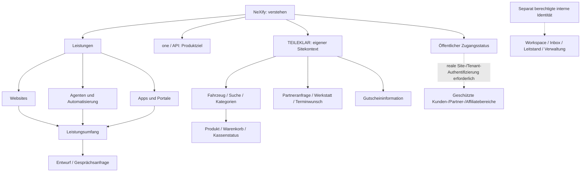

# 0010 – Deutsche Nutzerwege und verbundene Sitekontexte

Status: quellengebundener Architektur- und Inhaltsentwurf vom 26.10.2026.
Maschinenlesbare Quelle: `config/site-map.json`. Kein Produktiv-Go, keine
DNS-Veröffentlichung und keine pauschale Auth-/Commerce-Abnahme.

Der Nutzerauftrag umfasst die gesamte Seitenarchitektur, nicht nur einen Chat:
Agentur, KI-Produkte, TEILEKLAR-Shop, Werkstatt-/Partnerstrecken, geschützte
Portale und interne Steuerung. Aus den 93 HTML-Referenzen werden bewusst
**45 Zielrouten** gebildet: **35 öffentliche Inhalts-/Vorbereitungsseiten** und
**10 geschützte Zielbereiche**. Es werden keine Prototypdateien automatisch
als Produktionsrouten veröffentlicht.

## Markt, Sprache und Unternehmensidentität

Deutschland ist der primäre Zielmarkt; 90 % ist ein ausdrücklich gesetztes
Nutzerziel und keine gemessene Besucherquote. Deutsch ist Standard, NL/FR haben
dieselben strukturellen Inhaltsschlüssel. Die Ansprache bleibt Sie/u/vous.
Dieser Marktfokus macht aus der NeXify AI FACTORY B.V. kein deutsches Unternehmen.
Bestätigte niederländische Anbieter-/Register-/Steuerdaten werden nicht
umetikettiert; alte Einzelunternehmensangaben werden nicht als B.V.-Profil kopiert.

## Ein Monorepo, drei klar getrennte Kontexte

| Kontext | Entwicklungsbereich | Zweck und öffentlicher Einstieg |
|---|---|---|
| NeXify | `/` | Leistungen, Lösungen, Preise/Ablauf, Wissen, Unternehmen, Kontakt, one/API |
| TEILEKLAR | `/teileklar` | Eigener Marken-/Handelskontext, Fahrzeug/Teile und Werkstattstrecken |
| Intern | `/intern` | Ausschließlich geschützte Workspace-/Inbox-/Leitstand-/Admin-Ziele |

`teileklar.shop` und die NeXify-Domain sind benannte Zielkontexte, keine durch
diese Datei ausgeführten DNS- oder Hostingänderungen. Bewusste Inter-Site-Links
verbinden Lösungen ↔ TEILEKLAR. Navigation und Footer werden je Sitekontext
definiert. Ein öffentliches Next-Layout darf nur bereits gefilterte öffentliche
Seiten erhalten, niemals alle privaten Seitendaten als Client-Props.

Mandant, Site-Mitgliedschaft und Rolle gehören zu jeder privaten Datenanfrage.
Verschiedene Top-Level-Domains erhalten nicht automatisch gemeinsame Cookies,
Einwilligungen oder Single Sign-on. Die Konfiguration fordert Consent-Scope
aus Origin und Sitekontext; eine spätere Föderation braucht einen eigenen Vertrag.

## NeXify: verstehen → Leistung → Umfang → nächster Schritt

Die Hauptnavigation ist bewusst kurz: Leistungen, Lösungen, Preise und Ablauf,
Wissen, Unternehmen, Kontakt. Leistungen verzweigen in Websites, Agenten und
Automatisierung sowie Apps und Portale. Der Leistungsumfang ist eine eigene
Folgestufe. Ein Projekt darf aus jeder passenden Detailseite im gemeinsamen
Chat geklärt oder als Gesprächsanfrage vorbereitet werden.

Die drei typisierten Chatwege sind `quote`, `booking`, `marketing`:

- `quote`: Ziel und Umfang klären; unverbindlicher Angebotsentwurf, optionaler
  Entwurfs-PDF-Ausgang. Keine Vertrags-/Preisfreigabe durch eine Modellantwort.
- `booking`: Gesprächs-/Terminwunsch vorbereiten; keine bestätigte Reservierung
  oder behauptete Kalenderverfügbarkeit ohne die tatsächliche Schnittstelle.
- `marketing`: strukturiertes Briefing zu Ziel, Zielgruppe, Kanal und Ausgangslage;
  keine automatische Veröffentlichung, Werbeaussage oder Nachricht an Dritte.

Jede Seite besitzt neben Chataktionen registrierte Folgeseiten. Fehlt die
Chatfunktion, bleibt der registrierte Kontaktweg als Fallback verfügbar.
Rechtliche Informationen sind über direkte Footerlinks erreichbar.

Die Kontaktseite bietet hierfür zusätzlich `mail@nexifyai.cloud` als direkten
E-Mail-Ausgang, belegt durch den Kontaktabschnitt in `AGENTS.md`. Das Feld
`contact_channels` ist ausschließlich auf dieser öffentlichen Seite zulässig.
Der Ausgang öffnet das E-Mail-Programm ohne vorausgefüllte Nutzerdaten,
Betreff oder weitere Empfänger; die Anwendung versendet dadurch keine Nachricht.

one/API sind eigene Produktseiten mit ihrem dokumentierten Zielbild; sie
behaupten keine bereits aktivierten Schlüssel, Guthaben oder freigegebenen
Tarife. Der Kundenbereich führt zunächst zu einer erklärenden Statusseite.
Solange keine integrierte Authentifizierung geprüft ist, enthält dieser Einstieg
kein Credentialformular und keinen angeblich funktionierenden Login.

## TEILEKLAR: gezielte Folgeansichten statt erfundener Shopdaten

Die öffentliche Routefolge umfasst Start, Fahrzeug/Passung, Suche,
Kategorien, Kategorieansicht, Produktansicht, Warenkorb und Kassenstatus.
Daneben stehen Werkstatt-/Partneranfrage, Werkstattprofil, Terminwunsch und
Gutscheininformationen. Eigene Navigation, Markenbezeichnung und Kaufbedingungen
halten diesen Consumer-/Handelskontext von der Agenturstrecke getrennt.

Ohne angeschlossenen freigegebenen Katalog bleiben Produkt-/Kategorieansichten
als Vorbereitung erkennbar. Es gibt keine erfundenen Artikel, Lagerbestände,
Lieferzeiten, Werkstätten, Entfernungen, Bewertungen oder Preise. Ohne
Fahrzeugnachweis keine Passungszusage. Warenkorb/Kasse lösen derzeit keine
Bestellung, Zahlung oder vorgetäuschte Bestätigung aus.

Ein echter B2C-Kauf erfordert später die einschlägigen geprüften Preis-,
Versand-, Bestell-, Widerrufs- und Verbraucherinformationen. Die hierfür
erforderliche Button-Lösung betrifft diesen freigegebenen Consumer-Checkout;
sie wird nicht auf unverbindliche B2B-Kontakt-/Entwurfsaktionen übertragen.
Diese IA erstellt und übersetzt keine freizugebenden Rechtsbedingungen.

## Geschützte und interne Zielbereiche

| Ziel | Rollenanforderung im Zielvertrag | Öffentlicher Zustand |
|---|---|---|
| Kundenportal | Kunde, Site-/Mandantenmitgliedschaft | Kein Kundendaten-Render; Zugangsstatus/Fallback |
| API-Konsole | Kunde/Team/Admin, jeweilige Berechtigung | Keine Schlüssel-/Guthabendaten |
| Affiliate | Affiliate, Eigentums-/Sitebindung | Keine Codes oder Provisionen |
| TEILEKLAR-Konto | Kunde, zugeordneter Mandant | Keine Garage-/Bestelldaten |
| Werkstatt-/Partnerportal | Partner, konkrete Site-/Mandantenrechte | Keine Betriebe oder Abrechnungen |
| Nachbarschaft | Kunde, Eigentums-/Sitebindung | Keine persönlichen Gutscheine oder Termine |
| Workspace/Posteingang/Leitstand | Team/Admin, erlaubte Aktionen | Generischer Guard, keine internen Inhalte |
| Verwaltung | Admin, zusätzliche Schreibfreigaben/MFA | Kein öffentliches Verwaltungsmenü |

Die Rollenangaben sind Zielanforderungen, kein Beleg einer vollständigen
Authentifizierungsimplementierung. Die `public_allowlist` ist vom privaten
Zielregister getrennt; private oder interne IDs dürfen weder in der öffentlichen
Navigation noch als CTA-Ziel auftauchen. Private Ziele verweisen nach außen nur
auf die öffentliche Zugangsstatusseite.

## Gemeinsamer Chat und Datenschutz

Alle öffentlichen Seiten verlangen den gemeinsamen unteren Chateinstieg.
Optionale Verarbeitung ist zuerst über die globale Präferenzoberfläche zu
erklären und zu entscheiden. Analyse, externe Medien und Chatpersistenz sind
nicht automatisch aktiv. Der tatsächliche Cookie-/Medien-/Speichervertrag wird
im UI und Backend gesondert gegen diese Vorgabe geprüft; die JSON-Anforderung
allein beweist keine Durchsetzung.

## Quellen und Prüfungen

Primär: `AGENTS.md`, `docs/09-final/01`, `02`, `05`, `08`, `14`,
`docs/01-konzept/gesamtprojektplan.md`, Organisationshandbuch,
`config/brain/knowledge.json`, `config/regelwerk.json` sowie die bewusst je Route
zugeordneten `prototype_page_ids` aus `docs/contracts/prototype-pages.json`.
Alle Register-/Preis-/Rechtsfreigaben bleiben in ihren zuständigen Quellen.

`tests/test_site_map.py` prüft den echten Graphen auf Erreichbarkeit, bekannte
Navigations-/Footer-/CTA-Ziele, nachvollziehbare Journeykanten, Quellenbindung,
geschlossenes internes Register, DE/NL/FR-Schlüsselparität und sichere lokale
Routen. Negativproben verändern diesen Graphen gezielt: interne Navigation,
unverlinkte Seite, fehlende Übersetzung, fremdes/verschleiertes Redirectziel,
falsche Marktbehauptung, erfundene Loginfreigabe und rohe Prototyp-URLs.
Ein zusätzlicher Negativtest sperrt injizierte Mailto-Parameter und Zeilenumbrüche.
Die browserseitige Darstellung aller Zielrouten und CTA-Ausgänge ist ein
zusätzlicher Nachweis der nativen Webimplementierung.

## Vollständiges Zielroutenregister

Alle nachfolgenden Routen haben im IA-Register den Stand `planned`. Das beschreibt
die vorgesehenen Inhalts-/Guardrouten und ist keine Behauptung funktionierender
Zahlungen, Kontoanmeldung, Produktdaten oder einer Produktionsveröffentlichung.

| ID | Entwicklungspfad | Kontext / Sichtbarkeit | Deutscher Seitentitel | Gezielt nächster Ausgang |
|---|---|---|---|---|
| `home` | `/` | nexify / public | Digitale Lösungen für Ihr Unternehmen | `services`, `chat:quote`, `chat:booking` |
| `services` | `/leistungen` | nexify / public | Leistungen | `websites`, `automation`, `apps-portals`, `scope` |
| `websites` | `/leistungen/websites` | nexify / public | Websites | `scope`, `chat:quote`, `chat:booking` |
| `automation` | `/leistungen/agenten-automatisierung` | nexify / public | Agenten und Automatisierung | `scope`, `chat:quote`, `chat:marketing` |
| `apps-portals` | `/leistungen/apps-portale` | nexify / public | Apps und Portale | `scope`, `chat:quote`, `chat:booking` |
| `scope` | `/leistungsumfang` | nexify / public | Leistungsumfang und Projektstart | `chat:quote`, `chat:booking`, `contact` |
| `solutions` | `/loesungen` | nexify / public | Lösungen und Produkte | `tk-home`, `one`, `api`, `chat:quote` |
| `pricing` | `/preise-ablauf` | nexify / public | Preise und Ablauf | `scope`, `chat:quote`, `chat:booking` |
| `knowledge` | `/wissen` | nexify / public | Wissen und Orientierung | `knowledge-start`, `scope`, `contact` |
| `knowledge-start` | `/wissen/projekt-vorbereiten` | nexify / public | Ein digitales Projekt vorbereiten | `scope`, `chat:quote`, `chat:booking` |
| `company` | `/unternehmen` | nexify / public | Unternehmen | `contact`, `imprint`, `login` |
| `contact` | `/kontakt` | nexify / public | Kontakt und nächste Schritte | `chat:quote`, `chat:booking`, `chat:marketing`, `privacy` |
| `one` | `/produkte/one` | nexify / public | NeXify AI one und one+ | `api`, `chat:quote`, `chat:booking` |
| `api` | `/produkte/api` | nexify / public | API und technische Zugänge | `chat:quote`, `chat:booking`, `terms` |
| `imprint` | `/impressum` | nexify / public | Anbieterinformationen | `contact`, `terms` |
| `privacy` | `/datenschutz` | nexify / public | Datenschutz und Datenverwendung | `contact`, `terms` |
| `terms` | `/vertragsgrundlagen` | nexify / public | Vertragsgrundlagen und Freigabestand | `contact`, `privacy` |
| `ai-notice` | `/ki-hinweise` | nexify / public | Hinweise zur KI-Nutzung | `contact`, `terms` |
| `accessibility` | `/barrierefreiheit` | nexify / public | Barrierefreiheit und Rückmeldung | `contact`, `terms` |
| `cookies` | `/cookies` | nexify / public | Cookies und Einstellungen | `contact`, `terms` |
| `login` | `/anmelden` | nexify / public | Kundenbereich: aktueller Stand | `contact`, `services` |
| `tk-home` | `/teileklar` | teileklar / public | TEILEKLAR: Teile, Fahrzeug und nächste Schritte | `tk-search`, `tk-fitment`, `tk-partner`, `chat:quote` |
| `tk-search` | `/teileklar/suche` | teileklar / public | Teilesuche: in Vorbereitung | `tk-fitment`, `tk-categories`, `tk-product`, `chat:quote` |
| `tk-categories` | `/teileklar/kategorien` | teileklar / public | Sortiment und Kategorien | `tk-category`, `tk-search`, `chat:quote` |
| `tk-category` | `/teileklar/kategorie` | teileklar / public | Kategorieansicht: in Vorbereitung | `tk-product`, `tk-search`, `chat:quote` |
| `tk-product` | `/teileklar/produkt` | teileklar / public | Produktdetails: in Vorbereitung | `tk-search`, `tk-fitment`, `tk-cart`, `chat:quote` |
| `tk-cart` | `/teileklar/warenkorb` | teileklar / public | Warenkorb: noch ohne Bestellung | `tk-search`, `tk-checkout`, `chat:quote` |
| `tk-checkout` | `/teileklar/kasse` | teileklar / public | Kasse: nicht zum Kauf freigegeben | `tk-cart`, `tk-legal`, `chat:quote` |
| `tk-fitment` | `/teileklar/fahrzeug-und-passung` | teileklar / public | Fahrzeug und belegte Passung | `tk-search`, `tk-product`, `chat:quote` |
| `tk-appointments` | `/teileklar/termine` | teileklar / public | Werkstatttermin anfragen | `tk-workshop`, `tk-partner`, `chat:booking` |
| `tk-vouchers` | `/teileklar/gutscheine` | teileklar / public | Gutscheine und Einlösung: aktueller Stand | `tk-legal`, `login`, `chat:quote` |
| `tk-partner` | `/teileklar/partner-werden` | teileklar / public | Werkstattpartner werden | `tk-workshop`, `tk-appointments`, `chat:quote` |
| `tk-workshop` | `/teileklar/werkstatt` | teileklar / public | Werkstattprofil: freigegebene Daten erforderlich | `tk-appointments`, `tk-partner`, `chat:booking` |
| `tk-legal` | `/teileklar/rechtliches` | teileklar / public | TEILEKLAR: Anbieter, Datenschutz und Kaufbedingungen | `tk-home`, `cookies`, `chat:quote` |
| `customer-portal` | `/portal/kunde` | nexify / private | Kundenportal | `login` |
| `api-console` | `/portal/api` | nexify / private | API-Konsole | `login` |
| `affiliate-portal` | `/portal/affiliate` | nexify / private | Affiliate-Bereich | `login` |
| `tk-account` | `/teileklar/konto` | teileklar / private | Kundenkonto und Fahrzeug | `login` |
| `tk-partner-portal` | `/teileklar/partnerportal` | teileklar / private | Werkstatt- und Partnerportal | `login` |
| `tk-neighbourhood` | `/teileklar/nachbarschaft` | teileklar / private | Nachbarschaftskunden | `login` |
| `internal-workspace` | `/intern/workspace` | internal / internal | Interner Workspace | `login` |
| `internal-inbox` | `/intern/posteingang` | internal / internal | Interner Posteingang | `login` |
| `internal-control` | `/intern/leitstand` | internal / internal | Interner Leitstand | `login` |
| `internal-admin` | `/intern/verwaltung` | internal / internal | Interne Verwaltung | `login` |

## Zielzusammenhang der Bereiche

Die gestrichelten Übergänge sind Anforderungen an spätere autorisierte Integrationen,
keine in dieser IA erzeugten Konten, Anmeldungen oder gegenseitigen Domain-Sessions.
