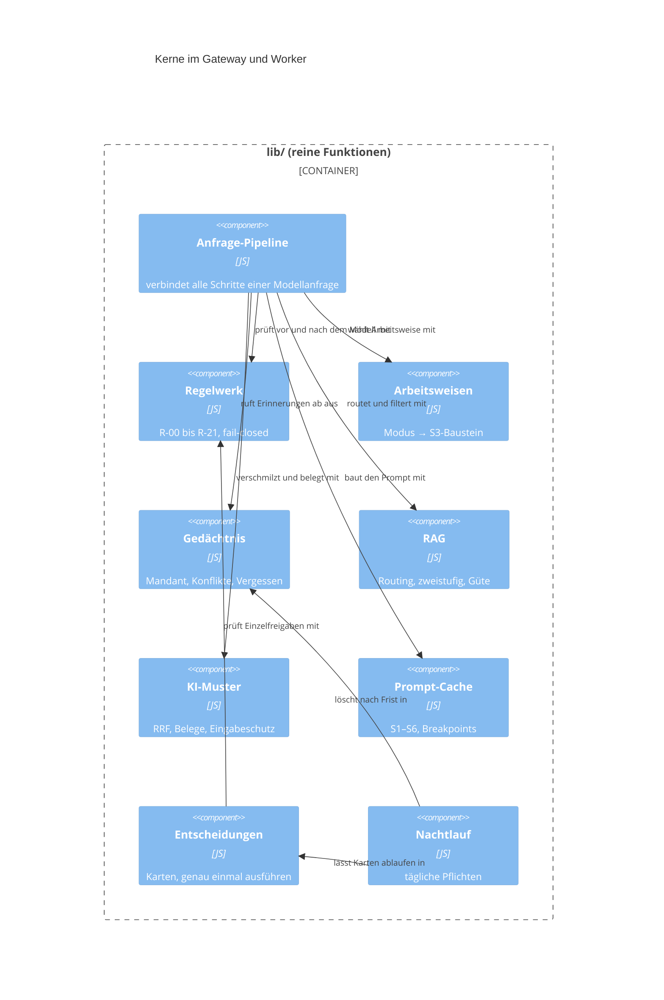

# C4 Ebene 3 · Komponenten im Gateway und Worker (Kerne)

**Stand 28.09.2026 · Zielgruppe:** Entwickler · **Quelle:** lib/*, tools/abhaengigkeiten.js

Nur die Kerne mit Abhängigkeiten; alle ohne Ein- und Ausgaben (CI-geprüft).

