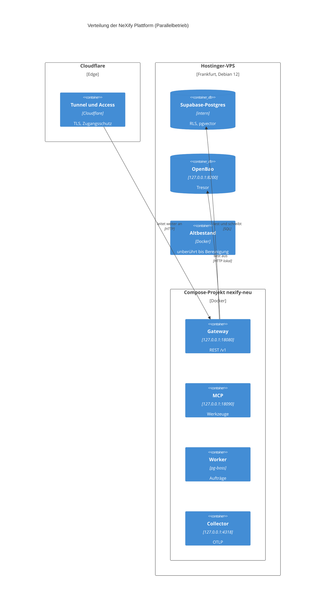

# C4 · Verteilung

**Stand 28.09.2026 · Zielgruppe:** Betrieb · **Quelle:** install.sh, deploy/compose.yml, Band 01

Frischer Server: gleiche Knoten, Projekt `nexify`, Ports 8080/8090, kein Altbestand.
