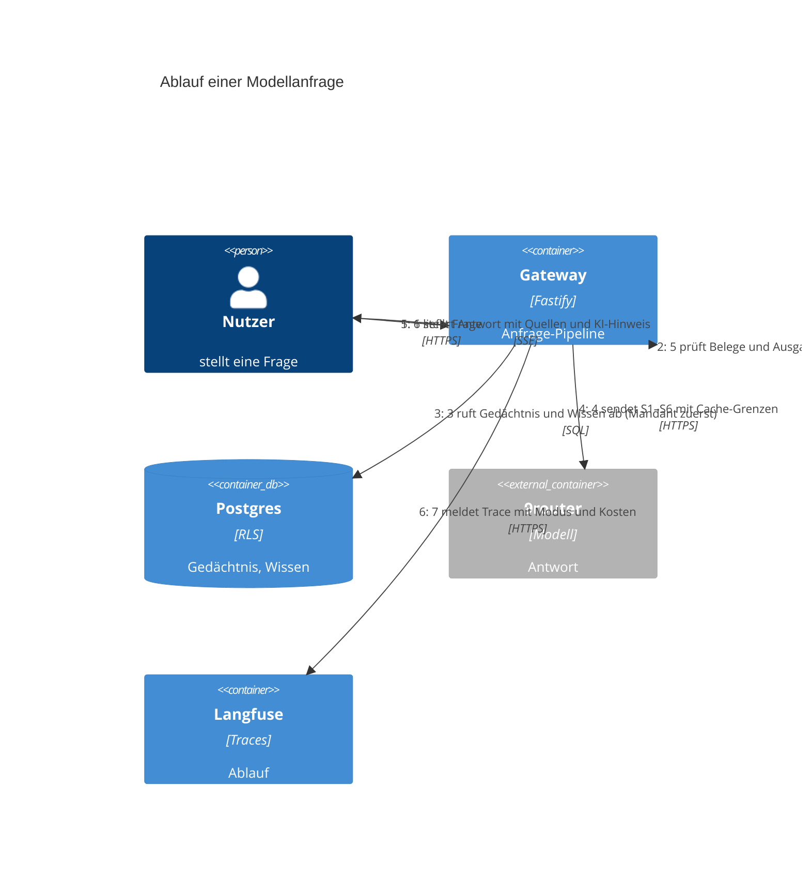

# C4 · Ablauf einer Modellanfrage

**Stand 28.09.2026 · Zielgruppe:** Technik · **Quelle:** lib/anfrage-pipeline.js (11/11)

Sonderwege: nichts Relevantes → ehrliche Antwort ohne Modell · Injektion von Kundenseite → abgewiesen · Modell aus → »wird nachgeholt«.
