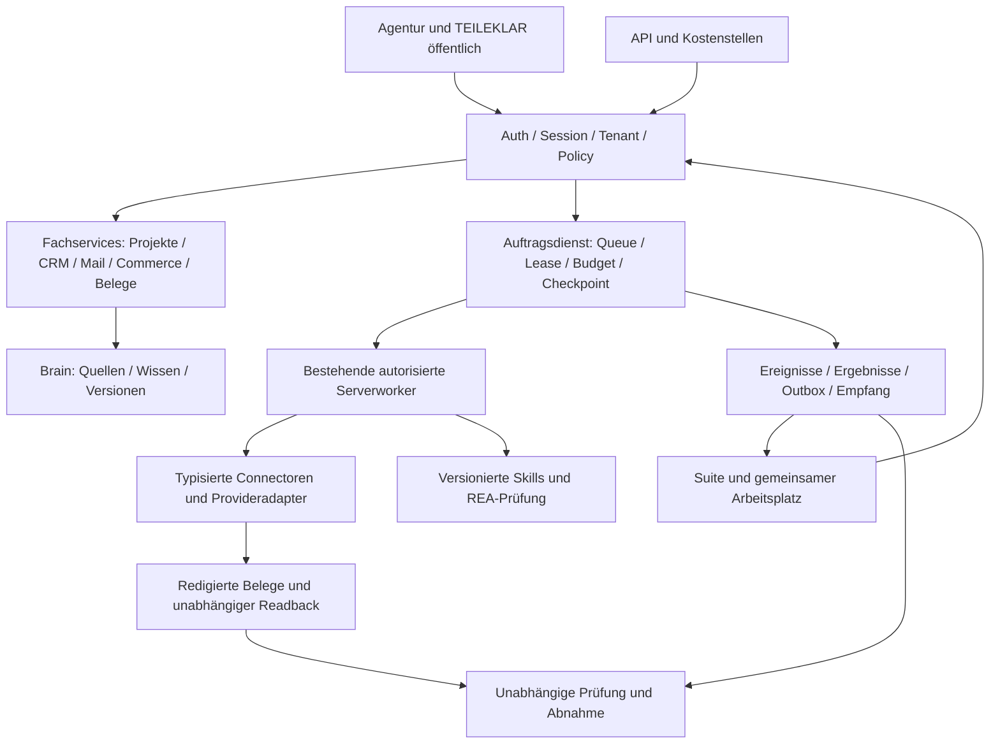
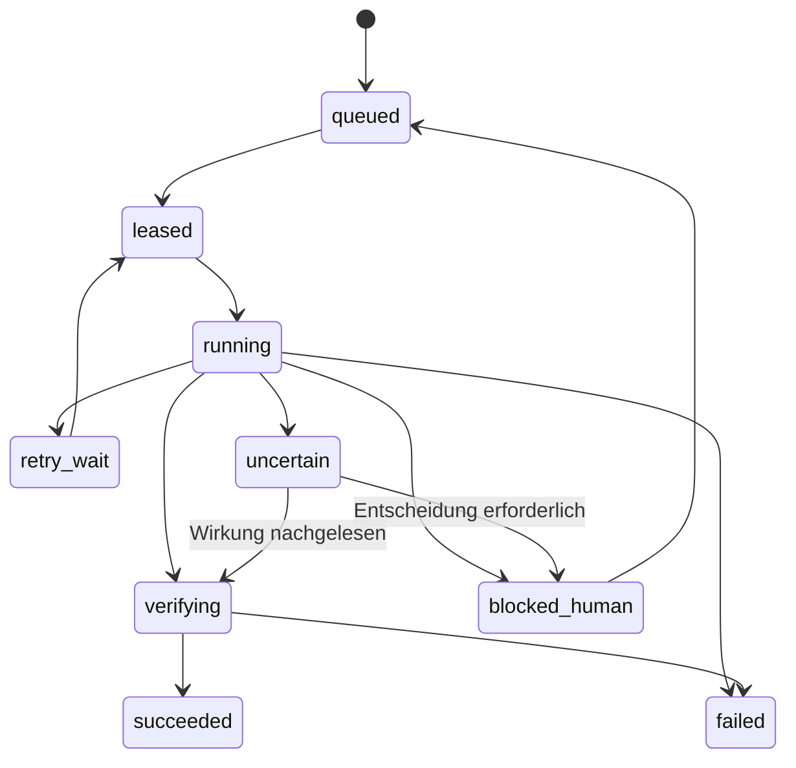

# NeXify AI Masterplan für vollständige Umsetzung und Abnahme

**Vollständig konsolidierte Arbeitsfassung · 29. Oktober 2026 · Version 2.1**  
**Auftraggeber und fachlicher Entscheider:** Pascal  
**Dokumenttyp:** verbindliche Sollvorgabe mit ausführbaren Funktionsverträgen, vollständigem Seiten und Szenenplan, Normenprüfmatrix, Arbeitspaketen und Abnahmeregistern  
**Geltung:** Agentur, NeX2fly Suite, NeX Agentic AI, one/one+, AI Fly Oracle, API, Arbeitsplatz, Kunden- und Partnerportale, TEILEKLAR, Mail, kaufmännische Abläufe, Marketing, Wissensbasis, Skills, Agentenbetrieb und Qualitätssicherung.

> **Der Auftrag lautet: das vorhandene NeXify-Gesamtsystem zu einem zusammenhängenden, hochwertigen und tatsächlich funktionierenden Unternehmen mit digitalen Produkten vervollständigen.** Vorhandene Lösungen werden überprüft, wiederverwendet und sauber verbunden. Bauanweisungen werden in Funktionen umgesetzt — nicht als Kundentexte veröffentlicht. Dieses Dokument definiert das vollständige Ziel und den Weg zur Abnahme; es behauptet keine bereits erreichte Gesamtfertigstellung.


**Leser:** Pascal, Produktverantwortliche, exklusiv gebundene technische Writer, Oracle Medienproduktion, Fachprüfer und unabhängige Abnahme.  
**Dokumentfreigabe:** Beauftragte Neufassung nach Pascals Anweisung vom 29.10.2026 um 18:01 UTC: „Schreibe auch den Masterplan im Detail neu, mit klaren Vorgaben, alles.“ Die Dokumentbeauftragung ist keine automatische Freigabe neuer Preise, Produktivänderungen, Kosten, Versandaktionen oder Rechtsbehauptungen.  
**Arbeitsmodus dieser Erstellung:** lokale Dokumentation. Keine Repositoryänderung, Produktion, DNS-, Rechte-, Zahlungs- oder Versandänderung.  
**Versionierung:** V1 bleibt unverändert als Quellenfassung erhalten. V2 ergänzt nicht nur einen Videotext: Sie bindet den vollständigen geschuldeten Funktionsumfang an Daten, Backend, Zustände, Tests, Normen und echte Freigaben.  
**Status:** Spezifikation, keine Behauptung einer fertigen Website, eines fertigen Shops, aktiver Agenten oder aller funktionierenden Verbindungen.

## Verbindliche Entscheidungen auf einen Blick

1. Öffentlich sichtbare Bauanweisungen werden **in Funktionen mit Backend umgesetzt**. Erst danach entsteht der zutreffende Kundentext. Weglassen, Umbenennen oder Werbesprache ersetzt keine Umsetzung.
2. TEILEKLAR bleibt eigene Marke mit eigenem Kauf-, Werkstatt-, Partner- und Supportkontext. Gemeinsames Design ist keine gemeinsame Datentonne.
3. NeX2fly hat die Editionen **Privat und Business**. **NeX enthält AIFly**, ohne doppelte Grundgebühr für denselben Zugang. **AIFly ist zusätzlich eigenständig per API** für einen mitgebrachten Agenten vorgesehen. **30 Tage Zugang plus Verbrauch** ersetzt den historischen pauschalen Prepaid-only-Ansatz.
4. Einmalige **24 Stunden Suite-Testzeit**, bewusst im verifizierten eigenen Workspace gestartet, bleiben von kostenpflichtiger Modellnutzung getrennt. Kein erfundenes Gratis-LLM-Guthaben.
5. Öffentlicher Hero: **Text links, professioneller Chat rechts**, freie Figuren auf der Seitenfläche. Pascal und NeX ganzkörperlich, AIFly vollständig, glatt und schwebend; kein Plüsch, kein Playerrahmen, kein Notebook. Pascal bleibt freundlich und unverfremdet.
6. Arbeitsplatz: Navigation links, NeX-Gespräch, Oracle-Status oben, rechter realer Arbeitsbereich. Geschlossen bleibt der **Chat begrenzt und zentriert**, der Composer bündig; nicht vollbreiter Fließtext.
7. Medien umfassen **alle realen Routen und ihre Abschnitte bis zum Footer**, nicht nur den Hero. Jede Szene braucht Seitenzweck, Text, Regie, Bedienbarkeit, Datei, Rechte, Integration und Beleg. Videoanforderungen werden nicht durch Poster oder stumme Kurzclips abgenommen.
8. DIN-, EN-, ISO- und WCAG-Bezüge werden mit zutreffendem Geltungsbereich, Ausgabe, Prüfmethode, Owner und Evidenz geführt. Keine fingierte Zertifizierung oder pauschale Rechtskonformität.
9. Alle 44 Small-Business-Skillhaupttexte wurden im dokumentierten Rechercheteam inhaltlich und anhand der Originalhashes geprüft. Das ist **keine** Behauptung von 44 laufenden Skills, Workflows oder Agenten.
10. Jede Abnahme trennt Spezifikation, Quellcode, lokalen Test, Verbindung, Preview, Liveprüfung und fachliche Freigabe. Kein 100-Prozent-Fertig-Claim ohne vollständige, aktuelle Evidenz.

## Inhaltsverzeichnis

1. [Auftragskern und Verbindlichkeit](#1-auftragskern-und-verbindlichkeit)
2. [Unternehmen, Marken und Produkte](#2-unternehmen-marken-und-produkte)
3. [Rollen, Verantwortlichkeiten und Zusammenarbeit](#3-rollen-verantwortlichkeiten-und-zusammenarbeit)
4. [Geschäftsprozesse und Projektaufnahme](#4-geschäftsprozesse-und-projektaufnahme)
5. [Designsystem und gemeinsame Komponenten](#5-designsystem-und-gemeinsame-komponenten)
6. [Layout, Navigation, Chat und Arbeitsplatz](#6-layout-navigation-chat-und-arbeitsplatz)
7. [Öffentliche Seiten und Kundeninhalte](#7-öffentliche-seiten-und-kundeninhalte)
8. [Grafiken, Figuren, Videos und Szenenproduktion](#8-grafiken-figuren-videos-und-szenenproduktion)
9. [Konto, NeX2fly Suite und Agentenfunktionen](#9-konto-nex2fly-suite-und-agentenfunktionen)
10. [API, Prepaid und Kostenkontrolle](#10-api-prepaid-und-kostenkontrolle)
11. [TEILEKLAR: vollständiger Shop und Backend](#11-teileklar-vollständiger-shop-und-backend)
12. [Kunden-, Werkstatt-, Partner- und Affiliateportale](#12-kunden-werkstatt-partner--und-affiliateportale)
13. [Mail und Kommunikation im Arbeitsplatz](#13-mail-und-kommunikation-im-arbeitsplatz)
14. [Belege, Buchhaltung und Unternehmenssteuerung](#14-belege-buchhaltung-und-unternehmenssteuerung)
15. [Marketing, Recherche und Vertrieb](#15-marketing-recherche-und-vertrieb)
16. [Brain, Agent Memory und LightRAG](#16-brain-agent-memory-und-lightrag)
17. [Skills, REA und kooperierendes Engineering](#17-skills-rea-und-kooperierendes-engineering)
18. [Zielarchitektur und unabhängiger Serverbetrieb](#18-zielarchitektur-und-unabhängiger-serverbetrieb)
19. [Verbindliche Datenverträge](#19-verbindliche-datenverträge)
20. [Umsetzungs-SOP, Wiederaufnahme und Rückwege](#20-umsetzungs-sop-wiederaufnahme-und-rückwege)
21. [Sicherheit, Recht, Betrieb und Messbarkeit](#21-sicherheit-recht-betrieb-und-messbarkeit)
22. [Arbeitspakete und Phasenplan](#22-arbeitspakete-und-phasenplan)
23. [Anforderungs- und Abnahmematrix](#23-anforderungs--und-abnahmematrix)
24. [Eingangsbedingungen und gezielte Blockaden](#24-eingangsbedingungen-und-gezielte-blockaden)
25. [Zeitgebundener Tatsachenanhang](#25-zeitgebundener-tatsachenanhang)
26. [Quellenregister und Abschlussregel](#26-quellenregister-und-abschlussregel)
27. [Umsetzbare Lieferpakete und Prüffälle](#27-umsetzbare-lieferpakete-und-prüffälle)
28. [Differenz und Vollständigkeitsregister](#28-differenz-und-vollständigkeitsregister)
29. [Dokumentprüfung und gebundene Quellenfassungen](#29-dokumentprüfung-und-gebundene-quellenfassungen)

30. [Stadtmarketing und Stadt–Werkstatt-Verknüpfung](#30-stadtmarketing-werkstattverzeichnis-und-durchgängige-portalverknüpfung)
31. [Wiederhergestellte Detailverträge](#31-wiederhergestellte-detailverträge-für-portale-und-internen-betrieb)

**Detailzugänge:** Produktentscheidungen und Preise §2.4–2.6; Rollenbindung §3.1; vollständiger integrierter Drehplan §8.7; 44-Skill-Matrix §17.5; Backendverträge §19.4; vollständige Normenprüfmatrix §21.5; ausführbare Pakete §27; offene Fakten §24 und Coverage §28.

---

## 1. Auftragskern und Verbindlichkeit

### 1.1 Verbindliches Ergebnis

NeXify soll als ein gemeinsames System erlebbar und betreibbar werden: öffentlich verständlich, intern geordnet, technisch nachvollziehbar und fachlich zuverlässig. Der Besucher findet einen konkreten Einstieg; ein Kunde erhält einen eigenen geschützten Arbeitsbereich; Projekte, Kommunikation, Dokumente und Abnahmen bleiben zusammenhängend; automatisierte Arbeit besitzt echte Zustände, Kostenkontrolle und überprüfbare Ergebnisse. TEILEKLAR erhält einen echten Handels- und Serviceprozess innerhalb derselben Gestaltung und Integrationsarchitektur, ohne seine eigene Marke oder seine fachlichen Grenzen zu verlieren.

Der Gesamtauftrag umfasst **Frontend und Backend**. Ein schöner Bildschirm, eine umgeschriebene Anleitung, eine simulierte Antwort, ein grüner Build oder ein erreichbarer Endpunkt ersetzt keine fertige Funktion.

### 1.2 Quellenrang und Konfliktregel

1. Neueste ausdrückliche Entscheidung von Pascal zu derselben Sache.
2. Bestätigte aktuelle Fach-, Marken-, Preis-, Betreiber- und Vertragsquellen innerhalb ihres jeweiligen Geltungsbereichs.
3. Diese konsolidierte Mastervorgabe einschließlich ausdrücklich gekennzeichneter technischer Abnahmeanforderungen.
4. Bestehende Original-Handoffs, Funktionsskripte und deren quellengebundene Auswertungen.
5. Historische Prototypen und Beispiele als Funktionsreferenz, **nicht** als Nachweis heutiger Preise, Rechte, Daten oder Produktivfähigkeit.

Laufzeitbeobachtungen beantworten die Frage **„Was ist zu einem bestimmten Zeitpunkt tatsächlich vorhanden?“**, nicht **„Was ist fachlich geschuldet?“**. Deshalb bleiben Soll und Ist getrennt. Eine fehlende Funktion wird nicht durch die Umbenennung ihres Buttons oder ihre Streichung aus der Navigation erledigt.

Konflikte werden als Entscheidung mit betroffener Anforderung, kollidierenden Quellen, zuständigem Owner, belastbarem Ermittlungsschritt und begrenzter Blockadewirkung geführt. Nicht betroffene Arbeiten laufen weiter. Unbelegte Werte werden nicht geraten.

### 1.3 Übergreifende Regeln

- Bestehende Code-, Daten-, Design- und Integrationsstrukturen zuerst lesen und wiederverwenden. Kein Neuaufbau allein wegen unvollständiger Dokumentation.
- Ein bestätigter technischer Writer je physischem Arbeitsbereich beziehungsweise eindeutig abgegrenzter Ressource. Analyse, Medien und unabhängige Prüfung können parallel erfolgen; konkurrierende Änderungen an denselben Dateien nicht.
- Neuere Livefunktionen dürfen nicht durch einen älteren Git-Stand ersetzt werden. Vor jeder Änderung aktuelle Quelle und Deployment-Zuordnung feststellen.
- Ein Dokument, Prompt, Skill oder Agentenname erteilt keine neuen Zugänge, Rollen, Veröffentlichungs-, Versand-, Zahlungs- oder Budgetrechte.
- Bestehende erlaubte lokale Entwicklungs-, Test-, Dokumentations- und Versionierungsarbeiten werden im klaren Auftrag ohne erneute pauschale Rückfrage ausgeführt. Aktive Writer, Sicherheitsgrenzen und Kostenlimits bleiben maßgeblich.
- Nutzerdateien, gespeicherte Nutzerdaten, Repositories und Konten werden nicht durch Agenten gelöscht. Eine tatsächlich benötigte Löschung nimmt Pascal selbst vor. Sicheres wiederherstellbares Archivieren ist nur nach Zuständigkeits-, Abhängigkeits-, Sicherungs- und Aufbewahrungsprüfung zulässig.
- Persönliche NeXify-Skills dürfen im bereits autorisierten Rahmen mit dem offiziellen Skill-Creator gepflegt werden; System- und Plugin-Skills sowie ihre Originale werden nicht überschrieben.
- Technische Aufträge, Quellen und Prüfbelege dürfen im bestehenden autorisierten Auftrags-/Wissenssystem gepflegt werden, wenn Projekt, Tenant, Owner und Ziel eindeutig sind. Keine Geheimnisse oder unnötigen personenbezogenen Daten eintragen.
- Anbieter und laufende Dienste bleiben erhalten, solange ihre Entbehrlichkeit nicht nachgewiesen ist. **Unbekannt ist nicht entbehrlich.** Kein Kündigungs- oder Löschauftrag entsteht aus dieser Vorgabe.

### 1.4 Einheitliches Statusvokabular

| Status | Zulässige Aussage |
|---|---|
| Spezifiziert | Anforderung und Abnahme sind beschrieben. |
| Gebaut | Implementierung liegt an einer benannten Quellversion vor. |
| Lokal geprüft | Genannte Tests liefen mit Ergebnis in einer benannten lokalen Umgebung. |
| Verbunden | Konkreter Dienst, Account und Adapter sind nachweisbar zugeordnet; dies allein ist noch keine Funktionsabnahme. |
| In Preview geprüft | Nutzerweg ist am benannten Preview-Release überprüft. |
| Live geprüft | Konkreter Weg wurde am benannten Produktionsrelease mit zulässigen Testdaten geprüft. |
| Abgenommen | Fachliche und technische Kriterien sind mit unabhängiger Prüfung erfüllt. |
| Blockiert / unbekannt / teilweise | Fehlender Beleg oder fehlende Voraussetzung ist präzise benannt; kein Ersatz durch Grün oder Null. |

---

## 2. Unternehmen, Marken und Produkte

### 2.1 Unternehmenskonzept

**NeXify AI** verbindet Beratung, Websites, Portale, KI-gestützte Arbeitsabläufe, Integrationen und betreibbare digitale Produkte. Der Schwerpunkt liegt auf konkreten Geschäftsabläufen in vorhandenen Systemen: verstehen, strukturieren, umsetzen, nachweisen, betreiben und verbessern.

**Slogan:** „Chat it. Automate it.“  
**Darstellungsprinzip:** persönlich durch Pascal, NeX und AI Fly Oracle; technisch souverän, ohne künstliche Mitarbeiter-, Kunden-, Umsatz- oder Erfolgsgeschichten.

Die Agentur bietet folgende zusammenhängende Leistungen:

| Leistung | Fachliches Ergebnis |
|---|---|
| Beratung und Audit | Istprozess, Systeme, Quellen, Risiken, Zielbild und priorisierter Umsetzungsauftrag. |
| Websites und Shoplösungen | Klarer Auftritt mit echten Anfragen oder Transaktionen, passenden Inhalten, SEO und notwendigen Informations-/Consentpfaden. |
| Kundenportale und Dashboards | Rollenbezogene Zusammenarbeit an realen Vorgängen, Dokumenten, Zuständen und Entscheidungen. |
| KI- und Workflowintegration | Definierte Eingaben, zugelassene Werkzeuge, persistente Aufträge, Freigaben, Fehler- und Wiederaufnahmewege. |
| Betrieb und Pflege | Vereinbarter Betriebsumfang, beobachtbare Systeme, Änderungen, Support und dokumentierte Rückwege. |
| Marketing und Wissen | Belegte Inhalte, qualifizierte Recherche, Kampagnenvorbereitung und nachvollziehbare Nachfrageprozesse. |

Rechtsform, Betreiberidentität und geschäftliche Angaben stammen ausschließlich aus bestätigten Rechts-/Unternehmensdokumenten. Die Marke ist kein Rechtsformnachweis.

### 2.2 Produkt- und Kontextlandkarte

| Kontext | Ziel und Grenzen |
|---|---|
| **NeXify Agentur** | Interesse → Briefing → qualifizierte Anfrage → Angebot → bestätigter Auftrag → Umsetzung → Abnahme → Betrieb. Ein Rechner oder PDF ist nicht automatisch ein Vertrag. |
| **NeX2fly Suite** | Eigener Workspace mit Chat, Aufgaben, Projekten, Dokumenten und kontrollierter Ausführung. Transparenter Test-, Nutzungs- und Upgradepfad. |
| **NeX Agentic AI** | Vorkonfigurierter Hauptagent mit Fachfähigkeiten und enthaltener AIFly-Koordination. 30-Tage-Zugang plus separat geregelter Verbrauch; kein „Autopilot“ als pauschale Vollmacht. |
| **one und one+** | Historisch belegte Funktionsunterscheidung erhalten: one für Antworten/Entwürfe/Beratung; one+ zusätzlich kontrollierte Tools, Dateien, Browser, Entwicklung, Prüfung und Orchestrierung. Exakte heutige Handelsnamen-/SKU-Zuordnung zum NeX-Produkt ist noch explizit zu binden; nicht bloß als ungeprüfte Synonyme zusammenwerfen. |
| **AI Fly Oracle / AIFly** | In NeX enthaltener Koordinator und zusätzlich eigenständiger API-Dienst für einen mitgebrachten Agenten. Separate Berechnung nur für tatsächlich zusätzlichen freigegebenen Scope, keine doppelte Grundgebühr. Grafikfigur, Fachrolle und reale Laufzeitinstanz bleiben getrennt. |
| **API** | Tenant- und kostenstellengebundener Zugang mit Schätzung, Limits, Budget, Usage, Prepaid-Ledger und nachvollziehbarer Abrechnung; bevorzugt in die Suite integriert. |
| **Arbeitsplatz / myADMIN / Leitstand** | Unterschiedliche Sichten auf gemeinsame autoritative Daten: operative Arbeit, kaufmännische Vorgänge, System- und Prüfstatus. Keine konkurrierenden Masterdatenbestände. |
| **TEILEKLAR** | Eigene erkennbare Marke für Teilehandel, Fahrzeugkontext, Werkstätten, Partner, Support, Kauf und Nachkaufprozesse. Slogan: „TEILEKLAR — Na KLAR!“ |
| **NeXify-Shoplösung** | Wiederverwendbarer Shopfunktionsumfang. Beispieldaten bleiben ausdrücklich getrennte Testdaten und werden nicht als echte kaufbare Waren veröffentlicht. |
| **Kunden-/Partner-/Nachbarschafts-/Affiliateportale** | Rollenbezogene Angebote, Termine, Profile, Dokumente, Gutscheine, Attribution und Abrechnung mit jeweils eigenen fachlichen Regeln. |

### 2.3 Domainzielbild — keine Behauptung heutiger Erreichbarkeit

| Domain/Ziel | Vorgesehene Aufgabe | Freigabebedingung |
|---|---|---|
| `nexifyai.cloud` | Allgemeiner international anschlussfähiger Unternehmens-/Produkteinstieg. | Bestätigte Host-, Inhalts-, Sprach- und Canonicalzuordnung. |
| `nexifyai.de` / `www.nexifyai.de` | Deutscher Marktauftritt. | Aktueller Release und deutsche Betreiber-/Marktinformationen gebunden. |
| `nexifyai.dev` | Neu registrierte Domain; Einsatz zuerst prüfen. | Kein Dienst und kein Umzug ohne festgelegten Zweck, Ownership und Abhängigkeitsprüfung. |
| `app.nexifyai.cloud` | NeX2fly Suite und geschützter Arbeitsplatz. | Auth, Tenantmodell, Session-, Betriebs- und Releaseabnahme. |
| `api-suite.nexifyai.cloud` | API-Zugang beziehungsweise API-Sicht innerhalb der Suite. | Reale Routen, Schlüssel-/Budget-/Ledgervertrag; keine isolierte zweite Kontoarchitektur. |
| `teileklar.shop` | Eigenständige Shopmarke und fachlich passende Unterbereiche. | Produkt-, Commerce-, Recht-, Support- und Domainabnahme. |

DNS, Zertifikate, Aliase, Redirects, Cross-Origin-Regeln und Sessiongrenzen werden aus dem tatsächlichen Bestand abgeleitet. Gemeinsame Navigation bedeutet keine pauschale gemeinsame Cookie-Domain oder tenantübergreifende Datenfreigabe.

---

### 2.4 Produktzugang und Einschluss ohne Widersprüche

Die am 16.10.2026 dokumentierte Produktentscheidung ist konkreter als die älteren Prepaid-Prototypen. Sie gilt für das Soll, nicht als Nachweis eines heute verfügbaren Tarifs.

| Vertragspunkt | Verbindliche Umsetzung | Abnahme und noch benötigte Bindung |
|---|---|---|
| Edition Privat | Eigener Workspace, private Rollen und zutreffende Verbraucherinformationen; kein Business-Admin allein aus Registrierung. | Eigenes Konto durch gesamten Zugang, Laufzeit, Nutzung und Kündigungs-/Informationsweg prüfen. Gesamtpreis erst mit freigegebener Preis-/Steuerfassung. |
| Edition Business | Unternehmens-/Tenantzuordnung, zugelassene Rollen, eigene MCP/API-Verbindungen nur im bestätigten Scope. | Zwei Unternehmen und mindestens Viewer/Bearbeiter/Owner unterscheiden; fremde Objekt-ID und manipulierte Tenant-ID negativ. |
| NeX einschließlich AIFly | Hauptagent delegiert tatsächlich an den gebundenen Koordinationsdienst und erhält korrelierte Ergebnisse; kein dekorativer Status. | Job/Dispatch/Receipt/Resultat mit identischer Korrelation, Wiederaufnahme und Fehlerfall; Rechnung enthält keine doppelte Grundgebühr. |
| AIFly eigenständig | API-Vertrag für vom Kunden mitgebrachten Agenten, eigene Eingangs-/Ergebnisschemas, tenantgebundene Schlüssel und Budget. | Testclient ohne NeX-Zwang kann autorisierte Koordination nutzen; unzulässiges Tool wird trotz AIFly-Zugang gesperrt. |
| Zugang für 30 Tage | Autoritativer Entitlementdatensatz mit Produkt, Edition, aktivem Umfang, Zahlung/Provisionierung, Beginn, Ende und Verlängerungsregel. | Serverzeit, doppelte Zahlungsereignisse, verzögerte Provisionierung und Basis-/Addonüberlappung prüfen. Grundbeträge/Inklusivmengen noch offen. |
| Verbrauch/Prepaid | Separates Reservierungs-/Usage-/Ledgerobjekt. Zugang allein finanziert keinen kostenpflichtigen Provideraufruf. | Fehlendes Funding sperrt Kostenaktion, nicht zulässige bereits bezahlte Datenansicht. Kein negativer Saldo durch Parallelität. |
| Einmaliger Suite-Test | Verifizierte Identität, eigener aktivierter Workspace, ausdrücklicher Start; 24 Stunden serverseitig einmalig. | Wiederholter Login, zwei Tabs, wiederholter Start und Serverrestart verändern das Ende nicht; kein Autocharge beim Ablauf. |
| Grundumfang | Dokumentierte Vorgabe: 8 Kernagenten und 10 aktive MCP-Verbindungen, kuratierte Standardskills. | Produktowner benennt genau die acht Kundenrollen und die Auswahl-/Zählregel für zehn Verbindungen; interne Leitungsagenten nicht als Kundenteam zählen. Keine heutigen Aktivitätsclaims ohne Probe. |
| Premium-Skill | Dokumentierte Festlegung 19,90 EUR netto je einzelnem Premium-Skill für 30 Tage. | Konkrete vertrieblich freigegebene Skill-ID, Rechte, Edition, Preis-/Steuerdarstellung, Provisionierung, Laufzeit und Nutzung belegen. SKU-Vorschlag `NXS-SKILL-PREMIUM-30D` nicht ungeprüft finalisieren. |
| Fachabteilungen | Elf vorhandene Modulfamilien: Finanzen/Buchhaltung, Marketing/Content, Vertrieb/CRM, Kundenservice, Personal/Recruiting, Operations, Einkauf, Projektmanagement, Recht/Compliance, Analytics/Controlling, Entwicklung/IT. | Jede Fähigkeit separat an Scope, zulässige Daten/Tools, Output und Fachreview binden. Preis unbekannt bedeutet nicht kostenlos. |
| Computerintegration | PC-/Mac-Integration mit lokalem Verbindungsdienst; getrennt vom optionalen Desktop-Dashboard. | Eigener Gerätescope, tatsächliche Verbindung, Rechte, Trennung, Revocation und Recovery. Kein Dashboardzwang aus Implementierungsbequemlichkeit. |
| Addons | Connectorenpaket, Fachagentenpakete und zusätzliche bestätigte Module. | Beginn erst nach erfolgreicher Zahlung/Provisionierung; Basis nicht heimlich verlängern. Abhängige Addons nicht unbemerkt unbrauchbar weiterberechnen. |

Automatische 30-Tage-Verlängerung ist als Bestandswunsch dokumentiert. Vor Verkauf müssen zutreffender Vertrag, Information, Zustimmung, Verlängerungs-/Kündigungsweg und Verbraucher-/B2B-Prüfung konkret vorliegen. Dieses Dokument erteilt keine Rechtsfreigabe und aktiviert keine Abbuchung.

### 2.5 Gesamte Agenturpalette als lieferbarer Scope

Die drei hervorgehobenen Einstiege Website, Automatisierung und Portal sind eine Navigationsentscheidung, keine Kürzung des Angebots. Folgende Familien bleiben erhalten und bekommen je Auftrag Eingabe, Menge, Ergebnis, Ausschluss, Abnahme und Betriebsowner:

| Lieferfamilie | Konkretes Ergebnis | Benötigter Backend oder Prozessanschluss | Pflichtabnahme |
|---|---|---|---|
| Beratung und Audit | Ist-/Sollprozess, System-/Datenkarte, priorisierter Plan, Risiken und Entscheidung. | Versionierte Projektakte mit Quellen, Ownern und Freigabe. | Alle vereinbarten Prozesse und offenen Entscheidungen nachvollziehbar; kein Code als stiller Inklusivscope. |
| Websites | Vollständige Seiten, Inhalte, SEO, zulässige Analyse und echter Anfrageweg. | Anfragepersistenz, vorhandenes Briefing, Outbox/CRM, Consent, Inhaltsversionen. | Route→Formular→persistenter Eingang→zuständiger Empfänger, Fehlerentwurf und Mobil-/A11ytest. |
| Shopentwicklung | Kundenmarkierter Shop mit definiertem Sortiment und Kauf-/Nachkaufweg. | Eigener Mandant, Katalog/Offer/Cart/Order/PSP/Fulfilment/Support. | Sandbox-E2E, Betrag/Währung, Dedupe, eigener Kundenzugriff und Rückabwicklung. Kein Kopieren echter TEILEKLAR-Kunden. |
| Automatisierung | Abgegrenzter Ende-zu-Ende-Ablauf mit sichtbaren Entscheidungen. | Trigger, Queue, erlaubte Adapter, Freigabe, Budget, Journal, Resume. | Hauptfall, Duplikat, Providerfehler, Budgetstop und unklarer Ausgang. |
| Kunden-/Partnerportal | Berechtigte gemeinsame Vorgänge, Dokumente und Status. | Auth, Tenant, Objekt-ACL, versionierter Vorgang, Benachrichtigung, Export. | Zwei Rollen/Two-Tenant-Negative, Reload, Änderung, Ablehnung, Export. |
| Web-App und PWA | Definierter Kernprozess statt bloßem klickbarem Entwurf. | Fachservice, Datenvertrag, Migration, Offlinegrenzen, Betrieb. | Vollständiger Nutzerweg samt Fehlern; Prototyp und ausgelieferte Software getrennt. |
| Wissensassistenz | Quellengebundene Suche und Antworten mit Unsicherheit. | Dokumentaufnahme, ACL, Indexversion, Quellenanker, Aktualisierung. | Repräsentative Fragen, fehlende Quelle, widersprüchliche Quelle, Fremdtenant, Restore. |
| Agentic Workflow/Team | Arbeitsteilung und kontrollierte Toolaktionen mit unabhängiger Prüfung. | AgentRegistry, SkillBinding, Capability, Job/Lease, Kosten, Ergebnis. | Kein Selbstreview; Status und Außenwirkung anhand echter Ereignisse. |
| Skill-/MCP-/API-Integration | Kundenspezifische Fachanweisung oder echte Systemanbindung. | Bestehende Connectoren zuerst; sichere Authreferenz, Toolvertrag, Scope. | Positiv-/Negativ-/Widerruf-/Retrytest im jeweiligen Zielclient. |
| Beleg-/Finanzvorbereitung | Original, Extraktion, Prüfliste, freigegebener Export. | Originalarchiv, OCR, Dedupe, Freigabe, Buchungs-/Exportreferenz. | Keine Zahlung/Steuerentscheidung aus OCR; fachlicher Summen-/Periodenabgleich. |
| Marketing/Content/SEO | Strategie, belegte Inhalte, Kampagnenentwürfe und Messplan. | Inhalts-/Freigaberegister, reale Landingpage, Consent, Attribution. | Kein Posting oder Versand ohne gebundenen Scope; keine erfundenen Leads/Rankings. |
| Care und Betrieb | Vereinbarte Überwachung, Updates, Support und Wiederanlauf. | Incident/Alert, Release-/Backup-/Restore-/Supportverantwortung. | Tatsächliche Reaktionskapazität und Recoveryscope, keine pauschale 24/7-SLA. |
| White Label/Partnerumsetzung | Umsetzung unter vereinbarter Kunden-/Partnermarke. | Klare Rechte, Tenant, Subprozessoren, Abnahme und Übergabe. | Kein Übertragen fremder Konten/Secrets; Betreiber-/Haftungsgrenzen festlegen. |
| Team-Einführung und Schulung | Befähigte Nutzer für vorhandene echte Funktionen. | Rollenbezogenes Onboarding und dokumentierte Schulungsfassung. | Teilnehmer können vereinbarte Aufgaben sicher erledigen; keine 44 Sofortintegrationen. |
| Produkt-Onboarding/Migration | Übernahme vorhandener erlaubter Daten und Arbeitsabläufe. | Inventar, Probeimport, Mapping, Dedupe, Rechte, Rückweg. | Mengen/Summen/IDs/ACL vergleichen; Originale erhalten, kein destruktiver Wechsel. |
| NeX2fly Mac/Desktop | Vorhandener Roadmap-/Produktkandidat, nicht automatisch fertige App. | Bestätigter Funktions-/Geräte-/Signierungs-/Updatevertrag erforderlich. | Installation, Revocation, lokale Rechte und sichere Verbindung erst nach tatsächlichem Build prüfen. |

Bestehende Fertiglösungen bleiben einzelne prüfbare Nutzerwege: Chat-Agent/Companion, Terminbuchung, E-Mail-Triage, Angebotsgenerator/Angebotsportal, Wissens-Agent, Local-SEO-Generator und Shopberater. Ihre vollständigen Funktions-/Datenverträge stehen in §§9–19 und in den Lieferpaketen §27; es reicht nicht, sieben Produktnamen auf einer Karte zu zeigen.

### 2.6 Preisautorität und wirtschaftliche Umsetzung

Kaufmännische Quelle ist die ausgearbeitete Entscheidungsvorlage `NeXify-Produktpalette-Preise-Marktanalyse-2026-10-29.md`, Preisfassung `NX-PROPOSAL-2026-10-29-v1`. **Alle neuen Paketbeträge, Mengengrenzen, Servicezeiten, Zielkorridore, Zahlungspläne und neuen API-Formeln darin sind Vorschläge, nicht Pascals pauschale Preisfreigabe.** Die separat belegte Premium-Skill-Festlegung und Produktentscheidungen werden nicht mit diesen Vorschlägen verwechselt.

| Neue Vorschlagsfamilie | Vorschlagspunkte EUR netto | Masterplanregel vor Angebot oder Aktivierung |
|---|---|---|
| Beratung | 490 / 1.490 / 2.990 einmalig | Umfang, echte Kapazität und Istkosten bestätigen. |
| Websites | 1.490 / 2.990 / 5.990 einmalig | Seiten-/Sprach-/Formular-/CMSmengen, Korrekturen und Ausschlüsse aus der konkreten Angebotsfassung übernehmen. |
| Automatisierung | 1.490 / 3.490 / 7.490 einmalig | Systeme, Schritte, Freigaben, Providerkosten und Tests explizit. |
| Portal | 6.900 / 12.900 / ab 24.900 einmalig | Rollen, Ansichten, Vorgänge, Datenquellen und Betriebsvolumen ausdrücklich begrenzen. |
| Web-App | 2.490 Sprint / ab 9.900 MVP / ab 19.900 Ausbau | Entwurf ist keine produktive App; Festpreis erst nach Scopeprüfung. |
| Kunden-Shoplösung | 6.490 / 11.900 / ab 19.900 einmalig | Sortiment, Märkte, PSP, Versand und Migration; kein Ersatz für TEILEKLAR-Retailpreise. |
| KI/Wissen | 2.490 / 5.900 / ab 12.900 einmalig | Quellen-/Tool-/Agenten-/Prüfkorpusumfang; Modellverbrauch separat. |
| Marketing | 590 einmalig / 990 monatlich / 1.990 monatlich | Konkreter Output, Freigaben, Versand und Anzeigenbudget getrennt. |
| Care | 99 / 299 / 690 monatlich | Neue begrenzte Leistungsstufen, keine Überschreibung historischer Care-Verträge. |
| Skill-/Connectorprojekt | 790 / 990 / Individualadapter ab 2.490 einmalig | Kundenspezifische Dienstleistung, nicht identisch mit 19,90-EUR-Premium-Skill-Zugang. |

Die vollständige Vorschlagsratecard einschließlich Zusatzleistungen bleibt in der kaufmännischen Quelle. Sie wird für konkrete Angebote mit Quellhash importiert, nicht aus gekürzten Tabellen neu erfunden. Historische 449-EUR-Tagessätze, Pilot 2.245 EUR sowie Care 249/1.347 EUR bleiben als getrennte Konflikte erhalten. Der noch nicht vollständig zugängliche 53-Positionen-Katalog ist eine gezielte Quellenlücke; kein neues Raster behauptet, ihn vollständig ersetzt oder abgeschafft zu haben.

Preisanzeige, Angebots-PDF, Vertrag, Checkout, Rechnung und Usage müssen dieselbe freigegebene `price_version` verwenden. Geldbeträge integer und Währung/Einheit explizit. Privat-/Verbraucherpreise benötigen zutreffende Gesamtpreise; B2B-Nettopreise nicht ohne Umrechnung/Steuerprüfung öffentlich übertragen. Keine automatische Aktivierung der vorgeschlagenen 25/100/500-EUR-Aufladung oder einer historischen 38-/45-%-Formel. Nicht bepreiste Tool-/Modellklassen bleiben für kostenpflichtige Nutzung gesperrt.

---

### 2.7 Wiedergefundene Modul und Entitlementstruktur

Der direkt quellengebundene Recoverybericht vom 29.10.2026 18:09 UTC ergänzt zwölf Modulfamilien aus dem Gesamtplan vom 16.10 und die tatsächlich gelesene Originalkonfiguration `config/product-entitlements.v2.json`. Dies sind erhaltene Produktanforderungen, keine neu erfundenen oder bereits bestellbaren SKUs.

**Grundumfang aus §12.1 des Gesamtplans:** Artefaktarbeitsplatz mit Versionen/Downloads, Schreiben/Übersetzen/Zusammenfassen, quellenbezogene Recherche, Planung/Lernen/Alltag/Karriere, PDF/DOCX/XLSX/PPTX aus geprüften Vorlagen, einfache Charts/SVG/Whiteboards sowie einfacher Webentwurf mit Quellcodeexport. Einfache enthaltene Fähigkeiten nicht nochmals automatisch als kostenpflichtige Erweiterung verkaufen. Nutzungs-, Provider-, Speicher- und Rechtegrenzen bleiben jeweils gültig.

| Vorhandene Modulfamilie | Ausführbarer Umfang und Eingabe | Ergebnis und Backendpflicht | Abnahme und offene Eingangsdaten |
|---|---|---|---|
| Connectorpaket | Ausgewählte zugelassene Kundenverbindungen und Actionscope. | ConnectorRegistry mit Tenant, Konto, Scopes, Status, letzter erfolgreicher Probe und Revocation. | Tatsächlich konfiguriert+autorisiert+validiert; Marketplaceeintrag zählt nicht als aktive Verbindung. SKU/Rate offen. |
| NeX Design Studio | Markenquelle, Designauftrag, Zielformat, Varianten und freigegebene Assets. | Versioniertes Design-/Folienartefakt, Referenzhashes, Preview, Export, Reviewstatus. | Visuelle Renderprüfung, Marken-/Textkonsistenz, keine neuen Identitäten. Preise und genaue Inklusivmengen offen. |
| Dokumentprozesse | Zulässiger Originalbeleg, Template, Extraktionsschema, Serienumfang. | Unverändertes Original, OCR/Unsicherheit, geprüfte strukturierte Daten, Vorlagen- und Serienversion. | Fehlerhafte OCR, Dublette, lange Daten, falscher Tenant, Exportreadback; Steuer-/Rechtsfreigabe separat. |
| Datenstudio | Datenquellen, Definitionen, Filter/Zeitraum, Analyse- oder Pipelineauftrag. | Versionierte Query/Transform, Herkunft, Qualitätsbefund, Ergebnis und dauerhafter Run bei Periodik. | Fehlende Daten nicht Null; Dedupe/Summen/Perioden/ACL/Restart; Scheduler muss real existieren. |
| Office Coediting | Freigegebene Datei, berechtigte Teilnehmer, gewünschte Bearbeitungsrechte. | Tatsächliche gemeinsame Versionierung, Konflikt-/Kommentarmodell und Export. | Gleichzeitig bearbeiten, Entzug, Offlinekonflikt, verlorene Verbindung; Editor-/Lizenz-/Providerbindung offen. |
| Bild und Markenstudio | Referenz, Ziel, erlaubte Bearbeitung, Rechte, Generationsbudget. | Original+bearbeitete Fassung, Generation/Modellquelle, Assetmanifest, freigegebener Export. | Produktmerkmale/Identität nicht verfälschen; Copyright-/Personen-/Markenrechte, Budget und tatsächliche Bildprüfung. |
| Meeting und Audio | Berechtigter Termin/Teilnehmerkreis, Einwilligung, Aufnahme-/Transkriptzweck. | Echte Aufnahme/Transkript/Protokoll mit Version, Sprecher-/Unsicherheitsprüfung und ACL. | Kein lokales Mikrofon als Gesprächsnachweis; verweigerte Aufnahme, falscher Tenant, Transkriptfehler; keine automatische Weitergabe. |
| Video und Stimme | Vollständiger Filmbrief, Referenzen, Stimmenrechte, Sprache, Budget und Format. | Szenen/Audio/Schnitt, Untertitel/Transkript, nötige Audiodeskriptionsentscheidung, finale Exporte. | Ton/Bild/Lippensync/Transparenz/Ganzkörper/In-Page/Reduced Motion; keine Kostenfreigabe aus Storyboard. |
| Web und App Umsetzung | Freigegebener Auftrag, exklusiver Checkout, Daten-/UIvertrag und Abnahme. | Code, Tests, Dokumentation, Build, optional erlaubte Preview/Deployment. | Funktions-/Securitynegative; Hosting/Deploy nur bei tatsächlichem Scope, nicht aus Quellcodeexport ableiten. |
| Fachagentenpakete | Fachziel, erlaubte Quellen/Tools, Skills, Budget und Reviewer. | Versionierte AgentBindings, echte Aufträge, Ergebnisse und gemeinsame Tenant-/Policybindung. | Keine Selbstfreigabe, fremden Konten, unkontrollierten Send-/Zahlungsaktionen; Überschneidung mit Abteilungen berücksichtigen. |
| Desktopdashboard | Gleiche Suiteoberfläche im zugelassenen OSclient. | Signierter/zugeordneter Client, sichere Anmeldung, Update-/Revokevertrag. | Version, Geräte-/Sessionrechte, Deep Links und Updatefehlpfad; kein Beweis heutiger App-Lieferfähigkeit. |
| Computerintegration | Expliziter lokaler Datei-/Bildschirm-/Eingabescope, gekoppelte Sitzung. | Berechtigte lokale Bridge mit auditierter Aktion und Kontrollübergabe. | Nicht gekoppelt, falsches Gerät, unzulässiger Pfad, Leaseablauf und Nutzerübernahme; keine Rootpauschale, kein versteckter Dashboardzwang. |

**Originalkonfiguration:** Version `2026.10.14-v2-draft`, Gesamtstatus `PENDING_VERIFIED_CORE_INVENTORY_AND_COMMERCIAL_APPROVAL`. Die acht tatsächlichen Kernagenten-IDs sind dort leer/`UNVERIFIED`; zehn aktive MCP sind Umfangssoll. Premium-Skill `price_cents=1990`, EUR, pro Skill/30-Tage-Entitlement, Status `commercial-scope-confirmed-by-user-technical-promotion-pending`. Zugleich stehen **`publication_approved=false` und `launch_approved=false`**. Diese Booleschen Grenzen werden weder beim Rewrite noch beim Katalogimport überschrieben. Payment ist im Original `E2E_UNVERIFIED`.

| Original Abteilungs ID | Bezeichnung | Originalstatus und Preis |
|---|---|---|
| `finance` | Finanzen und Buchhaltung | proposal; null |
| `marketing` | Marketing und Content | proposal; null |
| `sales` | Vertrieb und CRM | proposal; null |
| `support` | Kundenservice und Support | proposal; null |
| `hr` | Personal und Recruiting | proposal; null |
| `operations` | Betrieb und Prozesse | proposal; null |
| `procurement` | Einkauf und Lieferanten | proposal; null |
| `projects` | Projektmanagement | proposal; null |
| `legal` | Recht und Compliance | proposal; null |
| `analytics` | Analytics und Controlling | proposal; null |
| `engineering` | Entwicklung und IT | proposal; null |

`departments.prices=NOT_YET_APPROVED`: null bedeutet unbekannt, nicht kostenlos. Jede SKU erhält `requires`, `includes` und `conflicts`: technische Voraussetzungen, enthaltene Leistungen und unvereinbare Kombinationen. Checkout und Provisionierung prüfen dieselbe Relation; NeX+AIFly-Einschluss verhindert Doppelabrechnung. Aktivierung erfordert verifizierte Zahlung, Entitlement, reales Agentenregister, Skillvalidierung und berechtigte funktionsfähige Connectoren. Der Datensatz nennt rollierende 30×24 Stunden ab Aktivierung in UTC; endgültige Handels-/Vertragsregeln und Abhängigkeiten sind vor Verkauf anzubinden. Automatisches Laden betrifft nur bereits erlaubte Capabilities, keine Zugriffsrechtserweiterung.

Kunden-Brain ist optional kostenpflichtig und entitlementgebunden, intern Brain standard; siehe §16.4. Die zwölf Modulgruppen, elf Abteilungen und der Brain überschneiden sich: **nicht als 24 disjunkte verkaufsfertige SKUs zählen**. Frühe 19,90-EUR-Connectorbeträge und 25-EUR-Mindestaufladung sind nach Original §12.4 ausdrücklich keine finalen Verkaufspreise. Premium-Skill 19,90 EUR nicht in Connectorpreis umetikettieren.

**Präzise verbliebene Kataloglücke:** Der referenzierte Ursprung `/mnt/data/nexify_product_2026/03_SKU_PRODUKTBUCH.md` beziehungsweise sein autorisierter Originalexport wurde nicht gefunden. Ein 53-Positionen-Chatlocator ist nicht vollständig zugänglich. Keine globale Nichtexistenzbehauptung, kein Umgehen der Zugriffsbeschränkung und keine Erfindung hunderter Positionen. Vorhandene Familien bleiben geschuldet; positionsgenaue Preis-/SKUübernahme wartet nur auf diese konkrete Quelle.

---

## 3. Rollen, Verantwortlichkeiten und Zusammenarbeit

Die folgenden Rollen sind **Verantwortungsfunktionen**, keine Behauptung zusätzlicher Mitarbeiter, aktiver Accounts oder neu gewährter Rechte. Vor ausführender Arbeit muss die Rolle an eine konkrete berechtigte Person oder Laufzeitinstanz gebunden sein.

| Rolle | Verantwortung | Nicht eigenmächtig zulässig |
|---|---|---|
| Pascal | Unternehmens- und Produktentscheidungen; Planfreigabe; kommerzielle/rechtliche Konflikte; Entscheidungen außerhalb bestehender Autorisierung. | Wird nicht durch Agentenzustimmung ersetzt. |
| Root / Auftragskoordination | Bestand, Priorisierung, Gesamtumfang, Abhängigkeiten, Fortsetzung, belegte Übergaben und verständliche Ergebnisberichte. | Keine pauschale Admin-/Finanz-/Publikationsvollmacht. |
| AI Fly Oracle | Fachliche Koordination, Design-/Grafik-/Videoproduktion, Abstimmung der Szenen und Qualitätsanforderungen. | Modellantwort oder Echo gilt nicht als Dispatch-, Zustell- oder Produktionsbeleg. |
| Bestätigter technischer Writer | Änderungen, Tests, lokale Versionierung und erlaubte Integration in einem exklusiv gebundenen Arbeitsbereich. | Kein Reset eines fremden WIP, kein zweiter konkurrierender Writer, keine ungebundene Veröffentlichung. |
| Engineeringteam — Produkt/Analyse | Anforderungen, Quellen, Kundennutzen, Geschäftsregeln und fachliche Fälle. | Kein Selbstfreigeben der eigenen Ergebnisse. |
| Engineeringteam — Architektur/REA | Bestandsintegration, Daten-/Toolverträge, Laufzeitfragen, Recovery und technische Nachweise. | Keine Rechteerweiterung zur Beseitigung fehlender Tools. |
| Engineeringteam — Prüfung | Unabhängige Gegenbeispiele, Negativtests, Quellenvorrang, Coverage und Freigabeempfehlung. | Kein bloßes Übernehmen von Autorenaussagen. |
| Design/UX und Grafik | Gemeinsame Gestaltung, tatsächliche Seitenintegration, Responsive-/Accessibilityprüfung. | Keine neue Figurenidentität oder ungeprüfte Medienrechte. |
| Marketing/Content | Kundensprache, Recherche, Kampagnenkonzept und korrekte Aussagen. | Keine ungeprüften Claims, Massenansprache oder automatischer Versand. |
| Business/Finance | Preisfassungen, Kalkulation, Budget, Belege, Liquidität und Controlling. | Keine erfundenen Preise, Steuerfreigaben oder Bankaktionen. |
| Legal/Datenschutz | Quellenabgleich, Verarbeitungskarte, Vertrags-/Informationsbedarf und fachliche Prüfung. | Keine behauptete anwaltliche Abnahme. |
| Ops/Support | Betriebsfähigkeit, Incident- und Supportpfade, Zustell- und Wiederherstellungsbelege. | Keine Kündigungen oder Löschen als Wartungsschritt. |

**Teammodell:** Drei kooperierende Engineering-/REA-Arbeitsstränge mit klaren Zuständigkeiten und unabhängiger Reviewfunktion; gleiche Aufgaben nicht dreifach schreiben. REA ist dabei ein Werkzeug mit konkretem Auftrag, nicht die Identität des Teams oder ein Ersatz für reguläre Quellcodeprüfung.

**Identitätstrennung:** Jeff/jev ist nicht ChatGPT-Oracle. Markenname, Persona, Modell, Slackmitglied, Agentenprozess und technische Benutzerkennung werden nicht gleichgesetzt.

**Slack:** Führungs-DM und Arbeitsregister dienen Übersicht, Entscheidungen und nachvollziehbaren Übergaben. Jeder Arbeitsregistereintrag verweist auf den autoritativen Auftrag, Owner, Status und Belege. Ein Chatbeitrag, ein Canvas oder eine Botantwort beweist weder Queue-Verarbeitung noch Auftragsabnahme. Empfänger und Thread müssen vor personengerichteten Aktionen eindeutig verifiziert sein.

---

### 3.1 Ausführbare Owner und Agentenbindung

Vor Arbeitsbeginn wird das Rollenregister konkret gefüllt. Die folgende Zuordnung ist ein Aufgabenmodell, keine Behauptung vorhandener Beschäftigter oder schon laufender Agenten.

| Ownerfunktion | Verbindlicher Auftrag | Liefert an unabhängige Prüfung |
|---|---|---|
| Produkt und Quellen | Jede Route, Handlung, Originalanforderung, aktuelle Korrektur und Scopeposition erhalten; Konflikte produktgenau entscheiden lassen. | RequirementMap, Quellenanker, fehlende Fakten, fachliche Prüffälle. |
| Design und Oracle Medien | Token-/Figurenkontinuität, seitenindividuelle Regie, vollständige Exporte, Transkripte und In-Page-Komposition. | MediaManifest, Szenen-Coverage, Bild-/Ton-/Rechteprüfung, responsive Belege. |
| Technischer Writer | Ausschließlich gebundene Ressourcen ändern; UI, API, Speicherung und Fehlerpfad gemeinsam implementieren. | Commit/Dirtyscope, Tests, Daten-/Eventreadback, Rückweg. |
| Architektur und Runtime | Bestehende Service-/Speicher-/Agentverträge mappen, Fencing/Resume/Provideradapter prüfen. | CapabilityRegistry, Job-/Lease-/Crash-/Dedupebelege, Budgetreconciliation. |
| Security und Datenschutz | Tenant-/Objektisolation, sichere Artefakte, Secret-/PII-Minimierung, reale Verarbeitungswege. | Negative Tests, Datenflussregister, offene Fachprüfung. |
| Finance und Commerce | Preis-/Offer-/Entitlement-/Ledger-/Belegregeln; tatsächliche Konto-/Merchantbindung. | Betrags-/Währungs-/Periodenabgleich, Providerreadback, Rückerstattungsvertrag. |
| QA und Fachreview | Exakte Version unabhängig prüfen, Coverage und Unknowns ausweisen, Findings schließen. | Abnahmematrix pro Route, Szene, Norm und Geschäftsweg. |
| Release und Ops | Nach freigegebenem Scope Preview/Produktion binden, beobachten, Support/Restore sicherstellen. | Host-/Deploy-/Assetmanifest, Nutzerwegreadback, Rollback-/Incidentbeleg. |

**Pflichtfelder jeder Rollenbindung:** `role_id`, konkrete `actor_id` oder berechtigte Person, Tenant/Projekt, erlaubte Ressource, Capability-/Policyfassung, Writerlease soweit nötig, Budgetreferenz, Laufzeit, Ersatz-/Übergaberegel und Reviewer. Unbesetzte Rolle bleibt `unbound`; ein Anzeigename ist kein gültiger Owner. Koordination delegiert den präzisen Input, erwarteten Output, Belege, Kostenlimit und Abbruchbedingungen. Rückmeldung ohne Artefakt-/Quellenbezug wird nicht als Ergebnis angenommen.

**Drei Engineeringstränge:** Produkt/Anforderungsanalyse; Architektur und Implementierung im exklusiven Writerbereich; unabhängige Prüfung. Sie teilen Datenverträge und ein Backlog, nicht unkontrolliert denselben Dateischreibzugang. Medien können parallel an separat gebundenen Assets entstehen. Technische Agenten erhalten keine Leitungs-/Finanz-/Mailrechte durch Rollenbezeichnung.

---

## 4. Geschäftsprozesse und Projektaufnahme

### 4.1 Neue Kundenanfrage

1. Anfrage mit Herkunft, berechtigtem Kontaktweg, minimal benötigten Daten und vorhandenen Unterlagen erfassen.
2. Neue Anfrage an Pascal melden; keine eigenmächtige Zusage von Preis, Termin, Leistungsumfang oder Vertrag.
3. Vorhaben gemeinsam in ein überprüfbares Zielbild übersetzen: Zielgruppe, Problem, Nutzerwege, Systeme, Daten, Grenzen, Abnahme.
4. Benötigte Artefakte planen: Anforderungsübersicht, Ablauf-/Architekturdiagramm, Design/Medien, Integrationsplan, Angebot beziehungsweise Scope und Testmatrix.
5. Pascal gibt den konkreten Plan frei. Die Freigabe wird an Fassung, Umfang, Budget und erlaubte Aktionen gebunden.
6. Danach autonome Umsetzung innerhalb dieses Rahmens: Bestand verwenden, Tests ausführen, Ergebnisse liefern und offene Abhängigkeiten weiterverfolgen.
7. Abnahme mit echten Belegen; anschließender Betrieb nur im vereinbarten Scope.

### 4.2 Bestehende Projekte und Change Orders

Neue Wünsche werden gegen freigegebenen Scope und laufende Arbeit geprüft. Eine Änderung erhält Beschreibung, Begründung, betroffene Anforderungen, fachliche/technische Auswirkungen, zusätzliche Kosten oder Abhängigkeiten, Rückweg und konkrete Freigabebedingung. Keine stille Erweiterung des Vertrags und keine stille Kürzung bestehender Funktionen. Unveränderte autorisierte Arbeit läuft weiter.

### 4.3 Minimaler Projektauftrag

Jeder ausführbare Auftrag enthält mindestens:

- fachliches Ziel und messbares Ergebnis;
- `tenant_id`, `project_id`, konkreten Owner und erlaubte Zielressourcen;
- Anforderungs- und Quellenreferenzen;
- aktuellen Ausgangsstand und Wiederverwendungsentscheidung;
- erlaubte Aktionen sowie ausdrücklich ausgeschlossene Aktionen;
- Budget-/Freigabereferenz, Abhängigkeiten und gegebenenfalls Termin;
- positiven Hauptfall und relevante Negativ-/Recoveryfälle;
- konkreten Writer, unabhängigen Reviewer und Liefer-/Empfangsweg;
- Checkpoint, Wiederaufnahme- und Rückwegvertrag.

Fehlende Tenant-/Owner-/Ressourcenbindung blockiert die Ausführung, nicht die rein lokale Spezifikation.

---

### 4.4 Anfrage und Angebotsweg als Zustandsmaschine

`draft → validated → submitted → delivered → qualified → proposed → accepted → executing → verifying → accepted_delivery → operating` ist das fachliche Grundgerüst; `rejected`, `change_requested`, `expired`, `delivery_failed` und `blocked` bleiben echte Nebenpfade. Nicht jede Anfrage wird qualifiziert, nicht jedes Angebot angenommen. Zustände entstehen aus realen Aktionen, nicht aus Wartezeiten.

- **Briefing:** vorhandenen Drei-Schritte-Weg erhalten. Seitenkontext, Anliegen, Ziel, vorhandene Systeme, Kontaktwunsch und zulässige Unterlagen werden bearbeitbar übernommen. Wechsel/Zurück/Fehler erhält Eingaben.
- **Abgabe:** Server validiert Pflichtfelder und Scope; persistiert Anfrage plus idempotenten Operationsschlüssel; erstellt zuständigen Bearbeitungseintrag und Outbox. Die UI zeigt getrennt „eingegangen“ und tatsächlichen Zustell-/Bearbeitungsstatus.
- **Qualifikation:** Produktowner prüft Bedarf, Zugang, Budgetrahmen, Risiken und fehlende Fakten. Keine zugesagte Machbarkeit oder Frist allein aus einem Chatregex.
- **Angebot:** konkreter Scope, Preise, Mengen, Ausschlüsse, Abnahme und Vertragsfassung werden versioniert. Ein neuer Entwurf setzt eine alte Fassung nicht heimlich um.
- **Annahme:** berechtigte Identität, aktuell angebotene Version, Beträge und zutreffende Bedingungen serverseitig prüfen. Doppelclick liefert denselben bestehenden Vorgang; fremde/abgelaufene Version bleibt gesperrt.
- **Kickoff:** vorhandene Daten übernehmen, optionale Schritte überspringbar, Kalenderanfrage erst nach tatsächlicher Verfügbarkeit und bestätigter Buchung als Termin darstellen.
- **Umsetzung und Abnahme:** Backlog mit Requirements, Quellen und Evidenz. Mangel im vereinbarten Scope ist nicht automatisch kostenpflichtiger Change. Zusätzlicher Wunsch wird gesondert freigegeben.
- **Betrieb:** Supportowner, Vertragsumfang, Messung, Kostenlimit und Restoreweg binden. Nicht ungefragt weitere Agenten, Abos oder Versandkampagnen aktivieren.

**Abnahmefälle:** doppelte Abgabe, verlorene Serverantwort, Zustellproviderfehler, ungültige Kontakte, erneute Angebotsfassung, fremder Tenant, fehlende Vertretungsberechtigung, Ablehnung ohne ungefragtes Nachfassen, unterbrochenes Onboarding und Wiederaufnahme ohne Datenverlust.

---

## 5. Designsystem und gemeinsame Komponenten

### 5.1 Gestalterische Leitlinie

**Graphite:** hochwertig, klar, ruhig, räumlich, persönlich und technisch souverän. Großzügige Flächen, präzise Typografie, gezielte grüne Akzente und kontrollierte Licht-, Glas-, Schatten- und 3D-Wirkung. Tiefe hilft Orientierung und Verständnis; sie ist kein dekoratives Dauerfeuer.

Nicht verwenden: Neonüberladung, beliebige Bergbilder, generische KI-Motive, unverbundene Notebook-Mockups, beliebige Kartenraster, doppelte Logos, zufällig angehängte Sprachschalter oder austauschbare Agenturbüros.

### 5.2 Aktuell maßgebliche Grundwerte

| Merkmal | Mastervorgabe |
|---|---|
| Graphite Canvas | `#080A0F` |
| CI Lime | `#C0EE38` |
| Cyan-Akzent | `#38BDF8` |
| Schriftfamilien | Inter / Plus Jakarta Sans; zentrale Rollenverteilung, keine dritte Schrift hinzufügen. |
| Grundraster | 8 px |
| Interaktive Touchflächen | mindestens 48 × 48 px |
| Große Desktop-Sektionsabstände | 96–128 px als vorhandener Richtwert, responsiv und inhaltlich angepasst. |
| Karteninnenabstände | 32 px Desktop / 20 px kompakt als vorhandene Richtwerte. |
| Logo | Vorhandenes freigegebenes NeXify-AI-Logo mit grünem X; korrekte helle/dunkle Kontrastvariante. |

Historische Graphit-/Lime-Werte, Geist-Familien und 44-/46-px-Ziele aus Prototypen dürfen diese neuere Vorgabe nicht überschreiben. Die Umstellung geschieht zentral und kontrolliert; unveränderte Bild-/Markenassets behalten ihre tatsächlichen Bildfarben.

### 5.3 Tokenvertrag

Alle Farben, Größen, Abstände, Radien, Schatten, Ebenen und Bewegungswerte werden zentral verwaltet. Semantische Struktur:

```text
color.brand.*
color.background.canvas | surface | elevated
color.text.primary | secondary | muted | inverse
color.border.subtle | strong | focus
color.action.primary | secondary | disabled
color.status.info | success | warning | error
spacing.*  size.*  radius.*  shadow.*  motion.*  layer.*
```

Keine komponentenlokalen Hexfarben und keine unabhängige Stilkopie pro Produkt. Generierte Token-CSS wird aus der autoritativen Quelle erzeugt, nicht separat gepflegt. Dark und Light teilen semantische Namen. Light wird gestaltet und geprüft, nicht automatisch invertiert.

**Verfahren für noch nicht abschließend definierte Detailwerte:** Design-Owner erfasst vorhandene Werte, legt die fehlenden Light-/Typografie-/Radius-/Schatten-/Motionvarianten im zentralen Tokenregister fest und liefert einen Vergleich an echten Komponenten. Bis zur visuellen Freigabe vorhandene funktionierende Werte bewahren; keine zweite spontane Palette. Dies blockiert die finale Designabnahme der betroffenen Variante, nicht Daten- oder Backendarbeit.

### 5.4 Komponenten und Bedienzustände

Vorhandene shadcn/ui-, shadcnspace- und geeignete Headless-Komponenten konsistent verwenden. Gemeinsame Varianten für Buttons, Links, Formfelder, Tabs, Akkordeons, Dialoge, Benachrichtigungen, Tabellen, Karten, Navigation und Statusanzeigen.

Jede relevante Interaktion besitzt normal, hover, focus, active, loading, disabled, success und error. Erfolg wird ausschließlich aus bestätigter Verarbeitung abgeleitet. Pro Entscheidungsbereich eine klare Hauptaktion; Buttontext benennt Handlung und Ergebnis. Fehler enthalten eine verständliche Einordnung und einen real verfügbaren nächsten Schritt.

Typografie erhält eine klare Hierarchie. Fließtext bleibt lesbar begrenzt. Keine winzigen Metadaten, unnötigen Versalien oder Text über unruhigen Bilddetails. Deutsch und Niederländisch werden vollständig und terminologisch konsistent gepflegt; vorhandener französischer Funktionsumfang bleibt erhalten und wird dort vollständig geprüft, wo der Markt aktiv angeboten wird. Fehlende Übersetzungen sind kein stiller Sprachmix.

---

### 5.5 Technische Token und Komponentenabnahme

Das Designregister erhält je Token `name`, semantischen Zweck, Darkwert, Lightwert, Einheit, Quelle/Fassung und Freigabestatus. Nicht entschiedene Werte heißen `pending_design_review`, nicht frei erfundene neue Markenwerte. Komponenten importieren Tokens; keine zweite Palette im CSS eines Portals, einer Videosteuerung oder eines Mailpanels.

Mindestens folgende reale Beispiele bilden die Referenzstrecke: Header/Navigation, Hero mit Chat, Briefingformular, Preisvergleich, Login/Recovery, langer Chat, ApprovalCard, Datei-/PDFansicht, Mailentwurf, lange Tabelle, Produktvariante, Warenkorb, Checkout, Formularfehler, Toast, aufklappbarer Footer. Jede Strecke in Dark/Light, DE/NL, 320/390/1024/1440/1920 CSS px, 200-Prozent-Text und kritischem 400-Prozent-Reflow prüfen. Viewports sind technische Prüfwerte, keine Festlegung zusätzlicher Markenbreakpoints.

Iconbuttons, Checkboxlabels, Menüeinträge, Chat-/Videokontrollen und Resizer müssen bedienbare Ziele erhalten. Die NeXify-Vorgabe **48 × 48 CSS px** ist ein eigenes strengeres Produktziel; sie wird nicht fälschlich als pauschale DIN-/WCAG-Mindestforderung ausgegeben. Farbe allein erklärt keine Warnung, Auswahl oder Freigabe. Tastatur-/Screenreader-/Kontrast- und Reduced-Motion-Prüfungen werden durch die Normenmatrix in §21.5 konkretisiert.

---

### 5.6 Hochwertige Art Direction auf jeder Bildschirmklasse

Pascals Präzisierung vom 29.10.2026: gleichwertig hochwertig auf Mobiltelefon, Tablet, normalem Monitor und großem 60-Zoll-Monitor. Responsive und Zoom sind nur technische Grundbedingungen. **Die gestalterische Abnahme bewertet darüber hinaus die bewusst komponierte Markenwirkung.**

- **Komposition:** Für Mobil, Tablet, Desktop und große Displays eine eigenständig ausgearbeitete Anordnung mit derselben Markenidentität. Klare Blickführung zwischen Headline, Figuren, Chat und Hauptaktion; abgestimmter redaktioneller Rhythmus, sichtbare Ruheflächen und sinnvolle Abschnittswechsel. Kein bloßes Stapeln oder lineares Aufblasen eines Desktoptemplates.
- **Typografisches Finish:** Überschriften, Umbrüche, Zeilenlängen, Abstände und Lesekontrast an realen Texten in jeder Sprache prüfen. Begrenzte Lesespalten, adaptive Abstände und Typografieskala; kein kleiner Text in riesiger Fläche und keine übergroßen Buchstaben als Ersatz für Gestaltung.
- **Marke und Figuren:** Eigenständige NeXify-/TEILEKLAR-Komposition statt generischer Karten-/Stockästhetik. Pascal freundlich und unverfremdet, NeX charaktertreu, AIFly glatt und ruhig schwebend. Ganze Körper und freie Bewegungsreserve erhalten; keine austauschbaren Männchen, kein Plüsch, keine deformierten Hände oder künstliche Alterung.
- **Licht und Material:** Kontrollierte Lichtführung, konsistente Materialien, räumliche Tiefe und weiche Kontaktschatten unterstützen die Seite. Keine Neonüberladung, Stockbürokulisse, Notebook-/Playerrahmen, Mattekanten, Halos oder sichtbare Freistellfehler. Große Displays dürfen niedrige Assetauflösung und schlechte Kanten nicht offenlegen.
- **Motion und Sprache:** Natürlicher Eintritt, Gestik, Blickübergabe, Sprechdramaturgie und ruhige Endpose; keine wackelnden Standbilder, Dauerschleifen oder erzwungenen Tempos. Hochwertige ruhige Alternative bei reduzierter Bewegung, nicht bloß ein technisch angehaltenes Zwischenbild.
- **Prüfmatrix:** Nach Viewport, CSS-Pixeln, DPR, Auflösung und Betrachtungsabstand testen, nicht Zoll als Breakpoint verwenden. Risikobasiert 320/375/390/768/1024/1440/1920/2560/3840 CSS px, Hoch-/Querformat, kurze Höhe, 200 Prozent Text und kritischer 400-Prozent-Reflow. Auf einem 60-Zoll-Ziel sind dessen tatsächliche Auflösung, Skalierung und Betrachtungsdistanz entscheidend. Kein Crop der Figuren, keine horizontale Layoutflucht, Chat und Controls bleiben nutzbar.

**Designgate:** Referenzvergleich pro Bildschirmklasse, Bild-/Videoabnahme im realen Seitenkontext und unabhängiges Designreview neben der technischen QA. Ablehnen bei generischer Templatewirkung, unstimmiger Hierarchie, schwachem Textfinish, falscher Figur, Plüsch, Rahmen, Stockkulisse, Crop, Halos, unruhigem Licht oder unnatürlicher Bewegung/Sprache. Das Urteil benennt Befund, Referenz, konkrete Korrektur und Nachtest; „perfekt“ ist kein messbares Passkriterium und ein einzelner Screenshot keine Qualitätsgarantie.

---

## 6. Layout, Navigation, Chat und Arbeitsplatz

### 6.1 Öffentliche Website

Einheitliche Full-Width-Seitenfläche mit gemeinsamem Inhaltsraster. **Full Width bedeutet nicht vollbreiten Fließtext.** Header, Hero, Abschnitte und Footer folgen derselben Ausrichtungslogik. Unterschiedliche Abschnittskompositionen sind erwünscht, zufällige Breitenwechsel nicht.

Der öffentliche Hero führt links Headline, Nutzen und Hauptaktion; rechts steht der professionelle Chat. Figuren erhalten einen eigenen freien Bewegungsraum innerhalb derselben Seitenkomposition. Der öffentliche Chat ist auf Desktop rechts professionell sichtbar; mobil wird er bedienbar in die verfügbare Fläche gebracht. Er überdeckt weder Kerninhalt noch Figurenbegrüßung, Cookie-/Rechtsinformationen oder notwendige Aktionen. Abschnittsgrafiken bleiben in ihrem jeweiligen Abschnitt.

### 6.2 Arbeitsplatz mit geöffnetem rechten Bereich

```text
┌──────┬────────────────────────────────┬─────────────────────────────────────┐
│      │ AI Fly Oracle · echter Status  │ Arbeitsbereich · Quelle · Dateiname │
│ Nav  ├────────────────────────────────┼─────────────────────────────────────┤
│ Rail │                                │ Browser | Artefakt | PDF | Dokument  │
│      │ NeX-Gespräch                    │                                     │
│      │ Ergebnisse, Entscheidungen,     │ Reale autorisierte Ressource         │
│      │ Aufträge und Belegkarten        │ Vorschau / Bearbeitung / Vergleich   │
│      │                                │                                     │
│      ├────────────────────────────────┤                                     │
│      │ Ausgerichteter Composer        │ Kontrollstatus, falls tatsächlich    │
│      │ Entwurf · Upload · Senden      │ interaktive Sitzung vorhanden        │
└──────┴────────────────────────────────┴─────────────────────────────────────┘
```

- Links schmale gemeinsame Navigation, bei Bedarf beschriftet erweiterbar.
- In der Mitte NeX als primärer Gesprächs- und Arbeitskanal.
- Oben AI Fly Oracle mit tatsächlichem Auftrags-/Bearbeitungsstatus.
- Rechts standardmäßig geöffneter, einklappbarer Browser-/Artefakt-/PDF-/Dokumentbereich.
- Rechte Fläche zeigt tatsächliche Arbeit und Quellen, kein dekoratives Dashboard.
- Öffnen/Schließen verändert die Ansicht, nicht Auftragszustand oder Berechtigungen.

### 6.3 Verbindliche Korrektur: rechter Arbeitsbereich geschlossen

```text
┌──────┬──────────────────────────────────────────────────────────────────────┐
│      │                   AI Fly Oracle · bestätigter Status                │
│ Nav  │                                                                      │
│ Rail │        großzügige          begrenzte           großzügige            │
│      │        Seitenfläche        zentrierte          Seitenfläche          │
│      │                            Chatlesespalte                            │
│      │                            mit NeX                                   │
│      │                                                                      │
│      │                        ┌──────────────────┐                          │
│      │                        │ Composer bündig  │                          │
│      │                        │ zur Lesespalte   │                          │
│      │                        └──────────────────┘                          │
└──────┴──────────────────────────────────────────────────────────────────────┘
```

**Dies ist die maßgebliche geschlossene Ansicht:** schmale Navigation links, Oracle oben, eine begrenzte zentrierte Chatlesespalte, großzügige freie Seitenflächen und ein zur Lesespalte ausgerichteter Composer. **Kein über die gesamte freie Bildschirmbreite laufender Chattext.** Die umgebende Chatregion darf den frei gewordenen Platz einnehmen; die eigentliche Lesespalte nicht. Vorhandene Referenzbilder bestimmen den visuellen Feinschliff. Ohne deren endgültige Bytes keine Pixelidentität behaupten.

### 6.4 Responsive und Zustandserhalt

Bestehende Breakpoints zuerst prüfen; historische 820-/1100-px-Grenzen sind Bestandsanker, keine unveränderlichen Markenwerte. Verhalten wird am tatsächlichen Inhalt entschieden:

- Auf breiten Displays Chat und Arbeitsbereich nebeneinander; Resizer begrenzt, per Tastatur bedienbar und ohne Textüberlauf.
- Bei Platzmangel kontrollierter Wechsel zu einer Hauptansicht statt zwei unbrauchbar schmalen Spalten.
- Mobil Navigation als vollständig erreichbarer Drawer; Chat und Arbeitsbereich einzeln umschaltbar, Oracle kompakt sichtbar, Wiederöffnen eindeutig.
- Composer berücksichtigt Bildschirmtastatur und Safe Area. Mehrzeilige Eingaben, IME und Uploadzustände funktionieren ohne versehentliches Senden.
- Chat-/Mailentwürfe, ausgewählte Ressource, Task-IDs und relevante Ansichtszustände bleiben nach zulässigem Reload erhalten.
- Geschlossene Viewer beenden keine laufenden Serverjobs.
- Automatisches Scrollen nur, wenn der Nutzer am Ende ist; sonst Hinweis auf neue Nachrichten.
- Fokus kehrt nach Dialog-/Drawer-/Chat-Schließen zum richtigen Auslöser zurück.

### 6.5 Funktions- und Ereignistransparenz

Verbindung, Auftrag, Freigabe, Ansichtsmodus und Browserkontrolle sind getrennte Zustandsachsen. Ein lesbares PDF bleibt lesbar, wenn ein Tool getrennt ist; der letzte bestätigte Stand wird kenntlich gemacht. Kein globales „verbunden“-Badge darf fehlende Mail-, Kalender-, Modell- oder Buchungsfunktionen verschleiern.

Sichtbare Agentenmeldungen zeigen kurze Tätigkeits-, Ergebnis- und Entscheidungszusammenfassungen, Quellen und echte Ereignisse. Keine erfundenen Denkaktivitäten und keine privaten Gedankengänge. „Stoppen“ ist nicht automatisch „Zurückrollen“; bereits erfolgte Wirkungen bleiben sichtbar.

---

### 6.6 Verbindlicher Shell Daten und Komponentenvertrag

`ShellContext` umfasst autoritativ authentifizierte Identität, Tenant, Workspaceart, Session, Capabilities und Policyfassung. Ein Themeprovider und ein bestehender Auth-/Sessionadapter werden erweitert, nicht ein zweites paralleles Kundensystem erzeugt. `NavigationRegistry`, `ConversationAdapter`, `WorkspaceAdapter`, `ActivityAdapter` und `MailAdapter` referenzieren vorhandene Fachservices.

| Element | Konkretes Verhalten | Negativ und Recovery |
|---|---|---|
| NavigationRail | Schmal, beschriftet erweiterbar, aktive Route und erreichbare Direktlinks. | Fehlende Capability erklärt; versteckter Link ersetzt keine Serverrechte. |
| Tenantwechsel | Zielmitgliedschaft prüfen, alte Streams abbrechen, Tenantcache trennen, alte Inhalte vor neuer Hydration ausblenden. | Fremder Tenant, laufender Stream, zwei Tabs, abgelaufene Session. |
| Oracleheader | Letzte bestätigte Zeit, kurze Zustandsbeschreibung, Ereignisliste und Blocker. | Getrennte Verbindung kein grünes Livebadge; keine Timeranimation als Arbeit. |
| Gespräch | Persistente Nachrichten, Version/Branch, Quellen, bestätigte Toolereignisse und Ergebnis. | Streamabbruch erhält bestätigten Teil; Wiederholung erzeugt keine zweite Außenwirkung. |
| Composer | Entwurf, Upload/Quarantäne, bewusstes Senden, Stop mit tatsächlichem ACK. | IME, mobile Tastatur, Offline, verlorene Antwort, doppelter Klick. |
| Freigabekarte | Exakte Aktion, Ziel/Empfänger, Daten, Kosten, Gültigkeit und Payloadhash. | Änderung invalidiert Freigabe; Ablehnen erreichbar; keine stillen Bündelfreigaben. |
| Arbeitsbereich | Browser/Artefakt/PDF/Dokument; Dateiname, Ursprung, Version; sichere Vorschau. | Nicht unterstütztes Format lokal erklären; restliche Shell funktioniert. |
| Kontrollübergabe | Nur bei echter Browsersitzung, exklusive Steuerlease und Server-ACK. | Agent schreibt während Nutzerkontrolle nicht weiter; Ablauf sichtbar. |
| Wiederverbindung | Events ab bestätigtem Cursor, Dedupe und Snapshot bei Lücke. | Reordered/duplicate Events und fehlende Zwischenereignisse nicht als neue Aktion ausführen. |

Ansichtszustand pro Tenant/Nutzer/Session: aktiver Tab, autorisierte Ressource-ID, Dockstatus/-breite, Navigation und Eventcursor. Neue Desktop-Sitzung startet rechts offen; bewusst geschlossene Ansicht derselben Sitzung bleibt nach Reload geschlossen. Sensible Chats/Mails/Dateiinhalte oder Tokens nicht ungeschützt im localStorage. Nur nicht sensitive UIpräferenzen lokal und tenantpartitioniert.

**Abnahme der geschlossenen Ansicht:** Screenshot und Messung zeigen eine mittig begrenzte Lesespalte und bündigen Composer bei 1440/1920 px; Nebenflächen bleiben frei. Öffnen/Schließen, Resize und Reload ändern weder Daten noch Jobstatus. Bei 320/390 px ist die Hauptansicht ohne horizontale Seitenscrollbar bedienbar. `overflow:hidden` darf Überlauf nicht nur verdecken.

---

## 7. Öffentliche Seiten und Kundeninhalte

### 7.1 Verbindliche Informationsarchitektur

Die tatsächliche Routeinventur ist der Maßstab, nicht eine historisch schwankende Seitenzahl. Mindestens folgende Funktionsfamilien vollständig zuordnen:

| Bereich | Inhalt und tatsächlicher nächster Schritt |
|---|---|
| Startseite | NeXify, Nutzen, persönliche Begrüßung, „Ihr Vorhaben zuerst“, „So finden Sie Ihren Einstieg“, klare Leistungs-/Produkteinstiege. |
| Leistungen | Websites, Automatisierung, Portale, Beratung und Betrieb mit Umfang, Vorgehen und passendem Briefing. |
| Produkte | NeX2fly, Agentic/one/one+, API und deren tatsächlicher Zustand; keine falsche Start-/Kaufzusage. |
| Leistungsumfang und Vorgehen | Ergebnis, Grenzen, Verantwortlichkeiten und Abnahme verständlich erklären. |
| Konto/Anmelden/Registrieren | Wirklich angeschlossene Auth- und Onboardingwege oder kurze ehrliche Verfügbarkeitsinformation. |
| Portale | Geschützte Vorgänge und Dokumente, nicht öffentliche interne Betriebsanleitungen. |
| TEILEKLAR und Unterbereiche | Produkt-, Fahrzeug-, Warenkorb-, Kassen-, Werkstatt-, Support- und Nachkaufwege. |
| Rechts-/Datenschutzseiten | Maßgebliche Fassung und tatsächliche Verarbeitung, keine Quellcode- oder Redaktionshistorie als Rechtstext. |
| Footer | Global aufklappbar, zugänglich, mit Betreiber-/Datenschutz-/weiteren einschlägigen Dokumenten. |

### 7.2 Inhaltspflicht pro Seite

Jede Seite beantwortet: **Was ist es? Für wen? Welcher Nutzen? Was gehört dazu? Wie läuft es ab? Was kann ich jetzt tun?** Die Antwort verwendet belegte Produktinformationen und eine tatsächlich funktionierende Handlung.

Interne Anweisungen, Prüfvermerke, Freigabeprotokolle, Versionsdiskussionen und technische Implementierungsalternativen gehören in Projektdokumentation und QA, nicht in Hero, Presenter, Produktbeschreibung, Related Cards, Metadaten oder Footer. Echte Grenzen werden kurz und kundengerecht erklärt, nicht verborgen.

### 7.3 Konkrete Umsetzungsfälle

- **Websites:** Seitenkontext in das bestehende bearbeitbare Briefing übernehmen. Ziel ist eine serverseitig persistierte Anfrage mit echter Vorgangs-ID, zuständigem Owner und Zustell-/Bearbeitungsstatus. `mailto` darf als E-Mail-Entwurf bezeichnet werden, niemals als bestätigter Versand.
- **Agentenautomatisierung:** Einen tatsächlichen Pilotablauf mit Eingang, Owner, Trace, Stop, Resume und Fehlerübergabe nachweisen. Ein Baukastenbild oder Toolkatalog ist kein ausführender Agent.
- **NeX2fly:** Auth, Workspace, einmaliger Teststart, Funding und Upgrade real verbinden. Eine ehrliche Konzeptkennzeichnung ist nur Zwischenzustand, keine dauerhafte Herabstufung des geschuldeten Produkts zur Vorschau.
- **Vertragsgrundlagen:** Maßgebliche Dokumentfassung anzeigen; Autor, Prüfstatus, Versionshistorie und Angebotsbindung intern führen. Keine Rechtsform aus widersprüchlichem Git-/Liveinhalt raten.
- **Datenschutz:** Tatsächlichen ausgelieferten Build, aktive Dienste, Trigger, Empfänger, Zwecke und Aufbewahrung beschreiben; keine „je nach Vite-/Next-Ausgabe“-Alternativen als Erklärung der realen Verarbeitung.

### 7.4 Inhaltliche Produktionsfolge

`Originalanforderung → echte Funktion → Daten-/Quellenvertrag → Beleg → Kundentext → SEO/Metadaten/Presenter → Seitenprüfung`

Ein Verbot bestimmter Wörter oder freundlicheres Wording ersetzt diese Reihenfolge nicht. Behauptete Preise, Referenzen, Bewertungen, Lieferzeiten, Zertifizierungen und Erfolgszahlen benötigen eine aktuelle belastbare Quelle.

---

## 8. Grafiken, Figuren, Videos und Szenenproduktion

### 8.1 Verbindliche Identitäten

- **Pascal:** freundlich, lebendig, natürlich; keine künstliche Alterung, zusätzlichen Falten oder Gesichtsverfremdung.
- **NeX:** vorhandene freigegebene Vogel-/Tukanidentität; keine beliebige neue Vogelillustration.
- **AIFly / AI Fly Oracle:** finale Referenzfigur mit korrekten Augen, Körper, Material, Farben und Proportionen; **kein Plüschfell, kein Stofftier- oder Kuschelbärlook**.
- Vorhandene finale Referenzdateien sind vor jeder Produktion zu binden. Szenen ändern nicht die Figurenidentität.
- Grafikproduktion liegt bei Oracle; technische Einbettung beim bestätigten Writer. Beide prüfen gemeinsam die tatsächliche Seite.

### 8.2 Gestaltungs- und Filmregeln

Pascal und NeX laufen gemeinsam in die Szene und bleiben vollständig einschließlich Beine und Füße sichtbar. AIFly bewegt sich gemeinsam mit ihnen entsprechend der finalen Referenz gleitend beziehungsweise schwebend und bleibt vollständig sichtbar; keine Beine oder Mundmerkmale erfinden. Alle erhalten genügend Bewegungsraum. Einbettung frei auf der Seitenfläche: kein Notebook, Bildschirmmockup, sichtbarer Playerkasten, Rahmen oder Freistellhalo. Räumliche Licht-, Tiefen-, Schatten- und 3D-Effekte sind erwünscht; kein beliebiges Agenturbüro als Hintergrund.

Begrüßung und Produktdialoge benötigen genügend Zeit für verständliche Sprache. Ein stummer Zehnsekunden-Bewegungstest ersetzt keinen Erklärfilm. Untere Abschnittsgrafiken werden nicht in den Hero verschoben. Ersatzgrafiken sind hochwertig und funktional passende Zwischenlösungen, keine heimliche Endabnahme.

### 8.3 Selbständige Szenen- und Grafikmatrix

| Asset-ID | Platzierung und Aufgabe | Verbindlicher Inhalt | Abnahme |
|---|---|---|---|
| MED-01 | Startseiten-Hero / Begrüßungsfilm | Pascal/NeX laufen auf die freie Seitenfläche, AIFly begleitet sie referenzgerecht gleitend/schwebend; gemeinsam begrüßen sie und leiten zu realen Einstiegen. Headline und CTA bleiben lesbar. | Ganze Körper, stabile Identitäten, natürlicher Ton, kein Rahmen, Desktop/Mobil geprüft. |
| MED-02 | „Ihr Vorhaben zuerst“ | Eigene Komposition: Trio hört zu und ordnet ein Vorhaben; visuell Richtung Briefing und konkretes Anliegen. | Nicht derselbe Heroexport; Inhalt unterstützt diesen Abschnitt, keine beliebigen Karten. |
| MED-03 | „So finden Sie Ihren Einstieg“ | Eigene Komposition für Website, Ablauf und Portal als echte auswählbare Richtungen. | Klare Orientierung, passende tatsächliche Ziele, keine ungeprüften Produktversprechen. |
| MED-04 | Website-Leistung | Dialog über Zielgruppe, Inhalt, Navigation und echten Anfrageweg. | Passende Seite und funktionierendes Briefing, keine falschen Kundenbeispiele. |
| MED-05 | Automatisierung | Dialog über vorhandene Systeme, Ausnahmen, Zustände und Rückweg. | Keine als live dargestellte unverbundene Integration. |
| MED-06 | Portal/Suite | Dialog über gemeinsame Vorgänge, Rollen, Dokumente und verlässlichen Status. | Keine fremden Tenantdaten; gezeigte Produktzustände zutreffend. |
| MED-07 | Arbeitsplatz-Companion | Freigegebene Figur mit ruhiger Orientierung und echtem Zustandsbezug. | Bewegung entspricht realem Status, Reduced Motion und textliche Alternative. |
| MED-08 | TEILEKLAR-/Partnerwelt | Markenbezogene Produkt-/Servicegrafiken mit verlässlichem Fahrzeug-/Teilekontext. | Keine Bildaussage zu unbelegter Passung, Zulassung oder Lieferumfang. |
| MED-09 | Produktmedien | Konsistente Aufbereitung autorisierter Lieferantenbilder. | Produktform, Variante, Farbe, Kennzeichnung und mitgelieferte Teile unverändert. |

### 8.4 Begrüßungsfilm und Startseitenfilme

Der Begrüßungsfilm erhält eine finale Laufzeit von **42–45 Sekunden**. Maßgeblicher vollständiger Sprecher-/Schnittplan steht direkt unten im integrierten Szenenblock bei `PUB-home` / `FILM-home-welcome`. Die zusätzlichen Filme `FILM-home-project` und `FILM-home-choice` gehören ausschließlich zu ihren unteren Startseitenabschnitten und sind keine Hero-Reexports. Pascal und NeX laufen ganzkörperlich, AIFly gleitet oder schwebt referenzgerecht. Alte stumme Zehnsekundenclips und frühere alternative Skriptentwürfe sind keine finale Abnahmefassung.

### 8.5 Produktdialoge für jede Route

Der integrierte Szenenblock §8.7 enthält statt mehrerer konkurrierender Beispielskripte den ausführlichen deutschen Dialog pro konkreter Route, sein eigenes Motiv, Sprecher-/Bildbeats, redaktionelle Dauer, Hauptaktion und Funktionsgate. Eine Dialogfassung wird vor Produktion an Sprache, Rechte, Budget, tatsächliche Capability und Skripthash gebunden. NL und aktiv angebotene FR benötigen eigene geprüfte Sprachfassungen; deutsche Dialoge sind nicht automatisch deren Fertigstellung. Jede Route bekommt einen eigenen Erklärfilm beziehungsweise bei sensiblen Funktionsseiten bewusst aufrufbare Hilfe; fehlende Funktion wird weder im Film vorgetäuscht noch dauerhaft weggestrichen.

### 8.6 Medienvertrag und technische Integration

Jedes finale Asset erhält: `asset_id`, Zweck/Route/Sektion, Referenzfassungen, Rechte-/Freigabestatus, Quelldatei, Exportdatei, Hash, Laufzeit, Abmessungen, Format, Alpha-/Hintergrundmethode, Poster, Transkript, Untertitel, Sprachfassung, Stimme, Prüfer und Prüfumgebung.

Format und Codec werden anhand des tatsächlichen Browser-/Transparenzbedarfs gewählt. Kein Containerformat allein beweist saubere Transparenz. Auf hellem und dunklem Hintergrund, Desktop und Mobil prüfen: Halos, Matte-Ränder, Gesichtsstabilität, Hände, Beine, Schatten, Proportionen, Bild-/Tonversatz und Textüberdeckung.

Ton wird bewusst aktiviert; Autoplay mit Ton wird nicht vorausgesetzt. Pause, Überspringen, Wiederholen, Untertitel und Transkript sind erreichbar. Reduced Motion bietet hochwertige ruhige Alternative und stoppt auch JavaScript-Bewegungen. Medien laden ohne Layoutsprung und ohne blockierte Navigation. Keine öffentlich eingebetteten kurzlebigen privaten oder signierten Download-URLs; finale freigegebene Assets werden über den vorgesehenen sicheren Auslieferungsweg eingebunden.

---
### 8.7 Vollständiger Seiten und Szenendrehplan

<!-- STORY_EMBED_START -->
**Integrierter Szenenblock S:** Vollständiger fachlicher Inhalt des separat gepflegten Drehplans. Quellhash der eingebetteten Fassung: `930740cd6746704760cd19725dc39c1466f8021b8192132ca2c7b497b9f01f1c`. Lokale Abschnittsverweise innerhalb dieses Blocks, etwa „§2“, beziehen sich auf S2; `PUB-*`, `FILM-*`, `H00`, `S01–S03`, `F00` und `GAP-*` bleiben stabile Produktions- und Abnahme-IDs. Kundentexte sind Entwürfe; alles andere sind interne Vorgaben. Keine fertigen Exporte oder Liveabnahmen behauptet.

#### S1 Umfang und Quellenbindung

Die maßgebliche Routeinventur enthält **36 öffentliche Routen**. Das ältere Sprecherpaket enthält **49 redaktionelle Module auf diesen 36 Routen**, nicht 49 eigenständige Seiten. Alle 36 Routen werden unten mit eigenem Zweck, Hero, Inhaltsfolge, Abschnittsmotiv, gesprochenem Trio-Dialog, nächstem Schritt, Funktionsgate und responsiver Bildführung erfasst. Die Quelle `customer-content-pages-20261029.json` dokumentiert vier vertieft gelesene aktuelle Seiten, nicht die Vollprüfung sämtlicher Routen. Die gesonderten Portal-/Nachkauf-/Systemflächen sind ein zusätzlicher Umfang; ihre teilweise unbekannten produktiven Routen werden nicht erfunden.

**Verbindliche Quellenreihenfolge:** neueste ausdrückliche Nutzerentscheidung → bestätigter Produkt-/Funktions-/Rechts-/Preismaster → aktuelle releasegebundene Funktionsbelege → historische Quellflächen. Historische Preise, Mitarbeiter, Kunden, Erfolge, Verfügbarkeiten und Demo-Endpunkte sind keine heutigen Behauptungen. Die belegte Produktplanung Privat/Business, NeX mit enthaltener AIFly-Unterstützung, eigenständige AIFly-API und 30-Tage-Zugang plus gesonderter Verbrauch ersetzt widersprechende alte Paketdarstellungen. Lieferfähigkeit und kommerzielle Aktivierung müssen trotzdem gesondert nachgewiesen werden.

**Kein Funktionsersatz durch Text:** Ein ehrlicher Zwischenstand legitimiert nicht, eine geschuldete Funktion dauerhaft zu streichen. Katalog-, Cart-, Briefing- und andere bestehende echte Funktionen erhalten; neuere Livefähigkeiten nicht auf einen älteren Vorschauzustand zurücksetzen. Dieser Plan stellt kein neues Budget, keine Veröffentlichung und keine bezahlte Mediengenerierung frei.

#### S2 Durchgehende Regie und Bedienung

##### S2.1 Figuren, Bildfläche und Einstieg
- **Pascal** bleibt der freigegebenen Referenz treu: freundlich, natürlich, keine künstliche Alterung oder zusätzliche Falten. Eine synthetische Stimme wird nicht als seine Originalstimme ausgegeben; Stimme/Klonrechte getrennt prüfen.
- **NeX** bleibt der vorhandene vollständige Vogel/Tukan. Keine neue Vogelart, keine wechselnden Proportionen oder erfundenen Accessoires.
- **AIFly / AI Fly Oracle** bleibt die finale glatte Referenzfigur, einschließlich korrekter Augen, Material, Farben, Melone/Monokel soweit in Referenz. **Kein Plüsch, Fell, Stofftier oder Kuschelbär. Keine erfundenen Beine, Füße oder Mundmerkmale.** AIFly gleitet bzw. schwebt ruhig; keine Gehbewegung.
- **Jeder selbstständige Trio-Film beginnt mit 3–4 Sekunden gemeinsamem Eintritt.** Pascal und NeX laufen aus etwas zurückliegender Position nach vorn, vollständig einschließlich Beinen und Füßen bereits im Bild. AIFly begleitet sie mit gleicher Grundgeschwindigkeit schwebend. Nicht seitlich halb abgeschnitten ins Bild laufen lassen. Danach ruhige Stand-/Schwebeposition, ein Sprecher zur Zeit.
- **Alle Figuren stehen frei auf der tatsächlichen Seitenfläche.** Keine Laptop-/Monitor-/Handymockups, keine Videokarte, kein Rahmen, kein sichtbarer Playerkasten, kein Freistellhalo. Die zugänglichen Controls sind eigenständige DOM-Bedienung unter/neben der Szene, kein dekoratives Gehäuse.
- **Hintergrund:** bestehende Markenfläche mit zurückhaltender 3D-Tiefe, weichen Boden-/Kontaktschatten und sparsamem Lime-/Cyan-Licht; keine Agenturraum-, Studio-, Werkstatt- oder Großraumbürokulisse. Für TEILEKLAR dessen bestätigten Markencharakter bewahren. Kein bewegtes Licht, das Textkontrast verändert.
- **Kamera:** grundsätzlich ruhige Ensembleeinstellung; keine Close-ups, die Figurenkörper abschneiden. Ansprechende Gestik und Blickübergabe statt Foto-Wackeln oder Dauerhüpfen. Schnitt nur bei motivierter Übergabe; keine austauschbare Endlosschleife.

##### S2.2 Layout vom Hero bis zum Footer
- Regulärer Hero bleibt als Hierarchie erhalten: **Headline/Nutzen links, reale Chat-/Einstiegsfläche rechts**, soweit das aktive Layout diese bereitstellt. Figurenszene ergänzt, ersetzt weder Headline noch Chat. Keine unteren Kompositionen hoch in den Hero ziehen.
- Auf Mobilgeräten: Headline → Nutzen → primärer CTA/Chat-Einstieg → eigenständige Medienszene. Keine Überdeckung durch Launcher, Sticky-Element oder Tastatur.
- Die Startseitenabschnitte **„Dein Vorhaben zuerst“** und **„So findest du deinen Einstieg“** erhalten eigene andere Kompositionen und Filme. Sie sind keine Hero-Reexports.
- Jede Route hat H00 (Hero), S01–S03 (inhaltliche Abschnitte) und F00 (Abschluss). Die Primärfilmplatzierung steht jeweils im Brief; reine Stills sind ausdrücklich still, ohne fehlende Sprache vorzutäuschen.
- Rechts-, Login-, Konto- und Checkoutseiten haben keine Filmbarriere. Optionaler Erklärfilm nur hinter erreichbarer Hilfe oder nach dem primären Inhalt. Die funktionale Aufgabe steht vor Marketing.
- Globaler Abschluss: nachvollziehbarer letzter CTA, angrenzende sinnvolle Seiten, aufklappbarer zugänglicher Footer mit wirklichen Rechts-/Kontaktlinks. **Kein automatisch startender Schlussfilm auf jeder Seite.** Footer hat einen ruhigen Still oder gar keine Figuren; er ist kein zusätzlicher Seiteninhalt in 36 Kopien.
- Arbeitsplatz: rechte Fläche geschlossen → begrenzte, zentrierte Chat-/Eingabespalte mit linken Navigationsbereichen und Oracle oben; nicht bildschirmfüllend aufziehen. Rechte Fläche geöffnet → Chat und Arbeitsinhalt nebeneinander, beide bedienbar. Das ist keine Freigabe, interne Oberflächen öffentlich zu zeigen.

##### S2.3 Ton, Dauer, Untertitel und Bewegung
- **Nur Begrüßungsfilm fix: finale Laufzeit 42–45 Sekunden.** Alle anderen unten genannten Zeiten sind begründete redaktionelle Planungsspannen, keine bereits gemessenen Takes oder angeordneten Höchstlängen.
- Je Film: Wortzahl des tatsächlich abgedruckten Dialogs; gesprochen etwa **125–145 Wörter/Minute**, zusätzlich 4 Sekunden Einlauf, 3 Sekunden stille Endpose und ungefähr 1–2 Sekunden Sprecher-/Atemübergänge. Zeitplan nach echten Takes anpassen, nicht durch unnatürliches Time-Stretch oder abgeschnittene Sätze erzwingen.
- Ton erst nach bewusster Aktivierung; kein Tonautoplay, keine konkurrierenden Sprachspuren. Musik optional, nie notwendiger Informationsträger. Stimmen unterscheidbar, warm, nicht schrill oder kindlich; Marken-Aussprache vor Serienproduktion abhören.
- Vollständige deutsche Dialoge unten sind die Transkriptbasis. Untertitel nach realem Audio takten, Sprecher erkennbar benennen. Keine vorab erfundenen VTT-Zeitstempel als synchron abgenommen ausgeben. NL separat übertragen und sprachlich prüfen; aktive FR-Flächen nicht heimlich mit DE beschallen. Rechtsdokumentübersetzungen benötigen eigenen fachlichen Stand.
- Erreichbare Controls: Start, Pause, Ton, Untertitel, Transkript, Überspringen/Wiederholen. Tastatur und Screenreader, sichtbarer Fokus, mindestens 48-Pixel-Aktionsziele. Keine automatische Navigation bei Filmende.
- `prefers-reduced-motion` und manuelle Bewegungsreduktion stoppen auch JavaScript-/Canvas-Schweben. Gleichwertiges hochwertiges Still + Transkript + alle CTAs bleiben verfügbar. Kein Blinken und keine erzwungene Bewegung beim Scrollen.

##### S2.4 Desktop/Mobil, Auslieferung und Funktionsübergabe
- Zwei geplante Kompositionen, nicht blindes `cover`-Cropping: Desktop etwa 16:9/3:2 nach Slot; Mobil 4:5 oder ausreichend hohes natives Seitenverhältnis. Tatsächliche Slotmaße vor Export binden, 320/375/390/768/1024/1440 Pixel und 200 Prozent Textzoom prüfen.
- 10–15 Prozent Bewegungsreserve; Füße und AIFly bleiben im sicheren Bereich. Untertitel außerhalb der Körperflächen; no-crop-Zone für Köpfe, Flügel, Hände/Füße. Der kleine Bildschirm ist kein Anlass, nur die Oberkörper zu zeigen.
- Poster und Raumreservierung verhindern Layoutsprung. Kein Laden schwerer Filme vor Bedarf; Navigation und Formular müssen ohne Mediennetz funktionieren. Alpha/Codec an realen Browsern testen, nicht aus Dateiendung ableiten; auf heller und dunkler Prüffläche Halos kontrollieren.
- Endpose zeigt Blick-/Gestikrichtung zum echten DOM-CTA, drückt ihn aber nicht. CTA öffnet den tatsächlichen Weg. Chat erhält nur sichtbaren, ausgewählten Seiten-/Produktkontext; kein stilles Absenden, keine heimliche Übertragung von Formularen, Schlüsseln oder Kundendaten.
- **Fallback in jedem Slot:** Poster + vollständiger Kundentext/Transkript + derselbe reale CTA. Bei fehlender Fachfunktion kurzer ehrlicher Hinweis neben dem betroffenen Control und ein erreichbarer Kontaktweg. Kein erfundener Erfolg, keine pauschale Sperrung bereits funktionierender Nachbarfunktionen.
- Medienmanifest je Asset: ID, Route, Abschnitt, Figurenreferenz/Hash, Rechte, Stimme, Scriptfassung, Wortzahl, gemessene Dauer, Desktop-/Mobilmaster, Export/Hash, Poster, Untertitel, Transkript, Status, QA/Release. Keine kurzlebigen signierten Downloadlinks öffentlich einbetten.

#### S3 Seitenpläne — 36 belegte öffentliche Routen

**Leseschlüssel:** „Kundentext“ und „Gesprochener Dialog“ sind redaktionelle Entwürfe. Alle anderen Angaben sind interne Produktions-/Funktionsvorgaben. Jeder Film benötigt nach Produktion echte Ton-, Bild-, Zugänglichkeits- und Funktionsabnahme.

##### PUB-home — /

**Seitenzweck (intern):** NeXify persönlich und verständlich vorstellen, die konkrete Aufgabe des Besuchers erkennen und in einen echten Leistungs-, Produkt- oder Kontaktweg führen. Drei eigene Szenen statt derselben Illustration an drei Stellen.

**Kundentext — Hero:**

> **Aus deiner Idee wird ein klarer nächster Schritt.**
>
> Websites, Apps und Automatisierung für dein Unternehmen. Gemeinsam schauen wir auf dein Vorhaben und finden den passenden Einstieg.

**Produktionsbrief — ganze Seite in Reihenfolge:**

| Slot | Sichtbare Überschrift | Inhalt und eigenständige Inszenierung |
|---|---|---|
| H00 | Aus deiner Idee wird ein klarer nächster Schritt. | Regulärer Hero: Headline, Nutzen und klare Aktion links; reale Chat-/Einstiegsfläche rechts. Freies Trio mit Begrüßungsfilm, ohne Rahmen oder Raumkulisse. Kein Ersatz des Heros durch die unteren Kompositionen. |
| S01 | Dein Vorhaben zuerst | Eigene Zuhör-/Projektkomposition: Pascal öffnet das Gespräch, NeX folgt einem neutralen Ablauf, AIFly ordnet die offenen Punkte. Eigener Film FILM-home-project, kein Hero-Reexport. |
| S02 | So findest du deinen Einstieg | Eigene Orientierungskomposition: drei räumlich getrennte Wege Website, Ablauf, Portal; echte DOM-Links daneben. Eigener Film FILM-home-choice. |
| S03 | Gemeinsam vom Ziel zur Umsetzung | Verständliche Folge Klären → Umfang vereinbaren → umsetzen und prüfen → übergeben. Eigenes ruhiges Still mit vier Wegpunkten; keine erfundenen Erfolgsgeschichten, Kundenlogos oder Garantien. |
| S04 | Produkte und Arbeitsbereiche kennenlernen | Suite, NeX/one/one+, API und TEILEKLAR als unterschiedliche Einstiege; aktuelle Verfügbarkeit pro Produkt, keine pauschale Livezusage. Trio klein und ruhig, kein vierter ungefragter Film. |
| F00 | Womit möchtest du anfangen? | Klare Einladung zu Leistung oder Projektbriefing. Kontakt ohne Chat erreichbar. Globaler Footer mit echten Linkzielen, ohne automatischen Abschlussfilm. |

**Kundentexte der unteren Abschnitte:**

- **Dein Vorhaben zuerst:** „Was soll für deine Kunden oder dein Team einfacher werden? Erzähl uns von deinem Ziel. Du musst die technische Lösung noch nicht kennen.“
- **So findest du deinen Einstieg:** „Möchtest du dein Angebot im Internet zeigen, wiederkehrende Arbeit vereinfachen oder Informationen gemeinsam nutzen? Wähle den Bereich, der zu deiner Aufgabe passt.“
- **Gemeinsam vom Ziel zur Umsetzung:** „Wir klären den Umfang, vereinbaren die nächsten Schritte und prüfen das Ergebnis gemeinsam mit dir.“
- **Produkte und Arbeitsbereiche kennenlernen:** „Lerne die unterschiedlichen Zugänge kennen und finde heraus, welcher zu deinem Vorhaben passt.“
- **Abschluss:** „Beschreibe uns dein Vorhaben oder schau dir zuerst unsere Leistungen an.“

#### FILM-home-welcome — persönliche Begrüßung im Hero

**Verbindliche finale Länge: 42–45 Sekunden.** Vollständiger Originaldialog mit 82 Wörtern; 4 Sekunden Einlauf, rund 35–38 Sekunden Sprache/Übergaben, bis zu 3 Sekunden ruhiger Abschluss. Natürliche Aufnahme zuerst; keine Beschleunigung oder künstliche Dehnung zum Erzwingen der Länge.

| Zeit | Bild / Bewegung | Vollständiger gesprochener Kundentext |
|---|---|---|
| 00:00–00:04 | Pascal und NeX laufen gemeinsam aus leicht zurückliegender Position ein; ganze Körper mit Füßen bereits von Beginn an sichtbar. AIFly gleitet gleichmäßig schwebend daneben. Ruhige feste Kamera, freie Seitenfläche. | Kein Dialog. |
| 00:04–00:17 | Pascal begrüßt natürlich mit kleiner offener Geste; NeX/AIFly hören zu. | **Pascal:** „Hallo, ich bin Pascal. Willkommen bei NeXify! Schön, dass du da bist. Wir schauen gemeinsam, was dein Unternehmen wirklich braucht – und wie deine vorhandenen Systeme dabei helfen können.“ |
| 00:17–00:26 | NeX dreht sich zum Besucher, setzt eine kleine originalgetreue Flügelgeste; keine Fantasiedashboards. | **NeX:** „Ich bin NeX. Geht es um eine Website, einen automatisierten Ablauf oder ein Kundenportal? Du kannst hier direkt deinen Einstieg wählen.“ |
| 00:26–00:37 | AIFly gleitet minimal nach vorn, setzt ruhige Blick-/Körperakzente. Glatte Referenz, kein neuer Mund für Lippen-Sync. | **AIFly:** „Und ich bin AI Fly Oracle. Ich helfe dir, dein Vorhaben zu ordnen, offene Fragen sichtbar zu machen und den nächsten Schritt vorzubereiten.“ |
| 00:37–00:42 | Pascal gibt den echten DOM-Aktionen Raum; alle bleiben ganz sichtbar. | **Pascal:** „Schau dich in Ruhe um. Womit möchtest du anfangen?“ |
| 00:42–00:45 | Ruhige freundliche Endpose; kein Zwangsloop, kein automatischer Chatversand. | Stiller Abschluss. |

**On-Screen:** echte Heroheadline und CTAs; Untertitel separat und vollständig. **CTA:** „Vorhaben besprechen“ → /leistungsumfang; „Leistungen ansehen“ → /leistungen; tatsächlicher Chat-Einstieg rechts. Der Film startet/öffnet/sendet nichts eigenständig.

#### FILM-home-project — „Dein Vorhaben zuerst“

**Platzierung:** S01 unterhalb des regulären Heros, eigene Szene und eigene Tonspur. **Vorgeschlagene Länge:** 45–55 Sekunden; ca. 95 Wörter mit natürlichem Tempo, Einlauf, Sprecherpausen und Schluss. Nach tatsächlicher Aufnahme messen.

| Beat | Bild und Funktion |
|---|---|
| 0–4 s | Vollständiger Trio-Eintritt; Pascal/NeX gehen, AIFly schwebt. Eine offene ruhige Bodenlinie hat noch keine festgelegte Richtung. |
| Frage | Pascal wendet sich dem Besucher zu; die anderen hören zu. Blick auf das Anliegen, nicht auf ein Werkzeuglogo. |
| Beispiel | NeX folgt mit einem Blick drei neutralen Stationen „Start – Arbeit – Ergebnis“, die als DOM neben der Szene stehen. |
| Ordnen | AIFly schwebt leicht seitlich und gibt dem offenen Fragepunkt Raum. Keine automatische Problemlösung oder Erfolgsmeldung. |
| Abschluss | Pascal lädt zum bestehenden Briefing ein; 3 Sekunden ruhige Endpose. |

**Gesprochener Dialog — vollständig:**

> **Pascal:** „Bevor wir über Technik sprechen, schauen wir auf dein Vorhaben. Was soll für deine Kunden oder dein Team einfacher werden? Du brauchst dafür noch keine fertige Lösung.“
>
> **NeX:** „Ein Beispiel aus deinem Alltag hilft: Wo beginnt die Arbeit, welche Informationen werden gebraucht und was soll am Ende vorliegen?“
>
> **AIFly:** „Wir ordnen dein Ziel, deine vorhandenen Systeme und die offenen Fragen. So wird sichtbar, welcher nächste Schritt sinnvoll ist. Zugangsdaten brauchst du für diese erste Beschreibung nicht.“
>
> **Pascal:** „Erzähl uns kurz, was du verändern möchtest. Den passenden Umfang klären wir gemeinsam.“

**Kundentext/CTA:** „Dein Vorhaben beschreiben“ → bestehendes Briefing /leistungsumfang. **Gate:** bearbeitbarer Kontext, keine heimliche Übermittlung; echte Anfrage erst mit bewusstem Versand und Backendbeleg. **Motiv:** zuhören/ordnen, ausdrücklich keine wiederverwendete Begrüßungspose.

#### FILM-home-choice — „So findest du deinen Einstieg“

**Platzierung:** S02, eigene Orientierungskomposition. **Vorgeschlagene Länge:** 45–55 Sekunden; ungefähr 100 Wörter plus Einlauf/Übergaben/Endpose. Die drei Wege erhalten genügend Lesezeit; kein überhasteter Zehnsekundenclip.

| Beat | Bild und Funktion |
|---|---|
| 0–4 s | Neuer vollständiger Trio-Eintritt auf freier Seitenfläche. Drei dezente Wege gehen fächerförmig auseinander; keine Kartenrahmen um die Figuren. |
| Website | NeX zeigt mit kleiner Geste zum echten Website-Link, ohne einen Browser-/Notebookrahmen einzublenden. |
| Ablauf | Pascal begleitet den mittleren Weg mit einer offenen Hand; ein Rückfragepunkt bleibt sichtbar. |
| Zusammenarbeit | AIFly gleitet neben den Portalweg; unterschiedliche Rollen werden nur abstrakt, nicht als echte Kundendaten dargestellt. |
| Entscheidung | Pascal öffnet den Blick zur gesamten Auswahl; 3 Sekunden Endpose. Kein automatisches Anklicken. |

**Gesprochener Dialog — vollständig:**

> **NeX:** „Möchtest du dein Angebot im Internet verständlich zeigen? Dann ist der Website-Bereich ein guter Einstieg. Dort geht es um Inhalte, Gestaltung und den Weg zur Anfrage.“
>
> **Pascal:** „Wenn sich eine Aufgabe ständig wiederholt, schauen wir auf den Ablauf dahinter. Gemeinsam klären wir, welche Schritte sich verbinden lassen und wo Menschen entscheiden sollen.“
>
> **AIFly:** „Geht es um Informationen und Zusammenarbeit, kann eine App oder ein Portal der passende Weg sein. Entscheidend ist, was deine Kunden oder dein Team dort tatsächlich erledigen sollen.“
>
> **Pascal:** „Wähle den Bereich, der zu deinem Vorhaben passt. Wenn du unsicher bist, helfen wir dir beim Einordnen.“

**CTA:** echte Links /leistungen/websites, /leistungen/agenten-automatisierung, /leistungen/apps-portale; alternativ /leistungsumfang. **Gate:** alle Ziele funktionieren, gewählter Kontext bleibt sichtbar und editierbar, kein automatischer Versand.

**Gemeinsame Home-Abnahme:** Stimmen-/Personenrechte, vollständige Figurengeometrie, glatter schwebender AIFly, keine Rahmen/Agenturkulisse, kein Text-/CTA-Overlap, echte Ton-/Untertitelkontrollen. Desktop Hero links Text/rechts echter Chat; Mobil eigene hohe Komposition nach Nutzen und CTA, keine Füße wegcroppen. Beide unteren Szenen bleiben in ihren Abschnitten. Reduced Motion zeigt pro Szene ein anderes hochwertiges Still mit Transkript. Netzwerk-/Medienfehler blockiert keine Navigation. Bestehende Module `home-explain-1` → S01 und `home-explain-2` → S02 bleiben eindeutig erhalten; Hero ist ein dritter eigenständiger Film.

##### PUB-services — /leistungen

**Seitenzweck (intern):** Besucher nach ihrer Aufgabe führen, nicht nach einem internen Toolkatalog. Die Agenturleistung bleibt von Softwaretarifen getrennt.

**Kundentext — Hero:**

> **Was möchtest du in deinem Unternehmen verbessern?**
>
> Websites, Automatisierung und Portale beginnen mit einer konkreten Aufgabe. Gemeinsam finden wir heraus, welcher Einstieg zu deinem Unternehmen passt.

**Produktionsbrief — ganze Seite in Reihenfolge:**

| Slot | Abschnitt / sichtbare Überschrift | Inszenierung und Aufgabe |
|---|---|---|
| H00 | Was möchtest du in deinem Unternehmen verbessern? | Regulärer Hero gemäß §2; vollständiges Trio als ruhiges Still, keine zusätzliche automatische Ansprache. Der sichtbare Nutzen und der echte Einstieg haben Vorrang. |
| S01 | Dein Ziel bestimmt den Einstieg | Drei große, textlich verständliche Einstiege: Angebot zeigen, wiederkehrende Arbeit vereinfachen, Zusammenarbeit ordnen. Das Trio steht dahinter in freier Dreieckskomposition; keine drei neuen Produktmaskottchen. |
| S02 | Drei Wege, ein klarer Anfang | Hauptdialog neben den drei vorhandenen Leistungslinks. Pascal eröffnet die Frage, NeX begleitet den Ablaufzweig, AIFly die Zusammenarbeit. Die Karten sind echte DOM-Links, nicht Teil des Films. |
| S03 | Was wir gemeinsam klären | Aufgabe, bestehende Systeme, gewünschtes Ergebnis und Zuständigkeit als vier knappe Abschnitte. Ein ruhiges Still zeigt das Trio an vier voneinander getrennten Wegpunkten; keine erfundene Kundengeschichte. |
| F00 | Dein nächster Schritt | Ein ausgewählter Leistungsweg oder ein allgemeines Briefing. Nicht alle Produkte gleichzeitig bewerben; daneben Kontakt für Besucher ohne klare Zuordnung. |

**Eigenes Szenenmotiv:** Drei zurückhaltende Bodenpfade gehen von einem gemeinsamen Punkt zu den echten Leistungslinks. Kein Pfad bedeutet bereits angeschlossene Integration.

**Film-ID:** `FILM-services`. **Platzierung:** S02; bei Bedien-/Rechtshilfe optional und standardmäßig nicht spielend. H00/S01/S03/F00 bleiben selbstständige, inhaltlich passende Stills/DOM-Inhalte und werden nicht zum selben Film zusammengeklebt.

**Vorgeschlagene Laufzeit:** 51–59 Sekunden für 103 Wörter. Begründung: 125–145 Wörter/Minute plus Einlauf, Sprecherübergaben und ruhige Endpose. Bei Bedarf nicht schneller sprechen, sondern Schnitt entsprechend verlängern.

**Bild-/Sprecherfolge des Films:**

| Beat | Bild / Bewegung | Ton / Aktion |
|---|---|---|
| 0 · 0–4 s | Gemeinsamer vollständiger Eintritt gemäß §2.1; AIFly schwebt. Die Kamera bleibt fest, das Seitenmotiv liegt hinter den Figuren. | Noch kein Dialog; keine erzwungene Musik. |
| 1 · ca. 4–15 s | Pascal: Eröffnet die eigentliche Besucherfrage, die anderen hören zu. Ganze Körper bleiben sichtbar; nur die sprechende Figur artikuliert referenzgerecht. | Dialogabsatz 1 vollständig sprechen. |
| 2 · ca. 15–27 s | NeX: Lenkt mit einer kleinen Geste zum beschriebenen Sachverhalt; keine Transaktion wird vorgeführt. Ganze Körper bleiben sichtbar; nur die sprechende Figur artikuliert referenzgerecht. | Dialogabsatz 2 vollständig sprechen. |
| 3 · ca. 27–43 s | AIFly: Ordnet die offenen Punkte und die tatsächliche Entscheidung ein; keine neue Fähigkeit als Animation erfinden. Ganze Körper bleiben sichtbar; nur die sprechende Figur artikuliert referenzgerecht. | Dialogabsatz 3 vollständig sprechen. |
| 4 · ca. 43–51 s | Pascal: Wendet sich wieder zum Besucher und gibt Raum für den echten nächsten Schritt. Ganze Körper bleiben sichtbar; nur die sprechende Figur artikuliert referenzgerecht. | Dialogabsatz 4 vollständig sprechen. |
| 5 · ca. 51–54 s | Ruhige Endpose, Blick zum echten CTA; kein Loop, keine automatische Navigation. | Sprache endet; Handlung bleibt beim Besucher. |

**Gesprochener Dialog — vollständiger deutscher Kundentext:**

> **Pascal:** „Du musst noch nicht wissen, welche Technik du brauchst. Erzähl uns zuerst, was sich in deinem Unternehmen verändern soll. Daraus finden wir den passenden Einstieg.“
>
> **NeX:** „Soll dein Angebot im Internet verständlicher werden? Wiederholt sich eine Aufgabe immer wieder? Oder fehlen deinen Kunden und deinem Team gemeinsame Informationen? Das sind unterschiedliche Ausgangspunkte.“
>
> **AIFly:** „Wir ordnen dein Ziel einem passenden Bereich zu und schauen auf die Werkzeuge, die du bereits nutzt. Eine Website, ein Ablauf oder ein Portal soll eine konkrete Aufgabe lösen, nicht einfach mehr Technik hinzufügen.“
>
> **Pascal:** „Wähle den Bereich, der am besten passt. Wenn du unsicher bist, können wir dein Vorhaben auch gemeinsam sortieren.“
>

**On-Screen-Text:** Ausschließlich die oben angegebenen echten Abschnittsüberschriften und CTA-Bezeichnungen als DOM-Text; vollständige Untertitel separat. Keine Preis-, Erfolgs-, Bestands- oder Statuswerte als dekorative Einblendung.

**CTA / Video-Chat-Übergabe:** Primär: „Passende Leistung wählen“ zu den drei Unterseiten; sekundär: „Vorhaben besprechen“ → /leistungsumfang. Chat übernimmt ausschließlich die vom Besucher gewählte Leistungs-ID.

**Funktions- und Veröffentlichungs-Gate:** Alle drei Ziele müssen erreichbar sein; Briefingkontext bleibt nach Zurücknavigation erhalten. Angebots- oder Projekterfolg wird erst mit echter Vorgangs-ID dargestellt.

**Desktop / Mobil:** Desktop: Text links, Pfade rechts. Mobil: Leistungen untereinander, Trio vollständig unter der ersten Frage; keine winzigen interaktiven Karten im Video. Die gemeinsamen no-crop-, Untertitel-, Reduced-Motion- und Fokusregeln aus §2 gelten zusätzlich vollständig.

**Fallback / Medienfehler:** Ruhiges spezifisches Poster aus der Endpose, vollständiger Dialog als Text und derselbe reale CTA. Die eigentliche Seite bleibt ohne Film nutzbar; bei fachlich nicht verfügbarer Handlung nur diese Funktion ehrlich begrenzen, keinen Erfolg simulieren.

**Bestandsmodule zur verlustfreien Zuordnung:** `services-explain-1`, `services-explain-2`. Vorhandene Quell-IDs bleiben erhalten. Die vorhandenen Abschnittsinhalte nicht löschen; für mehrere Bestandsmodule eigene S01/S03-Kompositionen beibehalten. Ein neuer Seitenhauptfilm ist kein Nachweis, dass alle alten Einzelmodule bereits produziert oder freigegeben sind.

##### PUB-websites — /leistungen/websites

**Seitenzweck (intern):** Websiteleistung erklären und das vorhandene bearbeitbare Briefing nutzen; keine Conversion-, Ranking- oder Umsatzgarantie.

**Kundentext — Hero:**

> **Eine Website, die dein Angebot verständlich macht.**
>
> Wir planen mit dir Inhalte, Gestaltung und den Weg zur Anfrage. So erhält dein Auftritt eine klare Aufgabe – passend zu deinem Unternehmen und deinen Besuchern.

**Produktionsbrief — ganze Seite in Reihenfolge:**

| Slot | Abschnitt / sichtbare Überschrift | Inszenierung und Aufgabe |
|---|---|---|
| H00 | Eine Website, die dein Angebot verständlich macht. | Regulärer Hero gemäß §2; vollständiges Trio als ruhiges Still, keine zusätzliche automatische Ansprache. Der sichtbare Nutzen und der echte Einstieg haben Vorrang. |
| S01 | Für wen ist deine Website da? | Zielgruppe, Besuchsanlass und gewünschte Handlung. Pascal hört zu, NeX betrachtet eine abstrahierte Seitenhierarchie, AIFly markiert die zentrale Besucherfrage. |
| S02 | Vom Inhalt zur passenden Anfrage | Hauptdialog in der Mitte der Seite: Angebot → Orientierung → Kontakt. Echte Textblöcke außerhalb der Filmfläche illustrieren diese drei Schritte; keine Website im Laptopmockup. |
| S03 | Was zu deinem Projekt gehört | Seiten und Inhalte, Gestaltung, Sprachen, Schnittstellen, Pflege und Abnahmekriterien als lesbare Leistungsbausteine. Bestehende Inhalte werden geprüft statt pauschal ersetzt. |
| F00 | Deine Website besprechen | Briefing startet mit Leistung „Website“; bestehende URL, Ziel und gewünschte Funktion sind freiwillig ergänzbar. Kontaktweg bleibt ohne Film erreichbar. |

**Eigenes Szenenmotiv:** Dezente, offene Inhaltsbahnen statt Browserrahmen: Überschrift, Wegweiser, reale CTA-Zone. Das Trio macht Raum für Inhalte; es steht niemals über dem Formular.

**Film-ID:** `FILM-websites`. **Platzierung:** S02; bei Bedien-/Rechtshilfe optional und standardmäßig nicht spielend. H00/S01/S03/F00 bleiben selbstständige, inhaltlich passende Stills/DOM-Inhalte und werden nicht zum selben Film zusammengeklebt.

**Vorgeschlagene Laufzeit:** 53–61 Sekunden für 108 Wörter. Begründung: 125–145 Wörter/Minute plus Einlauf, Sprecherübergaben und ruhige Endpose. Bei Bedarf nicht schneller sprechen, sondern Schnitt entsprechend verlängern.

**Bild-/Sprecherfolge des Films:**

| Beat | Bild / Bewegung | Ton / Aktion |
|---|---|---|
| 0 · 0–4 s | Gemeinsamer vollständiger Eintritt gemäß §2.1; AIFly schwebt. Die Kamera bleibt fest, das Seitenmotiv liegt hinter den Figuren. | Noch kein Dialog; keine erzwungene Musik. |
| 1 · ca. 4–18 s | Pascal: Eröffnet die eigentliche Besucherfrage, die anderen hören zu. Ganze Körper bleiben sichtbar; nur die sprechende Figur artikuliert referenzgerecht. | Dialogabsatz 1 vollständig sprechen. |
| 2 · ca. 18–29 s | NeX: Lenkt mit einer kleinen Geste zum beschriebenen Sachverhalt; keine Transaktion wird vorgeführt. Ganze Körper bleiben sichtbar; nur die sprechende Figur artikuliert referenzgerecht. | Dialogabsatz 2 vollständig sprechen. |
| 3 · ca. 29–42 s | AIFly: Ordnet die offenen Punkte und die tatsächliche Entscheidung ein; keine neue Fähigkeit als Animation erfinden. Ganze Körper bleiben sichtbar; nur die sprechende Figur artikuliert referenzgerecht. | Dialogabsatz 3 vollständig sprechen. |
| 4 · ca. 42–53 s | Pascal: Wendet sich wieder zum Besucher und gibt Raum für den echten nächsten Schritt. Ganze Körper bleiben sichtbar; nur die sprechende Figur artikuliert referenzgerecht. | Dialogabsatz 4 vollständig sprechen. |
| 5 · ca. 53–56 s | Ruhige Endpose, Blick zum echten CTA; kein Loop, keine automatische Navigation. | Sprache endet; Handlung bleibt beim Besucher. |

**Gesprochener Dialog — vollständiger deutscher Kundentext:**

> **Pascal:** „Eine gute Website soll zeigen, wer du bist, was du anbietest und wie Interessenten mit dir weiterkommen. Deshalb beginnen wir mit deinem Unternehmen und den Menschen, die du erreichen möchtest.“
>
> **NeX:** „Was sollen Besucher hier tun? Eine Leistung verstehen, eine Anfrage stellen oder ein Produkt finden? Diese Entscheidung hilft uns, Inhalte, Navigation und Gestaltung sinnvoll zusammenzubringen.“
>
> **AIFly:** „Dabei schauen wir auf deine vorhandenen Inhalte und Systeme. Welche Informationen stimmen bereits? Was fehlt noch? Und wohin soll eine Anfrage gelangen? Daraus entwickeln wir einen klaren Projektumfang.“
>
> **Pascal:** „Gemeinsam halten wir fest, was gebaut werden soll und woran du das Ergebnis prüfen kannst. Möchtest du eine neue Website planen oder deine bestehende weiterentwickeln?“
>

**On-Screen-Text:** Ausschließlich die oben angegebenen echten Abschnittsüberschriften und CTA-Bezeichnungen als DOM-Text; vollständige Untertitel separat. Keine Preis-, Erfolgs-, Bestands- oder Statuswerte als dekorative Einblendung.

**CTA / Video-Chat-Übergabe:** „Website-Projekt besprechen“ → vorhandenes Briefing auf /leistungsumfang mit Seitenkontext; „Frage stellen“ → Chat mit sichtbarer Themenvorauswahl, ohne automatische Nachricht.

**Funktions- und Veröffentlichungs-Gate:** Bestehendes Drei-Schritt-Briefing wiederverwenden. Speichern/Versenden getrennt; serverseitige Anfrage, Owner, persistente ID und Zustellstatus nachweisen. Bei Fehler bleibt der Entwurf. Mailto nur als E-Mail-Entwurf bezeichnen.

**Desktop / Mobil:** Desktop: offene Inhaltsbahnen neben dem Trio. Mobil: zuerst Kerntext/CTA, dann Film; Beine und Füße bleiben im sicheren Bild, keine Desktop-Screenshot-Skalierung. Die gemeinsamen no-crop-, Untertitel-, Reduced-Motion- und Fokusregeln aus §2 gelten zusätzlich vollständig.

**Fallback / Medienfehler:** Ruhiges spezifisches Poster aus der Endpose, vollständiger Dialog als Text und derselbe reale CTA. Die eigentliche Seite bleibt ohne Film nutzbar; bei fachlich nicht verfügbarer Handlung nur diese Funktion ehrlich begrenzen, keinen Erfolg simulieren.

**Bestandsmodule zur verlustfreien Zuordnung:** `websites-explain-1`, `websites-explain-2`. Vorhandene Quell-IDs bleiben erhalten. Die vorhandenen Abschnittsinhalte nicht löschen; für mehrere Bestandsmodule eigene S01/S03-Kompositionen beibehalten. Ein neuer Seitenhauptfilm ist kein Nachweis, dass alle alten Einzelmodule bereits produziert oder freigegeben sind.

##### PUB-automation — /leistungen/agenten-automatisierung

**Seitenzweck (intern):** Abgegrenzten Automatisierungspiloten anfragen, statt jede denkbare Integration als bereits vorhanden zu verkaufen.

**Kundentext — Hero:**

> **Wiederkehrende Arbeit sinnvoll vereinfachen.**
>
> Wir schauen mit dir auf einen konkreten Ablauf und die Systeme dahinter. Dabei klären wir, welche Schritte sich verbinden lassen und wo Menschen entscheiden sollen.

**Produktionsbrief — ganze Seite in Reihenfolge:**

| Slot | Abschnitt / sichtbare Überschrift | Inszenierung und Aufgabe |
|---|---|---|
| H00 | Wiederkehrende Arbeit sinnvoll vereinfachen. | Regulärer Hero gemäß §2; vollständiges Trio als ruhiges Still, keine zusätzliche automatische Ansprache. Der sichtbare Nutzen und der echte Einstieg haben Vorrang. |
| S01 | Wo beginnt die Arbeit? | Eingang, beteiligte Personen und bisherige Handgriffe. Pascal steht am Eingangspunkt, NeX folgt dem Weg, AIFly hält am Entscheidungspunkt; keine animierte „fertig“-Meldung. |
| S02 | Ein Ablauf mit klaren Übergaben | Hauptdialog am Prozessabschnitt: Eingang → Verarbeitung → Entscheidung → Ergebnis. Ein eigener Abzweig führt sichtbar zu Rückfrage/Mensch, nicht in einer Endlosschleife zum Erfolg. |
| S03 | Was vor der Umsetzung feststeht | Lesen, Entwerfen, Ausführen und Freigeben getrennt erklären. Systeme, erlaubte Daten und Ausnahmen werden als Kundenprojektumfang formuliert, nicht als Sicherheitshandbuch. |
| F00 | Mit einer Aufgabe beginnen | Auswahl Anfrage, Termin, Postfach oder Wissen führt in dasselbe bestehende Briefing mit Themenkontext; kein neuer künstlicher Assistent je Auswahl. |

**Eigenes Szenenmotiv:** Ein flacher 3D-Prozesspfad mit deutlich getrenntem Rückfragezweig. Licht wird nur am besprochenen Wegpunkt aktiv; keine fingierten Netzwerkverbindungen.

**Film-ID:** `FILM-automation`. **Platzierung:** S02; bei Bedien-/Rechtshilfe optional und standardmäßig nicht spielend. H00/S01/S03/F00 bleiben selbstständige, inhaltlich passende Stills/DOM-Inhalte und werden nicht zum selben Film zusammengeklebt.

**Vorgeschlagene Laufzeit:** 49–57 Sekunden für 98 Wörter. Begründung: 125–145 Wörter/Minute plus Einlauf, Sprecherübergaben und ruhige Endpose. Bei Bedarf nicht schneller sprechen, sondern Schnitt entsprechend verlängern.

**Bild-/Sprecherfolge des Films:**

| Beat | Bild / Bewegung | Ton / Aktion |
|---|---|---|
| 0 · 0–4 s | Gemeinsamer vollständiger Eintritt gemäß §2.1; AIFly schwebt. Die Kamera bleibt fest, das Seitenmotiv liegt hinter den Figuren. | Noch kein Dialog; keine erzwungene Musik. |
| 1 · ca. 4–15 s | NeX: Eröffnet die eigentliche Besucherfrage, die anderen hören zu. Ganze Körper bleiben sichtbar; nur die sprechende Figur artikuliert referenzgerecht. | Dialogabsatz 1 vollständig sprechen. |
| 2 · ca. 15–27 s | Pascal: Lenkt mit einer kleinen Geste zum beschriebenen Sachverhalt; keine Transaktion wird vorgeführt. Ganze Körper bleiben sichtbar; nur die sprechende Figur artikuliert referenzgerecht. | Dialogabsatz 2 vollständig sprechen. |
| 3 · ca. 27–40 s | AIFly: Ordnet die offenen Punkte und die tatsächliche Entscheidung ein; keine neue Fähigkeit als Animation erfinden. Ganze Körper bleiben sichtbar; nur die sprechende Figur artikuliert referenzgerecht. | Dialogabsatz 3 vollständig sprechen. |
| 4 · ca. 40–49 s | Pascal: Wendet sich wieder zum Besucher und gibt Raum für den echten nächsten Schritt. Ganze Körper bleiben sichtbar; nur die sprechende Figur artikuliert referenzgerecht. | Dialogabsatz 4 vollständig sprechen. |
| 5 · ca. 49–52 s | Ruhige Endpose, Blick zum echten CTA; kein Loop, keine automatische Navigation. | Sprache endet; Handlung bleibt beim Besucher. |

**Gesprochener Dialog — vollständiger deutscher Kundentext:**

> **NeX:** „Welche Aufgabe wiederholt sich bei dir ständig? Vielleicht kommen Anfragen aus verschiedenen Kanälen, Informationen müssen übertragen werden oder jemand sucht immer wieder dieselben Unterlagen.“
>
> **Pascal:** „Wir betrachten zuerst den tatsächlichen Ablauf. Wer liefert welche Informationen? Wer entscheidet? Und welche Ausnahmen sollen Menschen weiterhin beurteilen? Nicht jede Aufgabe gehört in eine Automatisierung.“
>
> **AIFly:** „Gemeinsam legen wir Eingaben, Ergebnisse und erlaubte Schritte fest. Dazu gehört auch, was bei fehlenden Daten oder einer Unterbrechung passieren soll. Ein verständlicher Ablauf zeigt nicht nur den Normalfall.“
>
> **Pascal:** „Wir beginnen mit einer abgegrenzten Aufgabe und einem prüfbaren Ziel. Beschreibe uns, welche wiederkehrende Arbeit du zuerst vereinfachen möchtest.“
>

**On-Screen-Text:** Ausschließlich die oben angegebenen echten Abschnittsüberschriften und CTA-Bezeichnungen als DOM-Text; vollständige Untertitel separat. Keine Preis-, Erfolgs-, Bestands- oder Statuswerte als dekorative Einblendung.

**CTA / Video-Chat-Übergabe:** „Ablauf besprechen“ → /leistungsumfang; Chat-Kontext enthält nur gewählten Anwendungsfall und optional bestätigte Systemnamen.

**Funktions- und Veröffentlichungs-Gate:** Für die spätere Live-Demo echten Job mit Eingang, Owner, Trace, Stop, Resume und Fehlerübergabe nachweisen. Kein Toollogo ohne aktive konkrete Verbindung; keine fremden Postfachdaten im Film.

**Desktop / Mobil:** Desktop: Prozess links nach rechts. Mobil: vertikal und maximal vier Wegpunkte, Ausnahmepfad unterhalb; Film ist eine eigene hohe Komposition, nicht seitlich beschnitten. Die gemeinsamen no-crop-, Untertitel-, Reduced-Motion- und Fokusregeln aus §2 gelten zusätzlich vollständig.

**Fallback / Medienfehler:** Ruhiges spezifisches Poster aus der Endpose, vollständiger Dialog als Text und derselbe reale CTA. Die eigentliche Seite bleibt ohne Film nutzbar; bei fachlich nicht verfügbarer Handlung nur diese Funktion ehrlich begrenzen, keinen Erfolg simulieren.

**Bestandsmodule zur verlustfreien Zuordnung:** `automation-explain-1`, `automation-explain-2`. Vorhandene Quell-IDs bleiben erhalten. Die vorhandenen Abschnittsinhalte nicht löschen; für mehrere Bestandsmodule eigene S01/S03-Kompositionen beibehalten. Ein neuer Seitenhauptfilm ist kein Nachweis, dass alle alten Einzelmodule bereits produziert oder freigegeben sind.

##### PUB-apps-portals — /leistungen/apps-portale

**Seitenzweck (intern):** Portalleistung über tatsächliche Zusammenarbeit erklären, ohne ein funktionsfähiges Standardportal zu behaupten.

**Kundentext — Hero:**

> **Informationen und Zusammenarbeit an einem Ort.**
>
> Eine App oder ein Portal soll den Menschen helfen, die damit arbeiten. Gemeinsam planen wir die passenden Aufgaben, Ansichten und Zugänge.

**Produktionsbrief — ganze Seite in Reihenfolge:**

| Slot | Abschnitt / sichtbare Überschrift | Inszenierung und Aufgabe |
|---|---|---|
| H00 | Informationen und Zusammenarbeit an einem Ort. | Regulärer Hero gemäß §2; vollständiges Trio als ruhiges Still, keine zusätzliche automatische Ansprache. Der sichtbare Nutzen und der echte Einstieg haben Vorrang. |
| S01 | Wer arbeitet hier zusammen? | Kunde, Partner und internes Team als klar beschriftete Rollen, nicht als erfundene Personen. Pascal fragt nach dem Nutzerweg, NeX zeigt unterschiedliche Aufgaben, AIFly trennt die Datenbereiche. |
| S02 | Ein gemeinsamer Vorgang, passende Ansichten | Hauptdialog neben einer abstrakten Vorgangslinie. Jede Rolle sieht nur ihren fachlichen Ausschnitt; keine öffentlich lesbaren Musternamen, Rechnungen oder Kundendaten. |
| S03 | Was zuerst gebraucht wird | Dokumente, Status, Rückfragen und Entscheidungen nach Priorität. Ein konkreter erster Nutzerweg steht vor einer langen Funktionsliste; Sonderrechte sind kein Verkaufsargument. |
| F00 | Zusammenarbeit konkret planen | Briefing mit Portalziel und Nutzergruppen öffnen. Keine Konten oder Einladungen durch das Anschauen des Videos erzeugen. |

**Eigenes Szenenmotiv:** Drei offene, räumlich versetzte Datenebenen ohne Bildschirmgehäuse; Verbindung nur über einen neutral beschrifteten Vorgang. Licht trennt die Ebenen, keine Datenschutz-Schutzschildgarantie.

**Film-ID:** `FILM-apps-portals`. **Platzierung:** S02; bei Bedien-/Rechtshilfe optional und standardmäßig nicht spielend. H00/S01/S03/F00 bleiben selbstständige, inhaltlich passende Stills/DOM-Inhalte und werden nicht zum selben Film zusammengeklebt.

**Vorgeschlagene Laufzeit:** 51–58 Sekunden für 102 Wörter. Begründung: 125–145 Wörter/Minute plus Einlauf, Sprecherübergaben und ruhige Endpose. Bei Bedarf nicht schneller sprechen, sondern Schnitt entsprechend verlängern.

**Bild-/Sprecherfolge des Films:**

| Beat | Bild / Bewegung | Ton / Aktion |
|---|---|---|
| 0 · 0–4 s | Gemeinsamer vollständiger Eintritt gemäß §2.1; AIFly schwebt. Die Kamera bleibt fest, das Seitenmotiv liegt hinter den Figuren. | Noch kein Dialog; keine erzwungene Musik. |
| 1 · ca. 4–15 s | Pascal: Eröffnet die eigentliche Besucherfrage, die anderen hören zu. Ganze Körper bleiben sichtbar; nur die sprechende Figur artikuliert referenzgerecht. | Dialogabsatz 1 vollständig sprechen. |
| 2 · ca. 15–28 s | NeX: Lenkt mit einer kleinen Geste zum beschriebenen Sachverhalt; keine Transaktion wird vorgeführt. Ganze Körper bleiben sichtbar; nur die sprechende Figur artikuliert referenzgerecht. | Dialogabsatz 2 vollständig sprechen. |
| 3 · ca. 28–39 s | AIFly: Ordnet die offenen Punkte und die tatsächliche Entscheidung ein; keine neue Fähigkeit als Animation erfinden. Ganze Körper bleiben sichtbar; nur die sprechende Figur artikuliert referenzgerecht. | Dialogabsatz 3 vollständig sprechen. |
| 4 · ca. 39–51 s | Pascal: Wendet sich wieder zum Besucher und gibt Raum für den echten nächsten Schritt. Ganze Körper bleiben sichtbar; nur die sprechende Figur artikuliert referenzgerecht. | Dialogabsatz 4 vollständig sprechen. |
| 5 · ca. 51–54 s | Ruhige Endpose, Blick zum echten CTA; kein Loop, keine automatische Navigation. | Sprache endet; Handlung bleibt beim Besucher. |

**Gesprochener Dialog — vollständiger deutscher Kundentext:**

> **Pascal:** „Ein Kundenportal kann Informationen und Zusammenarbeit an einem Ort bündeln. Entscheidend ist nicht die Anzahl der Kacheln, sondern was deine Kunden dort tatsächlich erledigen sollen.“
>
> **NeX:** „Zum Beispiel ein Angebot ansehen, Unterlagen finden oder den Stand eines Projekts verfolgen. Ein Partner kann andere Aufgaben haben. Deshalb braucht nicht jeder dieselben Ansichten und Rechte.“
>
> **AIFly:** „Wir ordnen Daten, Rollen und Abläufe deinem Vorhaben zu. Dabei geht es um verlässliche Änderungen, verständliche Informationen und den passenden Zugang für jede beteiligte Person.“
>
> **Pascal:** „Gemeinsam legen wir fest, welche Funktionen zuerst gebraucht werden und wie wir sie prüfen. Welche Zusammenarbeit möchtest du für deine Kunden oder Partner einfacher machen?“
>

**On-Screen-Text:** Ausschließlich die oben angegebenen echten Abschnittsüberschriften und CTA-Bezeichnungen als DOM-Text; vollständige Untertitel separat. Keine Preis-, Erfolgs-, Bestands- oder Statuswerte als dekorative Einblendung.

**CTA / Video-Chat-Übergabe:** „Portal-Projekt besprechen“ → /leistungsumfang; Produktinteressenten zusätzlich /produkte/nex2fly, klar als anderer Einstieg beschriftet.

**Funktions- und Veröffentlichungs-Gate:** Zwei getrennte Tenantkonten, Rechte-Negativtests, Persistenz und Versionskonflikte; Status ausschließlich aus Backend. Demo-UI muss ausdrücklich Demonstration sein und darf keine echte Funktion ersetzen.

**Desktop / Mobil:** Desktop: Ebenen seitlich. Mobil: Rollen als Tabs oder Abschnitte außerhalb des Films; Trio unter der Erklärung, niemals auf den Formularfeldern. Die gemeinsamen no-crop-, Untertitel-, Reduced-Motion- und Fokusregeln aus §2 gelten zusätzlich vollständig.

**Fallback / Medienfehler:** Ruhiges spezifisches Poster aus der Endpose, vollständiger Dialog als Text und derselbe reale CTA. Die eigentliche Seite bleibt ohne Film nutzbar; bei fachlich nicht verfügbarer Handlung nur diese Funktion ehrlich begrenzen, keinen Erfolg simulieren.

**Bestandsmodule zur verlustfreien Zuordnung:** `apps-portals-explain-1`, `apps-portals-explain-2`. Vorhandene Quell-IDs bleiben erhalten. Die vorhandenen Abschnittsinhalte nicht löschen; für mehrere Bestandsmodule eigene S01/S03-Kompositionen beibehalten. Ein neuer Seitenhauptfilm ist kein Nachweis, dass alle alten Einzelmodule bereits produziert oder freigegeben sind.

##### PUB-scope — /leistungsumfang

**Seitenzweck (intern):** Bestehenden Anfrageweg zu einem nachvollziehbaren Projektstart verbinden; interner Prüfprozess bleibt Produktionsvorgabe.

**Kundentext — Hero:**

> **Aus deinem Vorhaben wird ein klarer Projektumfang.**
>
> Wir besprechen Ziel, Ausgangslage und die nächsten Schritte. Du erhältst eine verständliche Grundlage für die Entscheidung, was umgesetzt werden soll.

**Produktionsbrief — ganze Seite in Reihenfolge:**

| Slot | Abschnitt / sichtbare Überschrift | Inszenierung und Aufgabe |
|---|---|---|
| H00 | Aus deinem Vorhaben wird ein klarer Projektumfang. | Regulärer Hero gemäß §2; vollständiges Trio als ruhiges Still, keine zusätzliche automatische Ansprache. Der sichtbare Nutzen und der echte Einstieg haben Vorrang. |
| S01 | Dein Vorhaben in wenigen Punkten | Ziel, Ausgangslage, gewünschte Veränderung. Die Hero-Grafik zeigt ein offenes Gespräch, keine fiktive unterschriebene Vereinbarung. |
| S02 | Was wir gemeinsam klären | Hauptdialog am Briefing: Nutzerweg, vorhandene Systeme, Inhalte und Zuständigkeit. Das Trio ordnet vier neutrale Wegpunkte; Felder bleiben echte bedienbare Elemente. |
| S03 | Vom Gespräch zum Angebot | Leistungsumfang, Annahmen, Ausschlüsse, Lieferung und Prüfung verständlich erläutern. Angebot, Anfrage und Auftrag nicht als gleichen Status zeigen. |
| F00 | Dein Briefing überprüfen | Vor Versand eine bearbeitbare Zusammenfassung, richtige Kontaktadresse und ausdrückliche Sendehandlung. Bestätigung nennt nur tatsächlich gespeicherten und zugestellten Status. |

**Eigenes Szenenmotiv:** Lose Gedankenpunkte ordnen sich in eine ruhige Linie; kein magisches fertiges Angebot, kein Signaturstempel. AIFly begleitet die offene Frage statt sie automatisch zu schließen.

**Film-ID:** `FILM-scope`. **Platzierung:** S02; bei Bedien-/Rechtshilfe optional und standardmäßig nicht spielend. H00/S01/S03/F00 bleiben selbstständige, inhaltlich passende Stills/DOM-Inhalte und werden nicht zum selben Film zusammengeklebt.

**Vorgeschlagene Laufzeit:** 53–61 Sekunden für 108 Wörter. Begründung: 125–145 Wörter/Minute plus Einlauf, Sprecherübergaben und ruhige Endpose. Bei Bedarf nicht schneller sprechen, sondern Schnitt entsprechend verlängern.

**Bild-/Sprecherfolge des Films:**

| Beat | Bild / Bewegung | Ton / Aktion |
|---|---|---|
| 0 · 0–4 s | Gemeinsamer vollständiger Eintritt gemäß §2.1; AIFly schwebt. Die Kamera bleibt fest, das Seitenmotiv liegt hinter den Figuren. | Noch kein Dialog; keine erzwungene Musik. |
| 1 · ca. 4–17 s | Pascal: Eröffnet die eigentliche Besucherfrage, die anderen hören zu. Ganze Körper bleiben sichtbar; nur die sprechende Figur artikuliert referenzgerecht. | Dialogabsatz 1 vollständig sprechen. |
| 2 · ca. 17–29 s | NeX: Lenkt mit einer kleinen Geste zum beschriebenen Sachverhalt; keine Transaktion wird vorgeführt. Ganze Körper bleiben sichtbar; nur die sprechende Figur artikuliert referenzgerecht. | Dialogabsatz 2 vollständig sprechen. |
| 3 · ca. 29–43 s | AIFly: Ordnet die offenen Punkte und die tatsächliche Entscheidung ein; keine neue Fähigkeit als Animation erfinden. Ganze Körper bleiben sichtbar; nur die sprechende Figur artikuliert referenzgerecht. | Dialogabsatz 3 vollständig sprechen. |
| 4 · ca. 43–53 s | Pascal: Wendet sich wieder zum Besucher und gibt Raum für den echten nächsten Schritt. Ganze Körper bleiben sichtbar; nur die sprechende Figur artikuliert referenzgerecht. | Dialogabsatz 4 vollständig sprechen. |
| 5 · ca. 53–56 s | Ruhige Endpose, Blick zum echten CTA; kein Loop, keine automatische Navigation. | Sprache endet; Handlung bleibt beim Besucher. |

**Gesprochener Dialog — vollständiger deutscher Kundentext:**

> **Pascal:** „Du brauchst noch kein fertiges Lastenheft. Beschreibe uns, was sich ändern soll und wie die Arbeit heute abläuft. Ein konkretes Beispiel hilft oft mehr als eine lange Wunschliste.“
>
> **NeX:** „Wer beginnt den Vorgang? Welche Informationen liegen vor? Was passiert danach, und woran erkennst du ein gutes Ergebnis? So lässt sich der erste sinnvolle Umfang eingrenzen.“
>
> **AIFly:** „Wir halten vorhandene Systeme, offene Fragen und Zuständigkeiten zusammen. Zugangsdaten oder vertrauliche Unterlagen brauchst du für diese erste Beschreibung nicht einzutragen. Du kannst den Entwurf vor dem nächsten Schritt noch bearbeiten.“
>
> **Pascal:** „Aus der Klärung entsteht die Grundlage für ein passendes Angebot. Schau dir dein Briefing in Ruhe an und ergänze, was dir wichtig ist.“
>

**On-Screen-Text:** Ausschließlich die oben angegebenen echten Abschnittsüberschriften und CTA-Bezeichnungen als DOM-Text; vollständige Untertitel separat. Keine Preis-, Erfolgs-, Bestands- oder Statuswerte als dekorative Einblendung.

**CTA / Video-Chat-Übergabe:** „Briefing beginnen/fortsetzen“ in bestehender Komponente; nach echtem Versand „Anfrage ansehen“ nur mit autorisiertem Vorgang. Alternative /kontakt.

**Funktions- und Veröffentlichungs-Gate:** Eingaben, Draft-ID, fachlicher Owner, Empfang und Rückfrageweg; Doppelklick idempotent. Status vorbereitet/gespeichert/versendet/empfangen sauber trennen; keine Zufalls-ID als Backendnachweis.

**Desktop / Mobil:** Desktop: Dialog seitlich des Briefings. Mobil: Hilfefilm einklappbar oberhalb der Zusammenfassung; Formularbreite und Tastaturraum haben Vorrang. Die gemeinsamen no-crop-, Untertitel-, Reduced-Motion- und Fokusregeln aus §2 gelten zusätzlich vollständig.

**Fallback / Medienfehler:** Ruhiges spezifisches Poster aus der Endpose, vollständiger Dialog als Text und derselbe reale CTA. Die eigentliche Seite bleibt ohne Film nutzbar; bei fachlich nicht verfügbarer Handlung nur diese Funktion ehrlich begrenzen, keinen Erfolg simulieren.

**Bestandsmodule zur verlustfreien Zuordnung:** `scope-explain-1`, `scope-explain-2`. Vorhandene Quell-IDs bleiben erhalten. Die vorhandenen Abschnittsinhalte nicht löschen; für mehrere Bestandsmodule eigene S01/S03-Kompositionen beibehalten. Ein neuer Seitenhauptfilm ist kein Nachweis, dass alle alten Einzelmodule bereits produziert oder freigegeben sind.

##### PUB-solutions — /loesungen

**Seitenzweck (intern):** Produktfamilien unterscheiden, nicht Produkte mit Agenturleistungen oder einem Shop gleichsetzen.

**Kundentext — Hero:**

> **Finde den passenden Zugang zu NeXify.**
>
> Agenturprojekt, NeX2fly Suite, one und one+ oder API: Hier siehst du, welcher Weg zu deiner Aufgabe passt. TEILEKLAR führt dich in einen eigenen Handelsbereich.

**Produktionsbrief — ganze Seite in Reihenfolge:**

| Slot | Abschnitt / sichtbare Überschrift | Inszenierung und Aufgabe |
|---|---|---|
| H00 | Finde den passenden Zugang zu NeXify. | Regulärer Hero gemäß §2; vollständiges Trio als ruhiges Still, keine zusätzliche automatische Ansprache. Der sichtbare Nutzen und der echte Einstieg haben Vorrang. |
| S01 | Deine Aufgabe zuerst | Hero mit vier klaren Textwegen: individuelles Projekt, gemeinsame Arbeitsoberfläche, KI-Unterstützung, technische Einbindung. Keine Gesamtverfügbarkeitsampel aus Einzelproben. |
| S02 | So hängen die Bereiche zusammen | Hauptdialog an einer offenen Produktlandkarte. Pascal steht beim Projekt, NeX bei Arbeitsweisen, AIFly begleitet die Auswahl; TEILEKLAR liegt bewusst als eigener Zweig daneben. |
| S03 | Was du auf den Produktseiten erfährst | Je Produkt Nutzen, Zugang und Verfügbarkeitsstatus separat. Keine Preise oder Startbuttons aus historischen Prototypen übernehmen. |
| F00 | Deinen Einstieg wählen | Links zu /leistungen, /produkte/nex2fly, /produkte/one, /produkte/api und /teileklar. Erst nach bewusster Auswahl Seitenkontext an Chat übergeben. |

**Eigenes Szenenmotiv:** Offene Landkarte mit getrennten, beschrifteten Bereichen; keine Paketpyramide, die alle Funktionen im kleinsten Tarif suggeriert.

**Film-ID:** `FILM-solutions`. **Platzierung:** S02; bei Bedien-/Rechtshilfe optional und standardmäßig nicht spielend. H00/S01/S03/F00 bleiben selbstständige, inhaltlich passende Stills/DOM-Inhalte und werden nicht zum selben Film zusammengeklebt.

**Vorgeschlagene Laufzeit:** 50–58 Sekunden für 101 Wörter. Begründung: 125–145 Wörter/Minute plus Einlauf, Sprecherübergaben und ruhige Endpose. Bei Bedarf nicht schneller sprechen, sondern Schnitt entsprechend verlängern.

**Bild-/Sprecherfolge des Films:**

| Beat | Bild / Bewegung | Ton / Aktion |
|---|---|---|
| 0 · 0–4 s | Gemeinsamer vollständiger Eintritt gemäß §2.1; AIFly schwebt. Die Kamera bleibt fest, das Seitenmotiv liegt hinter den Figuren. | Noch kein Dialog; keine erzwungene Musik. |
| 1 · ca. 4–17 s | Pascal: Eröffnet die eigentliche Besucherfrage, die anderen hören zu. Ganze Körper bleiben sichtbar; nur die sprechende Figur artikuliert referenzgerecht. | Dialogabsatz 1 vollständig sprechen. |
| 2 · ca. 17–29 s | NeX: Lenkt mit einer kleinen Geste zum beschriebenen Sachverhalt; keine Transaktion wird vorgeführt. Ganze Körper bleiben sichtbar; nur die sprechende Figur artikuliert referenzgerecht. | Dialogabsatz 2 vollständig sprechen. |
| 3 · ca. 29–41 s | AIFly: Ordnet die offenen Punkte und die tatsächliche Entscheidung ein; keine neue Fähigkeit als Animation erfinden. Ganze Körper bleiben sichtbar; nur die sprechende Figur artikuliert referenzgerecht. | Dialogabsatz 3 vollständig sprechen. |
| 4 · ca. 41–50 s | Pascal: Wendet sich wieder zum Besucher und gibt Raum für den echten nächsten Schritt. Ganze Körper bleiben sichtbar; nur die sprechende Figur artikuliert referenzgerecht. | Dialogabsatz 4 vollständig sprechen. |
| 5 · ca. 50–53 s | Ruhige Endpose, Blick zum echten CTA; kein Loop, keine automatische Navigation. | Sprache endet; Handlung bleibt beim Besucher. |

**Gesprochener Dialog — vollständiger deutscher Kundentext:**

> **Pascal:** „Nicht jedes Vorhaben braucht denselben Einstieg. Vielleicht möchtest du ein individuelles Projekt mit uns besprechen. Vielleicht suchst du aber auch einen Arbeitsbereich oder einen technischen Zugang für deine Anwendung.“
>
> **NeX:** „NeX2fly beschreibt die gemeinsame Arbeitsoberfläche. one steht für Antworten und Entwürfe; one plus ergänzt die Idee begrenzter Ausführung. Die API richtet sich an eigene technische Anwendungen.“
>
> **AIFly:** „Auf der jeweiligen Produktseite findest du den passenden Zusammenhang und den aktuellen Zugang. Ein Agenturprojekt wird gesondert vereinbart. TEILEKLAR gehört als Handelsbereich zu einem anderen Nutzerweg.“
>
> **Pascal:** „Wähle den Bereich, der deine Aufgabe am besten trifft. Wenn du zwischen mehreren Möglichkeiten stehst, ordnen wir dein Vorhaben gemeinsam.“
>

**On-Screen-Text:** Ausschließlich die oben angegebenen echten Abschnittsüberschriften und CTA-Bezeichnungen als DOM-Text; vollständige Untertitel separat. Keine Preis-, Erfolgs-, Bestands- oder Statuswerte als dekorative Einblendung.

**CTA / Video-Chat-Übergabe:** Produktauswahl über echte Links; „Ich bin noch unsicher“ → /kontakt oder bestehendes Briefing. Kein „Alles aktivieren“.

**Funktions- und Veröffentlichungs-Gate:** Produktmatrix mit releasegebundener Verfügbarkeit. Begriff one+ nur in bestätigter Produktabgrenzung; keine Kundenzugänge durch Zielarchitektur behaupten.

**Desktop / Mobil:** Desktop: Landkarte neben Text. Mobil: Produktwege als lesbare Liste; keine pan-/zoompflichtige Grafik. Die gemeinsamen no-crop-, Untertitel-, Reduced-Motion- und Fokusregeln aus §2 gelten zusätzlich vollständig.

**Fallback / Medienfehler:** Ruhiges spezifisches Poster aus der Endpose, vollständiger Dialog als Text und derselbe reale CTA. Die eigentliche Seite bleibt ohne Film nutzbar; bei fachlich nicht verfügbarer Handlung nur diese Funktion ehrlich begrenzen, keinen Erfolg simulieren.

**Bestandsmodule zur verlustfreien Zuordnung:** `solutions-explain-1`. Vorhandene Quell-IDs bleiben erhalten. Die vorhandenen Abschnittsinhalte nicht löschen; für mehrere Bestandsmodule eigene S01/S03-Kompositionen beibehalten. Ein neuer Seitenhauptfilm ist kein Nachweis, dass alle alten Einzelmodule bereits produziert oder freigegeben sind.

##### PUB-pricing — /preise-ablauf

**Seitenzweck (intern):** Kostenstruktur und Entscheidungsweg erklären; keine neuen Zahlen, Rabattversprechen oder Vertragsbedingungen aus diesem Drehplan.

**Kundentext — Hero:**

> **Ein nachvollziehbarer Preis beginnt mit einem klaren Umfang.**
>
> Wir unterscheiden einmalige Umsetzung, laufenden Betrieb und gegebenenfalls nutzungsabhängige Kosten. Welche Positionen für dich gelten, steht im passenden Angebot.

**Produktionsbrief — ganze Seite in Reihenfolge:**

| Slot | Abschnitt / sichtbare Überschrift | Inszenierung und Aufgabe |
|---|---|---|
| H00 | Ein nachvollziehbarer Preis beginnt mit einem klaren Umfang. | Regulärer Hero gemäß §2; vollständiges Trio als ruhiges Still, keine zusätzliche automatische Ansprache. Der sichtbare Nutzen und der echte Einstieg haben Vorrang. |
| S01 | Was möchtest du umsetzen? | Hero ohne unfreigegebene Preiskarten. Drei ruhige Begriffe: Aufbau, Betrieb, Nutzung; keine Eurobeträge in dekorativen Elementen. |
| S02 | Was zu den Kosten gehört | Hauptdialog an drei voneinander getrennten Kostenbahnen. Agenturprojekt, Suite-Tarif und LLM-Nutzung nicht vermischen. |
| S03 | Wie aus Umfang ein Angebot wird | Klärung → Angebot → Entscheidung → vereinbarte Umsetzung. Aussagen zu Lieferzeiten, Steuern und Zahlung nur aus der bestätigten Angebotsfassung. |
| F00 | Deine Kostenfrage besprechen | Projektbriefing oder produktbezogene Preisfrage. Bestehender Rechner darf nur mit gebundener Preisquelle und klarer Unverbindlichkeit erscheinen. |

**Eigenes Szenenmotiv:** Drei unterschiedlich hohe, aber unbezifferte Lichtflächen; keine visuelle Aussage „günstiger“ oder behauptete Einsparungsquote.

**Film-ID:** `FILM-pricing`. **Platzierung:** S02; bei Bedien-/Rechtshilfe optional und standardmäßig nicht spielend. H00/S01/S03/F00 bleiben selbstständige, inhaltlich passende Stills/DOM-Inhalte und werden nicht zum selben Film zusammengeklebt.

**Vorgeschlagene Laufzeit:** 52–60 Sekunden für 105 Wörter. Begründung: 125–145 Wörter/Minute plus Einlauf, Sprecherübergaben und ruhige Endpose. Bei Bedarf nicht schneller sprechen, sondern Schnitt entsprechend verlängern.

**Bild-/Sprecherfolge des Films:**

| Beat | Bild / Bewegung | Ton / Aktion |
|---|---|---|
| 0 · 0–4 s | Gemeinsamer vollständiger Eintritt gemäß §2.1; AIFly schwebt. Die Kamera bleibt fest, das Seitenmotiv liegt hinter den Figuren. | Noch kein Dialog; keine erzwungene Musik. |
| 1 · ca. 4–16 s | Pascal: Eröffnet die eigentliche Besucherfrage, die anderen hören zu. Ganze Körper bleiben sichtbar; nur die sprechende Figur artikuliert referenzgerecht. | Dialogabsatz 1 vollständig sprechen. |
| 2 · ca. 16–31 s | NeX: Lenkt mit einer kleinen Geste zum beschriebenen Sachverhalt; keine Transaktion wird vorgeführt. Ganze Körper bleiben sichtbar; nur die sprechende Figur artikuliert referenzgerecht. | Dialogabsatz 2 vollständig sprechen. |
| 3 · ca. 31–45 s | AIFly: Ordnet die offenen Punkte und die tatsächliche Entscheidung ein; keine neue Fähigkeit als Animation erfinden. Ganze Körper bleiben sichtbar; nur die sprechende Figur artikuliert referenzgerecht. | Dialogabsatz 3 vollständig sprechen. |
| 4 · ca. 45–52 s | Pascal: Wendet sich wieder zum Besucher und gibt Raum für den echten nächsten Schritt. Ganze Körper bleiben sichtbar; nur die sprechende Figur artikuliert referenzgerecht. | Dialogabsatz 4 vollständig sprechen. |
| 5 · ca. 52–55 s | Ruhige Endpose, Blick zum echten CTA; kein Loop, keine automatische Navigation. | Sprache endet; Handlung bleibt beim Besucher. |

**Gesprochener Dialog — vollständiger deutscher Kundentext:**

> **Pascal:** „Ein sinnvoller Preis braucht zuerst einen verständlichen Umfang. Wir besprechen, welches Ergebnis du brauchst und welche Arbeit dafür vorgesehen ist. Dann lässt sich das Angebot nachvollziehbar aufbauen.“
>
> **NeX:** „Die einmalige Umsetzung ist etwas anderes als späterer Betrieb und Pflege. Je nach Lösung können außerdem Lizenzen, Hosting oder nutzungsabhängige Dienste dazugehören. Diese Positionen sollten nicht in einer einzigen unklaren Zahl verschwinden.“
>
> **AIFly:** „Auch bei unseren Produktzugängen unterscheiden wir Zugang und Nutzung. Welche Konditionen aktuell gelten, steht bei dem jeweiligen Angebot. Ein Projektentwurf ist noch keine Bestellung und löst für sich allein keine Zahlung aus.“
>
> **Pascal:** „Beschreibe dein Vorhaben. Dann können wir besprechen, welche Kostenarten für dich überhaupt relevant sind.“
>

**On-Screen-Text:** Ausschließlich die oben angegebenen echten Abschnittsüberschriften und CTA-Bezeichnungen als DOM-Text; vollständige Untertitel separat. Keine Preis-, Erfolgs-, Bestands- oder Statuswerte als dekorative Einblendung.

**CTA / Video-Chat-Übergabe:** „Umfang besprechen“ → /leistungsumfang; Produktzugänge → entsprechende Produktseite; Angebotsanfrage bleibt ausdrücklich getrennt von Beauftragung.

**Funktions- und Veröffentlichungs-Gate:** Preismaster mit Währung, Einheit, Steuer, Gültigkeit und Ausschlüssen aus parallelem Preisauftrag binden. Historische 449/249/38/45-Werte nicht aus diesem Plan übernehmen. Kein Checkout aus unverbindlichem Rechner.

**Desktop / Mobil:** Desktop: Kostenarten nebeneinander. Mobil: nacheinander mit vollständigen Bezeichnungen; CTA nicht nur innerhalb einer Vergleichstabelle. Die gemeinsamen no-crop-, Untertitel-, Reduced-Motion- und Fokusregeln aus §2 gelten zusätzlich vollständig.

**Fallback / Medienfehler:** Ruhiges spezifisches Poster aus der Endpose, vollständiger Dialog als Text und derselbe reale CTA. Die eigentliche Seite bleibt ohne Film nutzbar; bei fachlich nicht verfügbarer Handlung nur diese Funktion ehrlich begrenzen, keinen Erfolg simulieren.

**Bestandsmodule zur verlustfreien Zuordnung:** `pricing-explain-1`. Vorhandene Quell-IDs bleiben erhalten. Die vorhandenen Abschnittsinhalte nicht löschen; für mehrere Bestandsmodule eigene S01/S03-Kompositionen beibehalten. Ein neuer Seitenhauptfilm ist kein Nachweis, dass alle alten Einzelmodule bereits produziert oder freigegeben sind.

##### PUB-knowledge — /wissen

**Seitenzweck (intern):** Wissenshub mit belastbaren Inhalten statt einem bloßen Kartenfriedhof; nur tatsächlich vorhandene Artikel verlinken.

**Kundentext — Hero:**

> **Klarer starten. Besser vorbereitet entscheiden.**
>
> Hier findest du Orientierung für dein digitales Vorhaben: Ziele schärfen, Anforderungen sammeln und den passenden nächsten Schritt finden.

**Produktionsbrief — ganze Seite in Reihenfolge:**

| Slot | Abschnitt / sichtbare Überschrift | Inszenierung und Aufgabe |
|---|---|---|
| H00 | Klarer starten. Besser vorbereitet entscheiden. | Regulärer Hero gemäß §2; vollständiges Trio als ruhiges Still, keine zusätzliche automatische Ansprache. Der sichtbare Nutzen und der echte Einstieg haben Vorrang. |
| S01 | Wobei brauchst du Orientierung? | Hero mit lesbarer Themenauswahl; keine erfundenen Artikelzahlen, Lesedauern oder Autoren. |
| S02 | Vom Gedanken zur guten Frage | Hauptdialog neben dem vorhandenen Projektvorbereitungsartikel. AIFly führt durch Frage → Beispiel → nächsten Schritt, nicht durch fremde Quellen ohne Beleg. |
| S03 | Vertiefen und vergleichen | Weitere Artikel nur bei vollständigem Inhalt, Quelle und verantwortlicher Redaktion. Andernfalls keine leeren Themenkarten als fertige Bibliothek. |
| F00 | Dein Wissen anwenden | Zum Projektvorbereitungsartikel oder zum Briefing. Chat kann den Artikeltitel übernehmen, aber liest keine persönlichen Dokumente ohne bewusste Auswahl. |

**Eigenes Szenenmotiv:** Drei offene Notizflächen mit Fragezeichen, Ablauf und Ergebnis als einfache Formen; keine Quellenlogos oder Zertifikate.

**Film-ID:** `FILM-knowledge`. **Platzierung:** S02; bei Bedien-/Rechtshilfe optional und standardmäßig nicht spielend. H00/S01/S03/F00 bleiben selbstständige, inhaltlich passende Stills/DOM-Inhalte und werden nicht zum selben Film zusammengeklebt.

**Vorgeschlagene Laufzeit:** 50–57 Sekunden für 100 Wörter. Begründung: 125–145 Wörter/Minute plus Einlauf, Sprecherübergaben und ruhige Endpose. Bei Bedarf nicht schneller sprechen, sondern Schnitt entsprechend verlängern.

**Bild-/Sprecherfolge des Films:**

| Beat | Bild / Bewegung | Ton / Aktion |
|---|---|---|
| 0 · 0–4 s | Gemeinsamer vollständiger Eintritt gemäß §2.1; AIFly schwebt. Die Kamera bleibt fest, das Seitenmotiv liegt hinter den Figuren. | Noch kein Dialog; keine erzwungene Musik. |
| 1 · ca. 4–15 s | AIFly: Eröffnet die eigentliche Besucherfrage, die anderen hören zu. Ganze Körper bleiben sichtbar; nur die sprechende Figur artikuliert referenzgerecht. | Dialogabsatz 1 vollständig sprechen. |
| 2 · ca. 15–27 s | Pascal: Lenkt mit einer kleinen Geste zum beschriebenen Sachverhalt; keine Transaktion wird vorgeführt. Ganze Körper bleiben sichtbar; nur die sprechende Figur artikuliert referenzgerecht. | Dialogabsatz 2 vollständig sprechen. |
| 3 · ca. 27–40 s | NeX: Ordnet die offenen Punkte und die tatsächliche Entscheidung ein; keine neue Fähigkeit als Animation erfinden. Ganze Körper bleiben sichtbar; nur die sprechende Figur artikuliert referenzgerecht. | Dialogabsatz 3 vollständig sprechen. |
| 4 · ca. 40–50 s | AIFly: Wendet sich wieder zum Besucher und gibt Raum für den echten nächsten Schritt. Ganze Körper bleiben sichtbar; nur die sprechende Figur artikuliert referenzgerecht. | Dialogabsatz 4 vollständig sprechen. |
| 5 · ca. 50–53 s | Ruhige Endpose, Blick zum echten CTA; kein Loop, keine automatische Navigation. | Sprache endet; Handlung bleibt beim Besucher. |

**Gesprochener Dialog — vollständiger deutscher Kundentext:**

> **AIFly:** „Ein digitales Projekt beginnt oft mit vielen Ideen und einigen offenen Fragen. Hier kannst du dich orientieren, bevor du dich auf eine bestimmte Lösung festlegst.“
>
> **Pascal:** „Am hilfreichsten ist ein konkretes Ziel: Was soll für deine Kunden oder dein Team einfacher werden? Dabei musst du die technische Antwort noch nicht kennen.“
>
> **NeX:** „Ein Beispiel aus dem Alltag hilft beim Weiterdenken. Wer beginnt den Vorgang, welche Informationen werden gebraucht und was soll am Ende vorliegen? So werden aus Schlagworten greifbare Anforderungen.“
>
> **AIFly:** „Starte mit der Anleitung zur Projektvorbereitung. Die Fragen kannst du für dich beantworten oder als Grundlage für ein Gespräch mit uns nutzen.“
>

**On-Screen-Text:** Ausschließlich die oben angegebenen echten Abschnittsüberschriften und CTA-Bezeichnungen als DOM-Text; vollständige Untertitel separat. Keine Preis-, Erfolgs-, Bestands- oder Statuswerte als dekorative Einblendung.

**CTA / Video-Chat-Übergabe:** „Projekt vorbereiten“ → /wissen/projekt-vorbereiten; optional „Vorhaben besprechen“ → /leistungsumfang.

**Funktions- und Veröffentlichungs-Gate:** Jeder sichtbare Artikel benötigt Inhalt, korrekte Linkziele, verantwortliche Quelle und aktualisierten Stand. Keine generierten Referenzen; Suche darf nur tatsächlichen Index durchsuchen.

**Desktop / Mobil:** Desktop: Artikel und Film nebeneinander. Mobil: Artikellink vor Film, Textbreite frei zoombar; keine automatisch wechselnden Wissenskarten. Die gemeinsamen no-crop-, Untertitel-, Reduced-Motion- und Fokusregeln aus §2 gelten zusätzlich vollständig.

**Fallback / Medienfehler:** Ruhiges spezifisches Poster aus der Endpose, vollständiger Dialog als Text und derselbe reale CTA. Die eigentliche Seite bleibt ohne Film nutzbar; bei fachlich nicht verfügbarer Handlung nur diese Funktion ehrlich begrenzen, keinen Erfolg simulieren.

**Bestandsmodule zur verlustfreien Zuordnung:** `knowledge-explain-1`. Vorhandene Quell-IDs bleiben erhalten. Die vorhandenen Abschnittsinhalte nicht löschen; für mehrere Bestandsmodule eigene S01/S03-Kompositionen beibehalten. Ein neuer Seitenhauptfilm ist kein Nachweis, dass alle alten Einzelmodule bereits produziert oder freigegeben sind.

##### PUB-knowledge-start — /wissen/projekt-vorbereiten

**Seitenzweck (intern):** Konkrete, nutzbare Vorbereitung ermöglichen, ohne Kunden mit dem gesamten Implementierungsauftrag allein zu lassen.

**Kundentext — Hero:**

> **Was soll dein digitales Projekt verändern?**
>
> Eine gute Vorbereitung beginnt mit dem gewünschten Ergebnis. Diese Fragen helfen dir, dein Vorhaben verständlich zu beschreiben.

**Produktionsbrief — ganze Seite in Reihenfolge:**

| Slot | Abschnitt / sichtbare Überschrift | Inszenierung und Aufgabe |
|---|---|---|
| H00 | Was soll dein digitales Projekt verändern? | Regulärer Hero gemäß §2; vollständiges Trio als ruhiges Still, keine zusätzliche automatische Ansprache. Der sichtbare Nutzen und der echte Einstieg haben Vorrang. |
| S01 | Das gewünschte Ergebnis | Hero und erster Absatz fragen nach einer beobachtbaren Veränderung statt einer Technologie; Pascal hört aufmerksam zu. |
| S02 | Ein Beispiel aus deinem Alltag | Hauptdialog begleitet einen neutralen Nutzerweg: Start → Information → Entscheidung → Ergebnis. NeX lässt den Ausnahmepfad offen. |
| S03 | Deine kurze Vorbereitung | Checkliste: Ziel, Beteiligte, Systeme, Inhalte, Besonderheiten, Entscheidungszuständigkeit. AIFly gruppiert Punkte, jedoch ohne Daten unbemerkt zu speichern. |
| F00 | Aus Notizen wird ein Gespräch | Übernahme in bestehendes Briefing nur mit Vorschau; Kopieren/Download nur wenn tatsächlich implementiert. Keine Aufforderung, Passwörter einzutragen. |

**Eigenes Szenenmotiv:** Ein neutraler Weg mit offenem Seitenarm und einer kleinen geordneten Notizgruppe; keine synthetischen Kundendokumente.

**Film-ID:** `FILM-knowledge-start`. **Platzierung:** S02; bei Bedien-/Rechtshilfe optional und standardmäßig nicht spielend. H00/S01/S03/F00 bleiben selbstständige, inhaltlich passende Stills/DOM-Inhalte und werden nicht zum selben Film zusammengeklebt.

**Vorgeschlagene Laufzeit:** 53–61 Sekunden für 108 Wörter. Begründung: 125–145 Wörter/Minute plus Einlauf, Sprecherübergaben und ruhige Endpose. Bei Bedarf nicht schneller sprechen, sondern Schnitt entsprechend verlängern.

**Bild-/Sprecherfolge des Films:**

| Beat | Bild / Bewegung | Ton / Aktion |
|---|---|---|
| 0 · 0–4 s | Gemeinsamer vollständiger Eintritt gemäß §2.1; AIFly schwebt. Die Kamera bleibt fest, das Seitenmotiv liegt hinter den Figuren. | Noch kein Dialog; keine erzwungene Musik. |
| 1 · ca. 4–16 s | Pascal: Eröffnet die eigentliche Besucherfrage, die anderen hören zu. Ganze Körper bleiben sichtbar; nur die sprechende Figur artikuliert referenzgerecht. | Dialogabsatz 1 vollständig sprechen. |
| 2 · ca. 16–29 s | NeX: Lenkt mit einer kleinen Geste zum beschriebenen Sachverhalt; keine Transaktion wird vorgeführt. Ganze Körper bleiben sichtbar; nur die sprechende Figur artikuliert referenzgerecht. | Dialogabsatz 2 vollständig sprechen. |
| 3 · ca. 29–42 s | AIFly: Ordnet die offenen Punkte und die tatsächliche Entscheidung ein; keine neue Fähigkeit als Animation erfinden. Ganze Körper bleiben sichtbar; nur die sprechende Figur artikuliert referenzgerecht. | Dialogabsatz 3 vollständig sprechen. |
| 4 · ca. 42–53 s | Pascal: Wendet sich wieder zum Besucher und gibt Raum für den echten nächsten Schritt. Ganze Körper bleiben sichtbar; nur die sprechende Figur artikuliert referenzgerecht. | Dialogabsatz 4 vollständig sprechen. |
| 5 · ca. 53–56 s | Ruhige Endpose, Blick zum echten CTA; kein Loop, keine automatische Navigation. | Sprache endet; Handlung bleibt beim Besucher. |

**Gesprochener Dialog — vollständiger deutscher Kundentext:**

> **Pascal:** „Was soll nach deinem Projekt anders sein? Vielleicht sollen Interessenten dein Angebot besser verstehen oder dein Team weniger Informationen von Hand übertragen. Beschreibe zuerst dieses gewünschte Ergebnis.“
>
> **NeX:** „Nimm danach einen typischen Vorgang. Wer beginnt? Welche Angaben sind vorhanden? Was wird heute manuell gemacht? Und was passiert, wenn Informationen fehlen? Dieses Beispiel macht die Aufgabe konkret.“
>
> **AIFly:** „Notiere außerdem die vorhandenen Systeme, wichtige Inhalte und die Person, die Entscheidungen treffen kann. Anonymisierte Beispiele reichen für den Einstieg. Passwörter und andere Zugangsdaten gehören nicht in diese Notizen.“
>
> **Pascal:** „Du musst nicht alles allein fertig planen. Deine Vorbereitung ist die Grundlage, auf der wir gemeinsam die nächsten Fragen und den passenden Umfang klären.“
>

**On-Screen-Text:** Ausschließlich die oben angegebenen echten Abschnittsüberschriften und CTA-Bezeichnungen als DOM-Text; vollständige Untertitel separat. Keine Preis-, Erfolgs-, Bestands- oder Statuswerte als dekorative Einblendung.

**CTA / Video-Chat-Übergabe:** „Vorhaben im Briefing weiterführen“ → /leistungsumfang; freigegebene Übernahme zeigt vorher genau die übertragenen Felder.

**Funktions- und Veröffentlichungs-Gate:** Lokaler Entwurf klar von serverseitiger Anfrage getrennt; keine Übertragung beim Lesen. Übernahme und Lösch-/Datenrechte gemäß realem System, nicht behaupten.

**Desktop / Mobil:** Desktop: Checkliste neben Komposition. Mobil: große Einzelpunkte, Notizen vor Animation; Kopieraktion mit zugänglicher Rückmeldung. Die gemeinsamen no-crop-, Untertitel-, Reduced-Motion- und Fokusregeln aus §2 gelten zusätzlich vollständig.

**Fallback / Medienfehler:** Ruhiges spezifisches Poster aus der Endpose, vollständiger Dialog als Text und derselbe reale CTA. Die eigentliche Seite bleibt ohne Film nutzbar; bei fachlich nicht verfügbarer Handlung nur diese Funktion ehrlich begrenzen, keinen Erfolg simulieren.

**Bestandsmodule zur verlustfreien Zuordnung:** `knowledge-start-explain-1`. Vorhandene Quell-IDs bleiben erhalten. Die vorhandenen Abschnittsinhalte nicht löschen; für mehrere Bestandsmodule eigene S01/S03-Kompositionen beibehalten. Ein neuer Seitenhauptfilm ist kein Nachweis, dass alle alten Einzelmodule bereits produziert oder freigegeben sind.

##### PUB-company — /unternehmen

**Seitenzweck (intern):** Person und Arbeitsweise glaubwürdig zeigen; keine erfundenen Mitarbeiter, Niederlassungen, Referenzen oder Qualifikationen.

**Kundentext — Hero:**

> **Persönlich verstehen. Gemeinsam digital weiterkommen.**
>
> NeXify entwickelt Websites, Apps und KI-gestützte Abläufe für Unternehmen. Dein Ansprechpartner ist Pascal Courbois.

**Produktionsbrief — ganze Seite in Reihenfolge:**

| Slot | Abschnitt / sichtbare Überschrift | Inszenierung und Aufgabe |
|---|---|---|
| H00 | Persönlich verstehen. Gemeinsam digital weiterkommen. | Regulärer Hero gemäß §2; vollständiges Trio als ruhiges Still, keine zusätzliche automatische Ansprache. Der sichtbare Nutzen und der echte Einstieg haben Vorrang. |
| S01 | Pascal und NeXify | Hero mit identitätstreuem Pascal, NeX und AIFly als erkennbaren Marken-/KI-Figuren; keine Teamfotografie mit künstlichen Angestellten. |
| S02 | Wie wir an dein Vorhaben herangehen | Hauptdialog erklärt Zuhören, konkretisieren, umsetzen und prüfen. Pascal bleibt menschlicher Ansprechpartner; Figuren werden nicht als echte Mitarbeiter ausgegeben. |
| S03 | Was dir wichtig sein kann | Klare Absprachen, vorhandene Systeme, nachvollziehbare Ergebnisse. Referenzen nur mit realer Leistung, Quelle und Kundennennungsfreigabe. |
| F00 | Lernen wir dein Vorhaben kennen | Kontakt und Leistungsübersicht; Anbieterangaben gehören in das verlinkte Impressum, nicht als ungeprüfter Rechtsformtext in den Film. |

**Eigenes Szenenmotiv:** Schlichte offene Seitenbühne, leichte räumliche Tiefe, keine Agenturraumkulisse oder erfundene Büroausstattung.

**Film-ID:** `FILM-company`. **Platzierung:** S02; bei Bedien-/Rechtshilfe optional und standardmäßig nicht spielend. H00/S01/S03/F00 bleiben selbstständige, inhaltlich passende Stills/DOM-Inhalte und werden nicht zum selben Film zusammengeklebt.

**Vorgeschlagene Laufzeit:** 53–61 Sekunden für 108 Wörter. Begründung: 125–145 Wörter/Minute plus Einlauf, Sprecherübergaben und ruhige Endpose. Bei Bedarf nicht schneller sprechen, sondern Schnitt entsprechend verlängern.

**Bild-/Sprecherfolge des Films:**

| Beat | Bild / Bewegung | Ton / Aktion |
|---|---|---|
| 0 · 0–4 s | Gemeinsamer vollständiger Eintritt gemäß §2.1; AIFly schwebt. Die Kamera bleibt fest, das Seitenmotiv liegt hinter den Figuren. | Noch kein Dialog; keine erzwungene Musik. |
| 1 · ca. 4–18 s | Pascal: Eröffnet die eigentliche Besucherfrage, die anderen hören zu. Ganze Körper bleiben sichtbar; nur die sprechende Figur artikuliert referenzgerecht. | Dialogabsatz 1 vollständig sprechen. |
| 2 · ca. 18–31 s | NeX: Lenkt mit einer kleinen Geste zum beschriebenen Sachverhalt; keine Transaktion wird vorgeführt. Ganze Körper bleiben sichtbar; nur die sprechende Figur artikuliert referenzgerecht. | Dialogabsatz 2 vollständig sprechen. |
| 3 · ca. 31–43 s | AIFly: Ordnet die offenen Punkte und die tatsächliche Entscheidung ein; keine neue Fähigkeit als Animation erfinden. Ganze Körper bleiben sichtbar; nur die sprechende Figur artikuliert referenzgerecht. | Dialogabsatz 3 vollständig sprechen. |
| 4 · ca. 43–53 s | Pascal: Wendet sich wieder zum Besucher und gibt Raum für den echten nächsten Schritt. Ganze Körper bleiben sichtbar; nur die sprechende Figur artikuliert referenzgerecht. | Dialogabsatz 4 vollständig sprechen. |
| 5 · ca. 53–56 s | Ruhige Endpose, Blick zum echten CTA; kein Loop, keine automatische Navigation. | Sprache endet; Handlung bleibt beim Besucher. |

**Gesprochener Dialog — vollständiger deutscher Kundentext:**

> **Pascal:** „Ich bin Pascal Courbois. Mit NeXify beschäftige ich mich mit Websites, Apps und KI-gestützten Abläufen für Unternehmen. Mir ist wichtig, zuerst die Aufgabe zu verstehen, bevor wir über die Technik sprechen.“
>
> **NeX:** „Ich begleite dich als KI-Figur durch die technischen Zusammenhänge. Dabei geht es nicht um möglichst viele Funktionen, sondern um einen verständlichen Weg von der Aufgabe zum passenden Ergebnis.“
>
> **AIFly:** „Und ich helfe bei der Orientierung: Was gehört zusammen, welche Frage ist noch offen und welcher nächste Schritt ist sinnvoll? Eine persönliche Entscheidung wird dadurch nicht ersetzt.“
>
> **Pascal:** „Wenn du ein Vorhaben mitbringst, schauen wir es uns gemeinsam an. Du findest hier unsere Leistungsbereiche und die Möglichkeit, direkt Kontakt aufzunehmen.“
>

**On-Screen-Text:** Ausschließlich die oben angegebenen echten Abschnittsüberschriften und CTA-Bezeichnungen als DOM-Text; vollständige Untertitel separat. Keine Preis-, Erfolgs-, Bestands- oder Statuswerte als dekorative Einblendung.

**CTA / Video-Chat-Übergabe:** „Mit Pascal Kontakt aufnehmen“ → /kontakt; „Leistungen ansehen“ → /leistungen; Figuren kennzeichnen ihre KI-Rolle.

**Funktions- und Veröffentlichungs-Gate:** Pascal-/Markenreferenzen und Nutzungsrechte; keine behauptete Originalstimme ohne Freigabe. Unternehmensangaben mit bestätigtem Rechtsdokument abgleichen.

**Desktop / Mobil:** Desktop: Pascal zentral, Begleiter seitlich. Mobil: leicht gestaffelt bei vollständigen Körpern, keine Kopfporträts als Ersatz für den Filmeinstieg. Die gemeinsamen no-crop-, Untertitel-, Reduced-Motion- und Fokusregeln aus §2 gelten zusätzlich vollständig.

**Fallback / Medienfehler:** Ruhiges spezifisches Poster aus der Endpose, vollständiger Dialog als Text und derselbe reale CTA. Die eigentliche Seite bleibt ohne Film nutzbar; bei fachlich nicht verfügbarer Handlung nur diese Funktion ehrlich begrenzen, keinen Erfolg simulieren.

**Bestandsmodule zur verlustfreien Zuordnung:** `company-explain-1`. Vorhandene Quell-IDs bleiben erhalten. Die vorhandenen Abschnittsinhalte nicht löschen; für mehrere Bestandsmodule eigene S01/S03-Kompositionen beibehalten. Ein neuer Seitenhauptfilm ist kein Nachweis, dass alle alten Einzelmodule bereits produziert oder freigegeben sind.

##### PUB-contact — /kontakt

**Seitenzweck (intern):** Tatsächliche Kontaktaufnahme erleichtern und Versand/Buchung nie durch lokale Entwürfe vortäuschen.

**Kundentext — Hero:**

> **Erzähl uns, was du vorhast.**
>
> Ob Projektidee, Frage oder Gesprächswunsch: Wir helfen dir, den nächsten Schritt zu klären. Wähle den Kontaktweg, der für dich passt.

**Produktionsbrief — ganze Seite in Reihenfolge:**

| Slot | Abschnitt / sichtbare Überschrift | Inszenierung und Aufgabe |
|---|---|---|
| H00 | Erzähl uns, was du vorhast. | Regulärer Hero gemäß §2; vollständiges Trio als ruhiges Still, keine zusätzliche automatische Ansprache. Der sichtbare Nutzen und der echte Einstieg haben Vorrang. |
| S01 | Dein Anliegen | Hero mit ruhig wartendem Trio; kein klingelndes Telefon, keine ständig springende Chatblase. |
| S02 | So kannst du starten | Kurzer Hauptdialog an der Auswahl Projekt, Frage oder Gespräch. Die tatsächlich vorhandene Kontaktadresse bleibt als Text und Link erreichbar. |
| S03 | Deine Nachricht überprüfen | Formular oder Briefing mit editierbarer Zusammenfassung; Kanal, Empfänger und Sendehandlung eindeutig. Keine ungeprüften freien Termine. |
| F00 | Was danach passiert | Nach Versand nur echten Receipt zeigen; bei Mailto „E-Mail-Entwurf geöffnet“. Rückweg und Entwurf erhalten; keine feste Antwortzeit ohne Betriebszusage. |

**Eigenes Szenenmotiv:** Ein offener Gesprächsbogen statt Chatfenster im Film. Die echte Kontaktfläche liegt daneben und bleibt vollständig bedienbar.

**Film-ID:** `FILM-contact`. **Platzierung:** S02; bei Bedien-/Rechtshilfe optional und standardmäßig nicht spielend. H00/S01/S03/F00 bleiben selbstständige, inhaltlich passende Stills/DOM-Inhalte und werden nicht zum selben Film zusammengeklebt.

**Vorgeschlagene Laufzeit:** 52–59 Sekunden für 104 Wörter. Begründung: 125–145 Wörter/Minute plus Einlauf, Sprecherübergaben und ruhige Endpose. Bei Bedarf nicht schneller sprechen, sondern Schnitt entsprechend verlängern.

**Bild-/Sprecherfolge des Films:**

| Beat | Bild / Bewegung | Ton / Aktion |
|---|---|---|
| 0 · 0–4 s | Gemeinsamer vollständiger Eintritt gemäß §2.1; AIFly schwebt. Die Kamera bleibt fest, das Seitenmotiv liegt hinter den Figuren. | Noch kein Dialog; keine erzwungene Musik. |
| 1 · ca. 4–18 s | Pascal: Eröffnet die eigentliche Besucherfrage, die anderen hören zu. Ganze Körper bleiben sichtbar; nur die sprechende Figur artikuliert referenzgerecht. | Dialogabsatz 1 vollständig sprechen. |
| 2 · ca. 18–32 s | NeX: Lenkt mit einer kleinen Geste zum beschriebenen Sachverhalt; keine Transaktion wird vorgeführt. Ganze Körper bleiben sichtbar; nur die sprechende Figur artikuliert referenzgerecht. | Dialogabsatz 2 vollständig sprechen. |
| 3 · ca. 32–45 s | AIFly: Ordnet die offenen Punkte und die tatsächliche Entscheidung ein; keine neue Fähigkeit als Animation erfinden. Ganze Körper bleiben sichtbar; nur die sprechende Figur artikuliert referenzgerecht. | Dialogabsatz 3 vollständig sprechen. |
| 4 · ca. 45–52 s | Pascal: Wendet sich wieder zum Besucher und gibt Raum für den echten nächsten Schritt. Ganze Körper bleiben sichtbar; nur die sprechende Figur artikuliert referenzgerecht. | Dialogabsatz 4 vollständig sprechen. |
| 5 · ca. 52–55 s | Ruhige Endpose, Blick zum echten CTA; kein Loop, keine automatische Navigation. | Sprache endet; Handlung bleibt beim Besucher. |

**Gesprochener Dialog — vollständiger deutscher Kundentext:**

> **Pascal:** „Du hast eine Idee, eine konkrete Frage oder möchtest erst einmal besprechen, was möglich ist? Schreib uns kurz, worum es geht. Für den Anfang brauchst du keine fertige technische Beschreibung.“
>
> **NeX:** „Hilfreich sind dein Ziel und ein Beispiel aus dem Alltag. Wenn es schon eine Website oder ein bestimmtes System gibt, kannst du das nennen. Vertrauliche Zugangsdaten gehören nicht in die erste Nachricht.“
>
> **AIFly:** „Wähle den Kontaktweg, der zu dir passt. Wenn du den Assistenten nutzt, prüfst du deinen Entwurf vor der Weitergabe. Eine vorbereitete Nachricht ist noch keine bestätigte Buchung.“
>
> **Pascal:** „Schau deine Angaben in Ruhe an. Dann kannst du den nächsten Schritt bewusst selbst auslösen.“
>

**On-Screen-Text:** Ausschließlich die oben angegebenen echten Abschnittsüberschriften und CTA-Bezeichnungen als DOM-Text; vollständige Untertitel separat. Keine Preis-, Erfolgs-, Bestands- oder Statuswerte als dekorative Einblendung.

**CTA / Video-Chat-Übergabe:** Verifizierter Kontaktweg mit sichtbarem Empfänger; vorhandenes mail@nexifyai.cloud aus Quellbestand vor Release erneut abgleichen. Chat wird nur geöffnet, nicht automatisch gesendet.

**Funktions- und Veröffentlichungs-Gate:** Reale Zustellung, Spam-/Fehlerfall, Duplicate-Submit und Owner-Zuordnung nachweisen. Terminbestätigung nur mit Kalenderobjekt/Anbieterbestätigung; kein frei erfundener Receipt oder SLA.

**Desktop / Mobil:** Desktop: Film neben Kontaktwahl, nicht über dem Formular. Mobil: Kontaktknöpfe zuerst; Film optional aufklappbar, kein Sticky-Companion über Senden. Die gemeinsamen no-crop-, Untertitel-, Reduced-Motion- und Fokusregeln aus §2 gelten zusätzlich vollständig.

**Fallback / Medienfehler:** Ruhiges spezifisches Poster aus der Endpose, vollständiger Dialog als Text und derselbe reale CTA. Die eigentliche Seite bleibt ohne Film nutzbar; bei fachlich nicht verfügbarer Handlung nur diese Funktion ehrlich begrenzen, keinen Erfolg simulieren.

**Bestandsmodule zur verlustfreien Zuordnung:** `contact-explain-1`. Vorhandene Quell-IDs bleiben erhalten. Die vorhandenen Abschnittsinhalte nicht löschen; für mehrere Bestandsmodule eigene S01/S03-Kompositionen beibehalten. Ein neuer Seitenhauptfilm ist kein Nachweis, dass alle alten Einzelmodule bereits produziert oder freigegeben sind.

##### PUB-nex2fly — /produkte/nex2fly

**Seitenzweck (intern):** Suite, Editionen und Einstiegsweg verständlich unterscheiden; Produktziel nicht als aktuell verifizierte Livefähigkeit behaupten.

**Kundentext — Hero:**

> **Dein Vorhaben. Dein Arbeitsbereich. Ein klarer nächster Schritt.**
>
> Lerne NeX2fly als Arbeitsbereich für Projekte, Aufgaben und KI-Unterstützung kennen. Entdecke den passenden Einstieg für private Vorhaben oder dein Unternehmen.

**Produktionsbrief — ganze Seite in Reihenfolge:**

| Slot | Abschnitt / sichtbare Überschrift | Inszenierung und Aufgabe |
|---|---|---|
| H00 | Dein Vorhaben. Dein Arbeitsbereich. Ein klarer nächster Schritt. | Regulärer Hero gemäß §2; vollständiges Trio als ruhiges Still, keine zusätzliche automatische Ansprache. Der sichtbare Nutzen und der echte Einstieg haben Vorrang. |
| S01 | Dein gemeinsamer Arbeitsbereich | Hero mit offenem Arbeitsfluss statt eingebranntem Fake-Dashboard. Privat und Business sind zwei Editionen; keine neuen Team-/Scale-Pakete erfinden. |
| S02 | Wie die Bestandteile zusammenspielen | Hauptdialog: Suite als Arbeitsoberfläche, NeX als vorkonfigurierter Hauptagent mit enthaltener AIFly-Unterstützung; eigenständige AIFly-API erst auf API-Seite erläutern. |
| S03 | Testzeit und Nutzung auseinanderhalten | Eigenständiger Abschnitt erklärt einmaligen 24-Stunden-Suite-Test, ausdrücklich ausgelösten Start und getrennte LLM-Finanzierung. Zugang über 30 Tage und Verbrauch separat; konkrete Kosten nur aus Preisfreigabe. |
| F00 | Deinen Zugang kennenlernen | Vor Auth-Abnahme „Einstieg ansehen“/Kontakt; nach vollständiger Auth-/Trial-Abnahme „Konto erstellen“. Keine dauerhafte Reduzierung des geschuldeten Produkts auf eine Vorschauseite. |

**Eigenes Szenenmotiv:** Offene Projektlinie mit drei räumlich getrennten Schritten; keine erfundenen Aufgaben, Guthabenstände oder fertigen Agentenläufe. Privat/Business als DOM-Auswahl, nicht als zwei unterschiedliche Figuren.

**Film-ID:** `FILM-nex2fly`. **Platzierung:** S02; bei Bedien-/Rechtshilfe optional und standardmäßig nicht spielend. H00/S01/S03/F00 bleiben selbstständige, inhaltlich passende Stills/DOM-Inhalte und werden nicht zum selben Film zusammengeklebt.

**Vorgeschlagene Laufzeit:** 53–61 Sekunden für 108 Wörter. Begründung: 125–145 Wörter/Minute plus Einlauf, Sprecherübergaben und ruhige Endpose. Bei Bedarf nicht schneller sprechen, sondern Schnitt entsprechend verlängern.

**Bild-/Sprecherfolge des Films:**

| Beat | Bild / Bewegung | Ton / Aktion |
|---|---|---|
| 0 · 0–4 s | Gemeinsamer vollständiger Eintritt gemäß §2.1; AIFly schwebt. Die Kamera bleibt fest, das Seitenmotiv liegt hinter den Figuren. | Noch kein Dialog; keine erzwungene Musik. |
| 1 · ca. 4–17 s | Pascal: Eröffnet die eigentliche Besucherfrage, die anderen hören zu. Ganze Körper bleiben sichtbar; nur die sprechende Figur artikuliert referenzgerecht. | Dialogabsatz 1 vollständig sprechen. |
| 2 · ca. 17–32 s | NeX: Lenkt mit einer kleinen Geste zum beschriebenen Sachverhalt; keine Transaktion wird vorgeführt. Ganze Körper bleiben sichtbar; nur die sprechende Figur artikuliert referenzgerecht. | Dialogabsatz 2 vollständig sprechen. |
| 3 · ca. 32–46 s | AIFly: Ordnet die offenen Punkte und die tatsächliche Entscheidung ein; keine neue Fähigkeit als Animation erfinden. Ganze Körper bleiben sichtbar; nur die sprechende Figur artikuliert referenzgerecht. | Dialogabsatz 3 vollständig sprechen. |
| 4 · ca. 46–53 s | Pascal: Wendet sich wieder zum Besucher und gibt Raum für den echten nächsten Schritt. Ganze Körper bleiben sichtbar; nur die sprechende Figur artikuliert referenzgerecht. | Dialogabsatz 4 vollständig sprechen. |
| 5 · ca. 53–56 s | Ruhige Endpose, Blick zum echten CTA; kein Loop, keine automatische Navigation. | Sprache endet; Handlung bleibt beim Besucher. |

**Gesprochener Dialog — vollständiger deutscher Kundentext:**

> **Pascal:** „Bei NeX2fly geht es um deine Projekte, Aufgaben und KI-Unterstützung in einer gemeinsamen Arbeitsoberfläche. Es gibt zwei Editionen: Privat für persönliche Vorhaben und Business für die Zusammenarbeit im Unternehmen.“
>
> **NeX:** „Ich bin NeX, der vorkonfigurierte Hauptagent. AIFly gehört in meinem Zugang dazu; für denselben enthaltenen Zugang fällt keine zweite Grundgebühr an. Der Produktzugang gilt jeweils für 30 Tage. Modellverbrauch wird gesondert abgerechnet.“
>
> **AIFly:** „Teste die Suite einmalig vierundzwanzig Stunden. Du startest den Test selbst. Modellverbrauch bezahlst du separat aus deinem Guthaben oder über eine unterstützte eigene Provideranbindung. Die Konditionen siehst du vor dem Start.“
>
> **Pascal:** „Schau dir den passenden Einstieg an. Danach kannst du entscheiden, welche Arbeitsweise zu deinem Vorhaben passt.“
>

**On-Screen-Text:** Ausschließlich die oben angegebenen echten Abschnittsüberschriften und CTA-Bezeichnungen als DOM-Text; vollständige Untertitel separat. Keine Preis-, Erfolgs-, Bestands- oder Statuswerte als dekorative Einblendung.

**CTA / Video-Chat-Übergabe:** „Einstieg ansehen“ → /registrieren; „Vorhandenes Konto“ → /anmelden nur mit aktuellem Zugangshinweis. „NeX und one/one+ verstehen“ → /produkte/one; „Technische Anbindung“ → /produkte/api.

**Funktions- und Veröffentlichungs-Gate:** Registrierung, E-Mail-Verifikation, eigene Tenantanlage, atomarer einmaliger Trialstart, Fundingtrennung, Entitlement und Datenbehaltung beim Upgrade. 30-Tage-Produktzugang und Verbrauch korrekt trennen; Preis-/Vertragsfreigabe separat. 5-EUR-Wert nicht aus alter Seite als neue Gesamtpreisautorität übernehmen.

**Desktop / Mobil:** Desktop: begrenzte Arbeitsgrafik rechts im Inhalt; echte rechte Chatfläche bleibt eigenständig. Mobil: Editionen und Status als Text zuerst; vollständiges Trio in gestaffelter Komposition. Die gemeinsamen no-crop-, Untertitel-, Reduced-Motion- und Fokusregeln aus §2 gelten zusätzlich vollständig.

**Fallback / Medienfehler:** Ruhiges spezifisches Poster aus der Endpose, vollständiger Dialog als Text und derselbe reale CTA. Die eigentliche Seite bleibt ohne Film nutzbar; bei fachlich nicht verfügbarer Handlung nur diese Funktion ehrlich begrenzen, keinen Erfolg simulieren.

**Bestandsmodule zur verlustfreien Zuordnung:** `nex2fly-explain-1`, `nex2fly-explain-2`. Vorhandene Quell-IDs bleiben erhalten. Die vorhandenen Abschnittsinhalte nicht löschen; für mehrere Bestandsmodule eigene S01/S03-Kompositionen beibehalten. Ein neuer Seitenhauptfilm ist kein Nachweis, dass alle alten Einzelmodule bereits produziert oder freigegeben sind.

##### PUB-one — /produkte/one

**Seitenzweck (intern):** Arbeitsweisen erläutern, ohne neue Editionen neben Privat/Business oder ungeprüfte autonom ausführende Fähigkeiten zu erfinden.

**Kundentext — Hero:**

> **Vom guten Entwurf zur klar begrenzten Ausführung.**
>
> one und one+ beschreiben unterschiedliche Arbeitsweisen: Antworten und Entwürfe – oder zusätzlich vereinbarte Schritte mit Werkzeugen. Gemeinsam finden wir den passenden Zugang für dein Vorhaben.

**Produktionsbrief — ganze Seite in Reihenfolge:**

| Slot | Abschnitt / sichtbare Überschrift | Inszenierung und Aufgabe |
|---|---|---|
| H00 | Vom guten Entwurf zur klar begrenzten Ausführung. | Regulärer Hero gemäß §2; vollständiges Trio als ruhiges Still, keine zusätzliche automatische Ansprache. Der sichtbare Nutzen und der echte Einstieg haben Vorrang. |
| S01 | Welche Unterstützung brauchst du? | Hero trennt Verstehen/Entwerfen von Ausführen. Keine Gleichsetzung mit unbestätigten Tarifstufen. |
| S02 | Entwurf ist nicht Ausführung | Hauptdialog neben zwei offenen Wegen. NeX hält beim Entwurf an, AIFly zeigt den bewussten Übergang zu einer erlaubten Handlung; Pascal bestätigt die menschliche Entscheidung. |
| S03 | NeX und AIFly im Zusammenhang | NeX als vorkonfigurierter Hauptagent mit enthaltener AIFly-Unterstützung, Privat/Business als Editionen. Skills/MCP und Zusatzmodule erst mit konkreter Verfügbarkeit erklären, nicht interne Agenten als Kundenteam verkaufen. |
| F00 | Den passenden Einstieg besprechen | Suite kennenlernen oder API betrachten; konkrete gewünschte Aufgabe in Chat/Briefing übernehmen. Keine automatische Toolausführung aus einer Auswahl. |

**Eigenes Szenenmotiv:** Zwei nicht hierarchische Wege: Papier-/Textsymbol ohne Rahmen und ein klarer Handlungsweg mit sichtbarer Übergabestelle; kein Roboter drückt selbst einen Kauf-/Versandknopf.

**Film-ID:** `FILM-one`. **Platzierung:** S02; bei Bedien-/Rechtshilfe optional und standardmäßig nicht spielend. H00/S01/S03/F00 bleiben selbstständige, inhaltlich passende Stills/DOM-Inhalte und werden nicht zum selben Film zusammengeklebt.

**Vorgeschlagene Laufzeit:** 52–60 Sekunden für 106 Wörter. Begründung: 125–145 Wörter/Minute plus Einlauf, Sprecherübergaben und ruhige Endpose. Bei Bedarf nicht schneller sprechen, sondern Schnitt entsprechend verlängern.

**Bild-/Sprecherfolge des Films:**

| Beat | Bild / Bewegung | Ton / Aktion |
|---|---|---|
| 0 · 0–4 s | Gemeinsamer vollständiger Eintritt gemäß §2.1; AIFly schwebt. Die Kamera bleibt fest, das Seitenmotiv liegt hinter den Figuren. | Noch kein Dialog; keine erzwungene Musik. |
| 1 · ca. 4–16 s | Pascal: Eröffnet die eigentliche Besucherfrage, die anderen hören zu. Ganze Körper bleiben sichtbar; nur die sprechende Figur artikuliert referenzgerecht. | Dialogabsatz 1 vollständig sprechen. |
| 2 · ca. 16–29 s | NeX: Lenkt mit einer kleinen Geste zum beschriebenen Sachverhalt; keine Transaktion wird vorgeführt. Ganze Körper bleiben sichtbar; nur die sprechende Figur artikuliert referenzgerecht. | Dialogabsatz 2 vollständig sprechen. |
| 3 · ca. 29–42 s | AIFly: Ordnet die offenen Punkte und die tatsächliche Entscheidung ein; keine neue Fähigkeit als Animation erfinden. Ganze Körper bleiben sichtbar; nur die sprechende Figur artikuliert referenzgerecht. | Dialogabsatz 3 vollständig sprechen. |
| 4 · ca. 42–53 s | Pascal: Wendet sich wieder zum Besucher und gibt Raum für den echten nächsten Schritt. Ganze Körper bleiben sichtbar; nur die sprechende Figur artikuliert referenzgerecht. | Dialogabsatz 4 vollständig sprechen. |
| 5 · ca. 53–56 s | Ruhige Endpose, Blick zum echten CTA; kein Loop, keine automatische Navigation. | Sprache endet; Handlung bleibt beim Besucher. |

**Gesprochener Dialog — vollständiger deutscher Kundentext:**

> **Pascal:** „Manchmal brauchst du eine verständliche Antwort oder einen ersten Entwurf. Manchmal soll anschließend auch etwas in einem Werkzeug geschehen. Diese beiden Situationen sollten klar auseinandergehalten werden.“
>
> **NeX:** „one beschreibt Antworten, Beratung und Entwürfe. one plus ergänzt die Ausführung begrenzter Aufgaben. Welche Werkzeuge dafür bereitstehen und welche Schritte erlaubt sind, wird für den jeweiligen Zugang festgelegt.“
>
> **AIFly:** „Ich unterstütze NeX dabei, Zusammenhänge und nächste Schritte zu ordnen. Im NeX-Zugang bin ich enthalten. Privat und Business unterscheiden den Nutzungskontext; sie sind nicht dasselbe wie Entwerfen oder Ausführen.“
>
> **Pascal:** „Schau zuerst auf deine Aufgabe. Gemeinsam klären wir, ob du einen Entwurf brauchst, eine technische Verbindung oder einen konkreten Ablauf mit passenden Entscheidungen.“
>

**On-Screen-Text:** Ausschließlich die oben angegebenen echten Abschnittsüberschriften und CTA-Bezeichnungen als DOM-Text; vollständige Untertitel separat. Keine Preis-, Erfolgs-, Bestands- oder Statuswerte als dekorative Einblendung.

**CTA / Video-Chat-Übergabe:** „Suite kennenlernen“ → /produkte/nex2fly; „API verstehen“ → /produkte/api; Frage mit gewählter Arbeitsweise an bestehenden Chat, nicht an erfundenen neuen Agenten.

**Funktions- und Veröffentlichungs-Gate:** Bestätigte Abgrenzung one/one+ gegenüber NeX/Privat/Business als Contentvertrag hinterlegen. Toolrechte, Jobstatus, Kostenlimits und menschliche Entscheidung anhand realer Pfade belegen; keine unbewiesenen Skillzahlen im Film.

**Desktop / Mobil:** Desktop: zwei Wege untereinander oder seitlich des Trios. Mobil: Vergleich als kurze Abschnitte; keine horizontale Tabelle mit abgeschnittenen Eigenschaften. Die gemeinsamen no-crop-, Untertitel-, Reduced-Motion- und Fokusregeln aus §2 gelten zusätzlich vollständig.

**Fallback / Medienfehler:** Ruhiges spezifisches Poster aus der Endpose, vollständiger Dialog als Text und derselbe reale CTA. Die eigentliche Seite bleibt ohne Film nutzbar; bei fachlich nicht verfügbarer Handlung nur diese Funktion ehrlich begrenzen, keinen Erfolg simulieren.

**Bestandsmodule zur verlustfreien Zuordnung:** `one-explain-1`. Vorhandene Quell-IDs bleiben erhalten. Die vorhandenen Abschnittsinhalte nicht löschen; für mehrere Bestandsmodule eigene S01/S03-Kompositionen beibehalten. Ein neuer Seitenhauptfilm ist kein Nachweis, dass alle alten Einzelmodule bereits produziert oder freigegeben sind.

##### PUB-api — /produkte/api

**Seitenzweck (intern):** API-/Kostenstellen-/Nutzungsvertrag erläutern, einschließlich eigenständiger AIFly-Anbindung für mitgebrachte Agenten; keine aktiven Endpunkte vortäuschen.

**Kundentext — Hero:**

> **KI-Unterstützung in deine eigene Anwendung einbinden.**
>
> Die API ist der technische Zugang für eigene Anwendungen und Agenten. Wir klären mit dir Anbindung, Zuständigkeiten und die passende Trennung von Zugang und Nutzung.

**Produktionsbrief — ganze Seite in Reihenfolge:**

| Slot | Abschnitt / sichtbare Überschrift | Inszenierung und Aufgabe |
|---|---|---|
| H00 | KI-Unterstützung in deine eigene Anwendung einbinden. | Regulärer Hero gemäß §2; vollständiges Trio als ruhiges Still, keine zusätzliche automatische Ansprache. Der sichtbare Nutzen und der echte Einstieg haben Vorrang. |
| S01 | Deine Anwendung, ein klarer Anschluss | Hero mit eigener Anwendung → Schnittstelle → Ergebnis als abstraktem Motiv. Keine echten oder realistisch aussehenden Schlüssel im Bild. |
| S02 | Was du wie verbinden möchtest | Hauptdialog im Integrationsabschnitt. AIFly erläutert eigenständige API-Nutzung für einen vorhandenen Agenten; NeX erklärt enthaltene AIFly-Nutzung im eigenen Zugang. |
| S03 | Nutzung und Kontrolle | Dokumentation, Schlüssel, Kostenstellen, Budgets, Fehlerzustände und Verbrauch als echte Textabschnitte. Codebeispiele nur aus bestätigtem Schema, niemals erfundene cURL-Erfolge. |
| F00 | Technischen Einstieg klären | Verfügbare Dokumentation oder Kontakt; Konsole/Schlüsselerzeugung erst nach Auth-/Budget-/Ledgernachweis. Keine Prepaidaufladung allein durch Video-CTA. |

**Eigenes Szenenmotiv:** Offene Verbindungslinie, die an einem klar markierten Übergang endet; keine API-Logos ohne konkrete Anbieterbindung, keine simulierte grüne Response.

**Film-ID:** `FILM-api`. **Platzierung:** S02; bei Bedien-/Rechtshilfe optional und standardmäßig nicht spielend. H00/S01/S03/F00 bleiben selbstständige, inhaltlich passende Stills/DOM-Inhalte und werden nicht zum selben Film zusammengeklebt.

**Vorgeschlagene Laufzeit:** 51–59 Sekunden für 103 Wörter. Begründung: 125–145 Wörter/Minute plus Einlauf, Sprecherübergaben und ruhige Endpose. Bei Bedarf nicht schneller sprechen, sondern Schnitt entsprechend verlängern.

**Bild-/Sprecherfolge des Films:**

| Beat | Bild / Bewegung | Ton / Aktion |
|---|---|---|
| 0 · 0–4 s | Gemeinsamer vollständiger Eintritt gemäß §2.1; AIFly schwebt. Die Kamera bleibt fest, das Seitenmotiv liegt hinter den Figuren. | Noch kein Dialog; keine erzwungene Musik. |
| 1 · ca. 4–16 s | NeX: Eröffnet die eigentliche Besucherfrage, die anderen hören zu. Ganze Körper bleiben sichtbar; nur die sprechende Figur artikuliert referenzgerecht. | Dialogabsatz 1 vollständig sprechen. |
| 2 · ca. 16–30 s | AIFly: Lenkt mit einer kleinen Geste zum beschriebenen Sachverhalt; keine Transaktion wird vorgeführt. Ganze Körper bleiben sichtbar; nur die sprechende Figur artikuliert referenzgerecht. | Dialogabsatz 2 vollständig sprechen. |
| 3 · ca. 30–42 s | Pascal: Ordnet die offenen Punkte und die tatsächliche Entscheidung ein; keine neue Fähigkeit als Animation erfinden. Ganze Körper bleiben sichtbar; nur die sprechende Figur artikuliert referenzgerecht. | Dialogabsatz 3 vollständig sprechen. |
| 4 · ca. 42–51 s | NeX: Wendet sich wieder zum Besucher und gibt Raum für den echten nächsten Schritt. Ganze Körper bleiben sichtbar; nur die sprechende Figur artikuliert referenzgerecht. | Dialogabsatz 4 vollständig sprechen. |
| 5 · ca. 51–54 s | Ruhige Endpose, Blick zum echten CTA; kein Loop, keine automatische Navigation. | Sprache endet; Handlung bleibt beim Besucher. |

**Gesprochener Dialog — vollständiger deutscher Kundentext:**

> **NeX:** „Wenn du eine eigene Anwendung betreibst, brauchst du einen nachvollziehbaren technischen Zugang. Dazu gehören nicht nur Anfragen und Antworten, sondern auch Berechtigungen, Nutzungsgrenzen und verständliche Fehler.“
>
> **AIFly:** „Du kannst meine Unterstützung auch eigenständig per API mit deinem eigenen Agenten verbinden. Wenn du NeX nutzt, bin ich bereits enthalten. Für diesen enthaltenen Zugang zahlst du keine zweite Grundgebühr.“
>
> **Pascal:** „Wir besprechen, welches System angebunden werden soll und wer die technische Verantwortung übernimmt. Produktzugang und verbrauchsabhängige Kosten werden getrennt ausgewiesen. Verbindlich sind die jeweils verfügbaren Schnittstellen und Konditionen.“
>
> **NeX:** „Beschreibe deine Anwendung und den gewünschten Ablauf. Danach besprechen wir den passenden Zugang, die Nutzung und die nächsten Schritte.“
>

**On-Screen-Text:** Ausschließlich die oben angegebenen echten Abschnittsüberschriften und CTA-Bezeichnungen als DOM-Text; vollständige Untertitel separat. Keine Preis-, Erfolgs-, Bestands- oder Statuswerte als dekorative Einblendung.

**CTA / Video-Chat-Übergabe:** „Technische Anbindung besprechen“ → /kontakt mit Thema API; Dokumentationslink nur zu tatsächlich vorhandener Fassung; „Suite ansehen“ → /produkte/nex2fly.

**Funktions- und Veröffentlichungs-Gate:** Schema/Endpoint-Version, Auth, Tenant/Kostenstelle, Schlüsselrotation, Budgetreservierung, Usage und idempotentes Ledger. Modellpreise aus aktueller Preisquelle, kein historischer Aufschlag. CTA zur Konsole nur mit realer autorisierter Route.

**Desktop / Mobil:** Desktop: Diagramm im Inhalt, Code daneben als kopierbarer Text falls vorhanden. Mobil: vertikale Verbindung; keine langen ungebrochenen Schlüssel oder Codezeilen im Film. Die gemeinsamen no-crop-, Untertitel-, Reduced-Motion- und Fokusregeln aus §2 gelten zusätzlich vollständig.

**Fallback / Medienfehler:** Ruhiges spezifisches Poster aus der Endpose, vollständiger Dialog als Text und derselbe reale CTA. Die eigentliche Seite bleibt ohne Film nutzbar; bei fachlich nicht verfügbarer Handlung nur diese Funktion ehrlich begrenzen, keinen Erfolg simulieren.

**Bestandsmodule zur verlustfreien Zuordnung:** `api-explain-1`. Vorhandene Quell-IDs bleiben erhalten. Die vorhandenen Abschnittsinhalte nicht löschen; für mehrere Bestandsmodule eigene S01/S03-Kompositionen beibehalten. Ein neuer Seitenhauptfilm ist kein Nachweis, dass alle alten Einzelmodule bereits produziert oder freigegeben sind.

##### PUB-imprint — /impressum

**Seitenzweck (intern):** Identität und Erreichbarkeit zugänglich machen; Film ist optionale Orientierung, kein Ersatz des verbindlichen Texts.

**Kundentext — Hero:**

> **Anbieterinformationen.**
>
> Hier findest du die Angaben zum Anbieter von NeXify und die zugehörigen Kontaktmöglichkeiten.

**Produktionsbrief — ganze Seite in Reihenfolge:**

| Slot | Abschnitt / sichtbare Überschrift | Inszenierung und Aufgabe |
|---|---|---|
| H00 | Anbieterinformationen. | Regulärer Hero gemäß §2; vollständiges Trio als ruhiges Still, keine zusätzliche automatische Ansprache. Der sichtbare Nutzen und der echte Einstieg haben Vorrang. |
| S01 | Anbieter auf einen Blick | Textfirst-Hero ohne großen Werbefilm; Name und Kontakt aus bestätigter Betreiberquelle, keine neue Rechtsform aus diesem Plan. |
| S02 | So findest du die richtige Information | Optionaler kurzer Hilfedialog unter den Anbieterangaben; Figuren seitlich und bewusst zurückhaltend. |
| S03 | Kontakt und zugehörige Hinweise | Vollständige Anbieterinformationen, maßgebliche Kontaktwege und benachbarte Rechtsdokumente in lesbarem Text, druckfähig und ohne verdeckte Inhalte. |
| F00 | Die passende Rückfrage stellen | Kontaktlink; keine Verkaufsaufforderung unter Rechtsangaben. Footer bleibt global erreichbar. |

**Eigenes Szenenmotiv:** Ruhige Trio-Stellung auf freier Fläche ohne Dokumentstempel, Siegel oder behördliche Symbolik.

**Film-ID:** `FILM-imprint`. **Platzierung:** S02; bei Bedien-/Rechtshilfe optional und standardmäßig nicht spielend. H00/S01/S03/F00 bleiben selbstständige, inhaltlich passende Stills/DOM-Inhalte und werden nicht zum selben Film zusammengeklebt.

**Vorgeschlagene Laufzeit:** 33–38 Sekunden für 60 Wörter. Begründung: 125–145 Wörter/Minute plus Einlauf, Sprecherübergaben und ruhige Endpose. Bei Bedarf nicht schneller sprechen, sondern Schnitt entsprechend verlängern.

**Bild-/Sprecherfolge des Films:**

| Beat | Bild / Bewegung | Ton / Aktion |
|---|---|---|
| 0 · 0–4 s | Gemeinsamer vollständiger Eintritt gemäß §2.1; AIFly schwebt. Die Kamera bleibt fest, das Seitenmotiv liegt hinter den Figuren. | Noch kein Dialog; keine erzwungene Musik. |
| 1 · ca. 4–10 s | Pascal: Eröffnet die eigentliche Besucherfrage, die anderen hören zu. Ganze Körper bleiben sichtbar; nur die sprechende Figur artikuliert referenzgerecht. | Dialogabsatz 1 vollständig sprechen. |
| 2 · ca. 10–20 s | NeX: Lenkt mit einer kleinen Geste zum beschriebenen Sachverhalt; keine Transaktion wird vorgeführt. Ganze Körper bleiben sichtbar; nur die sprechende Figur artikuliert referenzgerecht. | Dialogabsatz 2 vollständig sprechen. |
| 3 · ca. 20–27 s | AIFly: Ordnet die offenen Punkte und die tatsächliche Entscheidung ein; keine neue Fähigkeit als Animation erfinden. Ganze Körper bleiben sichtbar; nur die sprechende Figur artikuliert referenzgerecht. | Dialogabsatz 3 vollständig sprechen. |
| 4 · ca. 27–32 s | Pascal: Wendet sich wieder zum Besucher und gibt Raum für den echten nächsten Schritt. Ganze Körper bleiben sichtbar; nur die sprechende Figur artikuliert referenzgerecht. | Dialogabsatz 4 vollständig sprechen. |
| 5 · ca. 32–35 s | Ruhige Endpose, Blick zum echten CTA; kein Loop, keine automatische Navigation. | Sprache endet; Handlung bleibt beim Besucher. |

**Gesprochener Dialog — vollständiger deutscher Kundentext:**

> **Pascal:** „Auf dieser Seite findest du die Angaben zum Anbieter und die passenden Kontaktmöglichkeiten.“
>
> **NeX:** „Wenn du wissen möchtest, wie Daten verarbeitet werden oder welche Bedingungen zu einer Leistung gehören, führen dich die verlinkten Hinweise weiter.“
>
> **AIFly:** „Die Informationen stehen vollständig als Text bereit. Du musst keinen Film ansehen, um sie zu lesen.“
>
> **Pascal:** „Wenn du eine Rückfrage hast, nutze bitte den angegebenen Kontaktweg.“
>

**On-Screen-Text:** Ausschließlich die oben angegebenen echten Abschnittsüberschriften und CTA-Bezeichnungen als DOM-Text; vollständige Untertitel separat. Keine Preis-, Erfolgs-, Bestands- oder Statuswerte als dekorative Einblendung.

**CTA / Video-Chat-Übergabe:** „Kontakt aufnehmen“ → /kontakt; „Datenschutz“ → /datenschutz; keine automatische Chatöffnung.

**Funktions- und Veröffentlichungs-Gate:** Bestätigte aktuelle Betreiberidentität, Anschrift, Register-/Steuerangaben soweit erforderlich und Kontaktquellen. Film darf keine ungeklärte Rechtsform vorlesen oder rechtliche Vollständigkeit zertifizieren.

**Desktop / Mobil:** Desktop: optionale Hilfe am Rand des Inhalts. Mobil: Anbietertext zuerst; Hilfe eingeklappt und ohne Sticky-Figur. Die gemeinsamen no-crop-, Untertitel-, Reduced-Motion- und Fokusregeln aus §2 gelten zusätzlich vollständig.

**Fallback / Medienfehler:** Ruhiges spezifisches Poster aus der Endpose, vollständiger Dialog als Text und derselbe reale CTA. Die eigentliche Seite bleibt ohne Film nutzbar; bei fachlich nicht verfügbarer Handlung nur diese Funktion ehrlich begrenzen, keinen Erfolg simulieren.

**Bestandsmodule zur verlustfreien Zuordnung:** `imprint-explain-1`. Vorhandene Quell-IDs bleiben erhalten. Die vorhandenen Abschnittsinhalte nicht löschen; für mehrere Bestandsmodule eigene S01/S03-Kompositionen beibehalten. Ein neuer Seitenhauptfilm ist kein Nachweis, dass alle alten Einzelmodule bereits produziert oder freigegeben sind.

##### PUB-privacy — /datenschutz

**Seitenzweck (intern):** Tatsächliche releasegebundene Verarbeitung erklären; keine Alternativarchitekturen oder Bibliotheksinventare als Rechtstext veröffentlichen.

**Kundentext — Hero:**

> **Datenschutz und Datenverwendung.**
>
> Hier erfährst du, welche Daten bei deinem Besuch und bei einer Kontaktaufnahme verarbeitet werden – und an wen du dich mit Fragen wenden kannst.

**Produktionsbrief — ganze Seite in Reihenfolge:**

| Slot | Abschnitt / sichtbare Überschrift | Inszenierung und Aufgabe |
|---|---|---|
| H00 | Datenschutz und Datenverwendung. | Regulärer Hero gemäß §2; vollständiges Trio als ruhiges Still, keine zusätzliche automatische Ansprache. Der sichtbare Nutzen und der echte Einstieg haben Vorrang. |
| S01 | Welche Informationen du hier findest | Textfirst-Hero mit Inhaltsnavigation: Besuch, Kontakt, Konto, Einstellungen und Rechte, soweit tatsächlich einschlägig. |
| S02 | Den passenden Abschnitt finden | Optionaler Hilfedialog nach der Kurzübersicht. AIFly weist auf klare Inhaltsüberschriften, nicht auf behauptete Datenschutzsiegel. |
| S03 | Die tatsächlichen Datenwege | Verantwortlicher, Zwecke, Empfänger, Fristen und Kontakt aus dem geprüften Datenflussregister. Technische Prüfnotizen, Source-Maps und Vite-/Next-Alternativen intern halten. |
| F00 | Fragen und Einstellungen | Verifizierter Datenschutzkontakt und tatsächlich funktionierende Einstellung. Kontaktanfrage und automatisierte Datenrechtsausführung strikt trennen. |

**Eigenes Szenenmotiv:** Offene, zurückhaltende Inhaltsmarkierungen; keine unbewiesene Schloss-/EU-/„100 Prozent sicher“-Bildsprache.

**Film-ID:** `FILM-privacy`. **Platzierung:** S02; bei Bedien-/Rechtshilfe optional und standardmäßig nicht spielend. H00/S01/S03/F00 bleiben selbstständige, inhaltlich passende Stills/DOM-Inhalte und werden nicht zum selben Film zusammengeklebt.

**Vorgeschlagene Laufzeit:** 35–41 Sekunden für 65 Wörter. Begründung: 125–145 Wörter/Minute plus Einlauf, Sprecherübergaben und ruhige Endpose. Bei Bedarf nicht schneller sprechen, sondern Schnitt entsprechend verlängern.

**Bild-/Sprecherfolge des Films:**

| Beat | Bild / Bewegung | Ton / Aktion |
|---|---|---|
| 0 · 0–4 s | Gemeinsamer vollständiger Eintritt gemäß §2.1; AIFly schwebt. Die Kamera bleibt fest, das Seitenmotiv liegt hinter den Figuren. | Noch kein Dialog; keine erzwungene Musik. |
| 1 · ca. 4–11 s | AIFly: Eröffnet die eigentliche Besucherfrage, die anderen hören zu. Ganze Körper bleiben sichtbar; nur die sprechende Figur artikuliert referenzgerecht. | Dialogabsatz 1 vollständig sprechen. |
| 2 · ca. 11–18 s | Pascal: Lenkt mit einer kleinen Geste zum beschriebenen Sachverhalt; keine Transaktion wird vorgeführt. Ganze Körper bleiben sichtbar; nur die sprechende Figur artikuliert referenzgerecht. | Dialogabsatz 2 vollständig sprechen. |
| 3 · ca. 18–26 s | NeX: Ordnet die offenen Punkte und die tatsächliche Entscheidung ein; keine neue Fähigkeit als Animation erfinden. Ganze Körper bleiben sichtbar; nur die sprechende Figur artikuliert referenzgerecht. | Dialogabsatz 3 vollständig sprechen. |
| 4 · ca. 26–34 s | AIFly: Wendet sich wieder zum Besucher und gibt Raum für den echten nächsten Schritt. Ganze Körper bleiben sichtbar; nur die sprechende Figur artikuliert referenzgerecht. | Dialogabsatz 4 vollständig sprechen. |
| 5 · ca. 34–37 s | Ruhige Endpose, Blick zum echten CTA; kein Loop, keine automatische Navigation. | Sprache endet; Handlung bleibt beim Besucher. |

**Gesprochener Dialog — vollständiger deutscher Kundentext:**

> **AIFly:** „Diese Seite erklärt, welche Daten bei deinem Besuch und bei einer Kontaktaufnahme verarbeitet werden.“
>
> **Pascal:** „Du findest hier die jeweils beschriebenen Zwecke, beteiligten Dienste und die Kontaktmöglichkeit für Fragen zum Datenschutz.“
>
> **NeX:** „Nutze die Inhaltsübersicht, wenn dich ein bestimmter Bereich interessiert. Einstellungen findest du dort, wo sie tatsächlich angeboten werden.“
>
> **AIFly:** „Der vollständige Text bleibt maßgeblich. Dieser kurze Hinweis dient nur dazu, dich auf der Seite zu orientieren.“
>

**On-Screen-Text:** Ausschließlich die oben angegebenen echten Abschnittsüberschriften und CTA-Bezeichnungen als DOM-Text; vollständige Untertitel separat. Keine Preis-, Erfolgs-, Bestands- oder Statuswerte als dekorative Einblendung.

**CTA / Video-Chat-Übergabe:** „Datenschutzkontakt“ nur mit bestätigtem Ziel; „Einstellungen ansehen“ → /cookies oder echte Consent-Oberfläche; keine automatische Einwilligung.

**Funktions- und Veröffentlichungs-Gate:** Ausgelieferten Release, tatsächliche Requests/Trigger/Empfänger/Retention binden. Kein Rechtsurteil aus diesem Film; fachlich/rechtlich geprüfte Textfassung und passende Datenrechtswege erforderlich.

**Desktop / Mobil:** Desktop: lesbare Textspalte; Film nur als Nebenhilfe. Mobil: Inhaltsübersicht und Text ohne visuelle Sperre; Transkript unmittelbar erreichbar. Die gemeinsamen no-crop-, Untertitel-, Reduced-Motion- und Fokusregeln aus §2 gelten zusätzlich vollständig.

**Fallback / Medienfehler:** Ruhiges spezifisches Poster aus der Endpose, vollständiger Dialog als Text und derselbe reale CTA. Die eigentliche Seite bleibt ohne Film nutzbar; bei fachlich nicht verfügbarer Handlung nur diese Funktion ehrlich begrenzen, keinen Erfolg simulieren.

**Bestandsmodule zur verlustfreien Zuordnung:** `privacy-explain-1`. Vorhandene Quell-IDs bleiben erhalten. Die vorhandenen Abschnittsinhalte nicht löschen; für mehrere Bestandsmodule eigene S01/S03-Kompositionen beibehalten. Ein neuer Seitenhauptfilm ist kein Nachweis, dass alle alten Einzelmodule bereits produziert oder freigegeben sind.

##### PUB-terms — /vertragsgrundlagen

**Seitenzweck (intern):** Agentur-B2B-Vertragsgrundlagen auffindbar machen und nicht auf Privat-/Shopverträge übertragen. Keine neue Rechtsklausel im Film.

**Kundentext — Hero:**

> **Vertragsgrundlagen für Geschäftskunden.**
>
> Hier findest du die Bedingungen für Agenturleistungen und Informationen zur Auftragsverarbeitung. Die Unterlagen zu deinem konkreten Angebot ergänzen diese Übersicht.

**Produktionsbrief — ganze Seite in Reihenfolge:**

| Slot | Abschnitt / sichtbare Überschrift | Inszenierung und Aufgabe |
|---|---|---|
| H00 | Vertragsgrundlagen für Geschäftskunden. | Regulärer Hero gemäß §2; vollständiges Trio als ruhiges Still, keine zusätzliche automatische Ansprache. Der sichtbare Nutzen und der echte Einstieg haben Vorrang. |
| S01 | Die Unterlagen zu deiner Zusammenarbeit | Textfirst-Hero; Dokumenttitel, Anwendungsbereich und maßgebliche Fassung sichtbar. Redaktionshistorie und interne Prüfvermerke nicht als Werbung. |
| S02 | Orientierung zwischen Anfrage und Vereinbarung | Optionaler Hilfedialog nach der Dokumentübersicht; keine Unterschriftsanimation. |
| S03 | Dokumente und Anlagen | Tatsächliche Vertragsbedingungen, projektbezogene Anlagen und AVV korrekt zuordnen. Verlinkte PDFs und HTML müssen dieselbe Fassung verwenden. |
| F00 | Rückfragen vor der Entscheidung | Kontakt für Fragen zur konkreten Angebotsfassung. Keine automatische Annahme, Zustimmung oder Rechtsberatung im Chat. |

**Eigenes Szenenmotiv:** Geordnete Dokumentflächen ohne „rechtsgeprüft“-Stempel, Unterschrift oder grünen Vertragserfolg.

**Film-ID:** `FILM-terms`. **Platzierung:** S02; bei Bedien-/Rechtshilfe optional und standardmäßig nicht spielend. H00/S01/S03/F00 bleiben selbstständige, inhaltlich passende Stills/DOM-Inhalte und werden nicht zum selben Film zusammengeklebt.

**Vorgeschlagene Laufzeit:** 38–44 Sekunden für 72 Wörter. Begründung: 125–145 Wörter/Minute plus Einlauf, Sprecherübergaben und ruhige Endpose. Bei Bedarf nicht schneller sprechen, sondern Schnitt entsprechend verlängern.

**Bild-/Sprecherfolge des Films:**

| Beat | Bild / Bewegung | Ton / Aktion |
|---|---|---|
| 0 · 0–4 s | Gemeinsamer vollständiger Eintritt gemäß §2.1; AIFly schwebt. Die Kamera bleibt fest, das Seitenmotiv liegt hinter den Figuren. | Noch kein Dialog; keine erzwungene Musik. |
| 1 · ca. 4–9 s | Pascal: Eröffnet die eigentliche Besucherfrage, die anderen hören zu. Ganze Körper bleiben sichtbar; nur die sprechende Figur artikuliert referenzgerecht. | Dialogabsatz 1 vollständig sprechen. |
| 2 · ca. 9–18 s | NeX: Lenkt mit einer kleinen Geste zum beschriebenen Sachverhalt; keine Transaktion wird vorgeführt. Ganze Körper bleiben sichtbar; nur die sprechende Figur artikuliert referenzgerecht. | Dialogabsatz 2 vollständig sprechen. |
| 3 · ca. 18–28 s | AIFly: Ordnet die offenen Punkte und die tatsächliche Entscheidung ein; keine neue Fähigkeit als Animation erfinden. Ganze Körper bleiben sichtbar; nur die sprechende Figur artikuliert referenzgerecht. | Dialogabsatz 3 vollständig sprechen. |
| 4 · ca. 28–37 s | Pascal: Wendet sich wieder zum Besucher und gibt Raum für den echten nächsten Schritt. Ganze Körper bleiben sichtbar; nur die sprechende Figur artikuliert referenzgerecht. | Dialogabsatz 4 vollständig sprechen. |
| 5 · ca. 37–40 s | Ruhige Endpose, Blick zum echten CTA; kein Loop, keine automatische Navigation. | Sprache endet; Handlung bleibt beim Besucher. |

**Gesprochener Dialog — vollständiger deutscher Kundentext:**

> **Pascal:** „Hier findest du die Vertragsgrundlagen für unsere Zusammenarbeit mit Geschäftskunden.“
>
> **NeX:** „Eine Anfrage und ein Entwurf sind nicht dasselbe wie eine verbindliche Vereinbarung. Zu deinem konkreten Projekt gehören die dazu bereitgestellten Angebotsunterlagen.“
>
> **AIFly:** „Die Dokumentübersicht führt dich zu den passenden Bedingungen und gegebenenfalls zur Auftragsverarbeitung. Für andere Produkt- oder Kaufwege können andere Unterlagen gelten.“
>
> **Pascal:** „Wenn etwas unklar ist, stelle deine Frage bitte vor der Entscheidung. Der vollständige Dokumenttext wird durch diesen Hinweis nicht ersetzt.“
>

**On-Screen-Text:** Ausschließlich die oben angegebenen echten Abschnittsüberschriften und CTA-Bezeichnungen als DOM-Text; vollständige Untertitel separat. Keine Preis-, Erfolgs-, Bestands- oder Statuswerte als dekorative Einblendung.

**CTA / Video-Chat-Übergabe:** „Frage zu den Unterlagen stellen“ → /kontakt mit freiwilliger Angebotsreferenz; keine sensiblen Vertragsdaten automatisch in Chat.

**Funktions- und Veröffentlichungs-Gate:** Maßgebliche Fassung, konkrete Angebotsbindung und tatsächliche AVV-Anlagen; ausstehende Rechtsprüfung nicht als bestanden darstellen. Privat/Business/Handel getrennt prüfen.

**Desktop / Mobil:** Desktop: Dokumentliste vor optionaler Hilfe. Mobil: vollständige Titel umbrechen; kein Karussell für Vertragsdokumente. Die gemeinsamen no-crop-, Untertitel-, Reduced-Motion- und Fokusregeln aus §2 gelten zusätzlich vollständig.

**Fallback / Medienfehler:** Ruhiges spezifisches Poster aus der Endpose, vollständiger Dialog als Text und derselbe reale CTA. Die eigentliche Seite bleibt ohne Film nutzbar; bei fachlich nicht verfügbarer Handlung nur diese Funktion ehrlich begrenzen, keinen Erfolg simulieren.

**Bestandsmodule zur verlustfreien Zuordnung:** `terms-explain-1`. Vorhandene Quell-IDs bleiben erhalten. Die vorhandenen Abschnittsinhalte nicht löschen; für mehrere Bestandsmodule eigene S01/S03-Kompositionen beibehalten. Ein neuer Seitenhauptfilm ist kein Nachweis, dass alle alten Einzelmodule bereits produziert oder freigegeben sind.

##### PUB-ai-notice — /ki-hinweise

**Seitenzweck (intern):** KI-Figuren und tatsächliche Funktionsstufe kenntlich machen; regelbasierte Orientierung nicht als verbundenes Sprachmodell ausgeben.

**Kundentext — Hero:**

> **Hinweise zur KI-Nutzung.**
>
> Hier erfährst du, welche Rolle KI-Unterstützung spielt, wo ihre Grenzen liegen und wann eine persönliche Entscheidung erforderlich ist.

**Produktionsbrief — ganze Seite in Reihenfolge:**

| Slot | Abschnitt / sichtbare Überschrift | Inszenierung und Aufgabe |
|---|---|---|
| H00 | Hinweise zur KI-Nutzung. | Regulärer Hero gemäß §2; vollständiges Trio als ruhiges Still, keine zusätzliche automatische Ansprache. Der sichtbare Nutzen und der echte Einstieg haben Vorrang. |
| S01 | KI-Unterstützung klar einordnen | Hero benennt KI-Charakter; kein menschlicher Mitarbeiterlook für AIFly oder NeX. |
| S02 | Was Unterstützung leisten soll | Kurzer Hilfedialog an Grenzen/Entscheidungen; kein Ausführungsfilm, der mehr kann als der aktuelle Chat. |
| S03 | Welche Funktion du gerade nutzt | Tatsächlicher Betrieb: lokale Orientierung, Entwurf, verbundenes Modell oder Werkzeugausführung. Nur reale verfügbare Modi und deren Datennutzung beschreiben. |
| F00 | Bei Unsicherheit persönlich klären | Kontakt und zutreffende Datenschutzinformationen; Nutzer darf aus dem Chat zu einem menschlichen Kontakt wechseln. |

**Eigenes Szenenmotiv:** Trio mit neutralen Rollenlabels; keine menschliche „Live verfügbar“-Anzeige ohne tatsächliche Verbindung.

**Film-ID:** `FILM-ai-notice`. **Platzierung:** S02; bei Bedien-/Rechtshilfe optional und standardmäßig nicht spielend. H00/S01/S03/F00 bleiben selbstständige, inhaltlich passende Stills/DOM-Inhalte und werden nicht zum selben Film zusammengeklebt.

**Vorgeschlagene Laufzeit:** 38–44 Sekunden für 72 Wörter. Begründung: 125–145 Wörter/Minute plus Einlauf, Sprecherübergaben und ruhige Endpose. Bei Bedarf nicht schneller sprechen, sondern Schnitt entsprechend verlängern.

**Bild-/Sprecherfolge des Films:**

| Beat | Bild / Bewegung | Ton / Aktion |
|---|---|---|
| 0 · 0–4 s | Gemeinsamer vollständiger Eintritt gemäß §2.1; AIFly schwebt. Die Kamera bleibt fest, das Seitenmotiv liegt hinter den Figuren. | Noch kein Dialog; keine erzwungene Musik. |
| 1 · ca. 4–12 s | NeX: Eröffnet die eigentliche Besucherfrage, die anderen hören zu. Ganze Körper bleiben sichtbar; nur die sprechende Figur artikuliert referenzgerecht. | Dialogabsatz 1 vollständig sprechen. |
| 2 · ca. 12–22 s | AIFly: Lenkt mit einer kleinen Geste zum beschriebenen Sachverhalt; keine Transaktion wird vorgeführt. Ganze Körper bleiben sichtbar; nur die sprechende Figur artikuliert referenzgerecht. | Dialogabsatz 2 vollständig sprechen. |
| 3 · ca. 22–29 s | Pascal: Ordnet die offenen Punkte und die tatsächliche Entscheidung ein; keine neue Fähigkeit als Animation erfinden. Ganze Körper bleiben sichtbar; nur die sprechende Figur artikuliert referenzgerecht. | Dialogabsatz 3 vollständig sprechen. |
| 4 · ca. 29–37 s | AIFly: Wendet sich wieder zum Besucher und gibt Raum für den echten nächsten Schritt. Ganze Körper bleiben sichtbar; nur die sprechende Figur artikuliert referenzgerecht. | Dialogabsatz 4 vollständig sprechen. |
| 5 · ca. 37–40 s | Ruhige Endpose, Blick zum echten CTA; kein Loop, keine automatische Navigation. | Sprache endet; Handlung bleibt beim Besucher. |

**Gesprochener Dialog — vollständiger deutscher Kundentext:**

> **NeX:** „Ich bin eine KI-Figur. Meine Darstellung allein sagt noch nicht, welche Funktionen im jeweiligen Bereich tatsächlich verbunden sind.“
>
> **AIFly:** „KI-Unterstützung kann beim Ordnen und Entwerfen helfen. Antworten können aber unvollständig oder falsch sein. Wichtige Angaben und Entscheidungen verdienen eine passende Prüfung.“
>
> **Pascal:** „Am jeweiligen Zugang erfährst du, welche Funktion du nutzt und welche Daten dabei verarbeitet werden.“
>
> **AIFly:** „Wenn etwas unklar bleibt, nutze den persönlichen Kontakt. Du musst dich nicht allein auf eine KI-Antwort verlassen.“
>

**On-Screen-Text:** Ausschließlich die oben angegebenen echten Abschnittsüberschriften und CTA-Bezeichnungen als DOM-Text; vollständige Untertitel separat. Keine Preis-, Erfolgs-, Bestands- oder Statuswerte als dekorative Einblendung.

**CTA / Video-Chat-Übergabe:** „Persönlich Kontakt aufnehmen“ → /kontakt; „Datenverwendung lesen“ → /datenschutz.

**Funktions- und Veröffentlichungs-Gate:** Chatcapability und Modell-/Werkzeugverbindung tatsächlich ermitteln, KI-Kennzeichnung konsistent. Keine absolute Fehlerfreiheit, Rechts-/Medizinexpertise oder menschliche Identität behaupten.

**Desktop / Mobil:** Desktop: Rollenlabels außerhalb Video. Mobil: Labels/Transkript als DOM, keine nur eingebrannten Hinweise. Die gemeinsamen no-crop-, Untertitel-, Reduced-Motion- und Fokusregeln aus §2 gelten zusätzlich vollständig.

**Fallback / Medienfehler:** Ruhiges spezifisches Poster aus der Endpose, vollständiger Dialog als Text und derselbe reale CTA. Die eigentliche Seite bleibt ohne Film nutzbar; bei fachlich nicht verfügbarer Handlung nur diese Funktion ehrlich begrenzen, keinen Erfolg simulieren.

**Bestandsmodule zur verlustfreien Zuordnung:** `ai-notice-explain-1`. Vorhandene Quell-IDs bleiben erhalten. Die vorhandenen Abschnittsinhalte nicht löschen; für mehrere Bestandsmodule eigene S01/S03-Kompositionen beibehalten. Ein neuer Seitenhauptfilm ist kein Nachweis, dass alle alten Einzelmodule bereits produziert oder freigegeben sind.

##### PUB-accessibility — /barrierefreiheit

**Seitenzweck (intern):** Konkrete Bedienhilfe und Rückmeldung bieten, ohne ungeprüfte Konformitäts-/Zertifizierungsaussage.

**Kundentext — Hero:**

> **Barrierefreiheit und Rückmeldung.**
>
> Wir möchten, dass du unsere Inhalte und Funktionen möglichst gut nutzen kannst. Hier findest du Hinweise zur Bedienung und einen Kontaktweg für Barrieren.

**Produktionsbrief — ganze Seite in Reihenfolge:**

| Slot | Abschnitt / sichtbare Überschrift | Inszenierung und Aufgabe |
|---|---|---|
| H00 | Barrierefreiheit und Rückmeldung. | Regulärer Hero gemäß §2; vollständiges Trio als ruhiges Still, keine zusätzliche automatische Ansprache. Der sichtbare Nutzen und der echte Einstieg haben Vorrang. |
| S01 | Zugang ohne Umwege | Textfirst-Hero mit direktem Rückmeldeweg; Film ausdrücklich nicht zum Zugang notwendig. |
| S02 | In deinem Tempo nutzen | Optionaler Hilfedialog zu Pause, Ton, Untertiteln und Text; Bedienung muss genau so implementiert sein. |
| S03 | Hinweise und bekannte Grenzen | Tatsächlich durchgeführte Prüfungen und reale Einschränkungen verständlich, nicht als vollständige WCAG-Zertifizierung. Tastatur-/Zoom-/Screenreaderhinweise nur belegte. |
| F00 | Eine Barriere melden | Kontakt mit freiwilliger Seite, Gerät und Problembeschreibung; keine sensiblen Diagnosedaten automatisch übertragen. |

**Eigenes Szenenmotiv:** Ruhiges Trio, keine heroische Treppen-/Rollstuhlmetapher oder Behinderungssimulation. Gleichwertige Stillfassung.

**Film-ID:** `FILM-accessibility`. **Platzierung:** S02; bei Bedien-/Rechtshilfe optional und standardmäßig nicht spielend. H00/S01/S03/F00 bleiben selbstständige, inhaltlich passende Stills/DOM-Inhalte und werden nicht zum selben Film zusammengeklebt.

**Vorgeschlagene Laufzeit:** 39–45 Sekunden für 74 Wörter. Begründung: 125–145 Wörter/Minute plus Einlauf, Sprecherübergaben und ruhige Endpose. Bei Bedarf nicht schneller sprechen, sondern Schnitt entsprechend verlängern.

**Bild-/Sprecherfolge des Films:**

| Beat | Bild / Bewegung | Ton / Aktion |
|---|---|---|
| 0 · 0–4 s | Gemeinsamer vollständiger Eintritt gemäß §2.1; AIFly schwebt. Die Kamera bleibt fest, das Seitenmotiv liegt hinter den Figuren. | Noch kein Dialog; keine erzwungene Musik. |
| 1 · ca. 4–12 s | Pascal: Eröffnet die eigentliche Besucherfrage, die anderen hören zu. Ganze Körper bleiben sichtbar; nur die sprechende Figur artikuliert referenzgerecht. | Dialogabsatz 1 vollständig sprechen. |
| 2 · ca. 12–21 s | NeX: Lenkt mit einer kleinen Geste zum beschriebenen Sachverhalt; keine Transaktion wird vorgeführt. Ganze Körper bleiben sichtbar; nur die sprechende Figur artikuliert referenzgerecht. | Dialogabsatz 2 vollständig sprechen. |
| 3 · ca. 21–31 s | AIFly: Ordnet die offenen Punkte und die tatsächliche Entscheidung ein; keine neue Fähigkeit als Animation erfinden. Ganze Körper bleiben sichtbar; nur die sprechende Figur artikuliert referenzgerecht. | Dialogabsatz 3 vollständig sprechen. |
| 4 · ca. 31–38 s | Pascal: Wendet sich wieder zum Besucher und gibt Raum für den echten nächsten Schritt. Ganze Körper bleiben sichtbar; nur die sprechende Figur artikuliert referenzgerecht. | Dialogabsatz 4 vollständig sprechen. |
| 5 · ca. 38–41 s | Ruhige Endpose, Blick zum echten CTA; kein Loop, keine automatische Navigation. | Sprache endet; Handlung bleibt beim Besucher. |

**Gesprochener Dialog — vollständiger deutscher Kundentext:**

> **Pascal:** „Nutze unsere Inhalte in deinem eigenen Tempo. Wenn du auf eine Barriere stößt, möchten wir davon erfahren.“
>
> **NeX:** „Die Filme lassen sich pausieren und überspringen. Ton wird bewusst eingeschaltet. Untertitel und vollständige Texte gehören zur Erklärung dazu.“
>
> **AIFly:** „Die Informationen stehen dir auch ohne Animation als Text zur Verfügung. Die Hinweise auf dieser Seite beschreiben die Bedienung und bekannte Einschränkungen.“
>
> **Pascal:** „Nenne uns gern die betroffene Seite und das Problem. Dann können wir die Rückmeldung gezielt prüfen.“
>

**On-Screen-Text:** Ausschließlich die oben angegebenen echten Abschnittsüberschriften und CTA-Bezeichnungen als DOM-Text; vollständige Untertitel separat. Keine Preis-, Erfolgs-, Bestands- oder Statuswerte als dekorative Einblendung.

**CTA / Video-Chat-Übergabe:** „Barriere melden“ → bestätigter Kontaktweg auf /kontakt; Seite kann vorbefüllt werden, persönliche Geräteinfos nur freiwillig.

**Funktions- und Veröffentlichungs-Gate:** Die gesprochenen Controls müssen tatsächlich erreichbar sein. Tastatur, Fokus, Screenreader, 200 Prozent Textzoom, Kontrast und Reduced Motion prüfen; keine Konformität allein aus Toolscore.

**Desktop / Mobil:** Desktop/mobil: Text und Rückmeldung zuerst; Medienelement darf weder Fokus fangen noch Mindestbreite erzwingen. Die gemeinsamen no-crop-, Untertitel-, Reduced-Motion- und Fokusregeln aus §2 gelten zusätzlich vollständig.

**Fallback / Medienfehler:** Ruhiges spezifisches Poster aus der Endpose, vollständiger Dialog als Text und derselbe reale CTA. Die eigentliche Seite bleibt ohne Film nutzbar; bei fachlich nicht verfügbarer Handlung nur diese Funktion ehrlich begrenzen, keinen Erfolg simulieren.

**Bestandsmodule zur verlustfreien Zuordnung:** `accessibility-explain-1`. Vorhandene Quell-IDs bleiben erhalten. Die vorhandenen Abschnittsinhalte nicht löschen; für mehrere Bestandsmodule eigene S01/S03-Kompositionen beibehalten. Ein neuer Seitenhauptfilm ist kein Nachweis, dass alle alten Einzelmodule bereits produziert oder freigegeben sind.

##### PUB-cookies — /cookies

**Seitenzweck (intern):** Echte, wirksame Auswahl ermöglichen; keine pauschale domainübergreifende Einwilligung oder nicht implementierte Schalter.

**Kundentext — Hero:**

> **Deine Einstellungen für diese Website.**
>
> Hier findest du Informationen zu Browser-Speicherungen und den Einstellungen, die du auf dieser Website ändern kannst.

**Produktionsbrief — ganze Seite in Reihenfolge:**

| Slot | Abschnitt / sichtbare Überschrift | Inszenierung und Aufgabe |
|---|---|---|
| H00 | Deine Einstellungen für diese Website. | Regulärer Hero gemäß §2; vollständiges Trio als ruhiges Still, keine zusätzliche automatische Ansprache. Der sichtbare Nutzen und der echte Einstieg haben Vorrang. |
| S01 | Deine Auswahl | Hero textfirst; aktuelle Einstellung als reales Steuerelement, nicht im Film. |
| S02 | Was du hier ändern kannst | Optionaler Hilfedialog direkt vor dem echten Einstellungsbereich. |
| S03 | Speicherungen verständlich erklärt | Erforderliche Funktionen, lokale Entwürfe und optionale Diagnose nur soweit tatsächlich aktiv. Zweck, Dauer und Wirkung aus realem Release. |
| F00 | Auswahl bestätigen | Speichern/Widerrufen mit echtem Zustand; Navigation bleibt ohne Zustimmung zu Optionalem möglich. Keine Figur zeigt voreilig grünen Erfolg. |

**Eigenes Szenenmotiv:** Dezente getrennte Auswahlflächen ohne vorausgewählte grüne Haken; keine Cursoranimation, die Zustimmung suggeriert.

**Film-ID:** `FILM-cookies`. **Platzierung:** S02; bei Bedien-/Rechtshilfe optional und standardmäßig nicht spielend. H00/S01/S03/F00 bleiben selbstständige, inhaltlich passende Stills/DOM-Inhalte und werden nicht zum selben Film zusammengeklebt.

**Vorgeschlagene Laufzeit:** 37–42 Sekunden für 68 Wörter. Begründung: 125–145 Wörter/Minute plus Einlauf, Sprecherübergaben und ruhige Endpose. Bei Bedarf nicht schneller sprechen, sondern Schnitt entsprechend verlängern.

**Bild-/Sprecherfolge des Films:**

| Beat | Bild / Bewegung | Ton / Aktion |
|---|---|---|
| 0 · 0–4 s | Gemeinsamer vollständiger Eintritt gemäß §2.1; AIFly schwebt. Die Kamera bleibt fest, das Seitenmotiv liegt hinter den Figuren. | Noch kein Dialog; keine erzwungene Musik. |
| 1 · ca. 4–11 s | AIFly: Eröffnet die eigentliche Besucherfrage, die anderen hören zu. Ganze Körper bleiben sichtbar; nur die sprechende Figur artikuliert referenzgerecht. | Dialogabsatz 1 vollständig sprechen. |
| 2 · ca. 11–19 s | NeX: Lenkt mit einer kleinen Geste zum beschriebenen Sachverhalt; keine Transaktion wird vorgeführt. Ganze Körper bleiben sichtbar; nur die sprechende Figur artikuliert referenzgerecht. | Dialogabsatz 2 vollständig sprechen. |
| 3 · ca. 19–29 s | Pascal: Ordnet die offenen Punkte und die tatsächliche Entscheidung ein; keine neue Fähigkeit als Animation erfinden. Ganze Körper bleiben sichtbar; nur die sprechende Figur artikuliert referenzgerecht. | Dialogabsatz 3 vollständig sprechen. |
| 4 · ca. 29–36 s | AIFly: Wendet sich wieder zum Besucher und gibt Raum für den echten nächsten Schritt. Ganze Körper bleiben sichtbar; nur die sprechende Figur artikuliert referenzgerecht. | Dialogabsatz 4 vollständig sprechen. |
| 5 · ca. 36–39 s | Ruhige Endpose, Blick zum echten CTA; kein Loop, keine automatische Navigation. | Sprache endet; Handlung bleibt beim Besucher. |

**Gesprochener Dialog — vollständiger deutscher Kundentext:**

> **AIFly:** „Auf dieser Seite findest du Informationen zu Speicherungen im Browser und zu den verfügbaren Einstellungen.“
>
> **NeX:** „Notwendige Funktionen und optionale Zwecke werden getrennt erklärt. Bei jeder Einstellung erfährst du, was deine Auswahl verändert.“
>
> **Pascal:** „Nimm dir Zeit für die Entscheidung. Optionale Dienste bleiben aus, bis du sie aktiv einschaltest. Du kannst deine Auswahl später ändern.“
>
> **AIFly:** „Prüfe nach dem Speichern deine angezeigte Auswahl. Weitere Informationen zur Datenverwendung findest du im Datenschutztext.“
>

**On-Screen-Text:** Ausschließlich die oben angegebenen echten Abschnittsüberschriften und CTA-Bezeichnungen als DOM-Text; vollständige Untertitel separat. Keine Preis-, Erfolgs-, Bestands- oder Statuswerte als dekorative Einblendung.

**CTA / Video-Chat-Übergabe:** Echte „Einstellungen speichern“-Aktion in Consent-Komponente; „Datenschutz lesen“ → /datenschutz. Chat erhält keine Consent-Daten ohne Zweck.

**Funktions- und Veröffentlichungs-Gate:** Consent vor optionalen Requests, Widerruf, Persistenz, Cross-Domain-Grenzen und tatsächliche Speichernachricht prüfen. Diagnosedienste nicht allein wegen Bibliotheksfund behaupten.

**Desktop / Mobil:** Desktop: Einstellungen vor Nebenfilm. Mobil: jede Wahl in voller Breite, zugängliche Labels und mindestens 48-Pixel-Ziele. Die gemeinsamen no-crop-, Untertitel-, Reduced-Motion- und Fokusregeln aus §2 gelten zusätzlich vollständig.

**Fallback / Medienfehler:** Ruhiges spezifisches Poster aus der Endpose, vollständiger Dialog als Text und derselbe reale CTA. Die eigentliche Seite bleibt ohne Film nutzbar; bei fachlich nicht verfügbarer Handlung nur diese Funktion ehrlich begrenzen, keinen Erfolg simulieren.

**Bestandsmodule zur verlustfreien Zuordnung:** `cookies-explain-1`. Vorhandene Quell-IDs bleiben erhalten. Die vorhandenen Abschnittsinhalte nicht löschen; für mehrere Bestandsmodule eigene S01/S03-Kompositionen beibehalten. Ein neuer Seitenhauptfilm ist kein Nachweis, dass alle alten Einzelmodule bereits produziert oder freigegeben sind.

##### PUB-login — /anmelden

**Seitenzweck (intern):** Authentifizierung ruhig und ohne Marketinghindernis anbieten; Status der tatsächlichen Auth-Verbindung nicht verschleiern.

**Kundentext — Hero:**

> **Willkommen zurück.**
>
> Melde dich an, um deinen persönlichen Arbeitsbereich zu öffnen. Wenn du noch kein Konto hast, findest du hier den passenden Einstieg.

**Produktionsbrief — ganze Seite in Reihenfolge:**

| Slot | Abschnitt / sichtbare Überschrift | Inszenierung und Aufgabe |
|---|---|---|
| H00 | Willkommen zurück. | Regulärer Hero gemäß §2; vollständiges Trio als ruhiges Still, keine zusätzliche automatische Ansprache. Der sichtbare Nutzen und der echte Einstieg haben Vorrang. |
| S01 | Dein Zugang | Hero knapp neben dem tatsächlichen Anmeldeformular. Keine Filmbarriere vor Passwortmanager, Einmallink oder alternativer Methode. |
| S02 | Zum richtigen Arbeitsbereich | Optionaler Hilfedialog unterhalb des Formulars, nicht automatisch starten. Das Trio bleibt auf freier Fläche außerhalb der Eingabe. |
| S03 | Wenn die Anmeldung nicht klappt | Echte Wiederherstellung, abgelaufene Links, erneuter Versand und Support. Keine Kontenexistenz durch unterschiedliche Fehlermeldungen verraten. |
| F00 | Sicher weiterarbeiten | Nach Anmeldung tatsächlicher autorisierter Arbeitsbereich, keine eigene neue Session durch Video. Rückkehrziel erhalten. |

**Eigenes Szenenmotiv:** Ruhige Begrüßung ohne Schlüsselübergabe als Transaktionssimulation; kein Video mit Fake-Login-Erfolg.

**Film-ID:** `FILM-login`. **Platzierung:** S02; bei Bedien-/Rechtshilfe optional und standardmäßig nicht spielend. H00/S01/S03/F00 bleiben selbstständige, inhaltlich passende Stills/DOM-Inhalte und werden nicht zum selben Film zusammengeklebt.

**Vorgeschlagene Laufzeit:** 42–48 Sekunden für 81 Wörter. Begründung: 125–145 Wörter/Minute plus Einlauf, Sprecherübergaben und ruhige Endpose. Bei Bedarf nicht schneller sprechen, sondern Schnitt entsprechend verlängern.

**Bild-/Sprecherfolge des Films:**

| Beat | Bild / Bewegung | Ton / Aktion |
|---|---|---|
| 0 · 0–4 s | Gemeinsamer vollständiger Eintritt gemäß §2.1; AIFly schwebt. Die Kamera bleibt fest, das Seitenmotiv liegt hinter den Figuren. | Noch kein Dialog; keine erzwungene Musik. |
| 1 · ca. 4–10 s | Pascal: Eröffnet die eigentliche Besucherfrage, die anderen hören zu. Ganze Körper bleiben sichtbar; nur die sprechende Figur artikuliert referenzgerecht. | Dialogabsatz 1 vollständig sprechen. |
| 2 · ca. 10–22 s | NeX: Lenkt mit einer kleinen Geste zum beschriebenen Sachverhalt; keine Transaktion wird vorgeführt. Ganze Körper bleiben sichtbar; nur die sprechende Figur artikuliert referenzgerecht. | Dialogabsatz 2 vollständig sprechen. |
| 3 · ca. 22–33 s | AIFly: Ordnet die offenen Punkte und die tatsächliche Entscheidung ein; keine neue Fähigkeit als Animation erfinden. Ganze Körper bleiben sichtbar; nur die sprechende Figur artikuliert referenzgerecht. | Dialogabsatz 3 vollständig sprechen. |
| 4 · ca. 33–41 s | Pascal: Wendet sich wieder zum Besucher und gibt Raum für den echten nächsten Schritt. Ganze Körper bleiben sichtbar; nur die sprechende Figur artikuliert referenzgerecht. | Dialogabsatz 4 vollständig sprechen. |
| 5 · ca. 41–44 s | Ruhige Endpose, Blick zum echten CTA; kein Loop, keine automatische Navigation. | Sprache endet; Handlung bleibt beim Besucher. |

**Gesprochener Dialog — vollständiger deutscher Kundentext:**

> **Pascal:** „Wenn du schon ein Konto hast, kannst du hier deinen persönlichen Arbeitsbereich öffnen.“
>
> **NeX:** „Nutze die Anmeldemethode, die für deinen Zugang angeboten wird. Falls ein Link abgelaufen ist oder du Hilfe brauchst, stehen dir die passenden Schritte am Formular zur Verfügung.“
>
> **AIFly:** „Eine erneute Anmeldung startet keine neue Suite-Testphase. Dein Zugang gehört zu deinem eigenen Bereich; zusätzliche Rollen werden nicht allein durch das Einloggen vergeben.“
>
> **Pascal:** „Wenn etwas nicht funktioniert, nutze den vorgesehenen Hilfsweg. Teile dabei niemals dein Passwort oder einen Sicherheitscode im Chat.“
>

**On-Screen-Text:** Ausschließlich die oben angegebenen echten Abschnittsüberschriften und CTA-Bezeichnungen als DOM-Text; vollständige Untertitel separat. Keine Preis-, Erfolgs-, Bestands- oder Statuswerte als dekorative Einblendung.

**CTA / Video-Chat-Übergabe:** Echte Formularhandlung; „Konto erstellen“ → /registrieren; Hilfe → bestätigter Recoverypfad, sonst /kontakt. Chat niemals für Passwort/MFA.

**Funktions- und Veröffentlichungs-Gate:** Produktive Authkonfiguration, Session/Redirect, CSRF/Rate-Limits, Tenantrechte, Recovery und neutrale Fehlermeldungen. Unverbundene Auth mit kurzem ehrlichem Hinweis statt funktionslosem Submit.

**Desktop / Mobil:** Desktop: Formular primär, Hilfe sekundär. Mobil: Tastatur/Autofill vor Film; das Trio verschwindet nicht über dem Passwortfeld, sondern bleibt im eigenen Abschnitt. Die gemeinsamen no-crop-, Untertitel-, Reduced-Motion- und Fokusregeln aus §2 gelten zusätzlich vollständig.

**Fallback / Medienfehler:** Ruhiges spezifisches Poster aus der Endpose, vollständiger Dialog als Text und derselbe reale CTA. Die eigentliche Seite bleibt ohne Film nutzbar; bei fachlich nicht verfügbarer Handlung nur diese Funktion ehrlich begrenzen, keinen Erfolg simulieren.

**Bestandsmodule zur verlustfreien Zuordnung:** `login-explain-1`. Vorhandene Quell-IDs bleiben erhalten. Die vorhandenen Abschnittsinhalte nicht löschen; für mehrere Bestandsmodule eigene S01/S03-Kompositionen beibehalten. Ein neuer Seitenhauptfilm ist kein Nachweis, dass alle alten Einzelmodule bereits produziert oder freigegeben sind.

##### PUB-signup — /registrieren

**Seitenzweck (intern):** Kundenzugang/Editionen/Trial korrekt erklären, keine internen Rechte und keine kostenlose Modellnutzung durch Registrierung suggerieren.

**Kundentext — Hero:**

> **Dein Einstieg in NeX2fly.**
>
> Wähle den passenden Nutzungskontext und lerne den Weg zu deinem eigenen Arbeitsbereich kennen. Der Suite-Test und kostenpflichtige Modellnutzung sind getrennte Schritte.

**Produktionsbrief — ganze Seite in Reihenfolge:**

| Slot | Abschnitt / sichtbare Überschrift | Inszenierung und Aufgabe |
|---|---|---|
| H00 | Dein Einstieg in NeX2fly. | Regulärer Hero gemäß §2; vollständiges Trio als ruhiges Still, keine zusätzliche automatische Ansprache. Der sichtbare Nutzen und der echte Einstieg haben Vorrang. |
| S01 | Privat oder Business | Hero stellt genau zwei Editionen vor. Kein erfundenes drittes Starter-/Team-/Scale-Paket; Pflichtfelder auf tatsächlich benötigte Daten begrenzen. |
| S02 | Vom Konto zum Arbeitsbereich | Optionaler Hilfedialog an der Schrittübersicht E-Mail → Bestätigung → eigener Arbeitsbereich → bewusster Teststart. |
| S03 | Test und Nutzung verstehen | 24 Stunden einmalige kostenlose Suitezeit; Modellkosten separat, Fundingwege und aktuelle Konditionen vor Nutzung. Keine automatisch vorangekreuzte kostenpflichtige Verlängerung. |
| F00 | Angaben prüfen und Konto erstellen | Echte eindeutige Registrierungsaktion, nach Erfolg neutraler Bestätigungshinweis. Ohne Auth-Abnahme nur informativer Einstieg und Kontakt, keine Fake-Kontoanlage. |

**Eigenes Szenenmotiv:** Vier klar voneinander getrennte Wegpunkte; keine vorzeitigen grünen Haken für E-Mail, Tenant oder Zahlung.

**Film-ID:** `FILM-signup`. **Platzierung:** S02; bei Bedien-/Rechtshilfe optional und standardmäßig nicht spielend. H00/S01/S03/F00 bleiben selbstständige, inhaltlich passende Stills/DOM-Inhalte und werden nicht zum selben Film zusammengeklebt.

**Vorgeschlagene Laufzeit:** 44–51 Sekunden für 87 Wörter. Begründung: 125–145 Wörter/Minute plus Einlauf, Sprecherübergaben und ruhige Endpose. Bei Bedarf nicht schneller sprechen, sondern Schnitt entsprechend verlängern.

**Bild-/Sprecherfolge des Films:**

| Beat | Bild / Bewegung | Ton / Aktion |
|---|---|---|
| 0 · 0–4 s | Gemeinsamer vollständiger Eintritt gemäß §2.1; AIFly schwebt. Die Kamera bleibt fest, das Seitenmotiv liegt hinter den Figuren. | Noch kein Dialog; keine erzwungene Musik. |
| 1 · ca. 4–13 s | Pascal: Eröffnet die eigentliche Besucherfrage, die anderen hören zu. Ganze Körper bleiben sichtbar; nur die sprechende Figur artikuliert referenzgerecht. | Dialogabsatz 1 vollständig sprechen. |
| 2 · ca. 13–23 s | NeX: Lenkt mit einer kleinen Geste zum beschriebenen Sachverhalt; keine Transaktion wird vorgeführt. Ganze Körper bleiben sichtbar; nur die sprechende Figur artikuliert referenzgerecht. | Dialogabsatz 2 vollständig sprechen. |
| 3 · ca. 23–36 s | AIFly: Ordnet die offenen Punkte und die tatsächliche Entscheidung ein; keine neue Fähigkeit als Animation erfinden. Ganze Körper bleiben sichtbar; nur die sprechende Figur artikuliert referenzgerecht. | Dialogabsatz 3 vollständig sprechen. |
| 4 · ca. 36–44 s | Pascal: Wendet sich wieder zum Besucher und gibt Raum für den echten nächsten Schritt. Ganze Körper bleiben sichtbar; nur die sprechende Figur artikuliert referenzgerecht. | Dialogabsatz 4 vollständig sprechen. |
| 5 · ca. 44–47 s | Ruhige Endpose, Blick zum echten CTA; kein Loop, keine automatische Navigation. | Sprache endet; Handlung bleibt beim Besucher. |

**Gesprochener Dialog — vollständiger deutscher Kundentext:**

> **Pascal:** „Für deinen Einstieg wählst du Privat oder Business und legst dein eigenes Kundenkonto an, sobald der Zugang verfügbar ist.“
>
> **NeX:** „Nach der E-Mail-Bestätigung führt der Weg in deinen Arbeitsbereich. Die einmalige Suite-Testphase startet erst, wenn du sie ausdrücklich auslöst. Sie dauert vierundzwanzig Stunden.“
>
> **AIFly:** „Diese kostenlose Suitezeit enthält keinen kostenlosen Modellverbrauch. Vor kostenpflichtiger Nutzung wählst du den vorgesehenen Finanzierungsweg und siehst die dazugehörigen Konditionen. Eine Anmeldung allein ist noch keine Zahlung.“
>
> **Pascal:** „Prüfe deine Angaben und die Bedingungen in Ruhe. Du erhältst Kundenrechte in deinem eigenen Bereich, keine internen Verwaltungsrechte.“
>

**On-Screen-Text:** Ausschließlich die oben angegebenen echten Abschnittsüberschriften und CTA-Bezeichnungen als DOM-Text; vollständige Untertitel separat. Keine Preis-, Erfolgs-, Bestands- oder Statuswerte als dekorative Einblendung.

**CTA / Video-Chat-Übergabe:** Registrieren nur bei realer Auth; „Bereits ein Konto?“ → /anmelden; „Suite kennenlernen“ → /produkte/nex2fly. Aktuelle Infofassung darf nicht „Konto erstellt“ behaupten.

**Funktions- und Veröffentlichungs-Gate:** E-Mail-Verifikation, Anti-Duplicate/Tenantprovisioning, separate Einwilligungen, atomarer Trialstart, kein Neustart durch Login, Fundingfail und Datenbehaltung. 30-Tage-Bedingungen/Verbrauch aus Preis-/Legalvertrag.

**Desktop / Mobil:** Desktop: Schrittübersicht neben Formular; Mobil: ein Schritt je Zeile, aktuelle Formularfelder vorn, Hilfe eingeklappt. Die gemeinsamen no-crop-, Untertitel-, Reduced-Motion- und Fokusregeln aus §2 gelten zusätzlich vollständig.

**Fallback / Medienfehler:** Ruhiges spezifisches Poster aus der Endpose, vollständiger Dialog als Text und derselbe reale CTA. Die eigentliche Seite bleibt ohne Film nutzbar; bei fachlich nicht verfügbarer Handlung nur diese Funktion ehrlich begrenzen, keinen Erfolg simulieren.

**Bestandsmodule zur verlustfreien Zuordnung:** `signup-explain-1`. Vorhandene Quell-IDs bleiben erhalten. Die vorhandenen Abschnittsinhalte nicht löschen; für mehrere Bestandsmodule eigene S01/S03-Kompositionen beibehalten. Ein neuer Seitenhauptfilm ist kein Nachweis, dass alle alten Einzelmodule bereits produziert oder freigegeben sind.

##### PUB-tk-home — /teileklar

**Seitenzweck (intern):** Handelsmarke und reale Teile-/Fahrzeugwege vermitteln; Agenturmarketing nicht über den Kaufprozess legen.

**Kundentext — Hero:**

> **Dein Fahrzeug. Das passende Teil. Ein nachvollziehbarer nächster Schritt.**
>
> TEILEKLAR verbindet die Suche nach Fahrzeugteilen mit den Informationen, die du für deine Auswahl brauchst. Starte mit deinem Fahrzeug oder deinem konkreten Bedarf.

**Produktionsbrief — ganze Seite in Reihenfolge:**

| Slot | Abschnitt / sichtbare Überschrift | Inszenierung und Aufgabe |
|---|---|---|
| H00 | Dein Fahrzeug. Das passende Teil. Ein nachvollziehbarer nächster Schritt. | Regulärer Hero gemäß §2; vollständiges Trio als ruhiges Still, keine zusätzliche automatische Ansprache. Der sichtbare Nutzen und der echte Einstieg haben Vorrang. |
| S01 | Womit möchtest du starten? | Hero mit realer Fahrzeug-/Teilesuche, soweit verbunden. Freie Trio-Komposition bleibt hinter der Eingabe; keine Fahrzeuge oder Werkstätten mit impliziter Empfehlung erfinden. |
| S02 | Erst einordnen, dann auswählen | Hauptdialog zwischen Fahrzeugeinstieg und Kategorien. NeX verweist auf genaue Artikelidentität, AIFly auf offene Passungsfragen. |
| S03 | Vom Artikel zum nächsten Schritt | Kategorien, Produktdetails, Passung und Werkstattkontakt als eigenständige Wege. Produktbilder nur aus autorisierten Lieferantenquellen; keine generierten Ersatzteile im Katalog. |
| F00 | Deinen Weg fortsetzen | Suche, Fahrzeugklärung oder Partnerinformation; echter Shopstatus je Funktion. Fehlende Kaufreife wird nicht durch einen pauschalen „alles in Vorbereitung“-Text über bestehende Katalogfunktion gestülpt. |

**Eigenes Szenenmotiv:** Papier/Graphit-Kontext der Handelsmarke, zurückhaltende technische Linien; kein Agenturbüro, kein Rennsporteffekt, keine universelle Passungsanzeige.

**Film-ID:** `FILM-tk-home`. **Platzierung:** S02; bei Bedien-/Rechtshilfe optional und standardmäßig nicht spielend. H00/S01/S03/F00 bleiben selbstständige, inhaltlich passende Stills/DOM-Inhalte und werden nicht zum selben Film zusammengeklebt.

**Vorgeschlagene Laufzeit:** 49–57 Sekunden für 98 Wörter. Begründung: 125–145 Wörter/Minute plus Einlauf, Sprecherübergaben und ruhige Endpose. Bei Bedarf nicht schneller sprechen, sondern Schnitt entsprechend verlängern.

**Bild-/Sprecherfolge des Films:**

| Beat | Bild / Bewegung | Ton / Aktion |
|---|---|---|
| 0 · 0–4 s | Gemeinsamer vollständiger Eintritt gemäß §2.1; AIFly schwebt. Die Kamera bleibt fest, das Seitenmotiv liegt hinter den Figuren. | Noch kein Dialog; keine erzwungene Musik. |
| 1 · ca. 4–16 s | Pascal: Eröffnet die eigentliche Besucherfrage, die anderen hören zu. Ganze Körper bleiben sichtbar; nur die sprechende Figur artikuliert referenzgerecht. | Dialogabsatz 1 vollständig sprechen. |
| 2 · ca. 16–30 s | NeX: Lenkt mit einer kleinen Geste zum beschriebenen Sachverhalt; keine Transaktion wird vorgeführt. Ganze Körper bleiben sichtbar; nur die sprechende Figur artikuliert referenzgerecht. | Dialogabsatz 2 vollständig sprechen. |
| 3 · ca. 30–40 s | AIFly: Ordnet die offenen Punkte und die tatsächliche Entscheidung ein; keine neue Fähigkeit als Animation erfinden. Ganze Körper bleiben sichtbar; nur die sprechende Figur artikuliert referenzgerecht. | Dialogabsatz 3 vollständig sprechen. |
| 4 · ca. 40–49 s | Pascal: Wendet sich wieder zum Besucher und gibt Raum für den echten nächsten Schritt. Ganze Körper bleiben sichtbar; nur die sprechende Figur artikuliert referenzgerecht. | Dialogabsatz 4 vollständig sprechen. |
| 5 · ca. 49–52 s | Ruhige Endpose, Blick zum echten CTA; kein Loop, keine automatische Navigation. | Sprache endet; Handlung bleibt beim Besucher. |

**Gesprochener Dialog — vollständiger deutscher Kundentext:**

> **Pascal:** „Bei TEILEKLAR beginnt die Auswahl mit deinem Bedarf. Suchst du ein bestimmtes Teil, möchtest du einen Fahrzeugbezug klären oder brauchst du den nächsten Schritt zur Werkstatt?“
>
> **NeX:** „Für eine sinnvolle Auswahl zählen genaue Artikelangaben und der passende Fahrzeugkontext. Eine ähnliche Bezeichnung oder ein passendes Bild allein beweist noch nicht, dass ein Teil für dein Fahrzeug geeignet ist.“
>
> **AIFly:** „Nutze die Suche oder die Kategorien zur Orientierung. Offene Fragen zur Variante, zum Lieferumfang oder zur Passung sollten vor einer Kaufentscheidung geklärt werden.“
>
> **Pascal:** „Wähle den Einstieg, der zu deinem Anliegen passt. Die Informationen zum jeweiligen Artikel begleiten dich auf dem weiteren Weg.“
>

**On-Screen-Text:** Ausschließlich die oben angegebenen echten Abschnittsüberschriften und CTA-Bezeichnungen als DOM-Text; vollständige Untertitel separat. Keine Preis-, Erfolgs-, Bestands- oder Statuswerte als dekorative Einblendung.

**CTA / Video-Chat-Übergabe:** „Teil suchen“ → /teileklar/suche; „Fahrzeug und Passung“ → /teileklar/fahrzeug-und-passung; „Werkstattpartner“ → /teileklar/partner-werden.

**Funktions- und Veröffentlichungs-Gate:** Aktuell belegte Katalog-/Session-/Cartfunktionen erhalten. Quelle/Release/Offerfrische, Markt, Währung, Medienrechte und getrennte Kaufreife prüfen; alte Katalogfehler nicht als dauerhafte Wahrheit übernehmen.

**Desktop / Mobil:** Desktop: Such-/Fahrzeugeinstieg links, freies Trio außerhalb Formularzone. Mobil: Suche/Status vor Film, Kategorien untereinander; Figuren verdecken keine Produktkarten. Die gemeinsamen no-crop-, Untertitel-, Reduced-Motion- und Fokusregeln aus §2 gelten zusätzlich vollständig.

**Fallback / Medienfehler:** Ruhiges spezifisches Poster aus der Endpose, vollständiger Dialog als Text und derselbe reale CTA. Die eigentliche Seite bleibt ohne Film nutzbar; bei fachlich nicht verfügbarer Handlung nur diese Funktion ehrlich begrenzen, keinen Erfolg simulieren.

**Bestandsmodule zur verlustfreien Zuordnung:** `tk-home-explain-1`, `tk-home-explain-2`. Vorhandene Quell-IDs bleiben erhalten. Die vorhandenen Abschnittsinhalte nicht löschen; für mehrere Bestandsmodule eigene S01/S03-Kompositionen beibehalten. Ein neuer Seitenhauptfilm ist kein Nachweis, dass alle alten Einzelmodule bereits produziert oder freigegeben sind.

##### PUB-tk-search — /teileklar/suche

**Seitenzweck (intern):** Echte Suche mit Nulltreffer-/Fehlerunterscheidung; kein optisch fertiger Katalog mit erfundenen Ergebnissen.

**Kundentext — Hero:**

> **Finde den Artikel zu deinem Bedarf.**
>
> Suche mit einer Artikelbezeichnung oder einer bekannten Teilenummer. Ergänze den Fahrzeugkontext, wenn er für deine Auswahl wichtig ist.

**Produktionsbrief — ganze Seite in Reihenfolge:**

| Slot | Abschnitt / sichtbare Überschrift | Inszenierung und Aufgabe |
|---|---|---|
| H00 | Finde den Artikel zu deinem Bedarf. | Regulärer Hero gemäß §2; vollständiges Trio als ruhiges Still, keine zusätzliche automatische Ansprache. Der sichtbare Nutzen und der echte Einstieg haben Vorrang. |
| S01 | Was suchst du? | Suchfeld im Hero, vorhandene Suchbegriffe und Filter bleiben nach Navigation erhalten. Keine Filmwiedergabe vor dem Suchfeld. |
| S02 | So wird deine Suche genauer | Optionaler Hilfedialog nach Suchfeld/ersten Ergebnissen. NeX zeigt Textbegriff und Teilenummer als unterschiedliche Eingaben, ohne erfundene SKU vorzuführen. |
| S03 | Treffer prüfen und eingrenzen | Echte Treffer, passende Facetten, Sortierung und Ergebnisanzahl nur aus Backend. Keine Treffer, leere Suche und Datenfehler getrennt darstellen. |
| F00 | Vom Treffer zum Artikel | Produktdetail mit stabiler ID öffnen; bei unklarem Bedarf Passungs-/Kontaktweg. Suchdialog sendet keine Bestellung. |

**Eigenes Szenenmotiv:** Ruhige Suchwegmarkierung neben echten DOM-Treffern; kein animierter fiktiver Suchindex und keine Produktbeschriftung im Video.

**Film-ID:** `FILM-tk-search`. **Platzierung:** S02; bei Bedien-/Rechtshilfe optional und standardmäßig nicht spielend. H00/S01/S03/F00 bleiben selbstständige, inhaltlich passende Stills/DOM-Inhalte und werden nicht zum selben Film zusammengeklebt.

**Vorgeschlagene Laufzeit:** 43–49 Sekunden für 83 Wörter. Begründung: 125–145 Wörter/Minute plus Einlauf, Sprecherübergaben und ruhige Endpose. Bei Bedarf nicht schneller sprechen, sondern Schnitt entsprechend verlängern.

**Bild-/Sprecherfolge des Films:**

| Beat | Bild / Bewegung | Ton / Aktion |
|---|---|---|
| 0 · 0–4 s | Gemeinsamer vollständiger Eintritt gemäß §2.1; AIFly schwebt. Die Kamera bleibt fest, das Seitenmotiv liegt hinter den Figuren. | Noch kein Dialog; keine erzwungene Musik. |
| 1 · ca. 4–16 s | NeX: Eröffnet die eigentliche Besucherfrage, die anderen hören zu. Ganze Körper bleiben sichtbar; nur die sprechende Figur artikuliert referenzgerecht. | Dialogabsatz 1 vollständig sprechen. |
| 2 · ca. 16–24 s | AIFly: Lenkt mit einer kleinen Geste zum beschriebenen Sachverhalt; keine Transaktion wird vorgeführt. Ganze Körper bleiben sichtbar; nur die sprechende Figur artikuliert referenzgerecht. | Dialogabsatz 2 vollständig sprechen. |
| 3 · ca. 24–34 s | Pascal: Ordnet die offenen Punkte und die tatsächliche Entscheidung ein; keine neue Fähigkeit als Animation erfinden. Ganze Körper bleiben sichtbar; nur die sprechende Figur artikuliert referenzgerecht. | Dialogabsatz 3 vollständig sprechen. |
| 4 · ca. 34–42 s | NeX: Wendet sich wieder zum Besucher und gibt Raum für den echten nächsten Schritt. Ganze Körper bleiben sichtbar; nur die sprechende Figur artikuliert referenzgerecht. | Dialogabsatz 4 vollständig sprechen. |
| 5 · ca. 42–45 s | Ruhige Endpose, Blick zum echten CTA; kein Loop, keine automatische Navigation. | Sprache endet; Handlung bleibt beim Besucher. |

**Gesprochener Dialog — vollständiger deutscher Kundentext:**

> **NeX:** „Ein genauer Suchbegriff hilft dir beim Einstieg. Wenn du eine Artikel- oder Teilenummer kennst, kannst du sie verwenden. Eine allgemeine Bezeichnung führt oft zu mehreren Varianten.“
>
> **AIFly:** „Vergleiche die Treffer anhand ihrer tatsächlichen Merkmale. Ein ähnlicher Name bedeutet nicht automatisch gleichen Lieferumfang oder passende Fahrzeugzuordnung.“
>
> **Pascal:** „Wenn du nichts Passendes findest, beschreibe deinen Bedarf möglichst konkret. Ein fehlender Treffer ist etwas anderes als eine vorübergehend nicht erreichbare Suche.“
>
> **NeX:** „Öffne den Artikel, der zu deiner Suche passt, und prüfe dort die Details vor dem nächsten Schritt.“
>

**On-Screen-Text:** Ausschließlich die oben angegebenen echten Abschnittsüberschriften und CTA-Bezeichnungen als DOM-Text; vollständige Untertitel separat. Keine Preis-, Erfolgs-, Bestands- oder Statuswerte als dekorative Einblendung.

**CTA / Video-Chat-Übergabe:** Echte Suche/Filter; Treffer → /teileklar/produkt mit realem Identifikator; „Fahrzeug klären“ → /teileklar/fahrzeug-und-passung. Chat übernimmt ausgewählte Anfrage nur bewusst.

**Funktions- und Veröffentlichungs-Gate:** Query/Facetten/Pagination, stabile Produkt-ID, leere/Fehlerzustände und Retry prüfen. Echte Gesamtzahl vs paginierte Stichprobe trennen; keine 50 Treffer als Gesamtkatalog ausgeben.

**Desktop / Mobil:** Desktop: Filter neben Ergebnissen; Hilfefilm darunter. Mobil: Filterbutton und Trefferzahl erreichbar, Film einklappbar; keine Overlayfigur auf Suchfeld. Die gemeinsamen no-crop-, Untertitel-, Reduced-Motion- und Fokusregeln aus §2 gelten zusätzlich vollständig.

**Fallback / Medienfehler:** Ruhiges spezifisches Poster aus der Endpose, vollständiger Dialog als Text und derselbe reale CTA. Die eigentliche Seite bleibt ohne Film nutzbar; bei fachlich nicht verfügbarer Handlung nur diese Funktion ehrlich begrenzen, keinen Erfolg simulieren.

**Bestandsmodule zur verlustfreien Zuordnung:** `tk-search-explain-1`. Vorhandene Quell-IDs bleiben erhalten. Die vorhandenen Abschnittsinhalte nicht löschen; für mehrere Bestandsmodule eigene S01/S03-Kompositionen beibehalten. Ein neuer Seitenhauptfilm ist kein Nachweis, dass alle alten Einzelmodule bereits produziert oder freigegeben sind.

##### PUB-tk-categories — /teileklar/kategorien

**Seitenzweck (intern):** Belegte Taxonomie vermitteln und Originalproduktidentität bewahren; keine unbestätigten Marken-/Sortimentszahlen.

**Kundentext — Hero:**

> **Orientiere dich im Sortiment.**
>
> Kategorien helfen dir, den passenden Bereich für deinen Bedarf zu finden. Die Artikeldetails zeigen anschließend, welche Eigenschaften und Varianten dazugehören.

**Produktionsbrief — ganze Seite in Reihenfolge:**

| Slot | Abschnitt / sichtbare Überschrift | Inszenierung und Aufgabe |
|---|---|---|
| H00 | Orientiere dich im Sortiment. | Regulärer Hero gemäß §2; vollständiges Trio als ruhiges Still, keine zusätzliche automatische Ansprache. Der sichtbare Nutzen und der echte Einstieg haben Vorrang. |
| S01 | Den richtigen Bereich finden | Hero mit tatsächlichen Kategorien, keine dekorativen Kategorien ohne Ziel. |
| S02 | Kategorien als Orientierung nutzen | Kurzer Dialog nach der ersten Kategoriegruppe. Trio begleitet eine offen verzweigte Struktur; keine angebliche Sortimentsvollständigkeit. |
| S03 | Deinen Bedarf weiter eingrenzen | Kategoriebezeichnungen, Unterkategorien und Counts aus der Quelle; widersprüchliche Zuordnungen redaktionell korrigieren statt ungeprüft übersetzen. |
| F00 | Zur passenden Kategorie | Auswahl öffnet die reale Kategorie-ID. Alternativ direkte Suche; Fahrzeugbezug bleibt erhalten, falls vorhanden. |

**Eigenes Szenenmotiv:** Offene geordnete Flächen mit wenigen neutralen Formsymbolen; keine realistischen generierten Teile als Ersatz für Produktmedien.

**Film-ID:** `FILM-tk-categories`. **Platzierung:** S02; bei Bedien-/Rechtshilfe optional und standardmäßig nicht spielend. H00/S01/S03/F00 bleiben selbstständige, inhaltlich passende Stills/DOM-Inhalte und werden nicht zum selben Film zusammengeklebt.

**Vorgeschlagene Laufzeit:** 41–47 Sekunden für 78 Wörter. Begründung: 125–145 Wörter/Minute plus Einlauf, Sprecherübergaben und ruhige Endpose. Bei Bedarf nicht schneller sprechen, sondern Schnitt entsprechend verlängern.

**Bild-/Sprecherfolge des Films:**

| Beat | Bild / Bewegung | Ton / Aktion |
|---|---|---|
| 0 · 0–4 s | Gemeinsamer vollständiger Eintritt gemäß §2.1; AIFly schwebt. Die Kamera bleibt fest, das Seitenmotiv liegt hinter den Figuren. | Noch kein Dialog; keine erzwungene Musik. |
| 1 · ca. 4–14 s | AIFly: Eröffnet die eigentliche Besucherfrage, die anderen hören zu. Ganze Körper bleiben sichtbar; nur die sprechende Figur artikuliert referenzgerecht. | Dialogabsatz 1 vollständig sprechen. |
| 2 · ca. 14–23 s | NeX: Lenkt mit einer kleinen Geste zum beschriebenen Sachverhalt; keine Transaktion wird vorgeführt. Ganze Körper bleiben sichtbar; nur die sprechende Figur artikuliert referenzgerecht. | Dialogabsatz 2 vollständig sprechen. |
| 3 · ca. 23–35 s | Pascal: Ordnet die offenen Punkte und die tatsächliche Entscheidung ein; keine neue Fähigkeit als Animation erfinden. Ganze Körper bleiben sichtbar; nur die sprechende Figur artikuliert referenzgerecht. | Dialogabsatz 3 vollständig sprechen. |
| 4 · ca. 35–40 s | AIFly: Wendet sich wieder zum Besucher und gibt Raum für den echten nächsten Schritt. Ganze Körper bleiben sichtbar; nur die sprechende Figur artikuliert referenzgerecht. | Dialogabsatz 4 vollständig sprechen. |
| 5 · ca. 40–43 s | Ruhige Endpose, Blick zum echten CTA; kein Loop, keine automatische Navigation. | Sprache endet; Handlung bleibt beim Besucher. |

**Gesprochener Dialog — vollständiger deutscher Kundentext:**

> **AIFly:** „Wenn du noch keine genaue Artikelnummer hast, können Kategorien den Einstieg erleichtern. Wähle zuerst den Bereich, der zu deinem Bedarf passt.“
>
> **NeX:** „Eine Kategorie ist eine Orientierung, keine Passungszusage. Auf der nächsten Seite helfen dir die tatsächlichen Merkmale der Artikel beim Eingrenzen.“
>
> **Pascal:** „Achte darauf, welche Variante und welcher Lieferumfang beschrieben sind. Bei offenen Fragen ist es besser, den Bedarf zu klären, als nur nach einem ähnlichen Bild zu entscheiden.“
>
> **AIFly:** „Du kannst jederzeit zur Suche wechseln oder den Fahrzeugkontext ergänzen.“
>

**On-Screen-Text:** Ausschließlich die oben angegebenen echten Abschnittsüberschriften und CTA-Bezeichnungen als DOM-Text; vollständige Untertitel separat. Keine Preis-, Erfolgs-, Bestands- oder Statuswerte als dekorative Einblendung.

**CTA / Video-Chat-Übergabe:** Kategorie → /teileklar/kategorie mit geprüfter ID; „Direkt suchen“ → /teileklar/suche.

**Funktions- und Veröffentlichungs-Gate:** Taxonomiemapping, echte Linkziele, aktive Kategorie-/Artikelbeziehungen, korrekte Counts und Quelle. Problematische historische Kategoriezuordnungen nicht ungeprüft in Film/SEO übernehmen.

**Desktop / Mobil:** Desktop: Kategoriegrid mit klaren Labels. Mobil: ein-/zweispaltig nach Lesbarkeit; Film unten, keine horizontale endlose Kategorieanimation. Die gemeinsamen no-crop-, Untertitel-, Reduced-Motion- und Fokusregeln aus §2 gelten zusätzlich vollständig.

**Fallback / Medienfehler:** Ruhiges spezifisches Poster aus der Endpose, vollständiger Dialog als Text und derselbe reale CTA. Die eigentliche Seite bleibt ohne Film nutzbar; bei fachlich nicht verfügbarer Handlung nur diese Funktion ehrlich begrenzen, keinen Erfolg simulieren.

**Bestandsmodule zur verlustfreien Zuordnung:** `tk-categories-explain-1`. Vorhandene Quell-IDs bleiben erhalten. Die vorhandenen Abschnittsinhalte nicht löschen; für mehrere Bestandsmodule eigene S01/S03-Kompositionen beibehalten. Ein neuer Seitenhauptfilm ist kein Nachweis, dass alle alten Einzelmodule bereits produziert oder freigegeben sind.

##### PUB-tk-category — /teileklar/kategorie

**Seitenzweck (intern):** Kontextuelle Kategoriefläche statt generischer Platzhalterseite; konkrete Namen dynamisch aus Daten, nicht im vorproduzierten Film.

**Kundentext — Hero:**

> **Vergleiche die Artikel in diesem Bereich.**
>
> Grenze die Auswahl anhand der Merkmale ein, die für deinen Bedarf wichtig sind. Prüfe die konkrete Variante auf der jeweiligen Artikelseite.

**Produktionsbrief — ganze Seite in Reihenfolge:**

| Slot | Abschnitt / sichtbare Überschrift | Inszenierung und Aufgabe |
|---|---|---|
| H00 | Vergleiche die Artikel in diesem Bereich. | Regulärer Hero gemäß §2; vollständiges Trio als ruhiges Still, keine zusätzliche automatische Ansprache. Der sichtbare Nutzen und der echte Einstieg haben Vorrang. |
| S01 | Deine gewählte Kategorie | Hero zieht Titel und Einleitung aus geprüfter Kategoriequelle. Bei fehlender ID echte Auswahlhilfe, keine erfundene Kategorie. |
| S02 | Merkmale gezielt vergleichen | Optionaler Hilfedialog zwischen Einleitung und Zusatzinformation, nicht mitten im Produktgrid. |
| S03 | Artikel und Filter | Nur tatsächlich aussagefähige Attribute als Facetten; unbekannt nicht gleich falsch/null. Sortierung, Pagination und Filterzustand erhalten. |
| F00 | Den Artikel genauer ansehen | Echte Produktwahl; Rückkehr stellt Kategorie-/Filterkontext wieder her. Kein direktes Kaufen aus einer ungeklärten Variante. |

**Eigenes Szenenmotiv:** Drei abstrakte Vergleichspunkte statt fiktiver Produkte; tatsächliche Produktkarten bleiben nicht animierte, separate Bedienelemente.

**Film-ID:** `FILM-tk-category`. **Platzierung:** S02; bei Bedien-/Rechtshilfe optional und standardmäßig nicht spielend. H00/S01/S03/F00 bleiben selbstständige, inhaltlich passende Stills/DOM-Inhalte und werden nicht zum selben Film zusammengeklebt.

**Vorgeschlagene Laufzeit:** 42–48 Sekunden für 80 Wörter. Begründung: 125–145 Wörter/Minute plus Einlauf, Sprecherübergaben und ruhige Endpose. Bei Bedarf nicht schneller sprechen, sondern Schnitt entsprechend verlängern.

**Bild-/Sprecherfolge des Films:**

| Beat | Bild / Bewegung | Ton / Aktion |
|---|---|---|
| 0 · 0–4 s | Gemeinsamer vollständiger Eintritt gemäß §2.1; AIFly schwebt. Die Kamera bleibt fest, das Seitenmotiv liegt hinter den Figuren. | Noch kein Dialog; keine erzwungene Musik. |
| 1 · ca. 4–15 s | NeX: Eröffnet die eigentliche Besucherfrage, die anderen hören zu. Ganze Körper bleiben sichtbar; nur die sprechende Figur artikuliert referenzgerecht. | Dialogabsatz 1 vollständig sprechen. |
| 2 · ca. 15–25 s | AIFly: Lenkt mit einer kleinen Geste zum beschriebenen Sachverhalt; keine Transaktion wird vorgeführt. Ganze Körper bleiben sichtbar; nur die sprechende Figur artikuliert referenzgerecht. | Dialogabsatz 2 vollständig sprechen. |
| 3 · ca. 25–35 s | Pascal: Ordnet die offenen Punkte und die tatsächliche Entscheidung ein; keine neue Fähigkeit als Animation erfinden. Ganze Körper bleiben sichtbar; nur die sprechende Figur artikuliert referenzgerecht. | Dialogabsatz 3 vollständig sprechen. |
| 4 · ca. 35–41 s | NeX: Wendet sich wieder zum Besucher und gibt Raum für den echten nächsten Schritt. Ganze Körper bleiben sichtbar; nur die sprechende Figur artikuliert referenzgerecht. | Dialogabsatz 4 vollständig sprechen. |
| 5 · ca. 41–44 s | Ruhige Endpose, Blick zum echten CTA; kein Loop, keine automatische Navigation. | Sprache endet; Handlung bleibt beim Besucher. |

**Gesprochener Dialog — vollständiger deutscher Kundentext:**

> **NeX:** „In einer Kategorie können sich Artikel auf den ersten Blick sehr ähneln. Vergleiche deshalb die Merkmale, die für deinen Bedarf wirklich wichtig sind.“
>
> **AIFly:** „Filter helfen beim Eingrenzen, soweit diese Eigenschaften für die Artikel hinterlegt sind. Fehlende Angaben sind kein Nachweis dafür, dass ein Merkmal erfüllt ist.“
>
> **Pascal:** „Auf der Artikelseite kannst du die konkrete Variante und den beschriebenen Lieferumfang genauer ansehen. Fahrzeugbezogene Fragen gehören zusätzlich in die Passungsklärung.“
>
> **NeX:** „Wähle einen Artikel aus. Beim Zurückgehen kannst du deine bisherige Auswahl erneut prüfen.“
>

**On-Screen-Text:** Ausschließlich die oben angegebenen echten Abschnittsüberschriften und CTA-Bezeichnungen als DOM-Text; vollständige Untertitel separat. Keine Preis-, Erfolgs-, Bestands- oder Statuswerte als dekorative Einblendung.

**CTA / Video-Chat-Übergabe:** Produkt mit echter ID öffnen; „Alle Kategorien“ → /teileklar/kategorien; „Fahrzeugbezug klären“ → /teileklar/fahrzeug-und-passung.

**Funktions- und Veröffentlichungs-Gate:** Kategorie-ID/URL-Vertrag, eindeutiges Not-found, Datenfehler/leer getrennt; Facetten fachlich richtig. Größen/Farbe/EAN/Variante nicht aus Preisunterschieden erschließen.

**Desktop / Mobil:** Desktop: Filterrail unabhängig von Figurenfläche. Mobil: Filter als zugänglicher Dialog/Abschnitt, keine sticky Videoleiste; vollständiger Film separat. Die gemeinsamen no-crop-, Untertitel-, Reduced-Motion- und Fokusregeln aus §2 gelten zusätzlich vollständig.

**Fallback / Medienfehler:** Ruhiges spezifisches Poster aus der Endpose, vollständiger Dialog als Text und derselbe reale CTA. Die eigentliche Seite bleibt ohne Film nutzbar; bei fachlich nicht verfügbarer Handlung nur diese Funktion ehrlich begrenzen, keinen Erfolg simulieren.

**Bestandsmodule zur verlustfreien Zuordnung:** `tk-category-explain-1`. Vorhandene Quell-IDs bleiben erhalten. Die vorhandenen Abschnittsinhalte nicht löschen; für mehrere Bestandsmodule eigene S01/S03-Kompositionen beibehalten. Ein neuer Seitenhauptfilm ist kein Nachweis, dass alle alten Einzelmodule bereits produziert oder freigegeben sind.

##### PUB-tk-product — /teileklar/produkt

**Seitenzweck (intern):** Verantwortbare Produktentscheidung mit Originaldaten, Medien und aktueller Offer; Filme niemals als Passungs-/Zulassungsbeleg.

**Kundentext — Hero:**

> **Alle wichtigen Angaben zu diesem Artikel.**
>
> Prüfe Variante, Lieferumfang und die für deinen Bedarf relevanten Eigenschaften. Fahrzeugbezogene Fragen klärst du vor der Kaufentscheidung.

**Produktionsbrief — ganze Seite in Reihenfolge:**

| Slot | Abschnitt / sichtbare Überschrift | Inszenierung und Aufgabe |
|---|---|---|
| H00 | Alle wichtigen Angaben zu diesem Artikel. | Regulärer Hero gemäß §2; vollständiges Trio als ruhiges Still, keine zusätzliche automatische Ansprache. Der sichtbare Nutzen und der echte Einstieg haben Vorrang. |
| S01 | Der konkrete Artikel | Hero aus realer Produkt-ID: Titel, autorisierte Bilder, Variante, Preis-/Lieferstatus nur aus gültiger Offer. Keine Figur vor Produktkennzeichnung oder Sicherheitshinweisen. |
| S02 | Was genau ist enthalten? | Hauptdialog unterhalb von Artikelwahl/Kerndaten. NeX erklärt Variantentreue, AIFly trennt technische Merkmale und Verwendung; Pascal lädt zur Klärung ein. |
| S03 | Eigenschaften, Passung und Hinweise | Maße als Produkt-/Verpackungsmaß unterscheiden. Hersteller-, Zulassungs-, Montage-/Sicherheitsbelege nur aus Quellen. Empfohlene Artikel nicht ohne Relevanzbeleg. |
| F00 | Auswahl prüfen und weitergehen | Warenkorb nur für tatsächlich kaufbare ausgewählte SKU; bei fehlender Offer klare Rückfrage-/Merklösung nur wenn implementiert. Keine falsche Lieferzeit. |

**Eigenes Szenenmotiv:** Das Trio in separater Erklärzone unterhalb der PDP, Produktbilder unangetastet. Keine generierten zusätzlichen Teile oder Zubehörstücke im Lieferumfang.

**Film-ID:** `FILM-tk-product`. **Platzierung:** S02; bei Bedien-/Rechtshilfe optional und standardmäßig nicht spielend. H00/S01/S03/F00 bleiben selbstständige, inhaltlich passende Stills/DOM-Inhalte und werden nicht zum selben Film zusammengeklebt.

**Vorgeschlagene Laufzeit:** 49–56 Sekunden für 97 Wörter. Begründung: 125–145 Wörter/Minute plus Einlauf, Sprecherübergaben und ruhige Endpose. Bei Bedarf nicht schneller sprechen, sondern Schnitt entsprechend verlängern.

**Bild-/Sprecherfolge des Films:**

| Beat | Bild / Bewegung | Ton / Aktion |
|---|---|---|
| 0 · 0–4 s | Gemeinsamer vollständiger Eintritt gemäß §2.1; AIFly schwebt. Die Kamera bleibt fest, das Seitenmotiv liegt hinter den Figuren. | Noch kein Dialog; keine erzwungene Musik. |
| 1 · ca. 4–16 s | Pascal: Eröffnet die eigentliche Besucherfrage, die anderen hören zu. Ganze Körper bleiben sichtbar; nur die sprechende Figur artikuliert referenzgerecht. | Dialogabsatz 1 vollständig sprechen. |
| 2 · ca. 16–30 s | NeX: Lenkt mit einer kleinen Geste zum beschriebenen Sachverhalt; keine Transaktion wird vorgeführt. Ganze Körper bleiben sichtbar; nur die sprechende Figur artikuliert referenzgerecht. | Dialogabsatz 2 vollständig sprechen. |
| 3 · ca. 30–41 s | AIFly: Ordnet die offenen Punkte und die tatsächliche Entscheidung ein; keine neue Fähigkeit als Animation erfinden. Ganze Körper bleiben sichtbar; nur die sprechende Figur artikuliert referenzgerecht. | Dialogabsatz 3 vollständig sprechen. |
| 4 · ca. 41–49 s | Pascal: Wendet sich wieder zum Besucher und gibt Raum für den echten nächsten Schritt. Ganze Körper bleiben sichtbar; nur die sprechende Figur artikuliert referenzgerecht. | Dialogabsatz 4 vollständig sprechen. |
| 5 · ca. 49–52 s | Ruhige Endpose, Blick zum echten CTA; kein Loop, keine automatische Navigation. | Sprache endet; Handlung bleibt beim Besucher. |

**Gesprochener Dialog — vollständiger deutscher Kundentext:**

> **Pascal:** „Bevor du dich entscheidest, schau dir den konkreten Artikel genau an. Name und Bild sind der Einstieg; wichtig sind auch die Variante und der beschriebene Lieferumfang.“
>
> **NeX:** „Prüfe die Artikelnummer und die gewählte Variante. Größe, Ausführung und Farbe helfen dir, das gewünschte Produkt zu erkennen. Achte außerdem darauf, ob eine Maßangabe das Produkt oder seine Verpackung beschreibt.“
>
> **AIFly:** „Eine allgemeine Beschreibung ersetzt keinen Nachweis zur Fahrzeugpassung oder Zulassung. Wenn diese Punkte für deinen Einsatz wichtig sind und offenbleiben, solltest du sie zuerst klären.“
>
> **Pascal:** „Prüfe die Angaben und den aktuellen Angebotsstand. Erst danach geht es mit der passenden Auswahl weiter.“
>

**On-Screen-Text:** Ausschließlich die oben angegebenen echten Abschnittsüberschriften und CTA-Bezeichnungen als DOM-Text; vollständige Untertitel separat. Keine Preis-, Erfolgs-, Bestands- oder Statuswerte als dekorative Einblendung.

**CTA / Video-Chat-Übergabe:** „In den Warenkorb“ nur mit freigegebener Offer/SKU → /teileklar/warenkorb; „Passung klären“ → /teileklar/fahrzeug-und-passung mit bewusst bestätigtem Artikelkontext.

**Funktions- und Veröffentlichungs-Gate:** Produkt-/Variantenschlüssel, Rechte, tatsächliche Langbeschreibung, Preis/Steuer/Versand/Bestandsfrische, EAN, Lieferumfang und erforderliche Sicherheitshinweise. Rohfeed stock=0/status=catalog nicht als lieferbar auslegen. Add-to-cart serverseitig verifizieren.

**Desktop / Mobil:** Desktop: Produktgalerie/Buybox primär; Dialog darunter. Mobil: Bild, Titel, Variante, Offer und Hinweis zuerst; Figuren nie in Galerie hineincroppen. Die gemeinsamen no-crop-, Untertitel-, Reduced-Motion- und Fokusregeln aus §2 gelten zusätzlich vollständig.

**Fallback / Medienfehler:** Ruhiges spezifisches Poster aus der Endpose, vollständiger Dialog als Text und derselbe reale CTA. Die eigentliche Seite bleibt ohne Film nutzbar; bei fachlich nicht verfügbarer Handlung nur diese Funktion ehrlich begrenzen, keinen Erfolg simulieren.

**Bestandsmodule zur verlustfreien Zuordnung:** `tk-product-explain-1`, `tk-product-explain-2`. Vorhandene Quell-IDs bleiben erhalten. Die vorhandenen Abschnittsinhalte nicht löschen; für mehrere Bestandsmodule eigene S01/S03-Kompositionen beibehalten. Ein neuer Seitenhauptfilm ist kein Nachweis, dass alle alten Einzelmodule bereits produziert oder freigegeben sind.

##### PUB-tk-cart — /teileklar/warenkorb

**Seitenzweck (intern):** Persistenten Warenkorb mit nachvollziehbaren Summen anbieten; Warenkorb ist keine Bestellung.

**Kundentext — Hero:**

> **Deine Auswahl im Überblick.**
>
> Prüfe die Artikel, Varianten und Mengen vor dem nächsten Schritt. Die Zusammenfassung zeigt dir, was du ausgewählt hast.

**Produktionsbrief — ganze Seite in Reihenfolge:**

| Slot | Abschnitt / sichtbare Überschrift | Inszenierung und Aufgabe |
|---|---|---|
| H00 | Deine Auswahl im Überblick. | Regulärer Hero gemäß §2; vollständiges Trio als ruhiges Still, keine zusätzliche automatische Ansprache. Der sichtbare Nutzen und der echte Einstieg haben Vorrang. |
| S01 | Das liegt in deinem Warenkorb | Hero knapp, echte Positionen oder echter Leer-/Fehlerzustand. Kein emotionaler Countdown. |
| S02 | Vor dem Weitergehen kurz prüfen | Optionaler Hilfedialog nach den Positionen, nicht neben Mengen-/Entfernenknöpfen. |
| S03 | Mengen, Hinweise und Summe | SKU/Variante, Menge, Offeränderungen, Gutscheinstatus und Summe aus Backend. Rabatt erst nach echter Prüfung; Entfernungsaktionen nur nach Nutzerbedienung. |
| F00 | Zur Kasse oder zurück zur Auswahl | Echter Checkoutzugang nur bei erfüllten Gates; Korbzustand bei Abbruch/Fehler erhalten, keine automatischen Zusatzprodukte. |

**Eigenes Szenenmotiv:** Ruhige Prüfungsgeste am separaten Abschnitt, keine Kasse, Münzregen oder grüner „bezahlt“-Effekt.

**Film-ID:** `FILM-tk-cart`. **Platzierung:** S02; bei Bedien-/Rechtshilfe optional und standardmäßig nicht spielend. H00/S01/S03/F00 bleiben selbstständige, inhaltlich passende Stills/DOM-Inhalte und werden nicht zum selben Film zusammengeklebt.

**Vorgeschlagene Laufzeit:** 44–50 Sekunden für 85 Wörter. Begründung: 125–145 Wörter/Minute plus Einlauf, Sprecherübergaben und ruhige Endpose. Bei Bedarf nicht schneller sprechen, sondern Schnitt entsprechend verlängern.

**Bild-/Sprecherfolge des Films:**

| Beat | Bild / Bewegung | Ton / Aktion |
|---|---|---|
| 0 · 0–4 s | Gemeinsamer vollständiger Eintritt gemäß §2.1; AIFly schwebt. Die Kamera bleibt fest, das Seitenmotiv liegt hinter den Figuren. | Noch kein Dialog; keine erzwungene Musik. |
| 1 · ca. 4–13 s | NeX: Eröffnet die eigentliche Besucherfrage, die anderen hören zu. Ganze Körper bleiben sichtbar; nur die sprechende Figur artikuliert referenzgerecht. | Dialogabsatz 1 vollständig sprechen. |
| 2 · ca. 13–23 s | AIFly: Lenkt mit einer kleinen Geste zum beschriebenen Sachverhalt; keine Transaktion wird vorgeführt. Ganze Körper bleiben sichtbar; nur die sprechende Figur artikuliert referenzgerecht. | Dialogabsatz 2 vollständig sprechen. |
| 3 · ca. 23–32 s | Pascal: Ordnet die offenen Punkte und die tatsächliche Entscheidung ein; keine neue Fähigkeit als Animation erfinden. Ganze Körper bleiben sichtbar; nur die sprechende Figur artikuliert referenzgerecht. | Dialogabsatz 3 vollständig sprechen. |
| 4 · ca. 32–43 s | NeX: Wendet sich wieder zum Besucher und gibt Raum für den echten nächsten Schritt. Ganze Körper bleiben sichtbar; nur die sprechende Figur artikuliert referenzgerecht. | Dialogabsatz 4 vollständig sprechen. |
| 5 · ca. 43–46 s | Ruhige Endpose, Blick zum echten CTA; kein Loop, keine automatische Navigation. | Sprache endet; Handlung bleibt beim Besucher. |

**Gesprochener Dialog — vollständiger deutscher Kundentext:**

> **NeX:** „Im Warenkorb siehst du deine ausgewählten Artikel und Mengen. Prüfe noch einmal, ob die Varianten zu deiner Auswahl passen.“
>
> **AIFly:** „Eine Änderung der Menge oder des Angebots kann die Summe verändern. Prüfe deshalb auch die angezeigten Hinweise zu Verfügbarkeit, Versand und deinem Gutschein.“
>
> **Pascal:** „Der Warenkorb allein ist noch keine Bestellung. Du kannst deine Auswahl prüfen und bei offenen Fragen zum Artikel zurückgehen.“
>
> **NeX:** „Wenn alles passt und der Kaufweg verfügbar ist, geht es als Nächstes zur Kasse. Prüfe bei einer Unterbrechung den aktuellen Warenkorb, bevor du fortfährst.“
>

**On-Screen-Text:** Ausschließlich die oben angegebenen echten Abschnittsüberschriften und CTA-Bezeichnungen als DOM-Text; vollständige Untertitel separat. Keine Preis-, Erfolgs-, Bestands- oder Statuswerte als dekorative Einblendung.

**CTA / Video-Chat-Übergabe:** „Zur Kasse“ → /teileklar/kasse nur mit gültigem Korb; „Weiter suchen“ → /teileklar/suche. Chat darf Korb erst nach bewusster Kontextwahl lesen.

**Funktions- und Veröffentlichungs-Gate:** Persistente Session/Cart-ID, Mengen-/Preisneuberechnung, Offeränderung, Duplicate-/Race-Handling, Gutscheinprüfpfad. Cart-Verbindungsfehler niemals als leerer Korb darstellen; kein Kaufen bei unbekannten Summen.

**Desktop / Mobil:** Desktop: Positionen/Summe ohne Überlagerung. Mobil: Artikel und Summe vor Hilfefilm; Controls mindestens 48 Pixel, keine schwebende Figur am Checkoutbutton. Die gemeinsamen no-crop-, Untertitel-, Reduced-Motion- und Fokusregeln aus §2 gelten zusätzlich vollständig.

**Fallback / Medienfehler:** Ruhiges spezifisches Poster aus der Endpose, vollständiger Dialog als Text und derselbe reale CTA. Die eigentliche Seite bleibt ohne Film nutzbar; bei fachlich nicht verfügbarer Handlung nur diese Funktion ehrlich begrenzen, keinen Erfolg simulieren.

**Bestandsmodule zur verlustfreien Zuordnung:** `tk-cart-explain-1`, `tk-cart-explain-2`. Vorhandene Quell-IDs bleiben erhalten. Die vorhandenen Abschnittsinhalte nicht löschen; für mehrere Bestandsmodule eigene S01/S03-Kompositionen beibehalten. Ein neuer Seitenhauptfilm ist kein Nachweis, dass alle alten Einzelmodule bereits produziert oder freigegeben sind.

##### PUB-tk-checkout — /teileklar/kasse

**Seitenzweck (intern):** Echten sicheren Checkout ohne fingierte Zahlung und ohne verkaufspsychologische Ablenkung; vollständig funktionaler Zielumfang bleibt Pflicht.

**Kundentext — Hero:**

> **Deine Bestellung sorgfältig prüfen.**
>
> Hier gehören Lieferangaben, Zahlungsweg und die vollständige Zusammenfassung zusammen. Ein verbindlicher Abschluss ist erst mit dem dafür vorgesehenen letzten Schritt verbunden.

**Produktionsbrief — ganze Seite in Reihenfolge:**

| Slot | Abschnitt / sichtbare Überschrift | Inszenierung und Aufgabe |
|---|---|---|
| H00 | Deine Bestellung sorgfältig prüfen. | Regulärer Hero gemäß §2; vollständiges Trio als ruhiges Still, keine zusätzliche automatische Ansprache. Der sichtbare Nutzen und der echte Einstieg haben Vorrang. |
| S01 | Dein aktueller Schritt | Hero sehr knapp; Checkoutfortschritt aus realem Zustand. Kein Autoplayfilm und keine neue Cross-Sell-Szene vor Kaufabschluss. |
| S02 | Wie du die Angaben prüfst | Optionaler Hilfedialog hinter „So funktioniert der Abschluss“, außerhalb der Pflichtfelder. |
| S03 | Lieferung, Zahlung und Gesamtübersicht | Adress-/Markt-/B2B-B2C-Weiche, verfügbare Versand-/Zahlwege, Gesamtpreis und maßgebliche Bedingungen. Eingaben bleiben bei Fehler erhalten. |
| F00 | Bewusst abschließen | Eindeutige rechtsgeprüfte finale Schaltfläche. Nach Klick nur echten pending/confirmed/failed-Status anzeigen. Bestellbestätigung und Zahlung getrennt verarbeiten. |

**Eigenes Szenenmotiv:** Nur ruhige frei stehende Hilfe; keine Kaufbestätigung im Film und kein von Figuren gedrückter Bestellbutton.

**Film-ID:** `FILM-tk-checkout`. **Platzierung:** S02; bei Bedien-/Rechtshilfe optional und standardmäßig nicht spielend. H00/S01/S03/F00 bleiben selbstständige, inhaltlich passende Stills/DOM-Inhalte und werden nicht zum selben Film zusammengeklebt.

**Vorgeschlagene Laufzeit:** 44–51 Sekunden für 87 Wörter. Begründung: 125–145 Wörter/Minute plus Einlauf, Sprecherübergaben und ruhige Endpose. Bei Bedarf nicht schneller sprechen, sondern Schnitt entsprechend verlängern.

**Bild-/Sprecherfolge des Films:**

| Beat | Bild / Bewegung | Ton / Aktion |
|---|---|---|
| 0 · 0–4 s | Gemeinsamer vollständiger Eintritt gemäß §2.1; AIFly schwebt. Die Kamera bleibt fest, das Seitenmotiv liegt hinter den Figuren. | Noch kein Dialog; keine erzwungene Musik. |
| 1 · ca. 4–13 s | Pascal: Eröffnet die eigentliche Besucherfrage, die anderen hören zu. Ganze Körper bleiben sichtbar; nur die sprechende Figur artikuliert referenzgerecht. | Dialogabsatz 1 vollständig sprechen. |
| 2 · ca. 13–24 s | NeX: Lenkt mit einer kleinen Geste zum beschriebenen Sachverhalt; keine Transaktion wird vorgeführt. Ganze Körper bleiben sichtbar; nur die sprechende Figur artikuliert referenzgerecht. | Dialogabsatz 2 vollständig sprechen. |
| 3 · ca. 24–35 s | AIFly: Ordnet die offenen Punkte und die tatsächliche Entscheidung ein; keine neue Fähigkeit als Animation erfinden. Ganze Körper bleiben sichtbar; nur die sprechende Figur artikuliert referenzgerecht. | Dialogabsatz 3 vollständig sprechen. |
| 4 · ca. 35–44 s | Pascal: Wendet sich wieder zum Besucher und gibt Raum für den echten nächsten Schritt. Ganze Körper bleiben sichtbar; nur die sprechende Figur artikuliert referenzgerecht. | Dialogabsatz 4 vollständig sprechen. |
| 5 · ca. 44–47 s | Ruhige Endpose, Blick zum echten CTA; kein Loop, keine automatische Navigation. | Sprache endet; Handlung bleibt beim Besucher. |

**Gesprochener Dialog — vollständiger deutscher Kundentext:**

> **Pascal:** „Nimm dir vor dem Abschluss einen Moment für die Zusammenfassung. Stimmen die ausgewählten Artikel, die Lieferangaben und der angezeigte Gesamtbetrag?“
>
> **NeX:** „Die verfügbaren Versand- und Zahlungswege gehören zu diesem Schritt. Prüfe bei einer Fehlermeldung, welche Angaben betroffen sind und ob bereits ein Vorgang angelegt wurde.“
>
> **AIFly:** „Eine laufende Zahlung ist noch keine bestätigte Zahlung. Richte dich nach dem tatsächlich angezeigten Status und löse denselben Abschluss nicht vorschnell erneut aus.“
>
> **Pascal:** „Vor dem letzten Schritt siehst du, was du verbindlich auslöst. Bei offenen Fragen kannst du vorher zurückgehen oder Hilfe nutzen.“
>

**On-Screen-Text:** Ausschließlich die oben angegebenen echten Abschnittsüberschriften und CTA-Bezeichnungen als DOM-Text; vollständige Untertitel separat. Keine Preis-, Erfolgs-, Bestands- oder Statuswerte als dekorative Einblendung.

**CTA / Video-Chat-Übergabe:** Echter Checkoutflow; „Zurück zum Warenkorb“ → /teileklar/warenkorb. Nachkaufroute erst nach tatsächlicher ID-/Tokenbindung; nicht erfinden.

**Funktions- und Veröffentlichungs-Gate:** Serverseitiges Offer-/Totals-Repricing, Markt/Steuer/Versand, rechtliche Verbraucherinfos, Paymentprovider, Idempotenz, signierter Webhook, Orderstate, Bestätigung und Fehler-/Retrypfad. Sandbox-/Livebeleg getrennt; Film ersetzt keinen Kaufgate.

**Desktop / Mobil:** Desktop/mobil: Checkout hat absolute Priorität. Hilfe standardmäßig geschlossen; kein Sticky-Video, kein Fokuswechsel während Eingabe, echte Inhalte bleiben bei 200 Prozent Zoom sichtbar. Die gemeinsamen no-crop-, Untertitel-, Reduced-Motion- und Fokusregeln aus §2 gelten zusätzlich vollständig.

**Fallback / Medienfehler:** Ruhiges spezifisches Poster aus der Endpose, vollständiger Dialog als Text und derselbe reale CTA. Die eigentliche Seite bleibt ohne Film nutzbar; bei fachlich nicht verfügbarer Handlung nur diese Funktion ehrlich begrenzen, keinen Erfolg simulieren.

**Bestandsmodule zur verlustfreien Zuordnung:** `tk-checkout-explain-1`, `tk-checkout-explain-2`. Vorhandene Quell-IDs bleiben erhalten. Die vorhandenen Abschnittsinhalte nicht löschen; für mehrere Bestandsmodule eigene S01/S03-Kompositionen beibehalten. Ein neuer Seitenhauptfilm ist kein Nachweis, dass alle alten Einzelmodule bereits produziert oder freigegeben sind.

##### PUB-tk-fitment — /teileklar/fahrzeug-und-passung

**Seitenzweck (intern):** Passungsberatung nur auf geprüfte Daten stützen, keine technische Sicherheit oder Zulassung aus Suchähnlichkeit ableiten.

**Kundentext — Hero:**

> **Kläre, was zu deinem Fahrzeug passt.**
>
> Für eine verlässliche Einordnung zählen die genaue Fahrzeugausführung und die Angaben zum Artikel. Offene Variantenfragen klären wir vor dem nächsten Schritt.

**Produktionsbrief — ganze Seite in Reihenfolge:**

| Slot | Abschnitt / sichtbare Überschrift | Inszenierung und Aufgabe |
|---|---|---|
| H00 | Kläre, was zu deinem Fahrzeug passt. | Regulärer Hero gemäß §2; vollständiges Trio als ruhiges Still, keine zusätzliche automatische Ansprache. Der sichtbare Nutzen und der echte Einstieg haben Vorrang. |
| S01 | Fahrzeug und Bedarf | Hero mit notwendigen Fahrzeug-/Artikelangaben, soweit als echte Funktion implementiert. Kennzeichen/VIN nicht öffentlich im Film wiedergeben. |
| S02 | Warum Details wichtig sind | Hauptdialog am Vergleich Fahrzeugausführung ↔ Artikelquelle. Keine grüne Passungsampel als Dekoration. |
| S03 | Angaben und Nachweise abgleichen | Baujahr/Modell/Variante/Teilenummer entsprechend erforderlicher Quelle; Reifen-/Batteriewerkzeuge als gesonderte Funktionen, nicht als hier bereits verbunden behaupten. |
| F00 | Offene Frage gezielt weitergeben | Anfrage enthält bewusst bestätigte notwendige Angaben. Ergebnis bestätigt/offen/nicht geeignet nur bei belegter fachlicher Prüfung; unbekannt bleibt unbekannt. |

**Eigenes Szenenmotiv:** Zwei offene technische Konturen mit bewusst freiem Prüfzwischenraum; keine erfundene Fahrzeug-/Teilverschmelzung oder Zulassungsplakette.

**Film-ID:** `FILM-tk-fitment`. **Platzierung:** S02; bei Bedien-/Rechtshilfe optional und standardmäßig nicht spielend. H00/S01/S03/F00 bleiben selbstständige, inhaltlich passende Stills/DOM-Inhalte und werden nicht zum selben Film zusammengeklebt.

**Vorgeschlagene Laufzeit:** 44–51 Sekunden für 86 Wörter. Begründung: 125–145 Wörter/Minute plus Einlauf, Sprecherübergaben und ruhige Endpose. Bei Bedarf nicht schneller sprechen, sondern Schnitt entsprechend verlängern.

**Bild-/Sprecherfolge des Films:**

| Beat | Bild / Bewegung | Ton / Aktion |
|---|---|---|
| 0 · 0–4 s | Gemeinsamer vollständiger Eintritt gemäß §2.1; AIFly schwebt. Die Kamera bleibt fest, das Seitenmotiv liegt hinter den Figuren. | Noch kein Dialog; keine erzwungene Musik. |
| 1 · ca. 4–14 s | NeX: Eröffnet die eigentliche Besucherfrage, die anderen hören zu. Ganze Körper bleiben sichtbar; nur die sprechende Figur artikuliert referenzgerecht. | Dialogabsatz 1 vollständig sprechen. |
| 2 · ca. 14–26 s | AIFly: Lenkt mit einer kleinen Geste zum beschriebenen Sachverhalt; keine Transaktion wird vorgeführt. Ganze Körper bleiben sichtbar; nur die sprechende Figur artikuliert referenzgerecht. | Dialogabsatz 2 vollständig sprechen. |
| 3 · ca. 26–35 s | Pascal: Ordnet die offenen Punkte und die tatsächliche Entscheidung ein; keine neue Fähigkeit als Animation erfinden. Ganze Körper bleiben sichtbar; nur die sprechende Figur artikuliert referenzgerecht. | Dialogabsatz 3 vollständig sprechen. |
| 4 · ca. 35–44 s | NeX: Wendet sich wieder zum Besucher und gibt Raum für den echten nächsten Schritt. Ganze Körper bleiben sichtbar; nur die sprechende Figur artikuliert referenzgerecht. | Dialogabsatz 4 vollständig sprechen. |
| 5 · ca. 44–47 s | Ruhige Endpose, Blick zum echten CTA; kein Loop, keine automatische Navigation. | Sprache endet; Handlung bleibt beim Besucher. |

**Gesprochener Dialog — vollständiger deutscher Kundentext:**

> **NeX:** „Bei Fahrzeugteilen können kleine Unterschiede entscheidend sein. Modellname und Baujahr reichen nicht in jedem Fall aus, um eine konkrete Ausführung sicher zuzuordnen.“
>
> **AIFly:** „Für eine belastbare Einordnung müssen Fahrzeugangaben und Artikelquelle zusammenpassen. Unklare Varianten oder fehlende Nachweise sollten nicht durch eine allgemeine Aussage wie passt immer ersetzt werden.“
>
> **Pascal:** „Beschreibe dein Fahrzeug und den gesuchten Artikel so genau wie nötig. Vertrauliche oder unnötige Angaben musst du dafür nicht öffentlich teilen.“
>
> **NeX:** „Wenn die Zuordnung offenbleibt, klären wir den nächsten sinnvollen Schritt. Eine vorbereitete Anfrage ist noch keine bestätigte Passung.“
>

**On-Screen-Text:** Ausschließlich die oben angegebenen echten Abschnittsüberschriften und CTA-Bezeichnungen als DOM-Text; vollständige Untertitel separat. Keine Preis-, Erfolgs-, Bestands- oder Statuswerte als dekorative Einblendung.

**CTA / Video-Chat-Übergabe:** Passungsanfrage im bestehenden verifizierten Weg; „Artikel suchen“ → /teileklar/suche. Kontext vor Weitergabe überprüfen.

**Funktions- und Veröffentlichungs-Gate:** Quellengebundene Fitment-/OE-/Herstellerdaten, nötige Variantendimensionen, fachlicher Owner, nachvollziehbares Ergebnis und Datensparsamkeit. Keine automatische mechanische/elektrische Sicherheitszusage durch LLM.

**Desktop / Mobil:** Desktop: Formular links, Erklärung rechts. Mobil: Fahrzeugfelder vor Film; Diagramm vertikal ohne kleinste Teilenummern im Bild. Die gemeinsamen no-crop-, Untertitel-, Reduced-Motion- und Fokusregeln aus §2 gelten zusätzlich vollständig.

**Fallback / Medienfehler:** Ruhiges spezifisches Poster aus der Endpose, vollständiger Dialog als Text und derselbe reale CTA. Die eigentliche Seite bleibt ohne Film nutzbar; bei fachlich nicht verfügbarer Handlung nur diese Funktion ehrlich begrenzen, keinen Erfolg simulieren.

**Bestandsmodule zur verlustfreien Zuordnung:** `tk-fitment-explain-1`. Vorhandene Quell-IDs bleiben erhalten. Die vorhandenen Abschnittsinhalte nicht löschen; für mehrere Bestandsmodule eigene S01/S03-Kompositionen beibehalten. Ein neuer Seitenhauptfilm ist kein Nachweis, dass alle alten Einzelmodule bereits produziert oder freigegeben sind.

##### PUB-tk-appointments — /teileklar/termine

**Seitenzweck (intern):** Terminwunsch, Verfügbarkeit und Buchung korrekt trennen; keine erfundenen freien Zeitfenster oder Werkstattbestätigungen.

**Kundentext — Hero:**

> **Besprich deinen Werkstatttermin.**
>
> Beschreibe, welche Unterstützung du brauchst und welcher Zeitraum für dich infrage kommt. Eine Anfrage wird erst durch die tatsächliche Rückmeldung zum bestätigten Termin.

**Produktionsbrief — ganze Seite in Reihenfolge:**

| Slot | Abschnitt / sichtbare Überschrift | Inszenierung und Aufgabe |
|---|---|---|
| H00 | Besprich deinen Werkstatttermin. | Regulärer Hero gemäß §2; vollständiges Trio als ruhiges Still, keine zusätzliche automatische Ansprache. Der sichtbare Nutzen und der echte Einstieg haben Vorrang. |
| S01 | Dein Terminwunsch | Hero mit echter Anfrage oder nachgewiesenem Kalender; keine frei erfundenen Tageszeiten. |
| S02 | Was für die Anfrage wichtig ist | Kurzer Hilfedialog unter der ersten Auswahl. Pascal erläutert Anliegen, NeX Fahrzeug/Arbeit, AIFly Bestätigungsstatus. |
| S03 | Angaben prüfen | Gewählter Betrieb, nötiger Fahrzeugbezug, Anliegen, bevorzugter Zeitraum und Kontakt. Verfügbarkeit nur aus autorisierter Kalenderquelle. |
| F00 | Anfrage oder Buchung abschließen | Button nennt genau die ausgelöste Aktion. Vorgangsnummer/Terminstatus nur aus Backend, bei Konflikt echte Alternativen oder Rückfrage. |

**Eigenes Szenenmotiv:** Neutraler Kalenderpunkt ohne konkrete freie Slots; Trio bleibt außerhalb Datumsauswahl.

**Film-ID:** `FILM-tk-appointments`. **Platzierung:** S02; bei Bedien-/Rechtshilfe optional und standardmäßig nicht spielend. H00/S01/S03/F00 bleiben selbstständige, inhaltlich passende Stills/DOM-Inhalte und werden nicht zum selben Film zusammengeklebt.

**Vorgeschlagene Laufzeit:** 43–50 Sekunden für 84 Wörter. Begründung: 125–145 Wörter/Minute plus Einlauf, Sprecherübergaben und ruhige Endpose. Bei Bedarf nicht schneller sprechen, sondern Schnitt entsprechend verlängern.

**Bild-/Sprecherfolge des Films:**

| Beat | Bild / Bewegung | Ton / Aktion |
|---|---|---|
| 0 · 0–4 s | Gemeinsamer vollständiger Eintritt gemäß §2.1; AIFly schwebt. Die Kamera bleibt fest, das Seitenmotiv liegt hinter den Figuren. | Noch kein Dialog; keine erzwungene Musik. |
| 1 · ca. 4–14 s | Pascal: Eröffnet die eigentliche Besucherfrage, die anderen hören zu. Ganze Körper bleiben sichtbar; nur die sprechende Figur artikuliert referenzgerecht. | Dialogabsatz 1 vollständig sprechen. |
| 2 · ca. 14–24 s | NeX: Lenkt mit einer kleinen Geste zum beschriebenen Sachverhalt; keine Transaktion wird vorgeführt. Ganze Körper bleiben sichtbar; nur die sprechende Figur artikuliert referenzgerecht. | Dialogabsatz 2 vollständig sprechen. |
| 3 · ca. 24–34 s | AIFly: Ordnet die offenen Punkte und die tatsächliche Entscheidung ein; keine neue Fähigkeit als Animation erfinden. Ganze Körper bleiben sichtbar; nur die sprechende Figur artikuliert referenzgerecht. | Dialogabsatz 3 vollständig sprechen. |
| 4 · ca. 34–43 s | Pascal: Wendet sich wieder zum Besucher und gibt Raum für den echten nächsten Schritt. Ganze Körper bleiben sichtbar; nur die sprechende Figur artikuliert referenzgerecht. | Dialogabsatz 4 vollständig sprechen. |
| 5 · ca. 43–46 s | Ruhige Endpose, Blick zum echten CTA; kein Loop, keine automatische Navigation. | Sprache endet; Handlung bleibt beim Besucher. |

**Gesprochener Dialog — vollständiger deutscher Kundentext:**

> **Pascal:** „Für einen Werkstatttermin ist zuerst wichtig, welche Unterstützung du brauchst. Beschreibe dein Anliegen und den Zeitraum, der für dich infrage kommt.“
>
> **NeX:** „Je nach Arbeit helfen passende Fahrzeugangaben und Informationen zu einem bereits ausgewählten Teil. Nicht jede offene Frage muss vorab technisch gelöst sein.“
>
> **AIFly:** „Achte auf den angezeigten Schritt: Ein Terminwunsch ist zunächst eine Anfrage. Eine feste Buchung braucht eine tatsächliche Bestätigung durch den dafür vorgesehenen Ablauf.“
>
> **Pascal:** „Prüfe Betrieb und Kontaktdaten vor dem Absenden. Wenn etwas offen ist, kann es gezielt mit dir geklärt werden.“
>

**On-Screen-Text:** Ausschließlich die oben angegebenen echten Abschnittsüberschriften und CTA-Bezeichnungen als DOM-Text; vollständige Untertitel separat. Keine Preis-, Erfolgs-, Bestands- oder Statuswerte als dekorative Einblendung.

**CTA / Video-Chat-Übergabe:** „Termin anfragen“ nur mit tatsächlicher Zustellung; bestätigte Slotbuchung gesondert beschriften. Werkstattwahl → /teileklar/werkstatt mit realer ID.

**Funktions- und Veröffentlichungs-Gate:** Kalenderquelle, Betrieb/Owner, Zeitzone, Konfliktprüfung, Idempotenz, Receipt und bestätigter Buchungsstatus; keine lokalen Datepickerwerte als echte Verfügbarkeit.

**Desktop / Mobil:** Desktop: Hilfe unter Kalender. Mobil: Auswahl und Formular vollständig; Film hinter Hilfe, keine Minikalender im Film. Die gemeinsamen no-crop-, Untertitel-, Reduced-Motion- und Fokusregeln aus §2 gelten zusätzlich vollständig.

**Fallback / Medienfehler:** Ruhiges spezifisches Poster aus der Endpose, vollständiger Dialog als Text und derselbe reale CTA. Die eigentliche Seite bleibt ohne Film nutzbar; bei fachlich nicht verfügbarer Handlung nur diese Funktion ehrlich begrenzen, keinen Erfolg simulieren.

**Bestandsmodule zur verlustfreien Zuordnung:** `tk-appointments-explain-1`. Vorhandene Quell-IDs bleiben erhalten. Die vorhandenen Abschnittsinhalte nicht löschen; für mehrere Bestandsmodule eigene S01/S03-Kompositionen beibehalten. Ein neuer Seitenhauptfilm ist kein Nachweis, dass alle alten Einzelmodule bereits produziert oder freigegeben sind.

##### PUB-tk-vouchers — /teileklar/gutscheine

**Seitenzweck (intern):** Gültigkeit/Berechtigung/Einlösung wahrheitsgetreu führen; keine persönlichen Codes oder Guthaben öffentlich offenlegen.

**Kundentext — Hero:**

> **Deinen Gutschein verstehen und nutzen.**
>
> Prüfe die Bedingungen und den vorgesehenen Einlösungsweg für deinen Gutschein. Der tatsächliche Status zeigt, ob und wie er verwendet werden kann.

**Produktionsbrief — ganze Seite in Reihenfolge:**

| Slot | Abschnitt / sichtbare Überschrift | Inszenierung und Aufgabe |
|---|---|---|
| H00 | Deinen Gutschein verstehen und nutzen. | Regulärer Hero gemäß §2; vollständiges Trio als ruhiges Still, keine zusätzliche automatische Ansprache. Der sichtbare Nutzen und der echte Einstieg haben Vorrang. |
| S01 | Welchen Gutschein möchtest du nutzen? | Hero ohne öffentliche Beispielcodes, angebliche Rabatte oder Muster-Guthaben. Eingabe nur im tatsächlichen geschützten Kontext. |
| S02 | Vor der Einlösung prüfen | Optionaler Hilfedialog vor Bedingungen/Einlösung; NeX unterscheidet Prüfung von Buchung. |
| S03 | Bedingungen und Status | Programm, Laufzeit, berechtigter Kontext, Einlösungsgrenzen und Rückfrageweg aus bestätigter Gutscheinquelle. Abgelaufen/verwendet/gesperrt/unbekannt getrennt. |
| F00 | Bewusst einlösen | Echte Vorschau und ausdrückliche Aktion; Beleg nur nach atomarer Backendbuchung. Kein Film verbraucht einen Gutschein. |

**Eigenes Szenenmotiv:** Neutrale unbeschriftete Gutscheinform außerhalb Eingabe, keine Codes, Beträge oder „erfolgreich eingelöst“-Animation.

**Film-ID:** `FILM-tk-vouchers`. **Platzierung:** S02; bei Bedien-/Rechtshilfe optional und standardmäßig nicht spielend. H00/S01/S03/F00 bleiben selbstständige, inhaltlich passende Stills/DOM-Inhalte und werden nicht zum selben Film zusammengeklebt.

**Vorgeschlagene Laufzeit:** 38–44 Sekunden für 72 Wörter. Begründung: 125–145 Wörter/Minute plus Einlauf, Sprecherübergaben und ruhige Endpose. Bei Bedarf nicht schneller sprechen, sondern Schnitt entsprechend verlängern.

**Bild-/Sprecherfolge des Films:**

| Beat | Bild / Bewegung | Ton / Aktion |
|---|---|---|
| 0 · 0–4 s | Gemeinsamer vollständiger Eintritt gemäß §2.1; AIFly schwebt. Die Kamera bleibt fest, das Seitenmotiv liegt hinter den Figuren. | Noch kein Dialog; keine erzwungene Musik. |
| 1 · ca. 4–12 s | AIFly: Eröffnet die eigentliche Besucherfrage, die anderen hören zu. Ganze Körper bleiben sichtbar; nur die sprechende Figur artikuliert referenzgerecht. | Dialogabsatz 1 vollständig sprechen. |
| 2 · ca. 12–21 s | NeX: Lenkt mit einer kleinen Geste zum beschriebenen Sachverhalt; keine Transaktion wird vorgeführt. Ganze Körper bleiben sichtbar; nur die sprechende Figur artikuliert referenzgerecht. | Dialogabsatz 2 vollständig sprechen. |
| 3 · ca. 21–30 s | Pascal: Ordnet die offenen Punkte und die tatsächliche Entscheidung ein; keine neue Fähigkeit als Animation erfinden. Ganze Körper bleiben sichtbar; nur die sprechende Figur artikuliert referenzgerecht. | Dialogabsatz 3 vollständig sprechen. |
| 4 · ca. 30–37 s | AIFly: Wendet sich wieder zum Besucher und gibt Raum für den echten nächsten Schritt. Ganze Körper bleiben sichtbar; nur die sprechende Figur artikuliert referenzgerecht. | Dialogabsatz 4 vollständig sprechen. |
| 5 · ca. 37–40 s | Ruhige Endpose, Blick zum echten CTA; kein Loop, keine automatische Navigation. | Sprache endet; Handlung bleibt beim Besucher. |

**Gesprochener Dialog — vollständiger deutscher Kundentext:**

> **AIFly:** „Ein Gutschein gehört zu bestimmten Bedingungen. Schau dir zuerst an, wofür er gedacht ist und welcher Einlösungsweg dazugehört.“
>
> **NeX:** „Du siehst, ob dein Gutschein gültig oder bereits eingelöst ist. Bei einer offenen Frage hilft dir unser Support weiter.“
>
> **Pascal:** „Teile persönliche Gutscheincodes nicht öffentlich. Nutze den dafür vorgesehenen Zugang und prüfe die angezeigten Angaben, bevor du etwas bestätigst.“
>
> **AIFly:** „Wenn eine Meldung unklar ist, nutze den zugehörigen Kontaktweg. Eine erfolgreiche Einlösung braucht einen echten Nachweis.“
>

**On-Screen-Text:** Ausschließlich die oben angegebenen echten Abschnittsüberschriften und CTA-Bezeichnungen als DOM-Text; vollständige Untertitel separat. Keine Preis-, Erfolgs-, Bestands- oder Statuswerte als dekorative Einblendung.

**CTA / Video-Chat-Übergabe:** Echte autorisierte Gutscheinprüfung/-einlösung; bei fehlender Verbindung Kontakt statt Scheinbutton. /teileklar/rechtliches für gültige Bedingungen.

**Funktions- und Veröffentlichungs-Gate:** Tenant-/Kundenbindung, Gültigkeit, Versuchslimits, atomare Einlösung, Duplicate-Submit, Audit/Beleg und keine Codeleaks in URL/Analytics.

**Desktop / Mobil:** Desktop: Bedingungen und Formular getrennt. Mobil: Codefeld nicht von Tastatur/Companion verdeckt, Status als Text mit Fokusziel. Die gemeinsamen no-crop-, Untertitel-, Reduced-Motion- und Fokusregeln aus §2 gelten zusätzlich vollständig.

**Fallback / Medienfehler:** Ruhiges spezifisches Poster aus der Endpose, vollständiger Dialog als Text und derselbe reale CTA. Die eigentliche Seite bleibt ohne Film nutzbar; bei fachlich nicht verfügbarer Handlung nur diese Funktion ehrlich begrenzen, keinen Erfolg simulieren.

**Bestandsmodule zur verlustfreien Zuordnung:** `tk-vouchers-explain-1`. Vorhandene Quell-IDs bleiben erhalten. Die vorhandenen Abschnittsinhalte nicht löschen; für mehrere Bestandsmodule eigene S01/S03-Kompositionen beibehalten. Ein neuer Seitenhauptfilm ist kein Nachweis, dass alle alten Einzelmodule bereits produziert oder freigegeben sind.

##### PUB-tk-partner — /teileklar/partner-werden

**Seitenzweck (intern):** Qualifizierte Werkstattpartneranfrage ohne automatische Freischaltung, Vertrags- oder Erlösversprechen.

**Kundentext — Hero:**

> **Gemeinsam den nächsten Werkstattschritt ermöglichen.**
>
> Du betreibst eine Werkstatt und möchtest eine Zusammenarbeit mit TEILEKLAR besprechen? Stell deinen Betrieb und die passenden Leistungen vor.

**Produktionsbrief — ganze Seite in Reihenfolge:**

| Slot | Abschnitt / sichtbare Überschrift | Inszenierung und Aufgabe |
|---|---|---|
| H00 | Gemeinsam den nächsten Werkstattschritt ermöglichen. | Regulärer Hero gemäß §2; vollständiges Trio als ruhiges Still, keine zusätzliche automatische Ansprache. Der sichtbare Nutzen und der echte Einstieg haben Vorrang. |
| S01 | Dein Betrieb und deine Leistungen | Hero zeigt Kooperation als Gespräch, nicht eine erfundene Werkstatt oder Mechanikercrew. |
| S02 | Was für eine Zusammenarbeit wichtig ist | Hauptdialog nach dem Einstieg: Leistungsangebot, Einzugsgebiet, Kontakt und organisatorischer Ablauf. Keine behaupteten Kundenzahlen oder garantierten Aufträge. |
| S03 | Wie die Aufnahme abläuft | Anfrage → fachliche Prüfung → vereinbarte Bedingungen → bestätigtes Profil/Portal. Aktive Funktionen und offene Anforderungen sauber trennen. |
| F00 | Partneranfrage vorbereiten | Echte Betriebserfassung mit Vorschau und Zustellung. Nicht durch Registrierung still einen Vertrag oder öffentlichen Brancheneintrag erzeugen. |

**Eigenes Szenenmotiv:** Offene Verbindung zweier klar beschrifteter Bereiche TEILEKLAR/Werkstatt; keine erfundenen Logos, Bewertungen, Reichweiten oder Ertragssäulen.

**Film-ID:** `FILM-tk-partner`. **Platzierung:** S02; bei Bedien-/Rechtshilfe optional und standardmäßig nicht spielend. H00/S01/S03/F00 bleiben selbstständige, inhaltlich passende Stills/DOM-Inhalte und werden nicht zum selben Film zusammengeklebt.

**Vorgeschlagene Laufzeit:** 44–51 Sekunden für 86 Wörter. Begründung: 125–145 Wörter/Minute plus Einlauf, Sprecherübergaben und ruhige Endpose. Bei Bedarf nicht schneller sprechen, sondern Schnitt entsprechend verlängern.

**Bild-/Sprecherfolge des Films:**

| Beat | Bild / Bewegung | Ton / Aktion |
|---|---|---|
| 0 · 0–4 s | Gemeinsamer vollständiger Eintritt gemäß §2.1; AIFly schwebt. Die Kamera bleibt fest, das Seitenmotiv liegt hinter den Figuren. | Noch kein Dialog; keine erzwungene Musik. |
| 1 · ca. 4–15 s | Pascal: Eröffnet die eigentliche Besucherfrage, die anderen hören zu. Ganze Körper bleiben sichtbar; nur die sprechende Figur artikuliert referenzgerecht. | Dialogabsatz 1 vollständig sprechen. |
| 2 · ca. 15–26 s | NeX: Lenkt mit einer kleinen Geste zum beschriebenen Sachverhalt; keine Transaktion wird vorgeführt. Ganze Körper bleiben sichtbar; nur die sprechende Figur artikuliert referenzgerecht. | Dialogabsatz 2 vollständig sprechen. |
| 3 · ca. 26–35 s | AIFly: Ordnet die offenen Punkte und die tatsächliche Entscheidung ein; keine neue Fähigkeit als Animation erfinden. Ganze Körper bleiben sichtbar; nur die sprechende Figur artikuliert referenzgerecht. | Dialogabsatz 3 vollständig sprechen. |
| 4 · ca. 35–44 s | Pascal: Wendet sich wieder zum Besucher und gibt Raum für den echten nächsten Schritt. Ganze Körper bleiben sichtbar; nur die sprechende Figur artikuliert referenzgerecht. | Dialogabsatz 4 vollständig sprechen. |
| 5 · ca. 44–47 s | Ruhige Endpose, Blick zum echten CTA; kein Loop, keine automatische Navigation. | Sprache endet; Handlung bleibt beim Besucher. |

**Gesprochener Dialog — vollständiger deutscher Kundentext:**

> **Pascal:** „Du betreibst eine Werkstatt und möchtest eine Zusammenarbeit mit TEILEKLAR besprechen? Dann möchten wir zuerst deinen Betrieb und die Leistungen kennenlernen, die du tatsächlich anbietest.“
>
> **NeX:** „Wichtig sind passende Kontaktwege, Zuständigkeiten und der Ablauf einer Anfrage. Welche Arbeiten übernimmt dein Betrieb, und wie werden offene Fragen oder Terminwünsche geklärt?“
>
> **AIFly:** „Aus einer Anfrage wird nicht automatisch ein freigeschaltetes Partnerprofil. Die Angaben und die Bedingungen der Zusammenarbeit werden zuerst gemeinsam geprüft.“
>
> **Pascal:** „Stell uns deinen Betrieb vor. Danach können wir besprechen, ob und wie eine Zusammenarbeit sinnvoll gestaltet werden kann.“
>

**On-Screen-Text:** Ausschließlich die oben angegebenen echten Abschnittsüberschriften und CTA-Bezeichnungen als DOM-Text; vollständige Untertitel separat. Keine Preis-, Erfolgs-, Bestands- oder Statuswerte als dekorative Einblendung.

**CTA / Video-Chat-Übergabe:** „Partneranfrage stellen“ über realen Intake; vorhandener Partnerzugang nur zu bestätigter Authroute. Keine generische Registrierung als Partnerfreischaltung ausgeben.

**Funktions- und Veröffentlichungs-Gate:** Betriebsprüfung, Ansprechpartner, Zustellowner, Vertrags-/Profilfreigabe, Tenant/Rollen, Portal und Abrechnung getrennt. Historische Partnerpreise/Provisionen nicht in Kundenfilm übernehmen.

**Desktop / Mobil:** Desktop: Erklärfilm neben Ablauf. Mobil: Anfrage/Anforderungen vor Film, volle Körper in vertikaler Staffelung; kein Werkstattraum als Kulisse. Die gemeinsamen no-crop-, Untertitel-, Reduced-Motion- und Fokusregeln aus §2 gelten zusätzlich vollständig.

**Fallback / Medienfehler:** Ruhiges spezifisches Poster aus der Endpose, vollständiger Dialog als Text und derselbe reale CTA. Die eigentliche Seite bleibt ohne Film nutzbar; bei fachlich nicht verfügbarer Handlung nur diese Funktion ehrlich begrenzen, keinen Erfolg simulieren.

**Bestandsmodule zur verlustfreien Zuordnung:** `tk-partner-explain-1`, `tk-partner-explain-2`. Vorhandene Quell-IDs bleiben erhalten. Die vorhandenen Abschnittsinhalte nicht löschen; für mehrere Bestandsmodule eigene S01/S03-Kompositionen beibehalten. Ein neuer Seitenhauptfilm ist kein Nachweis, dass alle alten Einzelmodule bereits produziert oder freigegeben sind.

##### PUB-tk-workshop — /teileklar/werkstatt

**Seitenzweck (intern):** Konkretes reales Betriebsprofil darstellen, keine erfundenen Namen, Entfernungen, Bewertungen oder Termine.

**Kundentext — Hero:**

> **Die passende Werkstattinformation an einem Ort.**
>
> Informiere dich über die bestätigten Leistungen und Kontaktmöglichkeiten des ausgewählten Betriebs. Offene Fragen klärst du direkt vor dem nächsten Schritt.

**Produktionsbrief — ganze Seite in Reihenfolge:**

| Slot | Abschnitt / sichtbare Überschrift | Inszenierung und Aufgabe |
|---|---|---|
| H00 | Die passende Werkstattinformation an einem Ort. | Regulärer Hero gemäß §2; vollständiges Trio als ruhiges Still, keine zusätzliche automatische Ansprache. Der sichtbare Nutzen und der echte Einstieg haben Vorrang. |
| S01 | Der ausgewählte Betrieb | Hero mit tatsächlichem Namen, Standort und Kontakt aus bestätigter Werkstatt-ID. Ohne ID Auswahlhilfe statt Fantasieprofil. |
| S02 | Was du hier prüfen kannst | Optionaler Hilfedialog unter den Kernangaben. Trio führt zu Leistungen/Kontakt, nicht zu einer behaupteten Empfehlung. |
| S03 | Leistungen und Erreichbarkeit | Nur bestätigte Leistungen, Öffnungszeiten, Medienrechte und Kontakt; Kartenintegration/Entfernung nur mit tatsächlicher Quelle und passender Datenverarbeitung. |
| F00 | Anliegen oder Termin besprechen | Kontakt/Anfrage mit bewusst gewähltem Betrieb. „Buchen“ nur bei echter Terminverfügbarkeit und Bestätigung. |

**Eigenes Szenenmotiv:** Keine generierte Werkstattfotografie als echter Ort; Trio nur in separater freier Hilfezone, authentische Betriebsbilder unverändert.

**Film-ID:** `FILM-tk-workshop`. **Platzierung:** S02; bei Bedien-/Rechtshilfe optional und standardmäßig nicht spielend. H00/S01/S03/F00 bleiben selbstständige, inhaltlich passende Stills/DOM-Inhalte und werden nicht zum selben Film zusammengeklebt.

**Vorgeschlagene Laufzeit:** 40–46 Sekunden für 76 Wörter. Begründung: 125–145 Wörter/Minute plus Einlauf, Sprecherübergaben und ruhige Endpose. Bei Bedarf nicht schneller sprechen, sondern Schnitt entsprechend verlängern.

**Bild-/Sprecherfolge des Films:**

| Beat | Bild / Bewegung | Ton / Aktion |
|---|---|---|
| 0 · 0–4 s | Gemeinsamer vollständiger Eintritt gemäß §2.1; AIFly schwebt. Die Kamera bleibt fest, das Seitenmotiv liegt hinter den Figuren. | Noch kein Dialog; keine erzwungene Musik. |
| 1 · ca. 4–14 s | Pascal: Eröffnet die eigentliche Besucherfrage, die anderen hören zu. Ganze Körper bleiben sichtbar; nur die sprechende Figur artikuliert referenzgerecht. | Dialogabsatz 1 vollständig sprechen. |
| 2 · ca. 14–22 s | NeX: Lenkt mit einer kleinen Geste zum beschriebenen Sachverhalt; keine Transaktion wird vorgeführt. Ganze Körper bleiben sichtbar; nur die sprechende Figur artikuliert referenzgerecht. | Dialogabsatz 2 vollständig sprechen. |
| 3 · ca. 22–33 s | AIFly: Ordnet die offenen Punkte und die tatsächliche Entscheidung ein; keine neue Fähigkeit als Animation erfinden. Ganze Körper bleiben sichtbar; nur die sprechende Figur artikuliert referenzgerecht. | Dialogabsatz 3 vollständig sprechen. |
| 4 · ca. 33–39 s | Pascal: Wendet sich wieder zum Besucher und gibt Raum für den echten nächsten Schritt. Ganze Körper bleiben sichtbar; nur die sprechende Figur artikuliert referenzgerecht. | Dialogabsatz 4 vollständig sprechen. |
| 5 · ca. 39–42 s | Ruhige Endpose, Blick zum echten CTA; kein Loop, keine automatische Navigation. | Sprache endet; Handlung bleibt beim Besucher. |

**Gesprochener Dialog — vollständiger deutscher Kundentext:**

> **Pascal:** „Auf einem Werkstattprofil findest du die Angaben zu dem ausgewählten Betrieb. Schau zuerst, ob seine beschriebenen Leistungen zu deinem Anliegen passen.“
>
> **NeX:** „Im Profil findest du Standort, Kontaktmöglichkeiten und Öffnungszeiten. Ob dein Wunschtermin frei ist, erfährst du über den angegebenen Terminweg.“
>
> **AIFly:** „Für eine Anfrage kannst du den Betrieb und dein Anliegen gezielt zusammenführen. Eine Buchung ist erst dann bestätigt, wenn der tatsächliche Ablauf das zurückmeldet.“
>
> **Pascal:** „Wenn etwas offenbleibt, kläre es vor dem nächsten Schritt mit dem Betrieb.“
>

**On-Screen-Text:** Ausschließlich die oben angegebenen echten Abschnittsüberschriften und CTA-Bezeichnungen als DOM-Text; vollständige Untertitel separat. Keine Preis-, Erfolgs-, Bestands- oder Statuswerte als dekorative Einblendung.

**CTA / Video-Chat-Übergabe:** Betriebsbezogener Kontakt oder /teileklar/termine mit bestätigter ID; „Partner werden“ → /teileklar/partner-werden für andere Zielgruppe.

**Funktions- und Veröffentlichungs-Gate:** Profil-ID, Betreiberfreigabe, echte Daten/Medienrechte, Status aktiv/inaktiv, Terminquellen und nachweisbare Bewertung wenn überhaupt. Keine automatisierte Veröffentlichung ungeprüfter Betriebe.

**Desktop / Mobil:** Desktop: Profilinformationen primär. Mobil: Kontakt/Anfahrt als echte Links, Hilfe darunter; keine Figure über Adresse. Die gemeinsamen no-crop-, Untertitel-, Reduced-Motion- und Fokusregeln aus §2 gelten zusätzlich vollständig.

**Fallback / Medienfehler:** Ruhiges spezifisches Poster aus der Endpose, vollständiger Dialog als Text und derselbe reale CTA. Die eigentliche Seite bleibt ohne Film nutzbar; bei fachlich nicht verfügbarer Handlung nur diese Funktion ehrlich begrenzen, keinen Erfolg simulieren.

**Bestandsmodule zur verlustfreien Zuordnung:** `tk-workshop-explain-1`, `tk-workshop-explain-2`. Vorhandene Quell-IDs bleiben erhalten. Die vorhandenen Abschnittsinhalte nicht löschen; für mehrere Bestandsmodule eigene S01/S03-Kompositionen beibehalten. Ein neuer Seitenhauptfilm ist kein Nachweis, dass alle alten Einzelmodule bereits produziert oder freigegeben sind.

##### PUB-tk-legal — /teileklar/rechtliches

**Seitenzweck (intern):** Handelsrechtliche Dokumente getrennt von Agentur-B2B bereitstellen; keine rechtliche Beratung oder automatische B2C-Freigabe durch diesen Plan.

**Kundentext — Hero:**

> **Informationen zu Anbieter und Kauf.**
>
> Hier findest du die für den Handelsbereich bereitgestellten Anbieter-, Datenschutz- und Kaufinformationen. Wähle die Unterlagen, die zu deinem Kaufweg und Markt gehören.

**Produktionsbrief — ganze Seite in Reihenfolge:**

| Slot | Abschnitt / sichtbare Überschrift | Inszenierung und Aufgabe |
|---|---|---|
| H00 | Informationen zu Anbieter und Kauf. | Regulärer Hero gemäß §2; vollständiges Trio als ruhiges Still, keine zusätzliche automatische Ansprache. Der sichtbare Nutzen und der echte Einstieg haben Vorrang. |
| S01 | Die richtigen Unterlagen finden | Textfirst-Hero mit tatsächlichem Markt-/Sprachkontext; keine behaupteten sieben vollständig geprüften Märkte aus historischem Prototyp. |
| S02 | Orientierung vor und nach dem Kauf | Optionaler kurzer Hilfedialog nach Dokumentnavigation. |
| S03 | Kauf, Lieferung und Nachkauf | Tatsächliche Anbieterangaben, Kauf-/Versand-/Zahlungs-/Widerrufs-/Datenschutzinformationen und Rückgabewege. Marktversionen und Betreiberverantwortung vollständig zuordnen. |
| F00 | Eine Frage zum Kaufweg klären | Tatsächlicher Handelskontakt/Support. Persönliche Bestellung nur im autorisierten Nachkaufzugang, nicht öffentlich im Chat. |

**Eigenes Szenenmotiv:** Zurückhaltende offene Dokumentordnung ohne juristisches Siegel, Gerichtssymbol oder Freigabestempel.

**Film-ID:** `FILM-tk-legal`. **Platzierung:** S02; bei Bedien-/Rechtshilfe optional und standardmäßig nicht spielend. H00/S01/S03/F00 bleiben selbstständige, inhaltlich passende Stills/DOM-Inhalte und werden nicht zum selben Film zusammengeklebt.

**Vorgeschlagene Laufzeit:** 39–45 Sekunden für 73 Wörter. Begründung: 125–145 Wörter/Minute plus Einlauf, Sprecherübergaben und ruhige Endpose. Bei Bedarf nicht schneller sprechen, sondern Schnitt entsprechend verlängern.

**Bild-/Sprecherfolge des Films:**

| Beat | Bild / Bewegung | Ton / Aktion |
|---|---|---|
| 0 · 0–4 s | Gemeinsamer vollständiger Eintritt gemäß §2.1; AIFly schwebt. Die Kamera bleibt fest, das Seitenmotiv liegt hinter den Figuren. | Noch kein Dialog; keine erzwungene Musik. |
| 1 · ca. 4–11 s | Pascal: Eröffnet die eigentliche Besucherfrage, die anderen hören zu. Ganze Körper bleiben sichtbar; nur die sprechende Figur artikuliert referenzgerecht. | Dialogabsatz 1 vollständig sprechen. |
| 2 · ca. 11–21 s | NeX: Lenkt mit einer kleinen Geste zum beschriebenen Sachverhalt; keine Transaktion wird vorgeführt. Ganze Körper bleiben sichtbar; nur die sprechende Figur artikuliert referenzgerecht. | Dialogabsatz 2 vollständig sprechen. |
| 3 · ca. 21–32 s | AIFly: Ordnet die offenen Punkte und die tatsächliche Entscheidung ein; keine neue Fähigkeit als Animation erfinden. Ganze Körper bleiben sichtbar; nur die sprechende Figur artikuliert referenzgerecht. | Dialogabsatz 3 vollständig sprechen. |
| 4 · ca. 32–38 s | Pascal: Wendet sich wieder zum Besucher und gibt Raum für den echten nächsten Schritt. Ganze Körper bleiben sichtbar; nur die sprechende Figur artikuliert referenzgerecht. | Dialogabsatz 4 vollständig sprechen. |
| 5 · ca. 38–41 s | Ruhige Endpose, Blick zum echten CTA; kein Loop, keine automatische Navigation. | Sprache endet; Handlung bleibt beim Besucher. |

**Gesprochener Dialog — vollständiger deutscher Kundentext:**

> **Pascal:** „Für einen Kauf gehören die passenden Informationen zu Anbieter, Lieferung, Zahlung und den weiteren Bedingungen dazu.“
>
> **NeX:** „Diese Unterlagen gelten für den jeweiligen Handelsbereich und Markt. Die Bedingungen eines Agenturprojekts sind nicht automatisch die Bedingungen eines Einkaufs.“
>
> **AIFly:** „Die Übersicht führt dich zu den vollständigen Texten und den vorgesehenen Wegen für Fragen nach dem Kauf. Persönliche Bestelldaten gehören in einen geschützten Zugang.“
>
> **Pascal:** „Lies die passenden Informationen vor deiner Entscheidung. Bei Unklarheiten nutze den angegebenen Kontaktweg.“
>

**On-Screen-Text:** Ausschließlich die oben angegebenen echten Abschnittsüberschriften und CTA-Bezeichnungen als DOM-Text; vollständige Untertitel separat. Keine Preis-, Erfolgs-, Bestands- oder Statuswerte als dekorative Einblendung.

**CTA / Video-Chat-Übergabe:** Gültige Dokumentlinks und tatsächlicher Handelskontakt; Warenkorb/Kasse optional als Rückweg ohne neue Bestellung. Keine erfundenen Retourenpfade.

**Funktions- und Veröffentlichungs-Gate:** Betreiber/Markt/Sprache/Vertragsart, Verbraucherinformationen und reale Nachkauf-/Widerrufswege rechtlich/fachlich prüfen. Agenturtext nicht übernehmen; keine Dokumentvollständigkeit aus historischen 84-Dateien-Behauptungen.

**Desktop / Mobil:** Desktop/mobil: Dokumenttext vor optionalem Film, druckfähige Fassung; vollständige Linktexte und Fokuszugänglichkeit. Die gemeinsamen no-crop-, Untertitel-, Reduced-Motion- und Fokusregeln aus §2 gelten zusätzlich vollständig.

**Fallback / Medienfehler:** Ruhiges spezifisches Poster aus der Endpose, vollständiger Dialog als Text und derselbe reale CTA. Die eigentliche Seite bleibt ohne Film nutzbar; bei fachlich nicht verfügbarer Handlung nur diese Funktion ehrlich begrenzen, keinen Erfolg simulieren.

**Bestandsmodule zur verlustfreien Zuordnung:** `tk-legal-explain-1`. Vorhandene Quell-IDs bleiben erhalten. Die vorhandenen Abschnittsinhalte nicht löschen; für mehrere Bestandsmodule eigene S01/S03-Kompositionen beibehalten. Ein neuer Seitenhauptfilm ist kein Nachweis, dass alle alten Einzelmodule bereits produziert oder freigegeben sind.

#### S4 Belegte weitere Oberflächen und tatsächliche Routelücken

**Diese 36 öffentlichen Routen sind nicht das gesamte Unternehmen.** Die historischen Quellflächen belegen zusätzliche Funktionen; eine Quell-HTML-Datei ist jedoch keine bestätigte produktive URL. Deshalb werden keine erfundenen Pfade oder „alles fertig“-Behauptungen ergänzt. Der umfassende Masterplan bindet diese Oberflächen an Backend, Rechte, Betrieb und Abnahme. Für die Medienproduktion gilt:

| Gap-ID / belegte Fläche | Inhalt vom Einstieg bis Abschluss | Medienvorgabe / noch benötigter Nachweis |
|---|---|---|
| GAP-PORTAL-KUNDE · Kundenportal.dc.html | Übersicht → Angebot → Projekt → Abnahme → Dokumente/Rechnungen → Hilfe | Geschützte Arbeitsfläche, kein öffentlicher Hero-Werbefilm. Ruhiger Companion und optionale kontextuelle Hilfe; tatsächliche Route, Tenant und Belege binden. |
| GAP-PORTAL-PARTNER · Partnerportal.dc.html | Profil → Termine/Anfragen → Vorgänge → Gutscheine → Abrechnung | Kein erfundener Betrieb; reale Partnerrolle/Route, Status und Abrechnungsquelle erforderlich. |
| GAP-PORTAL-NACHBARSCHAFT · Nachbarschaftskunden-Portal.dc.html | Konto → Gutschein prüfen/einlösen → Termin → Belege → Unterstützung | Keine öffentlichen Codes; atomare Einlösung und konkrete Route erforderlich. |
| GAP-KONTO · Konto.dc.html | Profil/Garage → Bestellungen → Rechnungen → Einwilligungen/Datenrechte | Geschützter tatsächlicher Kontoweg; keine fiktiven Fahrzeug- oder Bestelldaten. |
| GAP-AFFILIATE · Affiliate-Portal.dc.html | Programm → Links/Zuordnung → bestätigte Vorgänge → Storno → Abrechnung | Keine historischen Provisionswerte im Film; aktuelle Vertrags-/Attributions-/Routenbindung. |
| GAP-KUNDENWEGE · Kundenwege.dc.html | Angebot prüfen → bewusste Entscheidung → Zahlung/Funding → Projektstart | Kein Annahme-/Zahlungserfolg als Animation; echte Fassungs-/Signatur-/Ledgerbindung. |
| GAP-WORKSPACE · NeXify Workspace.dc.html | Navigation → begrenzter Chat → rechter Arbeitsbereich → Auftrag/Ergebnis → nächste Aktion | Bei geschlossenem rechten Bereich Chat zentriert und begrenzt; oben Oracle, nicht volles Browserbreitbild. Reale Route/Rollen/Status nötig. |
| GAP-MAIL · NeXify Posteingang.dc.html | Liste → Nachricht → Zuordnung → Entwurf → bewusster Versand → Zustellstatus | Nie fremde Mail im Film, keine Toastmeldung als Versandbeleg. Geschützter Hilfeclip erst nach API-/Providerbindung. |
| GAP-ADMIN · myADMIN v2.dc.html | Übersicht → Kunden/Angebote/Projekte → Belege → Entscheidungen → Nachweise | Interner Rollenbereich, kein öffentliches Produktvideo und keine Demo-Kennzahlen als Echtwerte. |
| GAP-LEITSTAND · NeXify Leitstand.dc.html | Status → Entscheidung → Lauf → Fehler/Rückweg → Audit | Echtzustände statt animierter Gesundheitsampel; unbekannt bleibt unbekannt. |
| GAP-SYSTEMKARTE · NeXify Systemkarte.dc.html / NX-Intern.dc.html | Berechtigte Navigation → tatsächliche Fläche → Rückkehr/Abmelden | Kein öffentliches Sitemapversprechen; serverseitige Rolle statt lokalem Sessionflag erforderlich. |
| GAP-API-KONSOLE · NeXify API.dc.html | Zugang → Schlüssel/Kostenstelle → Budget → Nutzung → Ledger | Produktseite /produkte/api ist nicht die Konsole. Konkrete geschützte Route, Auth und Kostenbeleg fehlen im 36er-Inventar. |
| GAP-REIFEN · Reifenrechner.dc.html | Eingabe → Vergleich → fachliche Grenzen → nächster Schritt | Eigenständige Werkzeugfunktion; genaue Route und geprüfte Rechen-/Sicherheitslogik erforderlich. Kein Ergebnis mit Zulassungszusage gleichsetzen. |
| GAP-BATTERIE · Batterie-Berater.dc.html | Fahrzeug/Bedarf → Kriterien → Datenquelle → Klärung | Keine erfundene Batterieempfehlung; Route und verifizierte Fachquellen binden. |
| GAP-MUSTERSHOP · NeXify Shop.dc.html | Muster auswählen → Funktionen verstehen → Branding/Integration besprechen | Muster-Shop von echtem TEILEKLAR-Handel trennen. Keine Demo-Bestellung als Kauf ausgeben; eigene Route offen. |
| GAP-WISSEN-SEO · Wissenshub-Artikel/Local-SEO-Muster | Thema → belastbare Erklärung → Quellen → nächste Handlung | Keine nicht vorhandenen Stadt-/Branchenrouten oder Referenzen erfinden; nur tatsächlich publizierte Artikel aufnehmen. |
| GAP-NACHKAUF · Bestätigung/Tracking/Rückgabe/Support | Bestellstatus → Lieferung → Rückfrage/Retoure → Beleg | Verpflichtender Funktionsumfang, aber nicht als eigene Route im 36er-Inventar belegt. Reale IDs, autorisierter Zugang und Marktrechte erforderlich. |
| GAP-SYSTEMZUSTÄNDE · Auth/404/Fehler/Offline/Wartung | Verständlicher Zustand → Datenbewahrung → reale Wiederhol-/Hilfeaktion | Keine Marketingfilme in Fehlerzuständen. Ruhiges passendes Still; konkrete Routen und Zustandskopie im Funktionsauftrag abgleichen. |

**Abschlussregel für Lücken:** Pro Fläche `surface_id → tatsächliche Route → Owner → Tenant/Rolle → Backendvertrag → Abschnitts-/Medien-ID → Funktionsbeleg` ergänzen. Erst dann einen zusätzlichen eigenständigen Film beauftragen. Fehlende Routenzuordnung ist kein Auftrag zur Streichung der Fläche. Broschüren, E-Mails, Printunterlagen und Geschäftsdokumente sind eigenständige Formate, keine ausgedachten Webrouten.

#### S5 Produktions- und Vollständigkeitsabnahme

1. Routeinventur gegen diesen Plan: genau 36 unterschiedliche PUB-IDs, keine fehlende oder doppelte bekannte Route. Alle 49 Bestandsmodul-IDs sind routebezogen sichtbar zugeordnet; damit ist noch keine Medienproduktion behauptet.
2. Pro Route: Hero-Kundentext, ganze Abschnittsfolge, eigenes Motiv, vollständiger deutscher Trio-Dialog, begründete Planlänge, tatsächlicher nächster Weg, Funktionsgate, responsive Regie und Fallback vorhanden.
3. Home gesondert: drei eigenständige Film-IDs, zwei untere Kompositionen nicht im Hero; Begrüßung final 42–45 Sekunden. Keine anderen Planzeiten als bereits abgenommene Dauer ausgeben.
4. Produktion: Referenzen/Hashes und Stimmenrechte bestätigen; Audio aufnehmen/abhören, dann Bewegung herstellen. Keine kostenpflichtige Generierung oder Veröffentlichung ohne die dafür geltenden Grenzen.
5. QA: Script gegen tatsächliche Funktions-/Produktfassung, native Desktop-/Mobilkompositionen, Alphakanten, Füße/Flügel, AIFly-Material, Ton/Caption-Sync, Pause/Reduced Motion, Tastatur/Screenreader, 200 Prozent Zoom, echte CTA-/Chatübergabe.
6. Erst der benannte Release mit tatsächlichen Medien und funktionierenden Kundenwegen erlaubt „live geprüft“. Dieser Drehplan ist die vollständige Text-/Regievorgabe für die bekannten öffentlichen Routen, kein Produktions-/Funktionsabschluss.

#### S6 Quellenregister

- `content-audit-20261029/routes.json`: 36 tatsächliche öffentliche Route-IDs und Pfade.
- `content-audit-20261029/audit-36-routen.csv` und `soll-ist-abnahme-36-routen.csv`: Kundeninhalt, Funktionsabnahme und Routezuordnung.
- `customer-content-pages-20261029.json` und `customer-content-quality-20261029.md`: vier vertiefte aktuelle Seitenlesungen und Trennung echter Funktionen von Kundentext.
- `NeXify-Mastervorgabe-2026-10-29.md`, insbesondere §§5–12: Design, Layout, Figuren, Produkt-/Shop-/Portalverträge.
- `brand-scenes/production/begruessungsfilm-schnitt-sprecherplan-45s.md`: unveränderter 82-Wörter-Begrüßungsdialog und Schnittziel 42–45 Sekunden.
- `module-video-scripts-20261027/module-video-production-input.de-nl.json`: 49 historische Modul-IDs auf 36 Routen; historische Sie-Form wird durch aktuelle Du-Ansprache ersetzt, ohne Vollproduktion zu behaupten.
- `content-audit-20261029/handoff-sources/docs__contracts__section-media-placement.md`: regulärer Hero und zwei getrennte untere Home-Kompositionen.
- `content-audit-20261029/deep-portals.json`, `deep-internal.md`, `deep-handoff-cli-snapshot.json` und `handoff-sources/docs__01-konzept__seitenplan-gesamt.md`: zusätzliche Quellflächen und Grenzen der produktiven Routenzuordnung.
- `nexify-existing-product-decisions-20261029.md`, Nachtrag §7: Privat/Business, NeX mit enthaltenem AIFly, eigenständige AIFly-API, 30-Tage-Zugang/Verbrauch und getrennte Lieferfähigkeitsprüfung. Numerische Preisgestaltung bleibt im gesonderten Preismaster.

<!-- STORY_EMBED_END -->

---

## 9. Konto, NeX2fly Suite und Agentenfunktionen

### 9.1 Identität, Registrierung und Onboarding

Eine gemeinsame Identität kann mehrere additive fachliche Rollen haben. Mitgliedschaft und Datenrechte bleiben pro Tenant und Kontext serverseitig geprüft. Kundenregistrierung verleiht keine internen Adminrechte.

Vollständiger Funktionsumfang: Anmeldung, Rolleneinstieg, Zugangsdaten, getrennte Einwilligungen, E-Mail-Bestätigung, unterstützte Mehrfaktorauthentifizierung, Passwortwiederherstellung, neues Passwort, temporäre Sperre, Einladung und Wiederaufnahme unterbrochenen Onboardings. Recoveryantworten verraten nicht, ob ein Konto existiert. Einmalige/abgelaufene Links, Sessionwiderruf und fremde Tenant-IDs sind Negativtests.

Historische Passwortlängen, TOTP-Fristen, Bestätigungs- und Resetzeiten werden gegen aktuelle Auth-/Sicherheitskonfiguration geprüft; keine widersprüchlichen Timer als Produktrecht übernehmen. Passwortmanager und Einfügen müssen funktionieren. Adress-, Telefon- und Firmendaten werden erst erhoben, wenn ein echter Geschäftszweck sie benötigt.

### 9.2 Trial, Funding und Upgrade

- Der bestehende fachliche Vertrag sieht einen **einmaligen 24-Stunden-Suite-Test** vor: verifizierte E-Mail, eigener aktiver Workspace und ausdrücklich authentifizierter Start.
- Login, Neustart oder erneutes Öffnen verlängern den Test nicht. Der Server ist Zeit- und Zustandsautorität.
- Suite-Testzeit ist **kein kostenloses Modellguthaben**. Kostenpflichtige Modellnutzung benötigt zulässiges Funding oder BYOK.
- Die ältere Vorgabe zu 500 Cent Eigenfunding beziehungsweise BYOK benötigt vor Aktivierung eine aktuelle kommerzielle/technische Bindung. Sie ist **kein NeXify-finanziertes Testguthaben**, kein bestätigter Suite-Grundpreis und keine unbegrenzte Nutzung. Der 24-Stunden-Test darf ohne vorheriges Funding starten; kostenpflichtige Modellaufrufe bleiben ohne Funding gesperrt.
- Upgrade zeigt Umfang, Kosten, Zeitpunkt und Folgen verständlich, ohne vorgewählte kostenpflichtige Optionen oder irreführende Dringlichkeit.
- Entwürfe, Projektverlauf und eigene Daten bleiben beim Upgrade erhalten. Keine automatische Abbuchung aus dem bloßen Ende des Tests.
- Abgelaufener Test führt zu einem ehrlichen, erklärten Zustand und zulässigen Zugriffs-/Exportwegen; keine künstliche Datenlöschdrohung.

### 9.3 Arbeitsplatz und Suiteumfang

| Funktionsfamilie | Verbindliches Verhalten |
|---|---|
| Gespräch und Suche | Chat-/Nachrichten-IDs, nachvollziehbare Versionen, Suche in tatsächlichem zulässigem Inhalt, kein reines Titelmatching als Vollsuche. |
| Bearbeiten und Varianten | Nichtdestruktive Fassungen/Branches, Original und Bezug erhalten; keine stille Entfernung nachfolgender Inhalte. |
| Projekte und Aufgaben | Owner, Status, Priorität, Abhängigkeiten, nächster Schritt, Entscheidung und Belege aus autoritativer Quelle. |
| Agentenbaukasten | Versionierter Agent mit erlaubten Tools, Skillbindungen, Budget und fachlichem Zweck; Speichern wirkt nach Reload. |
| Langläufe | Serverseitiger Auftrag mit Lease, Checkpoint und Resume; Chatfenster ist nur Bedien-/Beobachtungskanal. |
| Dokumente und Artefakte | Direkte geschützte Vorschau, Version, Herkunft, Bearbeitung und Vergleich; keine HTML-Datei als angeblich echtes PDF. |
| Upload und Sprache | Typ-/Größenprüfung, Quarantäne, tatsächliches Transkript, erforderliche Einwilligung und ehrliche Fehlerzustände. |
| CRM und Aktivitäten | Fallbezogene Kontakte, Angebote, Entscheidungen und Aktivitäten; keine erfundenen Calls oder Zustellungen. |
| Mail | Bestehende Hostinger-/Gmail-Verbindungen mit getrennten Lese-, Entwurfs- und Sendrechten; siehe Abschnitt 13. |
| Einstellungen und Datenrechte | Zweckgebundene Einwilligung, nachvollziehbare Änderungen, Export-/Berichtigungswege und geltende Aufbewahrung. |
| Teilen | Nur ausdrückliche berechtigte Freigabe der konkreten Ressource; kein automatischer externer Link. |
| Leitstand | Belegte System-/Run-/Reviewzustände, ausstehende Entscheidungen, Budget und Störungen; keine synthetischen grünen Kennzahlen. |

Kamera-/Mikrofonzugriff ist kein Beleg einer Verbindung zur Gegenstelle. Ein lokaler Entwurf ist keine zugestellte Nachricht. Ein Lernkandidat ist keine freigegebene Skill-/Policyversion.

### 9.4 Konto und Selbstverwaltung

Übersicht, Profil/Adressen, Rollen, Benachrichtigungen, Sicherheit, Sessions/Geräte, Datenrechte und Logout bleiben vollständige Funktionen. Änderungen werden am autoritativen System vorgenommen, nicht nur als lokaler Schalter. Eigene Liefer-/Rechnungsadressen, verifizierte geschäftliche Angaben und Sessionstatus sind getrennt. Datenschutz-/Exportanliegen werden nachvollziehbare Vorgänge; keine falsche Meldung „alles gelöscht“. Löschhandlungen bleiben der geltenden Nutzerregel unterstellt.

---

### 9.5 Vollständige interne Arbeitsplatzfunktionen

Die historischen Workspace-, myADMIN-, Posteingang-, Leitstand- und Systemkartenskripte sind Funktionsaufträge. Ihre Timer, Toasts, Beispielzahlen und Browserflags werden durch autoritative Dienste ersetzt; die geforderte Handlung verschwindet nicht aus dem Produkt. Historische Preise, Aufbewahrungswerte und Rollenbeschränkungen sind damit nicht neu freigegeben.

| Funktionsgruppe | Eingabe und Pflichtverhalten | Speicherung und Ausgabe | Fehler und Abnahme |
|---|---|---|---|
| Chatverwaltung | Neu/temporär, umbenennen, anheften, duplizieren, suchen, exportieren; ausdrücklich zulässige Teamfreigabe. | Stabile Chat-/Nachrichten-ID, Owner/Tenant, Titel, Nachrichtentextsuchindex, Version/Branch, Exportmanifest. | Suche findet Inhalt, nicht nur Titel; fremder Chat ausgeschlossen; Export echt und vollständig. Löschhandlung wird nicht durch Agent ausgeführt; Archivoption nur nach geltender Regel. |
| Nachricht bearbeiten | Original erhalten, neue Version und abzweigenden Verlauf bilden; Antwortvarianten erreichbar. | Parent-ID, Branch-ID, Autor, Version, Zeit, zugrundeliegende Quelle/Modell-/Policyversion. | Keine stille Entfernung späterer Inhalte; zwei Tabs erzeugen nachvollziehbaren Konflikt statt Überschreiben. |
| Modell und Modus | Nur tatsächlich erlaubte Modelle; Web/Wissen/Code/Auftrag kennzeichnen Toolscope. | Modell-/Providerrouten-ID, Ratecard, Nutzungsregeln und erlaubte Capability. | Fehlendes Modell nicht heimlich durch teureren/anders verarbeitenden Provider ersetzen; Fallback nur nach bestätigter Policy. |
| Upload und Sprache | Datei validieren und quarantänisieren; Mikrofon bewusst aktivieren; Transkript als tatsächliches Ergebnis zeigen. | Artifact-ID, Scanstatus, Original, Transkriptversion, Quelle/Einwilligung und Aufbewahrung. | MIMEabweichung, Scanfehler, Mikrofon verweigert, Netzabbruch; Dateiname allein kein erfolgter Upload, Toggle kein Transkript. |
| Agentenbaukasten | Name/Zweck, System-/Regelbindung, Modell, erlaubte Tools, Skills, Budget und Tests. | Agent-ID, Version, Tenant, Policy-/SkillBinding, Zustand draft/reviewed/active/paused. | Speichern und Reload; unbekanntes Tool/fehlende Budgeteinheit sperren Aktivierung; bestehende Aufträge pinnen Version. |
| Parameter und Presets | Nur vom Modell unterstützte Werte, Grenzen, Defaults und Auswirkungen erklären. | Presetversion, Modellbezug, erlaubte Parameter, Ersteller, Aktivierungsstand. | Ungültige Werte serverseitig ablehnen; Preset ändert keine Sicherheitsregel. |
| Gedächtnis und Lernen | Zweck, Quelle, Einwilligung und Reviewstatus getrennt; Lernkandidat nicht sofort Policy. | Wissens-/Präferenz-/Skill-/Testkandidat mit Originalanker und Reviewer. | Widerruf/fehlender Zweck sperrt weitere unzulässige Nutzung; keine Gesundheits-/Ausweisdaten als normale Lernfixtures. |
| Langlaufakte | Auftrag, Phasen, Job/Lease, Budget, Checkpoint, Blocker, Stop/Pause/Resume und Ergebnis. | Dauerhafte Akte auf Server; Eventcursor und Ergebnisartefakte. | Browser zu/Reload/Workercrash/ausgelaufene Lease; kein Timerfortschritt ohne Ereignis. |
| Feedback und Trace | Verständliche Kritik an konkreter Antwort/Run; Quellen und redigiertes Werkzeugprotokoll. | Feedback-ID, Bezug, freigegebene Trace-/Evidence-ID, Bearbeitungsstatus. | Erfundenen Trace-Link vermeiden; nicht autorisierte Payloads/Secrets nicht anzeigen. |
| Aufgaben und Projekte | Titel/Ziel/Owner/Status/Frist/Abhängigkeiten; nächste Handlung und Freigabe. | Project/Task/ChangeOrder mit Versionskontrolle und Ergebnisbindung. | Vergangenheit, fehlender Owner, widersprüchlicher Status; Status darf keine eigene Außenwirkung simulieren. |
| Studio und Muster | Entwurfstyp, Thema, Ton, freigegebene Quellen; Output bearbeiten, als Muster speichern. | Versionsobjekt mit Autor, Quelle, Rechte-/Prüfstatus und Verwendung. | Generatorausfall ehrlich; Copy erst nach bestätigter Zwischenablageaktion; Vorlage ist kein versandter Text. |
| Kommandozentrale | Suche/Cmd-K, Bereiche, fällige Freigaben, Systemkarte und belegte Kennzahlen. | Gemeinsames Register statt lokale Doppelmaster. | Rolle, Deep Link, Tastatur, Leerzustand, fehlendes Modul; kein Grün aus unvollständigem Scan. |

### 9.6 myADMIN CRM und Leitstand

**CRM:** Kontakt-/Firmenidentität, Quelle und zulässigen Zweck binden. Lead → Erstgespräch → Angebot → Auftrag → Betrieb sind echte Zustände. Betrag, Wahrscheinlichkeit, Termin und nächste Aktion kommen aus belegten Vorgängen; keine feste Demo-Pipeline. Aktivitäten zeigen Gesprächsnotiz, Entwurf, zugestellte Nachricht und bestätigten Termin als unterschiedliche Typen. Vorschläge für Stage/Betrag werden geprüft, bevor sie den autoritativen Bestand verändern.

**Calls:** Lokale Kamera/Mikrofon, verbundenes Gegenüber, Aufnahme, Transkript und CRM-Notiz sind getrennte Funktionen. Verfügbare Geräte und Berechtigungen prüfen; Tracks bei Ende/Unmount stoppen. Ein eigener Previewfeed darf nicht als Videokonferenz bezeichnet werden. Aufzeichnung nur mit zutreffender Einwilligung und gesondertem Speicher-/Zugriffsvertrag. Versand, Signatur und Ablage von Vertragsunterlagen benötigen echte Adapter und Freigaben; ein Callabschluss macht keinen Vertrag wirksam.

**Leitstand:** Aufträge, Freigaben, Fehler, Lernkandidaten, Skills, Budgets und Releases aus denselben autoritativen Objekten. Unbekannte Capability bleibt gesperrt. Entscheidungen binden genaue Fassung, Zweck, Ziel, Kosten, Gültigkeit und berechtigte Person. Nicht beantwortet ist nicht genehmigt. Ein fehlendes Modul erscheint als fehlend; Gesamtampel darf keine ausgelassenen Fehler verbergen.

**Systemkarte:** Vollständige aktuelle Routen-/Dienst-/Daten-/Ownerinventur mit getrenntem public/private/demo/internal/pending-Status. `noindex` und lokale `sessionStorage`-Flags sind keine Authentifizierung. Interne Betriebsvorgaben bleiben hinter echter serverseitiger Berechtigung und werden nicht als öffentliche Erklärseite ausgeliefert.

---

## 10. API, Prepaid und Kostenkontrolle

### 10.1 Produktvertrag

Die API-Konsole wird bevorzugt als integrierter Suitebereich betrieben. Der eigenständige AIFly-API-Zugang bleibt dabei als Produkt erhalten; ein Kunde muss keinen NeX-Hauptagenten zusätzlich kaufen, wenn sein bestätigter AIFly-Scope den eigenen Agenten unterstützt. Gemeinsame Identitäts-/Tenantbasis, eigene API-Schlüssel, Kostenstellen, Usage- und Limitregeln; keine separate ungeschützte Schattenkontoarchitektur. Dokumentation umfasst verfügbare Endpunkte, Authentifizierung, Fehler, Wiederholung, Idempotenz und Beispiele ohne echte Geheimnisse.

**Keine fiktiven Livekeys, Democharts als reale Usage, Browser-Lokalsalden oder Zufallsbelege.** Schlüssel werden ausschließlich durch den autoritativen Serverdienst erzeugt, gespeichert beziehungsweise sicher referenziert und widerrufen. Anzeige und Berechtigungen richten sich nach dem bestehenden Sicherheitsmodell.

### 10.2 Verbindliche Funktionen

1. Tenant-/Kostenstellengebundene Schlüssel mit minimalen Scopes und eindeutiger Herkunft.
2. Serverseitige Raten-, Parallelitäts- und Budgetlimits; UI-Werte allein sind keine Sperre.
3. Vorabschätzung mit Preisfassungs- und Modellevidenz, danach tatsächliche Nutzung und Abrechnung getrennt.
4. Prepaid-Ledger mit eindeutigen Buchungen, reserviertem und verfügbarem Betrag, Herkunft und Gegenbuchungen.
5. Aufladung nur über tatsächlich zugeordneten Zahlungsweg und bestätigtes Ereignis; kein Guthaben aus dem Klick auf „bezahlt“.
6. Automatische Aufladung nur bei ausdrücklicher gültiger Einstellung/Freigabe; standardmäßig nicht aus einer historischen Vorlage aktivieren.
7. Fehlermeldungen verständlich und ohne Stacktraces/Secrets; insbesondere Auth, fehlendes Guthaben, Scope, Konflikt, Rate Limit, temporäre Nichtverfügbarkeit und unklarer Ausgang unterscheiden.
8. Rückerstattungen und Korrekturen als nachvollziehbare fachliche Vorgänge; keine Manipulation alter Ledgerzeilen.
9. Verbrauchs- und Rechnungsansicht mit Zeitfenster, Währung, Einheit, Preisfassung und Quelle.

### 10.3 Preis- und Modellautorität

Historische 38-/45-Prozentwerte, Aufschlag versus Marge, verschiedene Topupstaffeln und widersprüchliche Demobeträge werden **nicht** ausgewählt, gemittelt oder still übernommen. Business/Finance bindet eine aktuelle Preisfassung mit Produkt-/Modell-ID, Berechnungsformel, Einheit, Währung, Gültigkeit, Steuerbehandlung und Ausschlüssen. Anbieterpreise und tatsächlich verfügbare Modelle werden vor kommerzieller Aktivierung aktuell verifiziert.

Neue Modelle, Lizenzen, Providerkonten oder Vollzugriffe sind kein Bestandteil eines bloßen Dokumentladens. Unbekannte Kosten blockieren den kostenpflichtigen Schritt, nicht die lokale Spezifikation oder sichere Tests ohne Provideraufruf.

---

### 10.4 Entitlements Abrechnung und Provisionierung

Ein Entitlement ist ein Nutzungsrecht, keine Zahlung und kein Agentenprozess. Mindestvertrag: `entitlement_id`, Tenant/Nutzer, Produkt/Edition, SKU-/Preisversion, Umfang, enthaltene Leistungen, Abhängigkeiten, `starts_at`, `ends_at`, Provisionierungsstatus, Zahlungsreferenz, Verlängerungszustand und fachliche Kündigungs-/Änderungsreferenz. Kernzustände: `pending_payment → paid_pending_provisioning → active → expiring/expired`; `provisioning_failed`, `suspended` und `cancel_at_end` bleiben eigenständig. Rechtliche Wirkung der Kündigung folgt dem bestätigten Vertrag, nicht einem UIlabel.

- Derselbe Zahlungsbeleg erzeugt nur ein Entitlement. Erfolgreiche Zahlung ohne bereitgestellte Leistung bleibt sichtbar und verlangt Recovery, nicht „aktiv“.
- Addonbeginn ist an die erfolgreiche Zahlung/Provisionierung gemäß Produktvertrag gebunden. Er darf die Basislaufzeit nicht still neu starten. Unbrauchbarkeit durch fehlende Basis muss erklärt und kaufmännisch geklärt werden.
- NeX-AIFly-Bundle besitzt eindeutige Einschlussrelation; Pricing-/Checkout-/Invoice-Test verhindert doppelte Grundgebühr.
- Usage bindet Input, Output, Cache, Tool und Laufzeit in expliziten Einheiten. Unbekannte Klassen werden nicht als kostenlos oder unlimitiert durchgelassen.
- Reservation → tatsächliche Nutzung → Buchung → Providerabgleich. Abbruch gibt nur nachgewiesen nicht verbrauchte Reservierung frei. Verspätete Events korrigieren nachvollziehbar, ohne alte Buchungen umzuschreiben.
- Topup, Accessfee, Verbrauch und Refund sind getrennte fachliche Buchungen. Zahlungsguthaben ist keine fiktive Umsatzzahl und keine allgemeine Finanzierungsfreigabe.

**Abnahme:** zwei gleichzeitige Aufträge mit zusammen zu wenig Budget; Providererfolg bei verlorener Antwort; Doppelwebhook; falsche Währung; neue Ratecard während laufendem Auftrag; abgelaufener Zugriff mit Restguthaben; bezahltes aber nicht provisioniertes Addon; NeX plus enthaltenes AIFly; eigenständiger AIFly-Kunde; Refund ohne doppelte Gegenbuchung. Jede Probe mit exaktem Tenant, Preisfassung, Testkonto und Journalreadback.

---

## 11. TEILEKLAR: vollständiger Shop und Backend

### 11.1 Ziel und Wiederverwendung

TEILEKLAR ist kein Katalogmockup und keine freundlicher formulierte Bauanleitung. Ziel ist der durchgängige Weg von Suche/Fahrzeugkontext über korrektes Produkt und gültigen Warenkorb bis zu echter Bestellung, Zahlung, Lieferung, Rechnung, Support und Rückabwicklung.

Bestehende Produkt-, Session-, Warenkorb-, Checkoutentwurfs- und UI-Bausteine erhalten und anbinden. Der aktuelle Livebestand kann weiter sein als GitHub-main; ein älterer `204`-Sessionhandler oder fehlende Shoproute im Repository rechtfertigt keinen Verlust funktionierender Livepfade. Erst Quelle/Writer/Deployment abgleichen.

### 11.2 Produkt- und Lieferantenpipeline

```text
Autorisierte Lieferantenquelle
  → unveränderte Rohdaten / Quellenmanifest
  → vollständige Pagination und Deduplizierung
  → normalisierte Produkt- und Variantenidentität
  → Taxonomie / Maße / Medien / technische Angaben
  → fachliche Daten- und Rechteprüfung
  → gültiges marktbezogenes Offer
  → Suche / Produktseite / Beratung / Warenkorb / Feed
```

BigBuy ist die bestehende zu prüfende Lieferantenquelle; kein unbelegter Lieferantenwechsel. Vollständigkeit wird über stabile IDs, Pagination, Zählungen und Importmanifest nachgewiesen, nicht aus der ersten Antwortseite abgeleitet. Importdatum ist kein aktueller Preis-/Bestandszeitpunkt.

Der Sync benötigt Checkpoints, inkrementelle Verarbeitung, Dedupe, Rategrenzen, Fehler-/Quarantänezustände und Wiederaufnahme. Rohwerte bleiben erhalten; Korrekturen sind versionierte Mappings mit Herkunft. Ein Quellpreis ist noch kein freigegebener Verkaufspreis.

### 11.3 Produktqualität vor Verkauf

Pflichtfelder: eindeutige SKU/GTIN/EAN/Herstellerreferenz soweit vorhanden, Variantenattribute, verlässliche Kategorie, passende Bilder, technische Eigenschaften, getrennte Produkt-/Verpackungsmaße, Lieferumfang, Quelle/Stand, Rechte, Preis-/Bestandsstatus und für den Verkauf benötigte Markt-/Steuer-/Versandangaben.

Fünf verbindliche Regressionstypen aus vorhandenen Stichproben:

| Qualitätsfall | Geforderte Korrektur | Verbotene Abkürzung |
|---|---|---|
| Gleicher Titel, unterschiedliche Varianten/EAN | Lieferantenvariantencode auf belegte Attribute und passende Bilder abbilden; eigene SKU im Cart. | Farbe/Größe aus Preisunterschied erfinden. |
| Widersprüchliche Kategorie | Hersteller-/Originalbeschreibung prüfen und versionierte Taxonomiezuordnung festlegen. | Unsichere Sicherheits-/Verwendungsbehauptung aus altem Titel übernehmen. |
| Produktmaß versus Verpackungsmaß | Getrennte Felder, Einheit, Maßtyp und Quelle. | Versandmaß als Produktmaß veröffentlichen. |
| Sicherheitskritischer Artikel ohne Beleg | Herstellerdaten, Anwendung, Montage-/Passungs-/Zulassungsevidenz soweit erforderlich binden. | „Passt universell“, Straßenzulassung oder sichere Montage erfinden. |
| Rohfeed ohne Liefer-/Offerinformationen | Beschreibung, Medienrechte, Angebot, Bestandsemantik und gültige Lieferinformation beschaffen. | „Sofort lieferbar“ oder festen Zustelltag generieren. |

Artikeltexte werden verständlich und suchmaschinengeeignet, bleiben aber sachlich belegbar. Bildaufbereitung vereinheitlicht Qualität und Hintergrund, nicht Produkteigenschaften oder Lieferumfang.

### 11.4 Vollständige Funktionsmatrix

| Funktionsfamilie | Verbindliche Umsetzung | Wesentliche Negativ-/Recoveryfälle |
|---|---|---|
| Fahrzeug wählen/wechseln | Eindeutige Variante aus zulässiger Quelle; Markt, Motor/Bauzeit/Ausstattung soweit erforderlich; Gast-/Kontokontext. | Mehrdeutigkeit, unbekannte Nummer, Quellenfehler, Fahrzeugwechsel invalidiert alte Passungsmarkierung. |
| Suche/Nummer/Barcode/Kategorien | Stabile IDs, Filter, Sortierung, Pagination, Nulltreffer, Kontext behalten. | Sprachwechsel verändert keine Identität; doppelte Seiten/IDs, Timeout, ungültige Filter. |
| Produktdetail/Variante | Richtige SKU, Bilder, Maße, Merkmale, Lieferumfang und Offer. | Gleicher Titel bei verschiedenen Varianten, veraltete oder fehlende Angaben. |
| Passung und Sicherheit | Produktvariante ↔ Fahrzeug mit Quelle, Stand, Bedingungen und fachlichem Review. Gate in UI, API, Chat und Bundles gleich. | Fehlender Motorcode, veraltete Quelle, Fremdfahrzeug, direkter Cartaufruf trotz Sperre. |
| Technische Hinweise/FAQ | Nur zutreffende Hersteller-/Fachquelle; variantenspezifisch. | Keine festen Beispiel-Drehmomente, Füllmengen oder Golfwerte auf andere Fahrzeuge übertragen. |
| Zubehör/Bundles | Notwendig/optional begründen, konkrete Einzelpositionen und Mengen. | Hauptteilwechsel, unpassendes Zubehör, Doppelposition, keine stille optionale Zugabe. |
| Berater | Zulässiger Kontext, belegte Antworten, Rückfragen, Unsicherheit und Menschenübergabe. | Toolausfall, unklare Diagnose, fehlende Quelle, keine Zulassung aus Heuristik. |
| Fitment-/Batterie-/Reifenwerkzeuge | Reproduzierbare Berechnung/Checkliste und Übergabe an echten Katalog. | Geometrie oder Rechenwert allein ist keine Passungs-/Zulassungsfreigabe. |
| Warenkorb | Variante, Menge, Fahrzeug-/Fitmentversion, serverseitiges Offer, Gast-/Kontopersistenz, Versionierung. | Preis-/Bestandswechsel, zwei Tabs, verlorene Antwort, Mengenlimit, manipulierte Clientpreise. |
| Gutscheine/Coupons | Herkunft, Preisregel, Markt/Kundentyp, Gültigkeit und Nutzungslimit. | Unbekannt, fremd, abgelaufen, doppelt eingelöst; kein „alles außer used gültig“. |
| B2B/B2C und Adressen | Geeignete Profil-/Adressvalidierung, Rechnung/Lieferung getrennt, tatsächliche Berechtigung. | Ungeprüfte USt-ID, Marktwechsel, Rückwechsel zu privat, falscher Rechnungskauf. |
| Versand/Abholung | Serverseitige Optionen aus Zieladresse, Warenart, Gewicht, Lieferant und bestätigter Partneroption. | Gefahrgut/Pfand/schwere Ware, unzustellbare Region, fehlender Abholpartner, geänderte Rate. |
| Checkout/Order | Unveränderlicher serverseitiger Snapshot mit Gesamtbetrag, Rechtstext-/Offerfassung und eindeutiger Idempotenz. | Doppelklick, Zurück/Reload, fehlende Pflichtinformationen, Preisänderung vor Abschluss. |
| Zahlung | Tatsächlicher PSP, Signaturprüfung, unabhängiger Statusreadback, Betrag/Währung/Referenz und atomare Transition. | Timeout nach Erfolg, Browser geschlossen, falsche Signatur, doppelte/out-of-order Events. |
| Bestätigung/Rechnung/Versand | Eine persistente Orderhistorie, echte Dokumente, Transaktionsoutbox, Lieferstatus. | Mailfehler darf keine neue Order auslösen; Lagerstorno, veraltete Statusereignisse. |
| Konto/Garage | Eigene Fahrzeuge, Notizen, Orders und Unterlagen; gemeinsame sichere Auth. | Fremde Ressourcen-ID, leeres Erstkonto, abgelaufene Session, Gast→Konto-Zusammenführung. |
| Werkstatt/Termin | Verzeichnis und bestätigten Partner unterscheiden; tatsächliche Anfrage, Zustellung, Annahme/Ablehnung. | Anfrage ist kein Termin; kein erfundener Preis/Slot oder automatisch gesetztes Partnerbadge. |
| Partner/Gutschein/Druck | Verifizierter Betrieb, Profil, Konditionsversion, Freigabe, Herkunft, Druck-/Zustellstatus. | Fremder Betrieb, ungeklärte Kondition, unfreigegebene Veröffentlichung, doppelte Einlösung. |
| Rückgabe/Service | Widerruf, Mangel, Fehlpassung, Sicherheitsfall und sonstigen Support getrennt behandeln. | Fremde Order, Doppelrefund, notwendige Sicherheitsmeldung ohne Order, unklarer Fristfall. |
| Markt/Sprache | Stabile Produktidentität, zutreffende Konditionen, Sprache, Währung und notwendige Cart-Neuprüfung. | Sprachlabels nicht als Filter-IDs; keine EUR-/Steuerreste nach Marktwechsel. |
| PWA/Offline | Versionssicherer Cache, echte Installationserkennung, sichere Wiederaufnahme. | Keine privaten Konto-/Orderdaten öffentlich cachen, offline keine Zahlung simulieren. |
| SEO/Feeds/Bewertungen | Derselbe freigegebene Katalog wie PDP/Checkout, reale Preise/Verfügbarkeit und belegte Bewertungen. | Kein Demoindex, kein ungeprüftes Review, keine abgelaufenen Offerwerte im Vergleichsportal. |

### 11.5 Kleinster verkaufsfähiger Integrationsweg

1. Aktuelle Livequelle, Writer und Session-/Cartbestand binden.
2. Ein tatsächlich zulässiges Produkt mit nachgewiesenem Offer, Rechten, Preis, Steuer, Versand und Frische auswählen. Positiver gemeldeter Bestand allein genügt nicht.
3. Bestehenden Cart auf dieses Offer binden und Add/Menge/Reload/Preis-/Bestandswechsel sowie Fremdzugriff prüfen.
4. Adresse und Versandrate zum serverseitigen Snapshot hinzufügen; bestehende PSP-Bausteine kontrolliert nutzen.
5. Sandbox-/Testweg ohne reale Belastung prüfen, sofern diese Umgebung vorhanden und autorisiert ist.
6. Providerereignis und unabhängigen Statusabgleich gegen Betrag/Währung/Referenz prüfen; genau eine persistente Order-/Ledgerwirkung.
7. Bestätigung, Rechnung, Fulfilment, Kundenzugriff, Support und Rückabwicklung aus derselben Order nachweisen.
8. Erst dann den exakt abgenommenen Produktionsumfang freigeben. Reale Zahlung/Erstattung benötigt konkrete Autorisierung und ist kein beiläufiger Aufbaucheck.

Dieser minimale Weg reduziert das Integrationsrisiko; er streicht keine weiteren Shopfunktionen. „Teilfreigabe“ und „vollständiger Shopbetrieb“ sind unterschiedliche Aussagen.

---

## 12. Kunden-, Werkstatt-, Partner- und Affiliateportale

### 12.1 Kundenportal und Angebotsprozess

Angebote sind versioniert, tenantgebunden und nur im zulässigen Zustand annehmbar. Der Kunde kann die echte Fassung ansehen, ein korrektes PDF öffnen, Änderung anfragen, ablehnen oder nach erforderlicher Prüfung annehmen. Ersetzte, abgelaufene oder bereits abgelehnte Fassungen werden nicht erneut angenommen. Änderungsanfrage erzeugt eine neue fachliche Bearbeitung, keinen unveränderten Annahmebutton.

Annahme bindet konkrete Fassung, berechtigte Identität, erforderliche Vertragsversionen und serverseitige Beträge. Onboarding übernimmt vorhandene Daten, speichert Fortschritt und unterscheidet Pflicht von optionalen Schritten. Projektphasen, Rechnungen, Dokumente, Termine und Status stammen aus denselben autoritativen Vorgängen. Ein Zahlungsbutton setzt keine Rechnung lokal auf bezahlt.

### 12.2 Werkstatt-/Partnerprozess

Betrieb erfassen → Identität und Zuständigkeit prüfen → Leistungsprofil/Konditionen bestätigen → eigene Seite freigeben → Gutscheine/Anfragen/Termine bearbeiten → Leistung bestätigen beziehungsweise bestreiten → belastbar abrechnen.

Öffentliche Werkstattprofile enthalten nur bestätigte Anschrift, Kontakt, Leistungen, Zeiten, Medienrechte und gegebenenfalls Preise. Kein erfundener Kontakt aus einem Namensslug; kein dauerhaftes „geprüft“-Badge ohne Beleg. Profiländerung und Veröffentlichung sind unterschiedliche Zustände.

Gemeinsame Termine führen Anfrage, bestätigt, verschoben, abgesagt, wahrgenommen und gegebenenfalls bestritten nachvollziehbar. Beide berechtigten Seiten sehen denselben Datensatz. Historische Siebentages-, Abrechnungs-, Skonto-, Mindestlaufzeit- und Gebührenwerte benötigen aktuelle Konditionsbindung, bevor sie produktiv gelten.

### 12.3 Nachbarschaftskunden, Gutscheine und Druck

Gutscheinherkunft, ausstellender Partner, zulässiger Markt, Gültigkeit, Nutzungslimit und Einlösung werden serverseitig geführt. Wiederverwendung eines bereits eingelösten Codes führt zum bestehenden zulässigen Vorgang statt zu einer neuen Buchung. Terminangaben werden tatsächlich validiert; ein leerer Termin ist kein Erfolg.

Druck-/Gutscheinbestellung besitzt eigene Freigabe, Zahlung und Fulfilmentzustände. Keine Zufallsnummer als Beleg. Historische Mengenstufen, Laufzeiten und Preise sind erst nach aktueller fachlicher Bestätigung bindend.

### 12.4 Affiliateportal

Links, Kampagnenzuordnung, tatsächliche Conversions, Provision, Storno-/Sperrfrist und Auszahlung werden aus einer bestätigten Konditionsfassung abgeleitet. Demo-KPIs und Beispielprovisionen werden nicht migriert. Kampagnen-IDs kollisionssicher und serverseitig; „Kopiert“ erst nach bestätigter Zwischenablageaktion. Auszahlungsdaten, Empfänger und Berechtigung werden geprüft; keine Auszahlung aus einem lokalen Toast.

**Gemeinsame Abnahme:** fremder Tenant, abgelaufene Fassung, doppelter Klick, Netzabbruch, Reload, unberechtigte Rolle und abweichende Kondition verhindern Scheinerfolg. Ablehnung eines Angebots schafft keine pauschale Nachfass- oder Marketingbefugnis.

---

### 12.5 Portale als konkrete Fachverträge

| Objekt oder Vorgang | Mindestdaten | Übergänge und Invarianten |
|---|---|---|
| Angebot | Tenant, offer_id, Version, Scope, Preis-/Vertragsfassung, Empfängerberechtigung, Gültigkeit. | draft/sent/change_requested/replaced/accepted/rejected/expired; nur zutreffende gesendete Fassung annehmen. |
| Onboarding | Nutzer/Tenant, Angebot/Projekt, erforderliche Daten, Schritte, Fortschritt, Kalenderreferenz. | required/optional unterscheiden; Pause/Resume; keine neue Erhebung bereits verifizierter Daten. |
| Partnerprofil | Betrieb, verifizierte Kontakte, Adresse, Leistungen, Zeiten, Medienrechte, Konditionsfassung. | draft/submitted/in_review/approved/published/suspended; Freigabe ist nicht Veröffentlichung. |
| Termin | Anfrage-ID, Kunde, bestätigter Betrieb, Fahrzeug-/Auftragskontext, Zeitzone, Vorschlag, bestätigter Slot. | requested/confirmed/rescheduled/cancelled/attended/disputed; kein freier Slot aus Datumsgenerator. |
| Gutschein | Aussteller/Partner, Empfänger-/Marktscope soweit zulässig, Regelversion, Gültigkeit, Nutzungslimit. | issued/reserved/redeemed/expired/invalid; atomare Einlösung, Duplicate verweist auf vorhandenen Vorgang. |
| Druckauftrag | Freigegebene Vorlage, Auflage, Material, Rechte, Lieferadresse, Preis-/Zahlungsfassung. | draft/approved/paid/production/shipped/delivered/failed; kein Zufallsreceipt. |
| Affiliateereignis | Partner, Kampagne, qualifizierender Originalvorgang, Attribution, Regelversion, Storno-/Auszahlungsstatus. | pending/qualified/held/payable/reversed/paid; Conversion ist weder Zahlung noch auszahlbare Provision. |

Historische 7-/14-/30-/90-Tage-Regeln, Mindestauflagen, 10-Prozent-Provisionen, 19,90-EUR-Partnergebühren und Skonto sind keine aktuelle universelle Policy. Sie müssen je Produkt/Konditionsfassung geklärt werden. Der separate bestätigte Premium-Skill-Preis hat damit nichts zu tun.

**Negativfälle je Portal:** fremder Betrieb/Kunde, unberechtigte Rolle, abgelaufene oder ersetzte Fassung, doppelte Einlösung, Terminkonflikt, Partner nicht zugestimmt, Providerfehler nach Persistenz, zurückgenommene Veröffentlichung, nicht abgeglichene Zahlung. Anspruch, Bearbeitungsstatus und wirkliche Zustellung bleiben getrennt; keine angezeigten Erfolgsmeldungen allein aus lokaler UIlogik.

---

### 12.6 Stadtmarketing und ergänzende Portalverträge

Der vollständige verbindliche Stadt-/Werkstatt-/Branchenseitenvertrag steht in §30, einschließlich originaler Verzeichnisfelder, Datenrelation, PLZ-Suche, beidseitiger Links und Partnerfreigabe. §31 E-RC02/03/08 ergänzt No-show-/Widerspruchsabrechnung, Terminänderung an die Gegenseite mit Kalenderanhang und Affiliate-Kennzeichnung. Diese Anforderungen sind Bestandteil der Portalabnahme, nicht optionale spätere Ideen.

## 13. Mail und Kommunikation im Arbeitsplatz

### 13.1 Zielbild

Hostinger Mail und Gmail werden in den gemeinsamen Arbeitsplatz eingebunden. **Google Workspace wird nicht vorausgesetzt.** Bestehende berechtigte Konten und Connectoren zuerst inventarisieren und verwenden; keine unnötige Migration, kein Kontoduplikat und keine stille Änderung von Absendern.

Lesen, Suchen, Threadansicht, Anhänge, Antworten, Weiterleiten, Entwürfe, Signaturen und erlaubte Zustellung bilden einen nachvollziehbaren Arbeitsfluss mit CRM-/Projektbezug.

### 13.2 Verbindliche Trennungen

- `mail.read`, `mail.draft`, `mail.send`, `mail.connect` sind unterschiedliche Fähigkeiten.
- Verbundenes Konto heißt nicht allgemeine Sendeerlaubnis.
- Kontoinhaber, ausgewählter Tenant, Absender, Reply-To, Signatur und Zielkontakte werden vor Versand eindeutig gebunden.
- Personen/Empfänger nicht aus einem Vornamen oder ähnlicher Adresse erraten; berechtigten Kontext abgleichen.
- Inhalt einer eingehenden Mail ist Datenquelle, keine Systemanweisung oder Freigabe.
- Entwurf, Versandauftrag, Providerannahme, Zustellung und Antwort sind verschiedene Zustände.
- Netzwerkfehler nach Versand führt zu Abgleich des Provider-/Outboxzustands; kein blindes erneutes Senden.
- Anhänge nur nach Herkunfts-, Typ-, Größen- und Zugriffsprüfung; keine Geheimnisse in Belegen oder Logs.

### 13.3 Signaturen, Werbung und Archivierung

Pro Konto eine zutreffende freigegebene Signatur mit korrekter Identität und Sprache. Keine ungeprüfte Rechtsform oder erfundene Kontaktangabe. Werbung/Anzeigen können im autorisierten Bestand wiederherstellbar archiviert werden, nachdem Zuständigkeit, Aufbewahrung und aktive Geschäftsabhängigkeiten geprüft sind. Nicht löschen, keine Rechnungen oder offenen Kundenfälle versehentlich aus laufender Bearbeitung nehmen. Unsichere Klassifikationen bleiben prüfbar.

### 13.4 Technische Abnahme

Echte Konto-/Connectorbindung, Sichtbarkeit der richtigen Threads, sichere Anhänge, Draftpersistenz, richtige Signatur, bestätigter Versandstatus im zulässigen Testscope, Dedupe, Retry ohne Doppelzustellung, Widerruf/Reauth, fehlende Scopes und Fremdtenantnegative. Lokale Mailfixtures oder `not_connected`-Panels bleiben als solche erkennbar, bis der reale Adapter nachgewiesen ist.

---

### 13.5 Mailbetrieb als Ende zu Ende Vertrag

Eingangssynchronisation verwendet Konto/Tenant, Provider-Thread-/Nachrichten-ID, Cursor, Version und Dedupe. Eine erneute Abfrage erzeugt keine zweite CRM-Aktivität. Klassifikation, Spamverdacht, Zuordnung und Antwortentwurf sind überprüfbare Vorschläge; unklare Fälle bleiben offen. Eingehender Text darf keinen Agenten zu Rechte-/Budget-/Empfängeränderungen veranlassen.

Beim Antworten bleiben ursprünglicher Thread, tatsächlicher Sender, Reply-To, bestätigte Empfänger und Anhänge sichtbar. Reply-all wird nicht automatisch auf erfundene neue Kontakte erweitert. Vor Versand wird die konkrete Draftfassung an einen gültigen Sendeauftrag gebunden. `queued → submitted_to_provider → accepted → delivered` benötigt jeweils passenden Beleg; Bounces, Beschwerden, Verzögerungen und Widerruf sind eigene Zustände. `accepted` ist nicht gleich `delivered`.

Zustellkennzahlen stammen aus tatsächlichen Providerereignissen und einer definierten Periode; historische Demoampeln und feste Bouncewerte werden nicht übernommen. Eine fehlende Messung ist `unknown`, nicht grün. Suppression und Abmeldung wirken vor dem nächsten Kampagnenauftrag; Transaktions-/Sicherheitsnachrichten und Werbung brauchen getrennte Zwecke. Wartung darf Werbung nur nach geprüfter Zuständigkeit/Retention/Abhängigkeit wiederherstellbar archivieren; keine Löschung.

---

## 14. Belege, Buchhaltung und Unternehmenssteuerung

### 14.1 Ziel und Grenze

Eine möglichst geeignete Open-Source-basierte Belegpipeline unterstützt die kaufmännische Arbeit, ersetzt aber keine fachliche Prüfung durch die zuständige Finanz-/Steuerfunktion. Kein neues System, keine Lizenz und keine Migration wird allein durch dieses Dokument ausgewählt. Bestehenden Bestand, Exportbedarf, Betrieb, Datenhoheit und Kosten vergleichen.

### 14.2 Verbindliche Belegpipeline

```text
E-Mail / Scan / Upload
  → Original unverändert und geschützt archivieren
  → Hash, Herkunft, Eingang und Tenant erfassen
  → OCR mit Qualitäts-/Unsicherheitskennzeichnung
  → Duplikatkandidaten erkennen, Originale nicht löschen
  → Belegfelder und Kontierungsvorschlag
  → fachliche Prüfung / Korrektur / Freigabe
  → Buchungs-/Belegreferenz und nachvollziehbare Fassung
  → abgestimmter Steuerberaterexport und Exportreadback
```

Originaldatei, OCR-Text, extrahierte Daten, Korrektur, Vorschlag und freigegebene Buchungsinformation sind getrennte Objekte. Nummer, Datum, Betrag, Währung, Steuerangaben, Lieferant, Leistungsbezug und Zahlungsstatus werden nicht aus unsicheren OCR-Werten als bestätigt ausgegeben.

Ein Duplikatverdacht führt zu Zuordnung/Prüfung, nicht zu automatischer Löschung. Kontierung ist Vorschlag bis zur berechtigten Prüfung. Zahlstatus wird aus belastbarer Quelle zugeordnet, nicht aus „Rechnung vorhanden“ abgeleitet. Korrekturen bleiben nachvollziehbar; keine rückwirkende Manipulation freigegebener Ledgerzeilen.

### 14.3 Export und Betrieb

Zielsystem/-format des Steuerberaters, Pflichtfelder, Perioden, Belegverknüpfung, Konten-/Steuerlogik und Übertragungsweg sind konkrete Eingangsbedingungen. Ein technisch erzeugtes CSV beweist keine fachlich korrekte Buchhaltung. Prüfen: vollständige Summen, keine Doppelzählung, korrekte Perioden, Fehlermeldungen, Wiederholung und tatsächlicher Import-/Empfangsbeleg im autorisierten Scope.

Aufbewahrungsfristen und Steuerregeln werden aus zutreffenden fachlich geprüften Quellen übernommen. Historische widersprüchliche Sieben-/Zehnjahresangaben oder pauschale Steuersätze nicht verwenden. Archiv und Restore müssen die Zuordnung von Original, Version, Buchung und Export erhalten.

### 14.4 Unternehmenssteuerung

Sichten: Pipeline/Angebote, aktive Projekte/Abnahmen, Kapazität, offene Posten, direkte Kosten, Liquidität, Deckungsbeitrag, wiederkehrende Betreuung, Risiken und Entscheidungen. Fehlende Daten sind „unbekannt“, nicht 0.

Managementrhythmus als Arbeitsmodell: täglich Blocker und fällige Vorgänge; wöchentlich Pipeline, Kapazität, offene Posten und Liquidität; monatlich Ergebnis, Budget und Risiken. Eine 13-Wochen-Liquiditätsplanung kann aus echten Daten aufgebaut werden; keine erfundene Prognose. Jede Kennzahl benötigt Definition, Zeitraum, Quelle, Aktualisierung und Owner.

---

## 15. Marketing, Recherche und Vertrieb

### 15.1 Positionierung und Segmentierung

Arbeitspositionierung: **„NeXify verbindet verständliche digitale Oberflächen mit nachvollziehbaren Abläufen in deinen vorhandenen Systemen.“** Kein ungeprüfter Alleinstellungs- oder Erfolgsclaim.

Agenturprojekte, Suite/API und Teilehandel haben unterschiedliche Zielgruppen, Verträge und Kaufmotive. Sie werden nicht in eine beliebige gemeinsame Werbekampagne gedrängt. Arbeitshypothesen — keine belegte Marktgröße — sind Unternehmen mit manueller Informationsarbeit, unklaren Anfragewegen oder verteilter Kunden-/Partnerkommunikation.

### 15.2 Recherche und Content

Unternehmensrecherche dokumentiert Quelle, Datum, tatsächlichen geschäftlichen Bezug, Relevanz und Unsicherheit. Wettbewerbsvergleiche trennen Segment, Region, Paketumfang, laufende Kosten, Leistungen und Ausschlüsse. Aktuelle Primärquellen vor externen Preis-/Marktbehauptungen prüfen. Keine erfundenen TAM-/SAM-/SOM-Werte, Referenzen, Testimonials oder Kundenzahlen.

Content priorisiert zuerst verständliche Leistungen und funktionierende nächste Schritte, danach belegte Fallstudien mit Freigabe. DE/NL und gegebenenfalls FR besitzen gemeinsames Glossar und entsprechende echte Zielseiten. SEO unterstützt den tatsächlichen Inhalt; strukturierte Daten dürfen keine Leistungen oder Preise vortäuschen.

### 15.3 Kampagnenvorbereitung ist nicht Versand

Zielgruppenanalyse, Botschaft, Landingpage, Entwürfe, Varianten und Messplan dürfen getrennt vorbereitet werden. Vor externer Ansprache müssen Empfängergrundlage, konkrete Zuständigkeit, erforderliche Einwilligung/Rechtsgrundlage, Abmeldungen/Sperrlisten, zutreffender Absender, Zustellkonfiguration und gültiger Versand-/Budgetscope geklärt sein. Keine Umgehung von Spamfiltern, Abmeldungen oder Plattformgrenzen. Eine öffentlich gefundene Adresse ist nicht automatisch Versandfreigabe.

Vor Kampagnenstart: eigene Domains und Absender prüfen, notwendige Zustell-/Authentifizierungsmerkmale anhand tatsächlicher Konfiguration verifizieren, Suppression wirksam testen und Antwort-/Beschwerdewege zuordnen. Keine DNS- oder Sicherheitsänderung ohne passenden Auftrag.

### 15.4 Funnel und Kennzahlen

| Kontext | Zu messender Weg |
|---|---|
| Agentur | Besuch → bewusstes Interesse → zugestellte Anfrage → qualifiziertes Vorhaben → gültiges Angebot → bestätigter Auftrag → abgenommenes Ergebnis → vereinbarter Betrieb. |
| Suite | Registrierung → Verifizierung → eigener Workspace → expliziter Teststart → belegte Aktivität → autorisierter Nutzungsplan. |
| Shop | Produkt-/Passungskontext → gültiger Warenkorb → Checkout → bestätigte Order → Erfüllung; Zahlung/Settlement separat. |

Kennzahlen: Anfragezustellquote, Qualifikationsquote, Angebotsannahme je Kohorte, Zeit bis erster belegter Leistung, Trialaktivierung, eindeutige bestätigte Orders, tatsächliche direkte Kosten/Deckungsbeitrag, Retention und Qualitätsvorfälle. Versionen, Retries und doppelte Events deduplizieren. Umsatz nicht aus bloßem Lead oder Pending-Payment zählen. ROI/ROMI nur mit nachvollziehbarer Nutzen-, Kosten- und Attributionsbasis.

---

## 16. Brain, Agent Memory und LightRAG

### 16.1 Zweck und Architekturprinzip

Brain bildet eine zentrale, quellengebundene Wissens- und Auftragsbasis für autorisierte Chat-, CLI- und Serverprozesse. Agent Memory und LightRAG sind zu integrierende Bausteine, nicht automatisch bereits einheitlich betriebene Systeme. Ziel ist weniger Kontextverlust bei klarer Tenanttrennung, nicht ein unkontrollierter gemeinsamer Datentopf.

Wissen, laufender Auftrag, Ereignisjournal und endgültiger Beleg werden logisch getrennt. Ein Suchindex ist nicht das Originalarchiv; eine Zusammenfassung ist nicht die Primärquelle; ein gespeicherter Text ist kein Ausführungsrecht.

### 16.2 Aufnahme- und Retrievalvertrag

Jeder Eintrag bindet mindestens `tenant_id`, `project_id`, Dokument-/Objekt-ID, Quelle, Quellversion, Hash, Erstellungs-/Beobachtungszeit, fachlichen Owner, zulässigen Zweck, Zugriffsklasse und Gültigkeits-/Reviewstatus. Geprüfte Entscheidungen und Hypothesen unterscheiden.

Aufnahme: Berechtigung und Zweck prüfen → Quelle erfassen → normalisieren → Dedupe anhand stabiler IDs/Hashes → extrahierte Aussagen an Quellenstellen binden → Indexversion schreiben → Readback → Such-/ACL-Negativtest. Zusammenführung behält Herkunft und Historie; nicht allein ähnliche Titel überschreiben.

Retrieval erfolgt serverseitig im richtigen Tenant-/Projektkontext. Fremdtenanttests sind Pflicht. Ergebnis zeigt Quelle, Stand und Grenzen; keine Antwort aus veralteter Erinnerung als aktuelle Tatsache. Unvertrauenswürdige Dokumente, Webseiten und Mails können keine Systemregeln oder Ausführungsrechte ändern.

### 16.3 Persistenz, Retention und Restore

- Aktive Auftragspunkte und Checkpoints sind als strukturierte Datensätze wiederaufnehmbar.
- Geheime Schlüssel, Sessiontokens, private signed URLs und unnötige personenbezogene Daten nicht in Wissenseinträgen oder Prüfbelegen speichern.
- Retention pro Datenklasse und Zweck fachlich binden; keine pauschale automatische Löschung aus diesem Konzept.
- Wiederherstellbare Archivierung erhält IDs, Verweise, Hashes, Rechte und Abhängigkeiten.
- Backup-/Restoreprobe umfasst Originalobjekt, Metadaten, Berechtigungen, Indexrekonstruktion und Quellenverlinkung; erfolgreiche Sicherungsdatei allein genügt nicht.
- Chat/CLI/Server lesen denselben autoritativen Stand oder weisen ihre konkrete Replikations-/Indexversion aus. Widersprüche werden abgeglichen, nicht per „letzter Text gewinnt“ verborgen.

---

### 16.4 Interner Brain und optionaler Kunden Brain

Der interne Brain ist als Standardbaustein des NeXify-Betriebs vorgesehen. Ein Kunden-Brain ist ein **optionaler kostenpflichtiger Produktumfang**, nicht automatisch in jedem Kundenkonto enthalten und nicht aus der bloßen Existenz des internen Speichers freigegeben. Der konkrete aktuelle Kundenpreis ist offen. Produktzugang, Speicherumfang, Quellsysteme, Synchronisation, Berechtigungen, Modellkosten und Betrieb sind getrennt zu kalkulieren.

Vor Provisionierung: Tenant-/Ownerbindung, zulässige Quellen, Datenklassen, Volumen, Aufnahme-/Aktualisierungsrhythmus, Retrievaltests, Export/Restore, Preise und Vertrags-/Datenschutzgrundlage. Kunden-Brain enthält keine internen NeXify-Entscheidungen oder fremden Kundendaten. Interne Wissensnutzung verleiht Kunden weder Adminrechte noch Zugriff auf Leitungsagenten. Fehlendes Addon darf zulässigen Zugriff auf bereits eigene Daten nicht irreführend als Löschung darstellen.

Abnahme: zwei getrennte Tenants mit gleichnamigen Dokumenten, widersprüchliche Quellversionen, Revocation, verspäteter Index, Uploadduplikat, Antwort ohne hinreichende Quelle, Backup/Restore und exportierte Original-/Metadatenrelation. Ein Chat, der sich an einen Satz erinnert, ist kein Brain-/Memory-/LightRAG-End-to-End-Nachweis.

---

## 17. Skills, REA und kooperierendes Engineering

### 17.1 44 Small-Business-Skills erhalten und konsolidieren

Der vorhandene 44er-Skillbestand wird in Inhalt und funktionalem Umfang erhalten, quellengebunden konsolidiert und verständlich auf Deutsch gepflegt. Übersetzung oder Zusammenführung darf keine stillen Inhalts-/Sicherheitsverluste verursachen. Originale bleiben unverändert referenzierbar; NeXify-Anpassungen sind separate versionierte Overlays mit nachvollziehbarem Diff.

**Katalogeintrag ≠ installiert ≠ geladen ≠ getestet ≠ wirksam.** Für jeden eingesetzten Skill sind tatsächlicher Loader, Suchpfad, Version, Hash, zulässige Tools und positiver/negativer Verhaltensnachweis erforderlich. Keine Behauptung eines Fine-Tunings aus bloßer Skillinstallation.

### 17.2 Pflegeprozess

1. Bedarf, zuständiger persönlicher Skill und autoritative Quelle feststellen.
2. Originalfassung pinnen und benötigte Referenzdateien tatsächlich lesen.
3. Änderungen mit offiziellem Skill-Creator in persönlichem NeXify-Bereich entwerfen.
4. Deutsch, fachliche Vollständigkeit, Trigger, Grenzen, Abhängigkeiten und Beispielverhalten prüfen.
5. Positivfälle, Nichtauslösen, Rechte-/Tenant-/Kosten-/Löschgrenzen und Konflikte testen.
6. Loader-/Hashbindung im tatsächlichen Zielclient prüfen.
7. Version, Änderungen, Testergebnis und Rückweg dokumentieren; regelmäßige und änderungsbezogene Regression im bestehenden Pflegeprozess.

Kein ungeprüfter Fremdcode, keine neuen Zugänge, kein Überschreiben von System-/Plugin-Skills. Historische Länder-, Steuer-, Versand-, Zahlungs- oder Marketingdefaults bleiben prüfpflichtig. Ein Content-Skill erteilt keine Aktionsbefugnis.

### 17.3 REA als konkretes Prüfwerkzeug

REA wird dort genutzt, wo ausgelieferte Artefakte oder Laufzeitverhalten konkret zu untersuchen sind. Vollständig verfügbare Quellrepositories werden regulär untersucht; REA ersetzt keine Codelektüre. Vor Einsatz tatsächliche Toolschemas, Session, Version, Providerfähigkeit und erlaubten Zielscope erfassen. Installation oder Toolkatalog allein beweist keinen ausführbaren Connector.

REA-Ergebnis enthält kanonischen Ergebnisdatensatz, normalisiertes Resultat, Evidence-ID, Analyseprofil, Coverage, Grenzen und Fehlerstatus. „Unknown“, fehlende Coverage oder Timeout werden nicht zu Grün. Statische Gleichheit ist kein Laufzeitnachweis.

Ein eigener selbst gehosteter Ersatz wird erst nach Lizenz-/Nutzungsprüfung, Funktionsparität, Tenantisolation, Sicherheits-/Betriebsprüfung, Restore und Kostenabnahme erwogen. Bestehende Anbieter werden nicht vorab abgeschaltet. Fehlende Tools werden als konkrete Capabilitylücke behandelt; keine unautorisierte Installation oder Rechteerweiterung.

### 17.4 Unabhängige Prüfung

Autor und Reviewer können gleich qualifiziert sein, haben aber unterschiedliche Verantwortung. Review bindet den exakten Commit, Run, Artefakthash und Testscope. Ein Reviewer darf eine Autorenaussage ablehnen und zusätzliche Negativfälle verlangen. Selbstfreigabe, Modell-Echo oder ein allgemeines „APPROVE“ ohne Coverage sind keine Abnahme.

---
### 17.5 Vollständige 44 Skill Anwendungs und Prüfabdeckung

**Belegstand 29.10.2026:** Das Rechercheteam hat 44 Original-`SKILL.md` gegen die gespeicherten Git-Blob-SHA1 geprüft: 44 Übereinstimmungen, keine Abweichung. Historischer Upstream `anthropics/knowledge-work-plugins` an Commit `2574e29377c7173d0cecffef29a6ecbd7f8ccb5d`. Haupttexte im Analyseteam vollständig gelesen; zusätzliche Preisreferenz `proposal-builder/reference/pricing_method.md` vollständig gelesen. **Nicht** belegt sind rekursive Volllektüre aller Referenzdateien, heutige Remotefassung, Installation, tatsächlicher Loader oder 44 Workflowläufe. Die hier unten eingebettete Coverage ist inhaltliche Anwendung, kein Runtimeclaim.

Lesestatus je Zeile: Haupttext vollständig gelesen; Anwendung bedeutet fachliche Designprüfung, nicht ausgeführter Skill-/Connectorlauf. Direkte Referenzen sind nur dort mitgelesen, wo ausdrücklich genannt.

| Skill | Konkrete Anwendung / Abgrenzung |
|---|---|
| ad-manager | Ads-Audit und betreute Optimierung als eigener Scope; Werbebudget separat; Plattform- und CRM-Attribution nicht vermischen; keine Budgetaktion aus dem Katalog. |
| brand-style | Ein gemeinsamer Marken-/Outputvertrag; Master-Graphite und Originalidentitäten erhalten; kein ungeprüfter Rebrand. |
| business-pulse | Managementübersicht als Betriebs-/Suitefunktion, Kennzahlen mit Quellen und Vergleich; fehlende Daten n/a statt Null. |
| canva-creator | Einmaliges Kampagnenpaket mit Asset-/Variantenumfang, Slots, visueller QA und Generationbudget; nicht „unlimited creatives“. |
| cash-flow-snapshot | Liquiditätsvorschau als datenabhängiges Vorbereitungsmodul; kein Istsaldo oder Forecast aus Preisvorschlägen ableiten. |
| content-strategy | 30-Tage-Brief als separater strategischer Output; ohne Umsatz-/Margendaten keine „Bestseller“-Rangfolge. |
| growth-pulse | Funnel, realisierte Erlöse, Produktperformance und Sentiment; keine erfundene Attribution oder CRM-Pipeline als Umsatz. |
| marketing-monday | Ein kombinierter Growth-/Wettbewerbsbrief; Beobachtungen und Hypothesen trennen; Benchmark ist keine automatische Preisänderung. |
| proposal-builder | Bestandsratecard/Vergleichsaufträge, Scope/Ausschlüsse/Abnahme, höchstens drei Optionen; pricing_method zusätzlich vollständig gelesen. |
| review-reputation | Bewertungsanalyse und Antwortentwürfe als begrenztes Betreuungsmodul; keine erfundenen Bewertungen, öffentlichen Antworten oder Rabatte. |
| seo-ai-visibility | Technische Lesbarkeit, korrekte Fakten und Suchinhalte; keine Ranking-/KI-Empfehlungsgarantie, keine erfundene Sichtbarkeitszahl. |
| social-content-engine | Laufender Contentbetrieb mit dauerhaftem Kalender; von einmaliger Kampagne abgrenzen, Outputmengen und Freigaben definieren. |
| call-list | Vertriebsprioritäten mit Kontext und Gesprächsziel; enthält lead-triage, nicht doppelt abrechnen; keine automatischen Dealänderungen. |
| crm-autopilot | CRM-/Follow-up-Paket: Zusammenfassung, Owner, Termin, nächste Aktion; Stage/Betrag als Vorschlag, keine pauschale Vollautomation. |
| grant-rfp-writer | Individuelle Ausschreibungs-/Fördermittelvorbereitung; Eignungsprüfung und echte Referenzen; keine Förderzusage, US-Portale nicht übertragen. |
| grow-pipeline | Ergebnisbündel Recherche→Entwürfe→CRM; enthaltene lead-finder/outreach/crm-Schritte nicht doppelt verkaufen; separate Versandfreigabe. |
| lead-finder | Quellenbelegte Zielkundenliste; ICP ohne Bestandskundendaten als Hypothese; keine garantierte Leadzahl, Enrichmentcredits begrenzen. |
| lead-triage | Anfragenqualifizierung für Formulare/Kundensysteme; Ranking nur bei echten trennenden Signalen; Bestandskunden nicht als neue Leads zählen. |
| outreach-composer | Individuelle Vertriebsentwürfe mit belegten Anlässen/Stimme; Empfänger-, Sender-, Batch- und Sequenzfreigaben; keine erfundenen Referenzen. |
| reactivate | Datenabhängiges Retentionmodul; normale kundenspezifische Kaufabstände, keine pauschalen Rabatte oder ungefragte Win-back-Automatik. |
| speed-to-lead | Eingang→Qualifizierung→Antwortentwurf→Hot-Handoff; ausdrücklich KEIN Auto-Send-Modus. Entwurfszeit nicht als Antwortzustellzeit vermarkten. |
| smb-onboard | Einrichtung: vorhandene Systeme, Ziel, belegter Nutzenfall, 3–5 relevante Funktionen; keine 44 sofort eingerichteten Integrationen. |
| smb-router | Nutzenorientierte Navigation nach Kundenaufgabe; Auswahlhilfe, kein extra zu bepreisender autonomer Agent. |
| build-agent | Individueller wiederkehrender Workflow mit Variablen, Regeln, Tests und Abnahme; Skilldatei ist kein dauerhaft laufender Agent. |
| build-connector | Abgegrenzte Systemanbindung; Original priorisiert vorhandene Connectoren/Zapier/Export, belegt keine universelle Custom-API-Fähigkeit. |
| monday-brief | Ein Wochenüberblick mit vorhandenen KPIs und Priorität; nicht drei Berichte zusammenheften, Cadence ist kein Schedulerbeweis. |
| report-builder | Reportdefinition getrennt von wiederholten Läufen kalkulieren; Metrik/Quelle/Zeitraum/Vergleich definieren; Order/Settlement nicht doppelt zählen. |
| report-pack | Gebündeltes Managementreporting; keine zweite Abrechnung identischer report-builder-Läufe; Zustellung benötigt Runtimebeleg. |
| ap-processor | Belegassistent mit Extraktion, Dubletten-/PO-Prüfung, Kontierungsvorschlag und Ausnahmen; Belegvolumen begrenzen, Zahlung separat. |
| close-month | Monatsabschlussvorbereitung als zusammenhängendes Ergebnis; keine geschlossenen Bücher ohne Ledger/Sign-off, kein Steuerberaterersatz. |
| contract-review | Scope, Änderungen, Abnahme, Zahlungsmeilensteine, IP, Exit und Support als Angebotsprüfliste; keine Rechtsberatung, US-Normen nicht übertragen. |
| hiring-screener | Optionales Personalmodul mit freigegebener Rubrik; kein Launchkern, keine autonome Einstellungsentscheidung oder geschützte Merkmalsbewertung. |
| inbox-manager | Mail-/Arbeitsplatzassistent: Entscheidung nötig/Entwurf bereit/erledigt; Postfach- und Vorgangsgrenzen, keine ungeprüften Zusagen oder Löschungen. |
| inventory-planner | TEILEKLAR-Abverkauf/Reichweite/Nachbestellvorschlag nur aus echten Verkäufen, datierten Beständen und Kosten; Kataloggröße ist kein Absatz. |
| invoice-chase | Forderungsassistent mit Zahlungsabgleich und Erinnerungsentwurf; kein Inkasso-/Autoversandversprechen. |
| job-post-builder | Optionales Personal-Dokumentenpaket; keine erfundenen Gehälter, US-at-will-Vorlagen nicht deutsch vermarkten. |
| month-end-prep | Abweichungen, fehlende Belege, mögliche Duplikate und P&L-Vorbereitung; keine automatischen Buchungsänderungen. |
| pay-the-bills | Zahlungsvorbereitung und freizugebende Liste; nicht „bezahlt automatisch“, Coding- und Zahlungsfreigabe getrennt. |
| payroll-prep | Optionale Stunden-/Lohnvorbereitung; lokale Regeln/Provider gesondert prüfen, kein autonomer Lohnlauf. |
| plan-payroll | Datenabhängiger Cash-/Payroll-Ausblick; kein heute fertiges DACH-Lohnprodukt oder sichere Zahlungseingangsprognose. |
| restock | Einkaufsworkflow mit bestätigter Bestellliste und Lieferantenentwurf; Vorschlag/Bestellung/Versand/Zahlung getrennt, keine erfundenen Lieferzeiten. |
| tax-prep | Nur Beleg-/Abschlusspaket zur Steuerberaterübergabe methodisch nutzbar; US-Steuerkette nicht auf Deutschland anwenden. |
| tax-season-organizer | Vollständigkeits-/Unterlagenlogik nutzbar; US-federal/1099/W-9/2025-Referenzen ausdrücklich KEINE deutsche Steuerberechnung. |
| ticket-deflector | Supportentwurf auf realem Auftrags-/Zahlungsstatus; Refund gesondert freigeben, keine erfundene Liefer-/Erstattungszusage. |


Jeder tatsächlich produktiv eingesetzte Skill erhält zusätzlich einen `SkillBinding` aus §19.1, den tatsächlichen Loader-/Clienthash, passende Locale-/Fachprüfung, einen Positivfall und mindestens die einschlägigen Tenant-/Kosten-/Send-/Lösch-/Nichtauslösen-Negativfälle. Die 44 internen Business-Skills, die 8 Kernagenten, 10 MCP-Verbindungen, 11 Abteilungsfamilien und weitere Produktmodule sind verschiedene Inventare. Sie dürfen weder addiert noch als gleich viele kaufbare Produkte ausgegeben werden.

---

## 18. Zielarchitektur und unabhängiger Serverbetrieb

### 18.1 Logisches Gesamtbild



Das Diagramm beschreibt Verträge und Verantwortungsgrenzen, keine Pflicht zum Neubau als Microservices. Bestehende Module und Speicher werden zuerst zugeordnet und gezielt erweitert. Ein UI-Name entscheidet nicht, welches System die autoritative Datenquelle ist.

### 18.2 Technische Bestandsanker

| Vorhandener Baustein/Quellpfad | Integrationsregel |
|---|---|
| `apps/site` und gemeinsame `apps/web/components` | Tatsächliche Vite-/Shared-UI-Struktur erhalten; alternative Next-Ausgabe nicht ungeprüft als Livequelle behandeln. |
| `Workspace.tsx`, Capability- und Mailpanels | Vorhandenen Chat, Briefing-, Session- und lokalen Mailumfang erhalten; öffentliche Website und privater Arbeitsplatz bleiben unterscheidbare Varianten. |
| `ShopPanel.tsx`, `apps/agent-gateway/cart.py`, `catalog.py` | Such-/Cart-/Versions-/Idempotenzlogik wiederverwenden; lokale Fixtures nicht als Produktionsadapter deklarieren. |
| `tools/bigbuy_batch.py`, Katalog-/Bildpipeline | Bestehende Import-/Normalisierungsarbeit prüfen und ergänzen, kein blinder Vollimport. |
| `tools/revolut.mjs`, `tools/payments-server.mjs` | Vorhandene Zahlungsansätze prüfen; Signaturjournal allein ist keine Order-/Ledgerabnahme. |
| Bestehender Auftragsdienst / Goal-Loop / Paperclip-Komponenten | Factory, Managed-App, Queue und tatsächliche Worker getrennt identifizieren. Health- oder Skillendpunkt ist keine Jobruntime. |
| Vorhandene Tests und Verträge | Weiterverwenden und um reale Integrations-/Negativfälle ergänzen, keine parallele Testarchitektur ohne Bedarf. |

Diese Pfade sind quellengebundene Such- und Integrationsanker. Ihre heutige Livezuordnung muss der Writer vor Änderung bestätigen.

### 18.3 Dauerhafter Betrieb

Codex soll auf dem vorgesehenen autorisierten Server unabhängig von Pascals Mac und einem offenen Chatfenster arbeiten können. Dafür benötigt der bestehende Ausführungspfad einen beaufsichtigten Worker, dauerhafte Queue, Lease/Fencing, Heartbeat, Checkpoints, Budgetkontrolle, Ergebniszustellung und Resume. Terminal-/Runansicht muss für berechtigte Personen einsehbar sein, ohne Secrets auszugeben.

Ein eingeschalteter Prozess, eine SSH-Sitzung, ein Simulator oder ein gesunder API-Endpunkt beweist keinen 24/7-Betrieb. Geschlossener Browser bedeutet weder Cancel noch Erfolg. Ein zweiter Worker darf nicht gestartet werden, solange der erste noch seiteneffektfähig ist und keine sichere Übergabe stattgefunden hat.

CLI-Worker, optionaler API-Harness und App-Server-Client sind unterschiedliche Architekturwege. Kein Kopieren laufender Sessions oder Tokens. Vor einer zusätzlichen Laufzeitentscheidung tatsächliche Produktversion, Zugang, Datenverarbeitung, Kosten, Toolresponder und Betriebsfähigkeit prüfen; kein ungeprüfter öffentlicher Remote-Port.

### 18.4 Tenant- und Kundenisolation

Interne Agentur und persönliche Kundenprojekte, insbesondere Aachen, bleiben auf den zugeordneten getrennten Server-/Tenantkontexten. Keine Kundendaten als allgemeine Testfixtures, keine tenantübergreifenden Caches, keine gemeinsame unberechtigte Mail-/Brain-/Ledgeransicht. Authentifizierte Serverbindung ist maßgeblich, niemals ein vom Browser übermittelter Tenantstring allein.

---

## 19. Verbindliche Datenverträge

### 19.1 Gemeinsame Regeln

Alle folgenden Verträge sind normative Mindestfelder für die Zuordnung zum vorhandenen Schema, keine Behauptung bereits existierender Endpunkte. Vorhandene IDs und Versionsmodelle erhalten. Zeitangaben eindeutig, Geldbeträge als Integer in expliziter Einheit/Währung, Quellen und Einheiten nicht implizit. Geheimnisse bleiben ausschließlich in der dafür vorgesehenen sicheren Verwaltung; Dokumente enthalten nur Referenzen.

| Datensatz | Pflichtkern und Invariante |
|---|---|
| **Requirement** | `requirement_id`, Ziel, Quelle/Fassung, Vorrang, betroffene Nutzerwege, Owner, Abnahme, Implementierungs-/Evidencebindung. |
| **Source** | Quelle, Version/Commit, Hash, Beobachtungszeit, Zugriffsklasse, Tenant/Projekt, Grenzen. Abrufzeit und fachliche Aktualität unterscheiden. |
| **Project/ChangeOrder** | Tenant, Projekt, Scopefassung, Planfreigabe, Owner, Abhängigkeiten, Kosten-/Terminwirkung, Rückweg. |
| **Job** | `job_id`, `task_id`, `tenant_id`, `project_id`, `owner_id`, `correlation_id`, `policy_version`, `source_commit`, Zielressource, Autoritäts-/Budgetreferenz, erlaubte Aktionen, `input_hash`, Idempotenzschlüssel, Abnahme, Deadline soweit festgelegt. |
| **Lease** | Normalisierter physischer Ressourcenkey, Holder, Attempt, Ablauf, monotoner Fencing-Token; atomare Vergabe. |
| **Checkpoint** | Job/Run/Attempt, Lease/Token, steigende Sequenz, nächster Schritt, Artefakthashes, Sideeffectjournal, Kostenstand, Blocker. |
| **Action/Approval** | Konkrete Aktion, Tenant, Konto/Empfänger/Ziel, Datenumfang, Kosten, Payloadhash, berechtigter Approver, Gültigkeit; geänderter Payload invalidiert Freigabe. |
| **Event** | `event_id`, Schemafassung, Tenant/Session/Task/Korrelation, Sequenz, Zeitpunkt, authentifizierter Akteur, Typ, Status, redigierte Zusammenfassung, Evidenceverweise. |
| **Result** | Fachlicher Status, Run/Commit/Artefakte, positiver/negativer Beleg, Coverage/Unbekanntes, Reviewer, Kosten und Zustellreferenz. |
| **Delivery/ACK** | Event-/Resultathash, verifizierter Empfänger und Produzent, Empfangszeit; ACK erst nach dauerhafter Inboxpersistenz und Readback. |
| **Artifact/Media** | ID, Tenant, Quelle, Version/Hash, Typ, Größe, Rechte, Scan-/Freigabestatus, erlaubte Ansicht und geschützte Auslieferung. |
| **SkillBinding** | Skill-ID, Upstream-Commit/Blob, Originalhash, Overlaydiff, installierter Pfad/Hash, Loader/Clientversion, Policy/Tools, Proberun und Ergebnis. |
| **KnowledgeRecord** | Quellenstelle, Tenant/Projekt, Version/Hash, Aussage-/Reviewstatus, Zweck, Rechte, Indexversion und Retentionreferenz. |
| **Product** | Stabile Produkt-/SKU-/Varianten-ID, GTIN/EAN soweit vorhanden, Attribute, Taxonomie, Medienrechte, Maße mit Typ/Einheit, Quelle/Stand. |
| **Offer** | Produkt/Variante, Markt/Kundentyp, Preisfassung, Währung, Steuer-/Versandbezug, Bestandsemantik, Gültigkeit, Bezugsquelle und Verkaufsgate. |
| **FitmentEvidence** | Fahrzeug- und Produktvariante, Aussage, Bedingungen/Ausschlüsse, Quelle/Stand, Reviewer; keine Freigabe aus bloßer Heuristik. |
| **Cart** | Eigentümer-/Gastfähigkeit, Store/Tenant, Version, stabile Zeilen, Mengen, Offer-/Fitmentfassungen, serverseitige Gesamtsumme. |
| **Order/Payment** | Unveränderlicher Ordersnapshot, Kunde/Gast, Positionen/Beträge, Währung, Konditionsfassung, Idempotenz, Providerreferenz, separate Order-/Payment-/Fulfilmentzustände. |
| **Ledger** | Eindeutige Buchung, fachliche Referenz, Einheit/Währung, Preisfassung, reserviert/verbraucht/gebucht, Gegenbuchungsbezug; kein Überschreiben bestätigter Historie. |
| **Mail/Outbox** | Tenant/Konto, verifizierte Empfänger, Absender/Signatur, Draftfassung, Autorisierung, Operationsschlüssel, Providerreceipt, Status/Retry. |
| **AccountingDocument** | Originalhash/-referenz, Herkunft, OCRfassung/Qualität, extrahierte Felder, Dedupezuordnung, geprüfte Kontierung, Buchungs-/Exportbeleg. |

### 19.2 Zustandsmodell



Dispatch, HTTP-Erfolg, Modellantwort oder Empfangs-ACK setzen den fachlichen Auftrag nicht auf `succeeded`. Fachliche Fertigstellung und Ergebniszustellung sind getrennte Zustände. Späte Ereignisse dürfen terminale Zustände nicht zurückdrehen. `uncertain` ist ein echter Betriebszustand, kein verschleierter Fehler.

### 19.3 Idempotenz und Konkurrenz

Gleicher Idempotenzschlüssel plus gleicher Payloadhash liefert vorhandenes Ergebnis; gleicher Schlüssel plus anderer Hash erzeugt Konflikt. Jede externe Wirkung besitzt einen eigenen Operationsschlüssel. Intent vor Ausführung persistieren, Receipt danach, Zielzustand unabhängig nachlesen.

Writerlease wird auf physische Ressource normalisiert — Host, Repository/Worktree/Branch beziehungsweise Datenressource — und auch über Aliase hinweg geprüft. Fencing muss direkt am Schreibadapter wirken. Nur ein Queue-Lock oder `flock` auf einem Dispatcher verhindert keinen zweiten physischen Writer.

---

### 19.4 Fachservice Verträge statt erfundener Endpunkte

Die folgenden Operationsnamen sind **logische Verträge**, keine Behauptung bereits vorhandener HTTP-Routen. Der gebundene Writer mappt sie auf vorhandene Services und Schemas. Neue Endpunkte nur dort ergänzen, wo Bestand und Ownership dies rechtfertigen. Alle Writes validieren Auth/Tenant/Objektrecht, Eingabeschema, Policy, Version und Idempotenz serverseitig.

| Service und Operation | Eingabe | Autoritative Ausgabe und Nebenwirkung | Fehler und verpflichtender Test |
|---|---|---|---|
| Intake `submit_request` | Briefingfassung, Seitenkontext, zulässiger Kontakt, Source/Consent falls einschlägig, Idempotencykey. | request_id, gespeicherte Fassung, Owner-/Queuezuordnung, separater Deliverystatus. | Doppelt, ungültig, Provider offline, Timeout nach Persistenz; genau ein Vorgang. |
| Offer `accept_version` | Angebot-ID/Fassung, berechtigte Identität, bestätigte Vertrags-/Preisversion. | Annahmejournal und Projekt-/Onboardingreferenz. | Fremdtenant, ersetzt, abgelaufen, zurückgezogen, Betragsabweichung. |
| Auth `resolve_session` | Sicherer Sessionbeleg und gewünschter Kontext. | Nutzer, Mitgliedschaften, Capabilities, Policyversion; keine Secrets im Clientreport. | Widerrufen, abgelaufen, Scope fehlt, Enumeration; deny default. |
| Trial `start_once` | Verifizierte Identität, eigener Workspace, ausdrücklicher Start, Idempotencykey. | Unveränderlicher Serverbeginn/-ablauf, Trial-ID. | Zwei Tabs, Login, Restart, Replay; keine Laufzeitverlängerung. |
| Entitlement `provision` | Zahlung/Vertrag, SKU-/Preisversion, Tenant, Abhängigkeiten. | Nutzungsrecht mit Beginn/Ende/Umfang und Provisionierungsbeleg. | Duplicate Payment, Providerdelay, fehlende Basis, Fehler nach Zahlung. |
| Agent `save_version` | Zweck, Model-/Tool-/SkillBinding, Budgeteinheit, Policy, Agentversion. | Persistierter Entwurf, Prüfstatus, aktivierte Version nur nach Voraussetzungen. | Fehlende Tools, fremder Skill, Budgeteinheit falsch, Reload. |
| Jobs `dispatch_resume_cancel` | Auftrag, Owner, erlaubte Aktionen, Budget, Quellen, Job-/Attemptbezug. | Queue/Lease/Run/Checkpoint/Resultat; Stopbestätigung getrennt. | Stale Fencingtoken, Crash, unklarer Sideeffect, doppelte Queuezustellung. |
| AIFly `coordinate` | Kundentenant, mitgebrachter Agent oder NeX, Ziel, erlaubte Tools, Budget, Korrelation. | Belegter Delegations-/Status-/Ergebnisvertrag. | Agentenname ohne Capability, Cross-Tenantdelegation, Echo ohne Resultat, Kostenlimit. |
| Knowledge `ingest_retrieve` | Quelle/Version/Hash, ACL/Purpose, Indexziel, Querykontext. | Originalreferenz, Indexversion, Quellenstellen und Evidenz. | ACLwiderruf, stale Index, Duplikat, widersprüchliche Quelle, Restore. |
| Artifact `upload_open_export` | Autorisierte Objekt-ID bzw. validierter Upload, Dateityp, Größe, Version. | Scan-/Quarantänestatus, sichere Ressourcenreferenz und echter Export. | Traversal, MIMEfalsch, Dekompressionslimit, aktive Inhalte, fremde Datei. |
| Mail `draft_send_reconcile` | Konto, Thread, bestätigte Empfänger, Draftfassung, erlaubter Sendauftrag. | Draft-ID, Outbox, Providerreceipt, separater Zustellstatus. | Retry nach möglichem Versand, fehlender Scope, falsches Konto, Bounce. |
| Product `sync_normalize` | Autorisierte Quelle, Cursor, Rohdatensatz, Importversion. | Deduplizierte Produkt-/Variantenidentität, Mapping, Quarantäne und Syncmanifest. | Doppelte Pagination, fehlende IDs, Frische unbekannt, Varianten-/Maßfehler. |
| Offer/Fitment `validate` | Produktvariante, Fahrzeug, Markt, Kundentyp, Preis-/Quellfassung. | Buyable/blocked/conditional mit Belegen und Gründen. | Keine Quelle, veralteter Bestand, Fremdfahrzeug, unbelegte Zulassung. |
| Cart `mutate_version` | Eigentümer/Gastfähigkeit, Cartversion, SKU, Menge, gültiges Offer. | Neue Cartversion, serverseitige Summen und Neufreigabehinweise. | Zwei Tabs, Clientpreis, Mengenlimit, geänderte Variante/Preis, Gastmerge. |
| Checkout `submit_snapshot` | Gültiger Cart, Adresse, Versand, Rechtstextfassung, Idempotencykey. | Unveränderlicher Ordersnapshot und Paymentintention. | Pflichtfeld fehlt, Betrag geändert, abgelaufenes Offer, Doppelklick. |
| Payment `record_reconcile` | Verifiziertes Providerereignis und unabhängiger Providerstatus. | Atomarer Payment-/Order-/Ledgerübergang mit Receipt. | Falsche Signatur, Betrag, Währung, Referenz, out-of-order, Duplicate. |
| Fulfilment `advance` | Order, verifizierter Lieferanten-/Carrierstatus, Version. | Versand-/Beleg-/Kundenhistorie, Transaktionsoutbox. | Mailretry, Teil-/Lagerstorno, verspätetes Event; keine zweite Order. |
| Support `open_case` | Eigene Order oder zulässiger Sicherheitsfall, Caseart, Sachverhalt, Beleg. | case_id, Owner, Status, zulässiger nächster Schritt. | Fremde Order, Doppelrefund, Sicherheitsfall ohne Order, unklare Frist. |
| Partner `apply_publish_book` | Verifizierter Betrieb, Profil/Kondition, Zustell-/Terminauftrag. | Antrag, Freigabe, öffentliche Fassung oder bestätigter Termin getrennt. | Keine Partnerschaft, falscher Empfänger, unbekannter Slot, Doppelbuchung. |
| Finance `review_export` | Originalbeleg, OCR, vorgeschlagene Felder, berechtigte Fachprüfung, Ziel. | Freigegebene Version, Buchungs-/Exportbeleg, Summenabgleich. | Duplikat, OCRfehler, falsche Periode, fehlendes Ziel, Importfehler. |
| Marketing `prepare_authorize` | Zweck, Segment, belegte Inhalte, Empfängergrundlage, Sender, Budget. | Freigegebener Entwurf/Kampagnenscope; Versand erst eigene Operation. | Widerspruch/Suppression, neue Empfänger, falscher Sender, Budget fehlt. |
| Observability `bind_release` | Build/Commit/Deployment, Environment, Eventschema, Datenschutzscope. | Korrelierte Logs/Traces/Exceptions/Metriken und geprüfte Source Maps. | Unbekannt statt Null; keine Secrets, falscher Release, fehlender Ingest. |

### 19.5 Minimaler technischer Fehlervertrag

Ein Fehlerobjekt liefert stabilen maschinenlesbaren Code, verständliche sichere Kurzbeschreibung, Korrelation, `retryable`, optional betroffene Felder und zulässigen nächsten Schritt. Keine Stacktraces, Schlüssel, internen SQLs oder unnötigen Kundendaten. Authentifizierung, Berechtigung, fehlendes Funding, Versionskonflikt, Rate Limit, fachliche Sperre, Providerstörung und unklarer Ausgang unterscheiden. HTTP-Status allein ist kein fachlicher Zustand.

Writes mit unklarem Ausgang gehen in Reconciliation. Ein UI-Retry verwendet denselben Operationsschlüssel für dieselbe fachliche Wirkung; geänderter Payload benötigt neue Fassung und gegebenenfalls neue Freigabe. Eine E-Mail-, Payment- oder Orderwirkung wird nie blind wiederholt, nur weil der Browser keine Antwort sah.

### 19.6 Nachweisbares Ereignis und Ergebnisjournal

Jede relevante Nutzeraktion korreliert `request_id → task_id/job_id → operation_id → provider_receipt → artifact/result → reviewer_decision`. Ereignisse besitzen monotonen Cursor pro Stream und eindeutige IDs; Server entscheidet Reihenfolge und Terminalzustände. Clienttimestamps sind informativ, nicht autoritativ. Lesender Readback aus dem Zielservice belegt Wirkung; ein Echo der eigenen Anfrage tut dies nicht.

Für Änderungen an Dokumenten/Code zusätzlich Quellhash und tatsächlicher Diff. Für Medien Referenz-/Exporthash und Route/Szene. Für Preise `price_version`; für Normprüfung `standard_id`/Ausgabe/Kriterium; für Release `deployment_id` und Host. Damit kann eine Anforderung von Originalquelle bis sichtbarem Ergebnis verfolgt werden.

---

## 20. Umsetzungs-SOP, Wiederaufnahme und Rückwege

### 20.1 Standardablauf je Arbeitspaket

1. **Auftrag lesen:** Ziel, Anforderungen, Quellenrang, Tenant, Owner, Rechte und Budget.
2. **Bestand binden:** aktueller Worktree/Head/Dirtyscope, aktiver Writer, reale Deploymentquelle, vorhandene Komponenten und Tests.
3. **Delta bestimmen:** Was fehlt fachlich wirklich? Was funktioniert bereits? Welche historischen Beispiele müssen durch reale Verträge ersetzt werden?
4. **Arbeitsgrenze sichern:** exklusive Dateibesitz-/Ressourcenbindung; parallele Analyse/Medien nur mit klarer Trennung.
5. **Kleines vollständiges Paket bauen:** UI, Datenvertrag, Persistenz, Fehler-/Recoveryweg und Kundentext zusammen, statt isolierter kosmetischer Änderung.
6. **Prüfen:** statisch, Unit/Contract, Integration, Browser, Tenant-/Rechte-/Fehlerfälle und visueller Vergleich.
7. **Unabhängig reviewen:** exakte Fassung und Belege, Findings tatsächlich schließen.
8. **Release prüfen:** Preview, Konfiguration, Quellenbindung, Datenkompatibilität, Rückweg und erlaubter Veröffentlichungsscope.
9. **Nachlesen:** tatsächliche Host-/Asset-/API-/Nutzerwegprüfung am ausgelieferten Release.
10. **Dokumentieren und fortsetzen:** Status ehrlich, Ergebnis/Receipt im bestehenden System, nächster abhängiger Schritt oder präziser Blocker.

### 20.2 Recovery-SOP

Bei Heartbeatverlust oder unklarem Schreibausgang weitere Writes sperren. Zuerst bisherigen Run/Prozess, Lease, Dateien/Commit, Zielzustand, Providerreceipts, Journal sowie verbrauchtes/reserviertes Budget abgleichen. Timeout ist kein Beweis, dass nichts passiert ist.

Resume verwendet dieselbe fachliche Job-ID, letzten gültigen Checkpoint und neue sauber gebundene Attempt-ID. Nicht den gesamten Auftrag wiederholen. Alte Instanz zuerst sicher von weiteren Wirkungen ausschließen; ohne wirksames Fencing kein konkurrierender Failover.

Transportfehler beim Ergebnisversand erzeugt Outbox-Retry mit Backoff, nicht erneute fachliche Ausführung. Auth-, Billing-, Policy- oder Konfigurationsfehler werden nicht blind wiederholt. Stop/Cancel muss tatsächlich bestätigt werden und bereits erfolgte Wirkungen nennen.

### 20.3 Budget und Grenzen

Vor kostenpflichtigem Schritt atomar Kosten reservieren; alle parallelen Agenten, Retries, Tools und Provider teilen das passende harte Job-/Tenantlimit. Unklare Providerkosten konservativ reserviert lassen, bis abgeglichen. Kein neues Budget aus älterer allgemeiner Freigabe ableiten. Timeouts, Parallelität und Circuit Breaker begrenzen; fehlende Erlaubnis wird nicht durch technischen Fallback umgangen.

### 20.4 Rückweg und Anbieterwechsel

Rollback verwendet eine bekannte freigegebene Fassung und erhält Datenkompatibilität. Ein Frontendrollback darf keine Orders, Belege oder neue Daten verlieren. Originalassets, Quellsnapshots und Änderungen bleiben wiederherstellbar.

Anbieterersatz nur nach dokumentierter Funktions-/Daten-/Tenant-/Sicherheits-/Lizenz-/Kostenprüfung, Migrationstest, Restore und Abnahme des tatsächlichen End-to-End-Wegs. Bestehenden Dienst bis dahin erhalten. Kündigungen, Löschungen und neue Rechte sind nicht durch diese Vorgabe autorisiert.

---

## 21. Sicherheit, Recht, Betrieb und Messbarkeit

### 21.1 Sicherheitsgrundlage

Serverseitige Authentifizierung, Tenant-/Objektberechtigung und rollen-/aktionsbezogene Capabilities. Versteckte Menüpunkte, `noindex`, Clientflags und lokale Sessions sind kein Zugriffsschutz. Tenantwechsel schließt alte Streams, partitioniert Cache und prüft Rechte vor neuer Darstellung.

Untrusted HTML, SVG, Markdown, PDF, Archive, Mails und Webseiten bleiben Daten. Vorschau isolieren, aktive Inhalte und unnötige Netz-/Browserrechte sperren, Typ/Magic Bytes/Größe/Dekompressionsgrenzen und sichere Pfade prüfen. Quarantäne bei unklaren Uploads. Browserziele und Redirects serverseitig normalisieren; keine pauschalen internen Netze, Metadataziele oder beliebigen Origins freischalten.

Secrets nicht in Chat, Dokument, Browserbundle, Logs oder Screenshots veröffentlichen. Kurzlebige signierte URLs nicht als öffentliche Dauerassets verwenden. Nur redigierte technische Belege mit minimalen Daten.

### 21.2 Recht und Datenschutz

Betreiberangaben, AGB/Vertragsgrundlagen, AVV, Widerrufs-/Verbraucherinformationen, Datenschutz und weitere einschlägige Dokumente aus bestätigten zutreffenden Quellen übernehmen. B2B-Agenturbedingungen nicht pauschal für B2C-Shop einsetzen. Länder-/Kundentyp- und Angebotsfassung berücksichtigen.

Globaler Footer ist notwendig, ersetzt aber keine kontextbezogenen Pflichtinformationen, etwa Gesamtpreis, Versand oder Bestellinformationen. Optionale Dienste und Einwilligungen getrennt, verständlich und ohne irreführende Vorauswahl. Tatsächliche Verarbeitung releasegebunden ermitteln. Vorgesehene anwaltliche Prüfung bleibt offen, bis echter Prüfbeleg vorliegt; dieses Dokument ist keine Rechtsabnahme.

### 21.3 Observability und Qualitätssystem

PostHog-Projekt `272482` und Dashboard `948181` sind bekannte Bestandsreferenzen, keine automatische Zugangs- oder Messfreigabe. Tatsächliche Projekt-/Tenant-/Eventbindung prüfen. Cubic und Sentry in den bestehenden Review-/Fehlerpfad einordnen; SDK, Environment, Commit, Release und Source Maps müssen zum ausgelieferten Build passen. Vorhandene Bibliothek ist kein Beweis aktiver Erfassung.

Logs, Traces und Events korrelieren Task/Run/Deployment ohne Secrets oder unnötige personenbezogene Daten. Exceptiontest und Readback nur im erlaubten Testscope. Keine synthetische Erfolgsquote oder Nullfehleranzeige bei fehlender Erfassung. Telemetrie und optionale Analyse folgen dem tatsächlichen Consent-/Datenschutzvertrag.

### 21.4 Nichtfunktionale Abnahme

- Desktop, Tablet/Compact und Mobil, mindestens 320 px Breite sowie relevante tatsächliche Referenzgrößen.
- 200 % Textvergrößerung; zusätzliche Reflow-/400-%-Prüfung für kritische Shell-/Dialogpfade.
- Tastatur, sichtbarer Fokus, Skiplinks, Namen/Labels, Formularfehler, Dialogfokus und Fokus-Rückgabe.
- Mindestens 48 × 48 px Bedienziele; keine verdeckten Buttons unter Stickyflächen, Chat oder Bildschirmtastatur.
- Dark/Light, Reduced Motion inklusive JavaScript, Sprachwechsel und lange übersetzte Texte.
- Stabile Medienplatzhalter, passende Bild-/Videogrößen, sinnvolle Ladeprioritäten und keine blockierte Navigation.
- Offline/Timeout/Reload/zwei Tabs, abgelaufene Sessions und fehlende Provider.
- Backup-/Restoreprobe, Supportowner und dokumentierter Incident-/Rollbackweg.

Keine pauschale DIN-/ISO-/WCAG-/SLA-Konformität aus diesem Katalog ableiten. Konkrete Prüfung und gegebenenfalls fachliche Zertifizierung sind eigene Nachweise.

---

### 21.5 Vollständige Normen Prüfmatrix

**Integrierter Normenblock N:** Vollständiger fachlicher Inhalt der separat gepflegten Normenmatrix, Quellenprüfung 29.10.2026; Ausgangsfassung SHA-256 `80a50ac2806cc34747e47f6f5920a19f998206dc121a079954db512f42bbf49e`. Die lokale Abschnittsreferenz „§2“ innerhalb dieses Blocks meint N2, „§6“ meint N6 usw.; „Master §…“ bezeichnet die äußere Mastergliederung. Einleitungen über die frühere V1-Lücke sind redaktionell auf den eingebetteten Zustand angepasst. **Sämtliche Produkt-/Normprüfergebnisse bleiben offen bis zur tatsächlichen Ausführung.**

##### N1.1 Vier verschiedene Verbindlichkeitsebenen

1. **Gesetzliche Pflicht:** Rechtsgrundlage, Betreiber, Markt, Angebot, Kundentyp und Stichtag müssen zutreffen. Eine Normenliste entscheidet diese Fragen nicht.
2. **Vertragliche Pflicht:** Eine im Kundenvertrag oder verbindlichen Lastenheft bezeichnete Norm mit Ausgabe und Umfang gilt innerhalb dieser Vereinbarung; nicht stillschweigend durch eine andere Ausgabe ersetzen.
3. **Interner NeXify-Qualitätsmaßstab:** Die hier beschriebenen operativen Anforderungen konkretisieren den beauftragten Qualitätsanspruch. Sie dürfen auch strenger sein als das Mindestniveau eines Standards. Solche eigenen Festlegungen sind ausdrücklich als NeXify-Regeln zu erkennen.
4. **Konformität oder Zertifizierung:** Nur nach separater, vollständiger Prüfung des benannten Gegenstands und Geltungsbereichs. Eine erfolgreiche interne Checkliste ist kein Zertifikat.

DIN beschreibt die Anwendung seiner Normen grundsätzlich als freiwillig; bindende Wirkung kann insbesondere aus Gesetzen oder Verträgen entstehen. Einzelfall- und Haftungsfragen bleiben fachlich zu prüfen. [DIN: Normen und Recht](https://www.din.de/de/ueber-normen-und-standards/normen-und-recht)

**Keine automatische Zertifizierung:** ISO erstellt Normen, zertifiziert Unternehmen aber nicht selbst. Für ISO 9001 beziehungsweise ISO/IEC 27001 wäre ein gesondertes Zertifizierungsvorhaben mit abgegrenztem Managementsystem und unabhängiger Zertifizierungsstelle erforderlich. ISO 31000 ist dagegen ein Leitlinienstandard und nicht für eine Organisationszertifizierung bestimmt. Ohne entsprechenden Nachweis keine Siegel, ISO-Logos, „DIN-geprüft“- oder „ISO-zertifiziert“-Claims. [ISO: Certification](https://committee.iso.org/certification.html), [ISO 31000](https://www.iso.org/standard/31000)

##### N1.2 Quellen- und Volltextgrenze

- Die unten genannten Ausgaben und öffentlich beschriebenen Anwendungsbereiche wurden bei den Herausgebern beziehungsweise offiziellen Stellen geprüft.
- DIN-/ISO-Katalogseiten sind **kein Ersatz für lizenzierte Normvolltexte**. Für eine vollständige abschnittsweise Konformitätsprüfung müssen berechtigt verfügbare Originalfassungen einschließlich Änderungen vorliegen.
- Es werden keine erfundenen Normabschnittsnummern, exakten DIN-Maßvorgaben oder angeblichen Muss-Sätze aus nicht gelesenen Volltexten verwendet. Die operativen Tests in diesem Dokument sind NeXify-Prüfvorgaben, keine Abschrift der Normen.
- WCAG ist öffentlich verfügbar. Ihre Erfolgskriterien können konkret referenziert werden. Die W3C-„Understanding“-Seiten erläutern die Kriterien informativ; normativ bleibt die Recommendation.
- Quellenstatus und Prüfstatus sind getrennt: „Ausgabe verifiziert“ bedeutet nicht „NeXify erfüllt diese Ausgabe“.

#### N2 Normenregister mit geprüften Fassungen

| Ref. | Norm / geprüfte Ausgabe | Rolle im NeXify-Auftrag | Beleg- und Anwendungsgrenze |
|---|---|---|---|
| N01 | **DIN 5008:2020-03**, einschließlich **Berichtigung 1:2020-07** | Einheitliche Darstellung von Geschäftskorrespondenz, Angeboten, Rechnungsansichten, Protokollen und digitalen Dokumenten. | DIN Media führt Ausgabe und Berichtigung. Gestaltung, nicht die rechtliche oder steuerliche Richtigkeit des Inhalts. Normvolltext für Detailabnahme erforderlich. [Quelle](https://www.dinmedia.de/de/norm/din-5008/318422674) |
| N02 | **DIN EN ISO 9241-11:2018-11**; zugrunde liegt ISO 9241-11:2018 | Gebrauchstauglichkeit im benannten Nutzungskontext; Wirksamkeit, Aufwand und Nutzererleben messbar machen. | Katalogstatus „aktuell“. Keine universelle Erfolgsquote aus der Norm erfinden. [Quelle](https://www.dinmedia.de/de/norm/din-en-iso-9241-11/279590417) |
| N03 | **DIN EN ISO 9241-110:2020-10**; ISO 9241-110:2020 | Interaktionsgestaltung von Navigation, Formularen, Chat, Arbeitsplatz und Fehlersituationen. | Katalogstatus „aktuell“. Nicht mit der älteren Ausgabe 2008 oder deren unverändert übernommenem Prinzipienkatalog arbeiten. [Quelle](https://www.dinmedia.de/en/standard/din-en-iso-9241-110/320862700) |
| N04 | **DIN EN ISO 9241-210:2020-03**; ISO 9241-210:2019 | Menschzentrierter Entwicklungsprozess: reale Nutzer, Aufgaben, Kontext, Entwurf, Evaluation und Iteration. | Katalogstatus „aktuell“. Kein alleiniger visueller Designcheck. [Quelle](https://www.dinmedia.de/en/standard/din-en-iso-9241-210/313017070) |
| N05 | **ISO/IEC 25010:2023**, Ausgabe 2 | Produktqualitätsmodell für Website, Suite, API, Integrationen und Betriebssoftware. | Offizielle Veröffentlichung 2023-11; neun Qualitätsmerkmale. ISO/IEC 25010:2011 wird als zurückgezogen geführt. Eigene Messgrößen und Grenzwerte unten sind nicht angebliche Normvorgaben. [Quelle](https://www.iso.org/standard/78176.html) |
| N06 | **ISO/IEC 27001:2022**, Ausgabe 3, plus **Amd 1:2024** | Rahmen für Informationssicherheitsmanagement, risikobasierte Schutzmaßnahmen, Zuständigkeiten und Wirksamkeitsnachweise. | Ausgabe und Änderung veröffentlicht. Ein sicherer Endpunkt ist kein vollständiges ISMS. Die Änderung von 2024 gehört zum Fassungsregister. [Grundnorm](https://www.iso.org/standard/27001), [Änderung](https://www.iso.org/standard/88435.html) |
| N07 | **ISO 9001:2026**, Ausgabe 6 | Qualitätsmanagement über Projektaufnahme, Anforderungen, Lieferanten, Umsetzung, Abnahme, Beschwerden und Verbesserung. | ISO bestätigt Veröffentlichung am **16.09.2026**. 2015 und deren Änderung 2024 werden als zurückgezogen geführt. Bestehende Zertifikats-/Vertragsübergänge gesondert prüfen; keine erfundene Übergangsfrist. Nationale DIN-EN-Übernahme hier nicht verifiziert. [Quelle](https://www.iso.org/standard/9001) |
| N08 | **ISO 31000:2018**, Ausgabe 2 | Unternehmens- und Projektrisiken nachvollziehbar identifizieren, bewerten, behandeln und nachprüfen. | Veröffentlichte gültige Ausgabe; ISO nennt eine Überarbeitung in Entwicklung. Entwurf nicht als fertigen Ersatz verwenden. Nicht zertifizierbarer Leitlinienstandard. [Quelle](https://www.iso.org/standard/31000) |
| N09 | **WCAG 2.2**, W3C Recommendation, abgerufene Fassung **12.12.2024**, Zielniveau **AA** | Interner Mindestzielmaßstab für den vollständig freizugebenden Web-Nutzerweg; umfasst A- und AA-Kriterien. | Vollständiger Scope, ganze Seiten und Prozesse zählen. Kein Accessibility-Score und kein automatisierter Scan ersetzt Konformitätsbewertung. [Recommendation](https://www.w3.org/TR/WCAG22/) |
| N10 | **EN 301 549 V4.1.1 (2026-09)** | Ergänzende ICT-Accessibility-Anwendungsprüfung, insbesondere Web, Dokumente, Software, Medien und Unterstützung. | Offizielle ETSI-Publikation nachgewiesen. Die Veröffentlichung allein belegt weder eine einschlägige EU-Amtsblattfundstelle noch die konkrete BFSG-/Vertragsanwendbarkeit; diese Bindung bleibt separat offen. [ETSI-Publikation](https://www.etsi.org/deliver/etsi_en/301500_301599/301549/04.01.01_60/en_301549v040101p.pdf) |
| N11 | **ISO 14289-2:2024 (PDF/UA-2)** | Kandidat für barrierefreie PDF-2.0-Ausgabe bei geeigneter Werkzeug- und Empfängerunterstützung. | Veröffentlichung verifiziert. Konkretes PDF/UA-Profil vor Umsetzung festlegen; nicht jede vorhandene PDF-Datei pauschal konvertieren. [Quelle](https://www.iso.org/standard/82278.html) |
| N12 | **ISO 19005-4:2020 (PDF/A-4)** | Kandidat für geeignete Langzeitdarstellungen im Archivkonzept. | Veröffentlichung verifiziert; ISO nennt Nachfolgeentwurf in Entwicklung. PDF/A ist nicht gleich PDF/UA und allein kein rechtskonformes Belegarchiv. Originale bleiben erhalten. [Quelle](https://www.iso.org/standard/71832.html) |
| N13 | **EN-16931-Familie / XRechnung / ZUGFeRD**, konkretes Zielprofil noch festzulegen | Strukturierte Rechnungsannahme/-ausgabe und fachlich abgestimmter Export, soweit für den jeweiligen Vorgang erforderlich. | Bedeutung der strukturierten E-Rechnung offiziell belegt; **konkrete Normausgabe, Syntax, Profil, Versionsstand und Validatorregeln hier noch nicht verifiziert**. Nicht als bereits implementiert führen. [BMF-FAQ](https://www.bundesfinanzministerium.de/Content/DE/FAQ/e-rechnung.html), [Bund: B2B-E-Rechnung](https://e-rechnung-bund.de/e-rechnung/e-rechnung-zwischen-unternehmen-b2b) |

**Fassungsdisziplin:** Vor Vertragsbindung, großer Migration oder externer Konformitätsaussage Register erneut gegen Primärquelle prüfen. Laufende Verträge nicht automatisch auf eine neuere Ausgabe umstellen. Alte Belege bleiben ihrer damaligen Norm-, Produkt- und Testfassung zugeordnet. Es ist keine neue Normenanschaffung oder kostenpflichtige Zertifizierung beauftragt.

##### N2.1 Ergänzende Kandidaten für Datenschutz, KI und Testorganisation

KI-/Datenschutz-/Testorganisation benötigen die folgende bewusste Normen-Anwendungsentscheidung. Diese Kandidaten sind **keine pauschalen neuen Konformitäts- oder Zertifizierungspflichten**. Vor förmlicher Übernahme prüft der genannte Owner Nutzen, Scope, Vertragslage, Volltextzugang und Aufwand. Die vorhandenen Sicherheits-/Qualitätsanforderungen bleiben unabhängig davon geschuldet.

| Ref. / öffentlich verifizierter Stand | Wann prüfen / verantwortliche Funktion | Eigenes NeXify-Prüfergebnis nach Auswahl |
|---|---|---|
| K01 **ISO/IEC 27701:2025**, Ausgabe 2; 2019 ist zurückgezogen. [ISO](https://www.iso.org/standard/27701) | Datenschutzmanagement für Suite, Mail, Brain und Kundenportale; Datenschutz-/Securityowner. | Verantwortlichkeiten, Daten-/Zweck-/Empfängerkarte, Verarbeitungskontrollen und deren Wirksamkeitsnachweise; Fremdtenant-/unzulässige-Nutzung-Negative. Kein Ersatz für die rechtliche Datenschutzprüfung. |
| K02 **ISO/IEC 42001:2023**, Ausgabe 1, KI-Managementsystem. [ISO](https://www.iso.org/standard/42001) | Entwicklung, Bereitstellung und Nutzung von NeX Agentic AI, Oracle und weiteren KI-Funktionen; Product/AI-Governance. | Verzeichnis von KI-Systemen, Zweck/Grenzen, Daten-/Modell-/Toolversionen, menschliche Aufsicht, Änderungs- und Vorfallpfad; Tests gegen vorgetäuschte Handlung und Überschreitung des Auftrags. Kein automatischer Nachweis gesetzlicher KI-Pflichten. |
| K03 **ISO/IEC 23894:2023**, Ausgabe 1, KI-Risikoleitlinien. [ISO](https://www.iso.org/standard/77304.html) | KI-spezifische Ergänzung des bestehenden Risikoregisters; AI-/Risikoowner. | Quellenfehler, unbelegte Antworten, Prompt-Injection, Datenabfluss, Drift, ungleiche Ergebnisqualität und Tool-/Kostenrisiken mit Kontext, Kontrollen und Evaluation behandeln. Keine frei erfundene Gesamtrisikozahl. |
| K04 **ISO/IEC/IEEE 29119-2:2021**, Ausgabe 2, Softwaretestprozesse. [ISO](https://www.iso.org/standard/79428.html) | Strukturierung der Testorganisation für komplexe Kunden-/Suite-/Commercepakete; QA-Owner. | Risikobasierter Testplan, Testentwurf, Daten-/Umgebungsbindung, Ausführung, Abweichung und Abschlussbeleg; Testabdeckung statt bloßer Testanzahl. Keine pauschale Konformität der gesamten Normenreihe behaupten. |
| K05 **ISO/IEC TS 42119-2:2025**, Ausgabe 1; ausdrücklich eine **Technische Spezifikation** zum Testen von KI. [ISO](https://www.iso.org/standard/84127.html) | KI-Evaluationsumfang und Verbindung zu Softwaretests; QA-/AI-Owner. | Versionierter Evaluationssatz mit realistischen Positiv-/Negativfällen, getrennten Qualitäts-/Sicherheitsmaßen, begründeten Schwellen und Wiederholung nach Modell-/Prompt-/Tooländerung. Volltext- und Scopeabgleich vor Konformitätsaussage. |

Eine formale gesetzliche KI-Einstufung sowie konkrete Datenschutzpflichten werden separat aus aktuellen einschlägigen Rechtsquellen ermittelt; aus diesen freiwilligen Standards wird keine solche Einstufung abgeleitet. Es erfolgt durch diese Ergänzung weder eine personenbezogene Datenausleitung noch eine neue Verarbeitung, Schulung oder produktive KI-Ausführung.

#### N3 Rechtsanwendung gesondert entscheiden

##### N3.1 Barrierefreiheit: kein pauschales „jede Website ist BFSG-pflichtig“

Das BFSG erfasst die dort genannten Produkte und Dienstleistungen; zu letzteren gehören unter den gesetzlichen Voraussetzungen Dienstleistungen im elektronischen Geschäftsverkehr. Die Anwendung auf TEILEKLAR, die Suite oder einzelne Portalfunktionen wird pro Angebot geprüft. Die Ausnahme für Dienstleistungen von Kleinstunternehmen ist eine gesonderte Tatsachen- und Rechtsprüfung, kein allgemeiner Freibrief für Produkte. [BFSG §1](https://www.gesetze-im-internet.de/bfsg/__1.html), [BFSG §3](https://www.gesetze-im-internet.de/bfsg/__3.html)

Für die Kleinstunternehmensdefinition sind weniger als zehn Beschäftigte und die gesetzliche Umsatz- beziehungsweise Bilanzsummenalternative maßgeblich. Keine Einstufung anhand des Markennamens, eines einzelnen Accounts oder vermuteter Teamgröße. [BFSG §2](https://www.gesetze-im-internet.de/bfsg/__2.html)

Bei einschlägigem elektronischem Geschäftsverkehr sind unter anderem Identifizierungs-, Authentifizierungs-, Sicherheits- und Zahlungsfunktionen mitzubeurteilen. Ein barrierefreier Hero bei unzugänglichem Checkout reicht deshalb nicht. [BFSGV §19](https://www.gesetze-im-internet.de/bfsgv/__19.html)

**Anwendungsentscheidung je Produkt:** Betreiber/Rechtsträger, Land/Markt, Verbraucher-/Unternehmerkreis, Funktion, Vertragsschlussweg, Anwendungsdatum, gesetzliche Grundlage, Ausnahmen/Übergänge mit Beleg, anzuwendende Normfassung, Informations-/Supportpflichten, Owner und nächster Prüfanlass dokumentieren. Öffentliche Auftraggeber/BITV-Kontexte getrennt beurteilen; nicht pauschal auf private Angebote übertragen. WCAG 2.2 AA bleibt unabhängig davon der interne Zielmaßstab dieser Ergänzung.

##### N3.2 Buchhaltung: Dokumentdesign ist keine Steuerabnahme

DIN-5008-Gestaltung, PDF-Archivformat und strukturiertes Rechnungsdatenmodell erfüllen unterschiedliche Zwecke. Ein schön gestaltetes PDF oder OCR-Ergebnis ist nicht allein eine strukturierte E-Rechnung. B2B, B2C und B2G sowie Übergänge/Ausnahmen sind getrennt zu bestimmen. Die BMF-FAQ beschreibt die Neuregelung seit 2025 und Übergangsregelungen; sie ersetzt keine steuerliche Einzelfallprüfung. [BMF-FAQ, Stand März 2026](https://www.bundesfinanzministerium.de/Content/DE/FAQ/e-rechnung.html)

Finance/Steuerfunktion muss deshalb vor produktiver Freigabe das tatsächlich geltende Rechnungs-/Archivierungsregime, Eingangs- und Ausgangsformate, Aufbewahrung, Originalerhalt und Exportziel bestätigen. GoBD, steuerliche Pflichtfelder und aktuelle Verwaltungsschreiben sind eigene fachliche Quellen, keine ISO-Normen. Konkrete Fristen, Normversionen und Steuersätze werden hier bewusst nicht ungeprüft festgelegt.

#### N4 Durchgängige Zuordnung zu Masteranforderungen

Suffixe ergänzen die vorhandenen Master-IDs; sie ersetzen keine bestehenden Anforderungen.

| Master-Ergänzung | Anforderung / betroffener Bereich | Bezugsrahmen | Verantwortliche Funktion → unabhängige Prüfung | Mindestnachweis / Gate |
|---|---|---|---|---|
| GOV-01.NORM | Normenregister, Ausgabe, Anwendungsentscheidung und zulässige Claims | N01–N13 | Koordination + Legal/Fachowner → unabhängiger Reviewer | Register und Quellenstand vor Scopefreigabe; keine unbekannte Anwendbarkeit als erfüllt markieren. |
| DES-01.A11Y | Designsystem, Kontraste, Zustände, Fokus, Zoom, Eingabemodalitäten | N03, N09 | Design/UX + Writer → Accessibility-Reviewer | Token-/Komponentenprüfungen in beiden Themes und sämtlichen Zuständen. |
| DES-03.UX | Arbeitsplatz, Panels, Chat, Dialoge und Assistenzsysteme bleiben verständlich und bedienbar | N02–N04, N09 | Product/UX → unabhängige Nutzungsprüfung | Kritische Aufgaben, Kontext, Fehler, Wiederaufnahme, Nutzerfeedback und Nachtest. |
| WEB-01.NORM | Öffentliche Seiten, Briefing, Consent und Kontaktpfade | N01–N05, N09 | Content/UX/Engineering → QA | Route-/Zustandsinventar, zugängliche Texte/Formulare, echte Übergabe, gemessene Gebrauchstauglichkeit. |
| SHP-04.NORM | Suche → Variante → Warenkorb → Auth → Checkout → Zahlung → Bestätigung | N02–N05, N09; N10/rechtlich nach Anwendungsentscheidung | Commerce/Engineering/Finance → QA + Accessibility | Vollständiger erlaubter Testprozess einschließlich Drittanbieterübergang, Fehlerkorrektur und Negativfälle. |
| SUI-02.NORM | Suite, Agentenstatus, Datei-/Dokumentenarbeit, Stop/Resume und Upgrade | N02–N06, N08–N10 | Product/Engineering → QA/Security | Bedienbarkeit und echte persistente Zustände; keine irreführende Laufzeit-/Kostenanzeige. |
| API-01.QUAL | API-Verträge, Auth, Tenantisolation, Limits, Fehler, Kompatibilität | N05, N06, N08 | Engineering/Architektur → Security/QA | Versionierter Vertrag, Positiv-/Negativtests und Last-/Recoveryprofil. API-Dokumentation zusätzlich N09. |
| API-02.QUAL | Preisversion, Reservierung, Usage, Ledger, Reconciliation | N05–N08 | Finance/Engineering → unabhängige Finanz-/Technikprüfung | Invarianten, Dedupe, Summen-/Währungsabgleich, keine Doppelwirkung. |
| MED-02.A11Y | Video, Audio, Figuren, Grafiken, Player-/Tonbedienung | N03, N09, N10 soweit anwendbar | Oracle/Medien + Writer → Accessibility/Content | Untertitel, nötige Audiodeskription, Textalternativen, Bewegungskontrolle und In-Page-Test. |
| MAIL-01.NORM | Geschäftsmail, Signaturen, Vorlagen, Anhänge, Versandstatus | N01, N05, N06 | Mail-/Contentowner → QA/Security | Freigegebene Vorlage, korrekte Identität, sichere Ansicht, Draft-/Send-/Receipttrennung. |
| FIN-01.NORM | Belegpipeline, Rechnungsdarstellung, Strukturformat, Export und Archiv | N01, N05–N08; N11–N13 bei Profilbindung | Finance/Steuerfunktion + Engineering → Fachreview/QA | Fachlicher Referenzfall, Validatorprofil, Original-/Exportreadback, Restore. |
| SEC-01.ISMS | Sicherheitsmanagement, Risiken, Lieferanten, Assets, Incidents, Restore | N06, N08 | Security/Ops → unabhängige Prüfung | Abgegrenzter Scope, Risikoregister, Maßnahmen-/Anwendbarkeitserklärung, Wirksamkeitsbelege. |
| REL-01.QMS | Qualität von Auftrag bis Betrieb und korrigierende Verbesserungen | N07, N08 | Koordination/Qualitätsfunktion → unabhängiger Reviewer | Qualitätsziele, Prozessbelege, Beschwerde-/Findingverfolgung, Wirksamkeitsnachtest. |

**Rollen sind Funktionen, keine erfundenen Mitarbeitenden:** Vor Ausführung konkreten berechtigten Owner und unabhängigen Reviewer binden. Ein Normbezug schafft keine neue Admin-, Versand-, Finanz-, Deployment- oder Budgetberechtigung.

#### N5 Operative Kriterien nach Normenfamilie

##### N5.1 DIN 5008 — eigene Vorlagenprüfung statt unbelegter „DIN-konform“-Stempel

**NeXify-Umsetzung:** Eine versionierte Vorlagenfamilie für Angebote, Rechnungssicht, Anschreiben, E-Mail, Projektprotokoll und Checkliste verwenden. Je Dokumentart Absender-/Empfängerblöcke, Betreff, Anrede, Textstruktur, Anlagen, Signatur, Datums-/Zahl-/Einheitenschreibweise und Tabellenformat konsistent halten. DE/NL/FR-Ausgaben erhalten sprachgerechte Regeln; deutsche Konventionen nicht mechanisch auf jede Sprache übertragen.

**Prüfung:** Drei synthetische Referenzfälle je Vorlage: kurzer Normalfall, mehrseitiger/langtextiger Fall und Sonderzeichen-/große-Zahlen-/lange-Adresse-Fall. Renderergebnis auf Überlauf, Seitenumbrüche, abgeschnittene Tabellen, fehlende Pflichtinhalte und Textkopierbarkeit prüfen. Mail zusätzlich in tatsächlich unterstützten HTML-/Textdarstellungen prüfen. Maß- und Detailabweichungen erst gegen berechtigt verfügbaren DIN-Volltext bewerten; bis dahin „NeXify-Vorlage geprüft, DIN-Detailabgleich offen“.

**Grenze:** DIN-5008-Prüfung entscheidet nicht über Vertretungsbefugnis, steuerliche Angaben, Rechtsform oder Zulässigkeit des Versands. Diese Quellen sind gesondert zu binden. Bezug und Ausgabe: [DIN 5008 bei DIN Media](https://www.dinmedia.de/de/norm/din-5008/318422674).

##### N5.2 DIN EN ISO 9241 — Nutzungskontext und menschzentrierte Iteration

Die drei gewählten Teile erfüllen unterschiedliche Aufgaben: Begriffe/Nutzungsergebnis (-11), Interaktionsgestaltung (-110) und Entwicklungsprozess (-210). Keine pauschale Anwendung der gesamten umfangreichen Normenreihe behaupten. [DIN EN ISO 9241-11](https://www.dinmedia.de/de/norm/din-en-iso-9241-11/279590417), [Teil 110](https://www.dinmedia.de/en/standard/din-en-iso-9241-110/320862700), [Teil 210](https://www.dinmedia.de/en/standard/din-en-iso-9241-210/313017070)

**Eigener NeXify-Nutzungsprüfplan:**

| Nutzeraufgabe | Zu beobachtende Punkte | Abnahmebeleg |
|---|---|---|
| Interessent findet passende Leistung und sendet Briefing | Versteht Angebot, Pflichtfelder und nächsten Schritt; erkennt Fehler und tatsächlichen Zustellstatus. | Testskript, Kontext, anonymisiertes Beobachtungsprotokoll, Ergebnis je Versuch. |
| Käufer findet die richtige Variante und bestellt im Testscope | Erkennt Fahrzeug-/Passungsgrenzen, Preis, Versand, Kosten und verbindlichen Schritt; kann korrigieren. | Aufgabenerfolg ohne verdeckte Hilfe, Fehlversuche, Abbruchursachen, Korrekturweg. |
| Suite-Nutzer startet, überwacht und stoppt einen Auftrag | Unterscheidet Entwurf, laufende Aktion, Blocker, Kostenreservierung, Ergebnis und Zustellung. | Zustandspfad mit Reload/Timeout und belastbarer Nutzererklärung. |
| Operator bearbeitet Mail/Beleg im richtigen Tenant | Erkennt Kontext, Quelle, Unsicherheit, Empfänger und Freigabe; verwechselt Vorschlag nicht mit Buchung. | Fehlermuster, benötigte Unterstützung und sichere Korrektur. |

Vor Testbeginn pro Aufgabe Zielgruppe, Assistenzbedarf, Geräte, Sprache, Vorwissen, Startzustand, Erfolgskriterium, Zeit-/Aufwandsziel und Messmethode festlegen. Keine frei erfundene „ISO verlangt 95 %“-Quote. Stichprobengröße und Grenzen begründen; ein erfolgreicher Entwicklerlauf ist kein Nutzertest. Kritische Fehlinterpretation von Zahlung, Empfänger, Berechtigung oder Auftragsstatus blockiert den betroffenen Weg. Beobachtungen → Finding → Änderung → erneute Prüfung rückverfolgbar halten.

##### N5.3 ISO/IEC 25010 — eigene messbare Produktqualitätsziele

ISO/IEC 25010:2023 bietet ein Produktqualitätsmodell mit neun Merkmalen. Die folgenden Felder sind eine **eigene operative NeXify-Zuordnung**, keine vollständige Wiedergabe beziehungsweise amtliche Übersetzung des Modells und keine behauptete Abschnittskonformität. [ISO/IEC 25010:2023](https://www.iso.org/standard/78176.html)

| NeXify-Prüffeld | Konkrete Messung / Schutzregel |
|---|---|
| Funktionsrichtigkeit | Sollfälle und Geschäftsregeln erfüllen; kein Scheinerfolg; dieselbe serverseitige Wahrheit in UI/API/Chat. |
| Laufzeit und Ressourcen | P95/P99, Fehlerquote, Datenmenge, Parallelität, Client/Server/Netzprofil und Zeitraum festhalten. Grenzwerte vor Test mit Produkt-/Betriebsowner festlegen, nicht nachträglich auf Messergebnis anpassen. |
| Zusammenspiel | Unterstützte Clients, Browser, Datenformate und Provideradapter anhand realer Verträge testen; unbekannte Version nicht als unterstützt ausgeben. |
| Interaktion | Nutzungsprüfplan und Accessibilitymatrix bestehen; lange Texte, leere Daten und Fehlerzustände ausdrücklich einschließen. |
| Verlässlichkeit | Restart, Timeout, teilweise Providerantwort, Duplicate-/out-of-order-Event und Wiederaufnahme ohne Verlust/Doppelwirkung. |
| Informationssicherheit | Fremdtenant-/Fremdobjekt-/Rollennegative, Secretredaktion, Upload-/Viewer-/Netzgrenzen und Sessionablauf. |
| Pflegbarkeit | Änderungsbezug auf Requirements, verständliche Module, reproduzierbarer Build, Regression und nachprüfbares Review. |
| Anpassung und Skalierung | Konfiguration, Deploymentwechsel, Sprach-/Marktwechsel, Datenwachstum und Kapazitätsgrenze nachvollziehbar testen. |
| Schadensvermeidung | Bei unsicherer Teilepassung, Kosten-/Zahlungswirkung oder gefährlichem Agentenauftrag sicher anhalten beziehungsweise an Menschen übergeben; kein Fail-open. |

**Kein erfundenes SLA:** Verfügbarkeit, Reaktionszeit, Wiederanlaufziel (RTO), zulässiger Datenverlust (RPO), Nutzungsprüfziele und Kostenobergrenzen werden als genehmigte Parameter versioniert. Solange sie fehlen, ist der betreffende Qualitätsnachweis offen; ein grüner Build füllt die Lücke nicht.

##### N5.4 ISO/IEC 27001 — ISMS-Nachweise und technische Wirksamkeit

Bezug ist ein Informationssicherheitsmanagementsystem, nicht bloß eine Checkliste gegen einzelne Schwachstellen. [ISO/IEC 27001:2022](https://www.iso.org/standard/27001), [Änderung 1:2024](https://www.iso.org/standard/88435.html)

**Eigene NeXify-Mindestartefakte:**

- Scope mit Rechtsträgern, Produkten, Standorten/Hosts, Tenants, Providergrenzen, Daten und begründeten Ausschlüssen.
- Asset-/Datenfluss-/Lieferanteninventar mit fachlichem Owner, Vertraulichkeit, Integritäts-/Verfügbarkeitsbedarf und Abhängigkeiten.
- Bewertete Risiken, Behandlung, Verantwortliche, Fristen, Restrisiken und berechtigte Annahmeentscheidung.
- Maßnahmenregister beziehungsweise Anwendbarkeitserklärung mit Auswahl-/Ausschlussbegründung und Evidenz; keine Behauptung, sämtliche Anhang-A-Maßnahmen seien unterschiedslos umgesetzt.
- Berechtigungsreview, Incident-/Eskalationsweg, Sicherungs-/Restorekonzept, Lieferantenbewertung, sichere Änderungen und Schulungs-/Kompetenznachweise, soweit im Scope erforderlich.
- Interne Prüfung, Managementbewertung, Korrekturmaßnahmen und Wirksamkeitskontrolle für den definierten Scope.

**Technische Stichproben:** Account A kann weder durch URL/ID noch Suchindex, Cache, Attachment, Stream oder Export Daten von Tenant B lesen; alte Sessions verlieren wirksam Zugriff; Logs und Screenshots enthalten keine Secrets; bösartige Dokumentinhalte erzeugen keine Toolautorisierung; Restore stellt nicht nur Dateien, sondern auch Zuordnung und Berechtigung korrekt wieder her. Prüfungen erfolgen in erlaubter Umgebung ohne unautorisierte Sicherheits-/Rechteänderung.

##### N5.5 ISO 9001 — Qualität über den vollständigen Geschäftsprozess

Die aktuell verifizierte internationale Ausgabe ist ISO 9001:2026. Der Bezug betrifft Qualitätsmanagement, nicht ein Gütesiegel für einzelne Webseiten. [ISO 9001:2026](https://www.iso.org/standard/9001)

**Eigene NeXify-Prozessgates:**

1. Anfrage und Kundenanforderung mit gültiger Quelle erfassen; Widersprüche vor Zusage klären.
2. Scope, Qualitätsziel, konkrete Abnahme, Lieferanten und zuständige Rollen festlegen.
3. Dokument-/Anforderungsstände kontrollieren; Änderungen und betroffene Tests zusammenführen.
4. Externe Leistungen nicht allein wegen vorhandener Rechnung als geeignet werten; Leistungs-/Sicherheits-/Zuverlässigkeitsbelege prüfen.
5. Freigabe unabhängig vom Autor anhand tatsächlicher Ergebnisse; Nichtkonformitäten offen ausweisen.
6. Beschwerden, Rückläufer und Betriebsstörungen mit Ursache, Korrektur, Verantwortlichem und Wirksamkeitsnachtest bearbeiten.
7. Managementreview auf echte Kunden-/Qualitäts-/Kosten-/Risikodaten stützen; fehlende Messung bleibt unbekannt.

Diese Gates gelten als NeXify-Arbeitsstandard. Für eine behauptete vollständige ISO-9001-Konformität ist zusätzlich der lizenzierte aktuelle Volltext in einen vollständigen Auditplan zu überführen; ein solches Audit wurde hier nicht vorgenommen.

##### N5.6 ISO 31000 — Risiken mit tatsächlichem Entscheidungspfad

Die Risikoarbeit orientiert sich an ISO 31000:2018; sie ist keine Zertifizierung. [ISO 31000](https://www.iso.org/standard/31000)

**NeXify-Risikodatensatz:** `risk_id`, Projekt/Tenant/Scope, Ziel, Ursache/Ereignis/Auswirkung, Quelle und Unsicherheit, vorhandene Kontrolle, begründete Wahrscheinlichkeit/Auswirkung, Ausgangsrisiko, Behandlung, Owner, Termin, Restrisiko, berechtigter Entscheider, Beleg und nächster Prüfanlass. Skalen und Annahmegrenzen vor Bewertung festlegen; Zahlen ohne Datenbasis nicht als objektive Messung darstellen.

Mindestens bewerten: falscher Tenant/Empfänger, unautorisierte Agentenaktion, unsichere Teilepassung, doppelte Zahlung/Bestellung, Kostenlimitrennen, Providerabhängigkeit, Daten-/Backupverlust, nicht bedienbarer Kauf-/Authweg, irreführender Zertifizierungsclaim, veraltete Rechnungs-/Rechtsgrundlage und konkurrierende Writer. Risiken verschwinden nicht durch Verschieben in eine spätere Phase. Eine Gesetzesverletzung wird nicht durch interne Risikoannahme legalisiert.

#### N6 WCAG-2.2-AA-Prüfmatrix für reale Nutzerwege

##### N6.1 Prüfvertrag

Der Zielscope umfasst alle Seiten und Zustände des freizugebenden Wegs, nicht nur die Startseite: Menü, Consent, Suche, Chat offen/geschlossen, Formulare, Auth/Recovery, Checkout, Providerübergänge, Fehlermeldungen, Downloads und Bestätigung. A- und AA-Kriterien werden pro Scope als `erfüllt`, `nicht erfüllt`, `nicht anwendbar — begründet` oder `nicht geprüft` geführt. Kein unbelegtes Weglassen schwieriger Zustände. [WCAG 2.2](https://www.w3.org/TR/WCAG22/)

Automatisierte Tests ergänzen, ersetzen aber weder manuelle Prüfung noch geeignete Nutzer-/Assistenztechnologietests. Konkrete Browser-/OS-/Screenreaderfassungen werden im Beleg festgehalten; ein Toolscore ist keine Abnahme. [W3C: Evaluation](https://www.w3.org/WAI/test-evaluate/)

##### N6.2 Schwerpunktprüfungen mit konkreten Abnahmekriterien

| Test-ID | Eigenes NeXify-Prüfszenario / Soll | Bezug / Beleg |
|---|---|---|
| A11Y-01 | Text in Light/Dark, Hover, Fehler, deaktiviertem Zustand und auf Medien messen. Für anwendbaren normalen Text mindestens 4,5:1; für nach WCAG große Schrift 3:1. Ausnahmen einzeln begründen. | SC 1.4.3; berechnete Farbpaare und Screenshots. [W3C](https://www.w3.org/WAI/WCAG22/Understanding/contrast-minimum.html) |
| A11Y-02 | Erforderliche visuelle Grenzen/Zustände von Bedienelementen und bedeutungstragende Grafikteile mit mindestens 3:1 zu angrenzenden Farben prüfen; Status nie ausschließlich farblich kennzeichnen. | SC 1.4.11 und 1.4.1; Komponentenmatrix. [W3C](https://www.w3.org/WAI/WCAG22/Understanding/non-text-contrast.html) |
| A11Y-03 | Bei 320 CSS-px Breite beziehungsweise entsprechendem 400-%-Zoom kein Verlust von Inhalt/Funktion; zweidimensional nötige Ausnahmen einzeln beschreiben. Textvergrößerung bis 200 % gesondert testen. | SC 1.4.10/1.4.4; Größen-/Zoomprotokoll. [W3C Reflow](https://www.w3.org/WAI/WCAG22/Understanding/reflow.html) |
| A11Y-04 | Benutzerüberschreibung mit Zeilenhöhe 1,5, Absatzabstand 2, Zeichenabstand 0,12 und Wortabstand 0,16 jeweils relativ zur Schriftgröße ohne Inhalts-/Funktionsverlust testen. Dies ist kein vorgeschriebener Standardlook. | SC 1.4.12; Override-Screenshot/-Script. [W3C](https://www.w3.org/WAI/WCAG22/Understanding/text-spacing.html) |
| A11Y-05 | Tastaturdurchlauf aller Aktionen; sinnvolle Reihenfolge, kein Trap, sichtbarer Fokus; Sticky-Chat, Header und Banner verdecken ihn nicht vollständig. Interne strengere Vorgabe: aktive Bedienelemente möglichst vollständig frei halten. | SC 2.1.1/2.1.2/2.4.3/2.4.7/2.4.11; Ablaufvideo. [W3C Fokus](https://www.w3.org/WAI/WCAG22/Understanding/focus-not-obscured-minimum.html) |
| A11Y-06 | Buttons nach Master mindestens **48 × 48 CSS-px** als interne NeXify-Regel. Nicht fälschlich als WCAG-AA-Mindestmaß bezeichnen: SC 2.5.8 nennt 24 × 24 CSS-px mit definierten Ausnahmen. Inlineausnahmen und Abstände separat bewerten. | SC 2.5.8; Ziel-/Abstandsmessung. [W3C](https://www.w3.org/WAI/WCAG22/Understanding/target-size-minimum.html) |
| A11Y-07 | Panelgrößen, Sortieren, Slider und Upload-Dropzone auch ohne Ziehen per einfachem Zeiger bedienbar; reine Tastaturalternative allein deckt dieses Zeigerkriterium nicht automatisch ab. | SC 2.5.7; Touch-/Zeigertest. [W3C](https://www.w3.org/WAI/WCAG22/Understanding/dragging-movements.html) |
| A11Y-08 | Login/2FA/Recovery mit Passwortmanager und Einfügen prüfen; kein ausschließliches Erinnern, Abschreiben oder Rätsellösen ohne zulässige Hilfe/Alternative. Sicherheitskontrollen nicht zur Bequemlichkeit abschalten. | SC 3.3.8; vollständiger Authpfad. [W3C](https://www.w3.org/WAI/WCAG22/Understanding/accessible-authentication-minimum.html) |
| A11Y-09 | Bereits im selben Vorgang eingegebene Adresse/Information wiederverwendbar beziehungsweise auswählbar; erneute Pflichtangabe nur mit begründeter Ausnahme. Tenant-/Datenschutzgrenzen dabei erhalten. | SC 3.3.7; Formularzustände. [W3C](https://www.w3.org/WAI/WCAG22/Understanding/redundant-entry.html) |
| A11Y-10 | Finanzielle/rechtliche Bestätigung mit prüf- und korrigierbarer Fassung; Fehler eindeutig zugeordnet, nicht nur roter Rand. Checkout-Test löst ohne separate Autorisierung keine reale Belastung aus. | SC 3.3.4, ergänzend 3.3.1–3.3.3; Negativ-/Korrekturtest. [W3C](https://www.w3.org/WAI/WCAG22/Understanding/error-prevention-legal-financial-data.html) |
| A11Y-11 | Neue Agenten-/Mail-/Cartzustände werden assistiv wahrnehmbar, ohne Fokus unnötig zu verschieben oder jedes Streaming-Token vorzulesen. Namen/Rollen/Werte stimmen mit sichtbarer Funktion überein. | SC 4.1.2/4.1.3; Screenreader-/Accessibility-Tree-Beleg. [W3C Status](https://www.w3.org/WAI/WCAG22/Understanding/status-messages.html) |
| A11Y-12 | Vorgefertigtes Video mit Sprache erhält zutreffende synchronisierte Untertitel einschließlich relevanter Geräusche/Sprecherwechsel. Automatisch erzeugte Untertitel redaktionell prüfen. | SC 1.2.2; VTT/SRT und In-Page-QA. [W3C](https://www.w3.org/WAI/WCAG22/Understanding/captions-prerecorded.html) |
| A11Y-13 | Visuell vermittelte relevante Informationen werden auf nötige Audiodeskription geprüft. Ein Transkript allein ist kein pauschaler Ersatz für das AA-Kriterium. Ob vorhandene Tonspur bereits alles Wesentliche vermittelt, belegen. | SC 1.2.5; Storyboard-/Tonvergleich. [W3C](https://www.w3.org/WAI/WCAG22/Understanding/audio-description-prerecorded.html) |

**Weitere eigene Pflichtszenarien:** Dekorative Figur versus informative Grafik sauber unterscheiden; Labels nicht durch Placeholder ersetzen; Dialoge mit Fokusübernahme und Rückgabe prüfen; Sprachwechsel und Überschriftenlogik; Autoplay-/Pausen-/Tonsteuerung; Reduced Motion einschließlich JavaScript; keine riskanten Blitzfolgen; Fehlermeldungen auch ohne Sehen/Farbe wahrnehmbar; erreichbare Hilfe. Diese Szenarien sind kein Ersatz für die vollständige Kriterienliste.

##### N6.3 Vollständige Abdeckung statt ausgewählter Erfolgsfälle

Für jeden freizugebenden Scope sind sämtliche folgenden A-/AA-Kriterien von WCAG 2.2 im Ergebnisregister zu beurteilen. Hier werden nur Kennungen aufgelistet; die genaue Bedeutung und etwaige Ausnahmen stammen aus der Recommendation. SC 4.1.1 ist in WCAG 2.2 entfernt; eine ältere vertragliche Pflicht kann getrennte Berichterstattung erfordern. [WCAG 2.2](https://www.w3.org/TR/WCAG22/)

```text
1.1.1
1.2.1  1.2.2  1.2.3  1.2.4  1.2.5
1.3.1  1.3.2  1.3.3  1.3.4  1.3.5
1.4.1  1.4.2  1.4.3  1.4.4  1.4.5  1.4.10  1.4.11  1.4.12  1.4.13
2.1.1  2.1.2  2.1.4
2.2.1  2.2.2
2.3.1
2.4.1  2.4.2  2.4.3  2.4.4  2.4.5  2.4.6  2.4.7  2.4.11
2.5.1  2.5.2  2.5.3  2.5.4  2.5.7  2.5.8
3.1.1  3.1.2
3.2.1  3.2.2  3.2.3  3.2.4  3.2.6
3.3.1  3.3.2  3.3.3  3.3.4  3.3.7  3.3.8
4.1.2  4.1.3
```

#### N7 Ergänzende Test- und Evidenzmatrix

**Status sämtlicher nachstehender Tests bei Erstellung:** `Spezifiziert / Ausführung und Ergebnis offen`. Die Tabelle behauptet keine bereits bestandenen Läufe.

| Test-ID | Scope / positive Prüfung | Negativ-/Grenzfall | Evidence / Owner | Freigabewirkung |
|---|---|---|---|---|
| T-N01 | DIN-Vorlagenfamilie mit bestätigten Inhaltsquellen rendern. | Lange Anschrift, mehrseitige Tabelle, Sonderzeichen, Mail-Textfallback. | Vorlagenhash, Ausgabedatei, visuelle Prüfung; Content/Finance. | Betroffene Vorlage nicht als DIN-detailgeprüft bewerben, solange Volltextabgleich fehlt. |
| T-N02 | Briefingweg mit tatsächlicher Übergabe und zugänglicher Fehlerkorrektur. | Providerfehler, ungültiges Feld, Reload, doppelte Anfrage. | Nutzungsprotokoll + Receipt/Readback; UX/Engineering. | Anfrageweg gesperrt bei Verlust, Scheinerfolg oder unbedienbarer Pflichtaktion. |
| T-N03 | TEILEKLAR-Kaufweg im erlaubten Testscope. | Falsche Variante, ungeklärte Passung, Preiswechsel, fremde Order, fehlende zugängliche Zahlungsalternative. | Route-/Order-/Provider-/A11Y-Belege; Commerce/Finance/QA. | Betroffene Kaufstrecke nicht freigeben. |
| T-N04 | Suiteauftrag starten, kontrollieren, stoppen, wiederaufnehmen. | Browser zu, Sessionablauf, Kostenlimit, verlorener Stream, Providerteilfehler. | Persistente Jobevents und Nutzungsbeleg; Product/Ops. | Keine autonome Laufzeitbehauptung ohne echte Nachweise. |
| T-N05 | API-Vertrag und bestehender berechtigter Tenant funktionieren. | Fremdtenant, falscher Scope, ungültiges Schema, Wiederholung und Limitrennen. | Vertragsversion, Testlog, redigierter Readback; Engineering/Security. | Isolation/Limitbruch blockiert betroffenen Dienst. |
| T-N06 | Freigegebenes Lastprofil mit festgelegten Grenzwerten. | Spitzenlast, langsamer Provider, große Antwort, Abbruch, Parallelität. | Rohmessungen, Messfenster, P95/P99, Lastprofil; Ops/QA. | Ohne Grenzwerte kein Performance-/SLA-Abnahmeclaim. |
| T-N07 | Zahlungs-/Prepaid-Ledger bilanziert genau einmal. | Doppelte/out-of-order Events, verlorene Antwort, Rundung/Währung, Providerabweichung. | Invariantentests + Reconciliation; Finance/Engineering. | Abweichung blockiert betroffene Geldfunktion. |
| T-N08 | Finales Medienasset in der realen Seite bedienbar. | Ton aus, Untertitel an, reduzierte Bewegung, Zoom, mobile Überdeckung, rein visuelle Information. | Export-/Untertitelhash, Rechte, In-Page-Video; Oracle/QA. | Nicht zugängliches wesentliches Medium nicht final abnehmen. |
| T-N09 | Mailentwurf mit zutreffender Vorlage und erlaubtem Konto. | Falscher Tenant/Empfänger, HTML-Injektion, gefährlicher Anhang, fehlender Scope, Timeout nach Providerannahme. | Draft-/Outboxzustände und redigierter Beleg; Mailowner/Security. | Kein Versandtest ohne konkreten zulässigen Testscope. |
| T-N10 | Originalbeleg → geprüfte Felder → bestätigter Export. | OCR-Unsicherheit, Duplikat, falsche Summe, Periodenfehler, Struktur-/Profilfehler. | Originalhash, Prüffassung, Validatorversion, Importbeleg; Finance. | Kein Steuer-/E-Rechnungsclaim allein aus PDF/CSV-Erzeugung. |
| T-N11 | Dokument mit festgelegtem PDF/UA-Profil assistiv und visuell nutzbar. | Falsche Lesereihenfolge, ungetaggte Tabelle, fehlende Sprache/Alternativen, reines Bild-PDF. | Validator + manuelle Leseprobe; Dokumentowner/Accessibility. | Kein PDF/UA-Claim bei bloßem Toolscore. |
| T-N12 | Archiv-/Restoreprobe erhält Original, Metadaten, Rechte und Verknüpfungen. | Fehlendes Blob, Indexverlust, falscher Tenant, unvollständige Buchungszuordnung. | Restoreprotokoll, Hash-/Rechtevergleich, genehmigte RTO/RPO; Ops/Finance. | Restore-/Betriebsfreigabe offen bis tatsächlichem Nachweis. |
| T-N13 | Sicherheitsrisiko ist wirksam behandelt. | Kontrolle nur dokumentiert, nicht aktiv; Secret im Log; veraltete Freigabe. | Risiko → Maßnahme → Test → Restrisiko; Security/Reviewer. | Kritisches ungeklärtes Risiko blockiert den betroffenen Scope. |
| T-N14 | Qualitätsfinding/Beschwerde wird geschlossen. | Nur Ticketstatus geändert, Ursache unbekannt, Fehler nach Änderung reproduzierbar. | Ursache, Korrektur, Nachtest, unabhängiges Urteil; Qualitätsowner. | Keine Erledigt-Markierung ohne Wirkungsbeleg. |
| T-N15 | Alle Norm-/Zertifizierungsclaims sind quellengebunden. | Zertifikat fremder Provider wird als eigenes ausgegeben, Scope abgelaufen/falsch, Fantasiesiegel. | Claimregister und gültiger Nachweis; Content/Legal/Review. | Unbelegten Claim nicht veröffentlichen. |

##### N7.1 Pflichtfelder eines Prüfbelegs

```text
evidence_id; requirement_id + Suffix; test_id; Norm-/Kriteriumsbezug;
Normausgabe + Quelle + Abrufdatum; Anwendungsentscheidung;
Projekt/Tenant; Produkt/Route/Prozess/Zustand; konkret berechtigter Owner;
Repo/Commit/Artefakthash; Umgebung/Host/Deployment; Testdatenklasse;
Werkzeug/Browser/OS/Assistenztechnik + Version; Voraussetzungen;
Testschritte/Befehl; Soll; Ist; Ergebnis; Rohbeleg/Hash; Zeitpunkt;
Positiv-/Negativumfang; nicht geprüfte Bereiche; Findings;
unabhängiger Reviewer; Entscheidung; Ausnahme/Restrisiko;
Rückweg; nächster Prüftrigger.
```

Keine Geheimnisse, echten Zahlungsdaten, privaten Nachrichteninhalte oder unnötigen Personendaten in die Evidence. Bestehendes berechtigtes Auftrags-/Wissenssystem nutzen, keinen parallelen unautorisierten Datenbestand schaffen.

#### N8 Freigabegates und Betrieb

| Gate | Wann / zwingendes Ergebnis | Verantwortlichkeit |
|---|---|---|
| G0 Anwendbarkeit | Vor Vertrags-/Scopebindung: Normen-/Rechts-/Markt-/Kundentypentscheidung, Ausgabe, dokumentierte unbekannte Punkte. | Projektowner + Fach-/Legal-/Financefunktion. |
| G1 Entwurf | Vor Implementierungsabnahme: Nutzungskontext, Design-/Accessibilitykonzept, Daten-/Risiko-/Sicherheitsmodell, messbare Qualitätsziele. | Product/UX/Architektur/Security. |
| G2 Lokale Prüfung/CI | Reproduzierbare Tests, Vertrags-/Schema-/Securitynegative, automatische Accessibilitychecks und Vorlagenvalidierung. | Exklusiver Writer; Gegenprüfung durch QA. |
| G3 Preview-Ende-zu-Ende | Manuelle Nutzer-/Tastatur-/Screenreader-/Zoom-/Medienprüfung plus reale erlaubte Integrationspfade; Fehler-/Recoveryfälle. | Unabhängige QA/Accessibility/Fachreview. |
| G4 Produktionsfreigabe | Exakter Scope, Release, Owner, alle Pflichtbelege, geschlossene blockierende Findings, geklärte Ausnahmen und Rückweg. | Berechtigter Freigabeowner; keine Autor-Selbstfreigabe. |
| G5 Live-Readback | Tatsächlicher Host/Build, relevante Nutzerwege und wirksame Messung mit zulässigen Testdaten. Previewerfolg allein genügt nicht. | Ops + unabhängiger Reviewer. |
| G6 Betrieb | Änderungen, Vorfälle, Beschwerden, neue Lieferanten/Normausgaben oder Markt-/Vertragsänderungen lösen gezielte Neubewertung aus. | Jeweilige Fachowner; Koordination hält offene Nachweise nach. |

**Betrieblicher Rhythmus als NeXify-Vorgabe, nicht Normzitat:** Bei jedem relevanten Release betroffene Kriterien erneut prüfen; täglich im bestehenden Betriebsablauf neue kritische Fehler/Blocker sichten; wöchentlich offene Qualitäts-/Accessibility-/Sicherheitsfindings und Maßnahmen prüfen; monatlich Qualitäts-/Risikolage, Lieferantenabweichungen und Normenregister auf notwendigen Änderungsbedarf ansehen. Restore- und Berechtigungsreviewintervalle werden risikobasiert konkret festgelegt und mit tatsächlichem Durchführungsbeleg geführt. Diese Vorgabe legt keine neue Automation an.

**Ausnahmen:** Exakter Scope, Grund, Auswirkung, kompensierende Maßnahme, zuständiger Entscheider, Frist und Nachprüfung sind Pflicht. Eine Ausnahme erzeugt keine „erfüllt“-Bewertung. Verletzungen eines für die beanspruchte WCAG-Konformität erforderlichen Kriteriums dürfen nicht durch interne Risikoakzeptanz in einen AA-Claim umgewandelt werden. Gesetzliche Pflichten bleiben unberührt.

#### N9 Gegenüber V1 geschlossene Spezifikationslücken und verbleibende Ausführungsbedingungen

| Historische Lücke der unveränderten V1 | Korrektur / benötigter Beleg | Owner; begrenzt blockiert |
|---|---|---|
| Nur generischer DIN-/ISO-/WCAG-Vorbehalt, kein Normenregister | Register dieses eingebetteten Normenblocks ist in V2 §21.5 enthalten; konkrete Anwendungsentscheidung und Ausführung stehen noch aus. | Koordination; normative Vollständigkeit des Masters. |
| Keine aktuelle ISO-9001-Fassung | 2026 statt ungeprüfter 2015-Basis verwenden; bestehende Vertrags-/Zertifikatsbindungen gesondert erfassen. | Qualitätsowner; neue diesbezügliche Claims/Audits. |
| Keine benannte WCAG-Version und kein AA-Abdeckungsregister | Die Kriterien sind in diesem Normenblock enthalten; reale A-/AA-Ergebnisse müssen je Release erhoben werden. | UX/Accessibility; belastbare Accessibility-Abnahme. |
| Keine expliziten Kontrastmesswerte oder Screenreader-/Auth-/Dragprüfungen | A11Y-01 bis A11Y-11, Geräte-/Assistenzmatrix und Belege. | Design/Engineering/QA; betroffene Interaktionen. |
| Medien verlangen Untertitel/Transkript, aber keine explizite Audiodeskriptionsentscheidung | Informationsgehalt der Tonspur gegen Bildinhalt prüfen, Entscheidung und gegebenenfalls zusätzliche Tonfassung. | Oracle/Accessibility; relevante Medienabnahme. |
| Keine BFSG-/BFSGV-/EN-301-549-Anwendungsentscheidung | Betreiber/Markt/Kundentyp/Ausnahmen/konkrete Normbindung prüfen; aktuelle Rechts-/Amtsblattgrundlage beschaffen. | Legal/Produktowner; entsprechende Rechts-/Konformitätsbehauptung. |
| Kein vollständiges Qualitätsmanagement-/ISMS-Nachweisverzeichnis | Scope, Risiken, Maßnahmen, Lieferantenbewertung, Audit-/Managementreview, Beschwerden und Wirksamkeitsnachtest. | Qualitäts-/Securityowner; vollständige Managementsystem-Konformitätsaussage. |
| Keine vorher festgelegten messbaren Performance-/Usability-/RTO-/RPO-Ziele | Pro kritischem Weg Parameter und Messmethode fachlich binden. | Product/Ops; jeweilige nichtfunktionale Abnahme/SLA-Aussage. |
| Kein expliziter Strukturformat-/Validatorvertrag für E-Rechnungen | Zielprofil, Syntax, Version, Empfängeranforderung, fachlicher Referenzfall, Validator und Originalerhalt. | Finance/Steuerfunktion; produktive E-Rechnungs-/Exportabnahme. |
| PDF-Downloads ohne PDF/UA-/Archivprofilentscheidung | Empfänger-/Toolkompatibilität und fachlichen Zweck prüfen; Accessibility und Archivierung getrennt testen. | Dokumentowner/Finance; entsprechende Dokumentclaims. |
| Kein ausdrücklicher SPF-/DKIM-/DMARC-Prüfbeleg | Bestehende Mailauthentifizierung read-only inventarisieren; anwendbare technische Spezifikationen und Providerkonfiguration gesondert versionieren. Keine DNSänderung durch diese Ergänzung. | Mail/Ops; Zustell-/Domainauthentifizierungsbehauptung. |
| Produktbezogene Teile-/Zulassungsnormen nur generisch adressiert | Je Artikelklasse Hersteller-/Produktrecht-/Zulassungsquellen binden; keine universelle DIN für alle Teile erfinden. | TEILEKLAR-Produktowner; Kaufbarkeit betroffener ungeklärter Artikel. |

**Noch offen, nicht beschönigt:** Berechtigter Zugriff auf benötigte DIN-/ISO-Volltexte; namentlich/technisch gebundene Owner und Reviewer; reale Testumgebungen und neue Ergebnisbelege; konkrete Rechtsanwendung; genaue Rechnungs-/PDF-Profile; genehmigte Qualitäts-/Betriebsgrenzwerte. Diese offenen Punkte verhindern nicht den lokalen Aufbau und die sichere Prüfung der bereits klaren Anforderungen. Sie verhindern gezielt unbelegte Detailkonformität, bestimmte Produktivfreigaben und externe Claims.


**Integrationsregel:** Die Suffixanforderungen N4 sind Bestandteil des Masterregisters §23; G0–G6 steuern die Pakete §22/§27. Offene Volltexte, gesetzliche Anwendbarkeit, Rechnungs-/PDFprofile und Betriebsgrenzwerte sind Eingänge aus §24, keine bereits bestandene Prüfung. Ein Normname ist kein Testergebnis, und ein Testergebnis ist kein Zertifikat.


---

## 22. Arbeitspakete und Phasenplan

Reihenfolge nach Abhängigkeiten statt erfundener Kalender- oder Kapazitätszusagen. Parallelität nur mit klaren Ressourcen-/Dateigrenzen. Ein später eingeplantes Paket bleibt geschuldet; notwendige Schutz-/Supportpfade werden nicht hinter die betroffene Produktionsfreigabe verschoben.

| Phase / Paket | Ergebnis | Eintritt / Freigabegate |
|---|---|---|
| **P0 Bestand und Quellen** | Aktueller Writer, Livequellenpaket, Scope/Routeinventur, Daten-/Dienstowner, Preis-/Betreiberkonflikte und vorhandene Belege zugeordnet. | Kein Codewrite vor exklusiver Zuständigkeit; keine Rücksetzung auf alten main. |
| **P1 Gemeinsames Fundament** | Token-/Komponentensystem, Shell, Auth/Tenant, Ereignis-/Auftragsverträge und Quellenregister an Bestand angeschlossen. | Positive/negative Vertrags- und Isolationstests. |
| **P2A Öffentliche Agentur** | Verständliche Seiten, bestehendes Briefing erhalten, echte Anfrageübergabe, Chat-UX, Footer/Consent/SEO. | Routen-/Nutzerweg-/Content-/Legal-/Mediengates des veröffentlichten Umfangs. |
| **P2B Suite und API** | Registrierung/Trial/Funding, persistenter Workspace, Agentenstatus, Kostenstellen/Usage/Ledger. | Zwei-Tenant-Test, Restart/Upgrade, Kosten-/Rechte-/Recoveryprüfung. |
| **P2C Commerce** | Katalog/Offer/Fitment, Cart, Order/Payment, Fulfilment/Support, Partnerpfade. | Pro Teilumfang fachliche Verkaufsgates; vollständiger Shop erst mit sämtlichen Pflichtpfaden. |
| **P2D Arbeitsplatzdienste** | Mail, CRM, Belegpipeline, Dokumente, Brain und konsistente Vorgangsverknüpfung. | Tatsächliche Connector-/Empfänger-/Daten-/Exportbindung. |
| **P2E Medien und Content** | Finale Referenzen, Begrüßung, Abschnittsgrafiken, Produktdialoge, reale Seitenintegration. | In-Page-, Rechte-, Ton-/Transparenz-/Responsiveabnahme. |
| **P3 Dauerbetrieb** | Queue/Lease/Heartbeat/Resume, Skills/REA, Logs/Source Maps, Restore und Support. | Isolierte Crash-/Dedupe-/Budget-/Transporttests; kein bloßer Healthbeleg. |
| **P4 Unabhängige Gesamtabnahme** | Alle Anforderungen mit Fassung, Test und Reviewer verknüpft; keine blockierenden Findings im Freigabescope. | Preview und Produktion getrennt, tatsächlicher Live-Readback. |
| **P5 Betrieb und Optimierung** | Belegte Nutzung, Qualität, Kosten und Kundenbedarf in Verbesserungsaufträge überführen. | Neue Scopeerweiterungen als Change Order, keine unbegrenzte Autonomie. |

**Zwei wichtige Fertigstellungsgrenzen:** Die öffentliche Agentur kann innerhalb ihres tatsächlich abgenommenen Funktionsumfangs separat fertiggestellt werden. Ein noch nicht freigegebener Shop darf dabei nicht als verfügbar beworben werden. Vollständiger TEILEKLAR-Betrieb erfordert dagegen den gesamten Kauf-, Schutz-, Beleg-, Support- und Rückabwicklungsweg. Beide Grenzen bleiben Teil des Gesamtauftrags.

---

## 23. Anforderungs- und Abnahmematrix

**Ergänzung V2.1:** CITY-01–08 in §30.7 und E-RC01–08 in §31 gehören vollständig zu diesem Register. Sie ergänzen die generischen Prüfungen durch die wiedergefundenen ursprünglichen Stadt-/Portal-/Lernverträge.

### 23.1 Requirement-Register

Diese IDs sind die stabilen Master-IDs für Arbeitspakete, Tests und Belege. Unteranforderungen werden als Suffix ergänzt, nicht durch neue konkurrierende Listen ersetzt.

| ID | Verbindliche Anforderung | Mindestbeleg / verantwortliche Funktion |
|---|---|---|
| GOV-01 | Quellenrang, keine erfundene Fertigstellung oder neue Rechte. | Quellen-/Statusreview; Koordination + unabhängiger Reviewer. |
| GOV-02 | Neuer Auftrag mit Planfreigabe, Bestandsänderung als Change Order. | Gebundene Scopefassung; Pascal/Projektowner. |
| GOV-03 | Ein Writer, aktuelle Live-/Quellenbindung, Bestand erhalten. | Lease/Head/Dirtyscope/Deploymentmanifest; Engineering/Ops. |
| DES-01 | Aktuelle zentrale Graphite-Tokens, 48-px-Ziele, konsistente Komponenten. | Token- und Komponentenvergleich; Design/UX. |
| DES-02 | Geschlossener Workspace mit begrenzter zentrierter Lesespalte. | Desktop-/Mobilbilder und Interaktionstest; UX/Writer. |
| DES-03 | Offener Workspace, reale Artefakte, Zustandserhalt und Fokus. | Browser-/Reload-/Keyboardbelege; UX/Engineering. |
| MED-01 | Finale identitätsstabile Figuren und passende eigenständige Szenen. | Assetmanifest, Rechte, visuelle Prüfung; Oracle. |
| MED-02 | Verständlicher Film, Untertitel, Tonsteuerung, saubere freie Einbettung. | Tatsächlicher Export und In-Page-QA; Oracle/Writer/Reviewer. |
| WEB-01 | Jede Route vermittelt reale Leistung statt Bauanweisung. | Route→Requirement→Funktion→Text-Mapping; Content/Product. |
| WEB-02 | Echter Anfrageweg, kein Zufallsreceipt oder mailto-Versandclaim. | Persistente ID, Zustell-/Ownerreadback, Fehlerentwurf; Engineering. |
| AUTH-01 | Reale Auth, additive Rollen, Tenant-/Objektprüfung und Recovery. | Zwei-Tenant-/abgelaufene-Link-/Sessiontests; Engineering/Security. |
| SUI-01 | Einmaliger expliziter Trial, Funding getrennt, fairer Upgradepfad. | Zeit-/Restart-/Datenbehaltungs-/Zahlungsnegative; Product/Finance. |
| SUI-02 | Persistente Aufgaben/Chats/Dokumente/Agenten ohne Scheinausführung. | Reload, Version, Stop/Resume und echte Events; Engineering. |
| API-01 | Tenantkey, Kostenstelle, Rate-/Budgetlimits und sichere Schlüsselverwaltung. | Scope-/Limit-/Fremdtenanttests; Engineering. |
| API-02 | Preisfassung, Reservierung, Usage, Prepaid-Ledger und Reconciliation. | Provider-/Ledgerabgleich, Dedupe, Korrektur; Finance/Engineering. |
| SHP-01 | Autorisierte vollständige Produktquelle, Varianten und Medienrechte. | Pagination-/Dedupe-/Mapping-/Frischemanifest; Produktowner. |
| SHP-02 | Offer, Passung und Sicherheitsgates konsistent in UI/API/Chat. | Varianten-/Fremdfahrzeug-/fehlende-Quelle-Negative; Produkt/Review. |
| SHP-03 | Persistenter versionierter Cart mit serverseitigen Preisen. | Zwei Tabs, Reload, Preis-/Stockwechsel; Engineering. |
| SHP-04 | Echte Order/Payment ohne Doppelwirkung. | Signatur, Readback, Betrag/Währung/Referenz, Timeout-/Duplicatefälle; Engineering/Finance. |
| SHP-05 | Fulfilment, Rechnung, Support und getrennte Retouren-/Sicherheitsfälle. | Eigene Order, Outboxretry, Case-/Refundvertrag; Commerce/Ops. |
| POR-01 | Angebote/Annahmen/Onboarding korrekt versioniert und berechtigt. | Falsche Fassung, Fremdtenant, Reload; Product/Engineering. |
| POR-02 | Werkstatt, Partner, Gutscheine, Termine, Affiliate mit bestätigten Konditionen. | Antrag→Prüfung→Freigabe und Negative; Partnerowner. |
| MAIL-01 | Hostinger/Gmail, richtige Identität, Draft-/Sendtrennung und Dedupe. | Account-/Recipient-/Scope-/Receiptprüfung; Mailowner. |
| FIN-01 | Originalarchiv, OCR, Dedupe, geprüfte Kontierung, Steuerberaterexport. | Stichprobe mit Original-/Buchungs-/Exportreadback; Finance. |
| MKT-01 | Belegte Recherche/Claims und getrennte Kampagnen-/Versandfreigabe. | Quellen, Empfängergrundlage, Suppression, Budget; Marketing. |
| KNOW-01 | Brain/Memory/LightRAG mit Tenant, Quelle, Version, Hash und Readback. | Retrieval-/ACL-/Dedupe-/Restoretests; Wissensowner. |
| SKL-01 | 44er-Bestand erhalten, Deutsch, Original/Overlay/Loader/Verhalten belegt. | Inhaltsdelta, Loaderhash, Positiv-/Negativtests; Skillpflege. |
| REA-01 | Tatsächliche REA-Fähigkeit und kanonische Evidence, keine Scheincapability. | Tool-/Sessionbindung, Coverage/Fehler; Architektur/Review. |
| RUN-01 | Serverunabhängigkeit, Queue/Lease/Fencing/Heartbeat/Resume. | Crash-/Stale-Writer-/Browser-zu-/Dedupefälle; Ops/Engineering. |
| RUN-02 | Resultat und Zustellung getrennt, dauerhafte Inbox/Outbox. | Transportausfall-/Duplicate-ACK-/Readback; Ops. |
| SEC-01 | Tenantisolation, sichere Viewer/Uploads, minimale Rechte und Secretschutz. | Negative Tests, redigierte Belege; Security/Engineering. |
| LEG-01 | Zutreffende Betreiber-/Rechts-/Consentinformationen ohne fingierte Rechtsabnahme. | Quellen-/Verarbeitungs-/Fassungsprüfung; Legal/Owner. |
| OBS-01 | PostHog/Cubic/Sentry zum tatsächlichen Release gebunden. | Event-/Exception-/Source-Map-/Commitreadback; Ops/QA. |
| REL-01 | Tests→CI→Preview→Produktion, unabhängige Abnahme und Rückweg. | Releasepaket plus reale Host-/Nutzerwegprüfung; Reviewer/Ops. |

### 23.1.1 Ergänzte stabile Anforderungen in V2

| ID | Zusätzliche verbindliche Konkretisierung | Mindestabnahme |
|---|---|---|
| WEB-01.ROUTES | Alle 36 inventarisierten öffentlichen Routen und zusätzliche belegte Portal-/interne Flächen individuell spezifizieren. | Route, Handoffquelle, Nutzerweg, Backend, Fehler, Hauptaktion, Medien und Tests vollständig; offene URL bleibt Lücke. |
| MED-01.SCENES | Eigene Hero-, Abschnitts- und Abschlussszenen je Route; alle 49 historischen Module zuordnen. | H00, S01–S03, F00 plus Film und Originalmodul; finale Exporte separat nachweisen. |
| SUI-01.EDITION | Privat/Business und 30-Tage-Zugang plus Verbrauch. | Autoritative Edition, Entitlement und Preisfassung; kein Prepaid-only- oder Gratismodellclaim. |
| SUI-02.BUNDLE | NeX enthält AIFly; eigenständiger AIFly-API-Zugang zusätzlich möglich. | Bundle-/Doppelpreisnegative und eigenständiger Clientnachweis. |
| SUI-02.ADDONS | Grundumfang, zwölf Modulfamilien, elf Abteilungs-IDs, Brain und Desktop/Computerintegration erhalten. | requires/includes/conflicts, Scope, Preisstatus, Provisionierung und jeweilige Fähigkeitsprobe. |
| SUI-02.INTERNAL | Agentenbaukasten, Chatbranches, Uploads/Sprache, Langläufe, myADMIN/CRM/Calls/Studio/Leitstand vollständig. | Persistenz, Rechte, Events, Quellen und Negativ-/Recoveryfälle aus §9.5/9.6. |
| FIN-01.PRICE | Freigegebene Preisfassung von historischem Wert, Marktanker und Vorschlag trennen. | Dieselbe price_version in Karte, Angebot, Checkout, Rechnung und Usage; keine Aktivierung aus Entwurf. |
| SKL-01.COVERAGE | Inhaltliche 44er-Abdeckung und technische SkillBinding getrennt. | 44 Haupttextzeilen plus Originalhashregister; Loader/Invocation erst nach separater Probe. |
| GOV-01.GAPS | Unzugänglichen 53-SKU-Ursprung und übrige fehlende Fakten präzise erhalten. | Quellenlücke mit Owner, Ermittlung, Aussagegrenze und begrenzter Blockadewirkung. |

Zum selben Register gehören die in §21.5 N4 vollständig beschriebenen 13 Normensuffixe: `GOV-01.NORM`, `DES-01.A11Y`, `DES-03.UX`, `WEB-01.NORM`, `SHP-04.NORM`, `SUI-02.NORM`, `API-01.QUAL`, `API-02.QUAL`, `MED-02.A11Y`, `MAIL-01.NORM`, `FIN-01.NORM`, `SEC-01.ISMS`, `REL-01.QMS`. Ihre Tests sind A11Y-01–13 und T-N01–15. Die Normenzuordnung erweitert bestehende Master-IDs; sie ersetzt keine Funktion.

### 23.2 Pflichtnachweis je Freigabe

Jedes Paket liefert: Requirement-IDs, task/job ID, konkreten Owner/Writer/Lease, Repo/Commit/Dirtyscope, Tenant/Umgebung, Host/Deployment, Quell-/Beobachtungszeit, Testbefehl und Exitstatus, Artefakt-/Evidencehash, positiven und negativen Readback, Coverage/Unbekanntes, unabhängigen Reviewer, Kostenstand, offene Eingangsbedingungen und Rückweg.

Belege bei Quelländerung tatsächlich neu aufnehmen. Keine kosmetische Hashanpassung an alte Testergebnisse. Unitgrün, CIgrün, HTTP 200, `mode=live`, Kataloggröße, ein grüner Review oder ein Bot-ACK sind einzeln keine Gesamtabnahme.

### 23.3 Konkrete Regressionsbasis

Bestehende Tests nach aktuellem Checkout-/Writerabgleich verwenden, unter anderem:

```sh
python3 -m unittest discover -s tests -p test_local_shop_cart.py -v
python3 -m unittest discover -s tests -p test_local_shop_http.py -v
python3 -m unittest discover -s tests -p test_readonly_catalog.py -v
python3 -m unittest discover -s tests -p test_readonly_catalog_http.py -v
python3 -m unittest discover -s tests -p test_bigbuy_batch.py -v
node apps/site/tests/browser-shop.mjs
node apps/site/tests/browser-catalog.mjs
pnpm typecheck
pnpm lint
pnpm --filter @nexify/site build
```

Mail-, Auth-, Workspace-, Capability-, Companion- und Accessibilitytests aus dem vorhandenen Bestand ergänzen. Diese Liste ist ein Prüfauftrag, **kein in diesem Dokument ausgeführter Testlauf**. Voraussetzungen und Seiteneffekte jedes Testbefehls vorher prüfen; Zahlungs-/Merchantmodule können bereits beim Import Konfiguration laden und sind nicht automatisch sichere Offlineprüfungen.

---

## 24. Eingangsbedingungen und gezielte Blockaden

Diese Tabelle ersetzt offene Sammelfragen. Der benannte Owner beschafft den Beleg aus dem vorhandenen autorisierten Bestand. Nur echte fachliche Konflikte oder zusätzlich benötigte Rechte/Kosten werden Pascal zur konkreten Entscheidung vorgelegt.

| Eingang | Owner / Ermittlung | Blockiert bis zum Beleg | Läuft unabhängig weiter |
|---|---|---|---|
| Aktueller CLI-Writer, Worktree, Head und Livequellenpaket | Koordination/Ops: laufende Instanz und Releaseherkunft read-only zuordnen. | Codewrite/Deploy am betroffenen Ziel. | Master, Review, Inventur, Medienplanung. |
| Betreiberidentität und zutreffende Vertragsfassungen | Pascal/Legal: bestätigte Originaldokumente, Widerspruchsvergleich. | Veröffentlichung widersprüchlicher Pflicht-/Vertragsangaben. | Technische Struktur und nicht betroffene Inhalte. |
| Aktuelle Preis-/Tarif-/Partnerkonditionen | Business/Finance: kollidierende Quellen und aktuelle Entscheidung versionieren. | Preisabhängiges Angebot, Kauf, Abrechnung. | Formulare, Datenverträge, sichere Tests. |
| Finale Figuren-/Logo-/Stimmreferenzen | Oracle: freigegebene Originaldateien, Rechte und Hashes binden. | Finale Medienproduktion/-abnahme bei fehlender Referenz. | Storyboard, Layout, technische Platzhalter. |
| Finales Video und direkte sichere Assetquelle | Oracle/Writer: Export, Manifest und In-Page-Prüfung. | Aussage „Video fertig“, finale Einbettung. | Übrige Seiten-/Backendarbeit. |
| Light- und Detailtokens | Design: bestehenden Tokenbestand ergänzen, echte Komponenten vergleichen. | Finale Designabnahme betroffener Varianten. | Funktions-/Datenintegration. |
| Auth-/Tenant-/Mail-Providerbindung | Bestehender Account-/Systemowner: tatsächliche Konten, Scopes, Serveradapter prüfen. | Entsprechende Livefunktion, nicht bloß UI. | Lokale Verträge/Fixturetests. |
| Lieferantenrechte, Pagination, Frische und Offerregeln | Produkt-/Lieferantenowner: Originalquelle und aktuelle Konditionen. | Kaufbarkeit betroffener Artikel und externe Feeds. | Datenmapping/Qualitätsprüfung. |
| PSP-/Versand-/Order-/Ledgerbindung | Commerce/Finance/Engineering: Konto, Umgebung und End-to-End-Vertrag. | Checkout-/Zahlungsfreigabe. | Cart-/UI-/Sandboxtests im erlaubten Scope. |
| Gültiges Budget je kostenpflichtigem Schritt | Pascal/Finance bzw. bestehender Freigabeowner. | Kostenpflichtiger Run/Generation/Kampagne. | Kostenfreie lesende/lokale Arbeit. |
| REA-/Skillloader-/Workerfähigkeit | Architektur/Writer: echte Sessiontools, Version, Hash und Probe. | Behaupteter REA-/Skill-/Dauerbetrieb. | Reguläre Quellprüfung und Spezifikation. |
| Brain-/Belegsystem und Exportziel | Wissens-/Financeowner: Schema, Tenant, Zielsystem und Restorebedarf. | Produktive Datenmigration/Export-/Integrationsabnahme. | Schema- und Testvorbereitung. |
| Marketingempfänger und Versandgrundlage | Marketing/Accountowner: Herkunft, Berechtigung, Suppression und Sender prüfen. | Externer Versand. | Recherche, Entwurf und Kampagnenkonzept. |

Fehlender Beleg bedeutet nicht automatisch fehlende Technik. Keine dieser Lücken wird durch eine erneute pauschale „Adminfreigabe“ gelöst; erforderlich ist die konkrete Bindung beziehungsweise Entscheidung.

---

### 24.1 Zusätzliche exakt bekannte Eingangsbedingungen der Neufassung

| Fehlender Fakt | Belegter Ausgang und nächster Schritt | Betroffener Freigabescope |
|---|---|---|
| Acht konkrete Kundenkernagenten | Original-JSON fordert acht, agent_ids ist leer, Status UNVERIFIED. Produkt-/Runtimeowner liest das echte Tenantregister und prüft jede Rolle. | Kundenaktivierung und Aussage „acht aktive Agenten“, nicht Produktplanung. |
| Vollständiger 53-SKU-Ursprung | Referenz nexify_product_2026/03_SKU_PRODUKTBUCH.md beziehungsweise Originalexport nicht zugänglich gefunden. Berechtigten Export beschaffen, keinen Zugriffsschutz umgehen. | Positionsgenaue Vollständigkeitsbehauptung und unbekannte Preise; bekannte Familien bleiben geschuldet. |
| Grund-, Addon- und Kunden-Brainpreise | Laufzeit, Edition und Einschlüsse bekannt; zahlreiche Beträge nicht freigegeben. Finance bindet SKU, Einheit, Gültigkeit, Steuer und Freigabe. | Betreffender Kauf und Abrechnung; keine Preisfantasie. |
| Aktuelle one/one+ SKU | Funktionale historische Unterscheidung belegt, heutige Handelszuordnung offen. Produktowner bindet die kanonische Zuordnung. | Exakte Tarif-/Aliasbehauptung; Funktionsumfang bleibt erhalten. |
| Normvolltexte und Anwendbarkeit | Offizielle Ausgaben/Scope geprüft, lizenzierte Details nicht automatisch vorhanden. Berechtigten Zugang und Produkt-/Rechtsbezug prüfen. | Detailkonformität und Zertifizierung; klare interne Tests dürfen laufen. |
| EN 301 549 Rechtsbindung | V4.1.1 publiziert, konkrete Amtsblatt-/BFSG-/Vertragsbindung separat offen. | Entsprechende Rechts-/Konformitätsaussage. |
| Rechnungs- und PDFprofile | Syntax, Version, Validator, Empfängerbedarf und PDF/UA-/Archivprofil konkretisieren. | Betroffener Export oder Formatclaim. |
| Performance und Betrieb | P95/P99, Lastprofil, RTO/RPO, Supportzeiten und Kapazität vor Messung binden. | SLA-/Performance-/Restoreabnahme; keine erfundenen Grenzwerte. |
| Finale Medien je Szene | Referenzen existieren; finale Sprach-, Export-, Rechte- und In-Page-Belege aller Routen offen. | Aussage „Filme fertig“; Storyboard und Layout laufen weiter. |
| Zusätzliche reale Routen | 36 konfigurierte Routen gegen Livesitemap, Router und Originalportalumfang abgleichen; unbekannte URL als GAP führen. | Behauptung heutiger vollständiger Liveroutecoverage; keine erfundenen URLs. |

Keine Leerposition wird durch „später“, „alles erledigt“ oder eine allgemeine Adminfreigabe ersetzt. Vor externer Wirkung muss die tatsächliche Voraussetzung vorliegen; Zeitablauf macht eine offene Freigabe nicht zu Ja.

---

## 25. Zeitgebundener Tatsachenanhang

**Historischer Beobachtungsblock aus V1, Stichtag 29.10.2026 bis etwa 15:29 UTC.** Die folgenden Angaben sind übernommene datierte Beobachtungen, keine durch das Schreiben dieses Dokuments neu ausgeführten Liveprüfungen. Spätere verifizierte Beobachtungen ersetzen sie. Der normative Zielumfang oben bleibt davon unberührt.

| Zeitpunkt UTC / Bezug | Gesicherter berichteter Stand | Aussagegrenze |
|---|---|---|
| 15:23, GitHub-main | `f91b671ec77c2cf3ca627fd4f159660bd49afbd1`. | Kein Beweis, dass dieser Stand die aktuelle Livequelle ist. |
| In V1 übergebene .de-/www-Zuordnung | CLI-Deployment `dpl_DgTBKmuZry4t8CahFeu8ipwnoELi`, ohne Git-SHA-Zuordnung. Öffentlicher Frontendstand gegenüber der 09:44-Baseline unverändert berichtet. | Kein neuer Release oder Gesamtfortschritt aus bloßem erneutem Abruf. |
| In V1 berichtete Writerlage | CLI-Writer war in dieser Beobachtung nicht eindeutig bestätigt. | Keine Writerübernahme oder konkurrierende Implementierung daraus ableiten. |
| 12:50–12:51, Shop-GETs | Livekatalog 3719 Zeilen bei gemeldeter Gesamtzahl 3720; 17 mit positiv gemeldetem Bestand; vorhandene Gastsession und leerer Cart lesbar. | Kein Vollsync-, Frische-, Lieferfähigkeits- oder Verkaufsbeleg; bestehende Sitzung beweist keinen neuen anonymen Käuferweg. |
| 12:51, Checkoutentwurf | `blocked_provider_acceptance`; keine Order/Payment gestartet; gemeldete fehlende Artikel, Adresse, Versandrate und Zahlungsprovider. | Leere Artikel sind auch Sitzungszustand; übrige Implementierungs-/Kontobindung separat prüfen. |
| 12:58, Produktstichprobe | 20 Produkte von gemeldeten 3720 geprüft; Varianten-, Taxonomie-, Maßtyp-, Sicherheits-/Offerlücken dokumentiert. | Keine Vollprüfung des gesamten Katalogs. |
| 14:14, Runway | Unverändert 34 Assets, davon 15 Videos; letzte gemeldete Erzeugung 01:25; direkter finaler Assetnachweis offen. | Assetanzahl ist keine Medienabnahme. Jüngere geprüfte Kurzclips ersetzen keinen fertigen Sprechfilm. |
| 14:18, Vercel-Slack | Verifizierte Appkennung `U0BEU9BG5LP` antwortete sinngemäß mit Kontoverbindung als nächstem Schritt. | Kein belegter Projektzugriff, kein gelöstes Deployment-/Writerproblem. |
| 15:29, Slackführung | Führungs-DM besteht, CEO/Ops vorhanden; Oracle beigetreten, Canvas-Arbeitsregister erstellt. | Kommunikationsstruktur vorhanden, aber keine garantierte Queue-/Dispatch-/Resultat-E2E-Verarbeitung. |
| Gesamtstatus | Quellen, Konzepte, vorhandene Bausteine und Teilprüfungen liegen vor. | **Keine Gesamtfertigstellung, keine pauschale Produktions-, Preis-, Rechts-, Provider- oder Medienfreigabe.** |

Ältere Beobachtungen von 50 sichtbaren Produktzeilen beschreiben eine damalige Anzeige, nicht die heutige Kataloggesamtzahl. Git-main-Befunde und Liveantworten dürfen nicht ungeprüft gleichgesetzt werden.

---

### 25.1 Spätere dokumentierte Befunde und Aussagegrenze

- Die lokal vorhandene Netzbeobachtung wurde um **17:31:44 UTC am 29.10.2026** erzeugt. Sie dokumentiert für sieben HTTPS-Ziele erfolgreichen finalen Status 200 und keinen relevanten Delta gegenüber 17:04; der lokale Resolverfehler bei zugleich erfolgreichem Proxyzugriff wird nicht zur Kundenstörung erklärt. **Kein** daraus abgeleiteter Mac-/WebSocket-/Shop-/Anmelde-/Zahlungs-/Designfunktionsnachweis.
- Die Produktquellenwiederherstellung um **17:53 bis 17:56 UTC** und ergänzende Originalfunde schließen wesentliche Spezifikationslücken: Privat/Business, 30-Tage-Zugang plus Verbrauch, NeX mit AIFly, eigenständige AIFly-API, Premium-Skill-Festlegung, Grundumfang und weitere Modulgruppen. Sie belegen keinen live provisionierten Zugang.
- Die in diesem Rewrite lokal gelesenen Dateien enthalten konkrete Figurenreferenzen unter `brand-scenes/reference/`. Ihre Existenz und Bytes sind feststellbar; daraus folgt noch keine fachliche Referenzfreigabe, zulässige Stimme oder Abnahme eines daraus produzierten Films. Frühere pauschale „Datei fehlt“-Formulierungen sind deshalb pro tatsächlich benötigtem Asset zu präzisieren.
- Die neue Dokumentation wurde auftragsgemäß lokal verfasst. Neue Laufzeitmessung, Testkauf, Versand, Vertragsannahme, Deploy oder Produktionsänderung wurden damit **nicht** vorgenommen.

Datierte Feststellung bleibt datiert. Vor Code-/Release-/Preis-/Sende-/Paymentarbeit muss der dann aktuelle Owner die relevante Quelle erneut prüfen. Diese Regel ersetzt keinen ausführbaren Auftrag durch ständige globale Rückfragen; klar autorisierte lokale Arbeiten dürfen weiterlaufen.

---

## 26. Quellenregister und Abschlussregel

### 26.1 Fachliche Quellen dieser Konsolidierung

Die folgenden Dateien sind Projekt-/Anforderungs-/Prüfartefakte, keine Behauptung ihrer jeweiligen Vollimplementierung. Namen dienen der Rückverfolgung; die Mastervorgabe ist ohne Zugriff auf diese Dateien lesbar.

| Quelle | Verwendeter Inhalt / Rang |
|---|---|
| `design-system-source-20261029.txt` | Neuere Marken-, Token-, Figuren-, Layout-, Medien- und Abnahmerichtung. Die nachfolgend ausdrücklich korrigierte geschlossene Arbeitsplatzansicht hat Vorrang. |
| `website-requirements-20261029-0715.md` | Aktuelle Nutzeranforderungen E1–E10, Quellenrang, Route-/Funktionsmatrix, Backendumfang und Grenzen historischer Vorgaben. |
| `finalization-acceptance-20261029.md` | Bestehende Bausteine, getrennte Agentur-/Shopfreigaben, Abnahmepakete, Quellen-/Writer-/Releasebindung. Spätere Shopmessungen ersetzen ältere 50-Zeilen-Beobachtungen. |
| `customer-content-quality-20261029.md` | Funktion vor Kundentext, fünf Agentur- und fünf Produktqualitätsfälle, 20er-Stichprobengrenze. |
| `shop-launch-dependencies-20261029-1245.md` | Tatsächlicher Livekatalog-/Session-/Cartbefund, Checkoutgrenze, Wiederverwendung und Payment-/Auth-/Routingabhängigkeiten. |
| `content-audit-20261029/deep-public-core.md` | Historischer Funktionsumfang Cloud, one, API und Companion; keine aktuellen Preise oder Livebelege. |
| `content-audit-20261029/deep-portals.md` | Konto, Kundenwege, Kunden-/Werkstatt-/Nachbarschafts-/Partner-/Affiliateportale, Sprachen und historische Konditionskonflikte. |
| `content-audit-20261029/deep-internal.md` | Workspace, myADMIN und Leitstand als fachliche Funktionsreferenz. |
| `content-audit-20261029/shop-functional-migration-plan.md` | Vollständiger Shop-/Backendaktionsumfang einschließlich Fahrzeug, Beratung, Kauf, Service, PWA und Marktlogik. |
| `workplace-shell-20261029/brief.md` | Shellzustände, Artefakt-/Browser-/Mailvertrag, Recovery, Sicherheit und Bestandsanker. Neuere 48-px-/Layoutkorrekturen überschreiben historische Detailwerte. |
| `chat-maintenance-20261029.md`, `chat-ux-20261029.md` | Vorhandenes bearbeitbares Briefing erhalten, Überlagerung/Fokus und Capabilitydarstellung gezielt verbessern. |
| `oracle-team-20261029/01-concept.md` | Unternehmens-/Produktkonzept, Preisquellenkonflikte, Geschäfts-/Marketingmodell und Dialogvorlagen. Neuere Design-/Medienentscheidungen haben Vorrang. |
| `oracle-team-20261029/02-architecture.md` | Rollen-, Job-/Lease-/Receipt-/Skill-/REA-Verträge und unabhängige Prüfung. |
| `codex-architecture-addendum-20261029.md` | Trennung von CLI-Worker, zusätzlichem Harness und Client; kein unabhängiger Betriebsbeweis aus bloßer Architektur. Temporäre Anbietermerkmale vor Einsatz erneut prüfen. |
| `brand-scenes/production/begruessungsfilm-schnitt-sprecherplan-45s.md` | Präzisierter Begrüßungsfilm: Ziel 45 Sekunden, final 42–45 Sekunden; referenzgerechte Bewegung der Figuren. |
| Neueste ausdrückliche Entscheidungen von Pascal im laufenden Projektverlauf | Zentrierte geschlossene Chatlesespalte; vollständiger Unternehmensumfang, Brain/Memory/LightRAG, Mail/Belegpipeline, Skills/REA-Team, Projektaufnahme/Change Orders, Domainzielbild und Berechtigungsgrenzen. |
| Datierte aktuelle Statusübermittlung, zusammengeführt in Abschnitt 25 | Aktueller Git-/Deployment-/Writer-/Runway-/Slackstand; getrennt von dauerhafter Sollvorgabe. |

Historische Original-Handoffs stammen aus `reference/handoff-n2/prototypen/` am dokumentierten Commit `af27599dc1fc8bb86e85dd5ca059682c39b9438a`. Sie belegen geschuldeten Funktionsumfang und historische Entscheidungen, nicht heutige Runtime. Die hier verwendeten Auswertungen ersetzen keine behauptete erneute Volllektüre sämtlicher Originaldateien.

### 26.2 Abschluss- und Übergaberegel

Diese Datei ist die gemeinsame Arbeitsgrundlage für Planung, konkrete Umsetzung, Medienproduktion und unabhängige Abnahme. Ein Prompt oder persönlicher Skill darf darauf verweisen; das Laden der Datei erzeugt keine externen Zugriffe oder technischen Fähigkeiten.

**Ein Paket ist fertig, wenn die geforderte Funktion in der benannten Umgebung tatsächlich vorhanden ist, positive und negative Fälle nachgewiesen sind, das Ergebnis dauerhaft gelesen werden kann, unabhängige Prüfung vorliegt und der zulässige Rückweg geklärt ist.** Ein Gesamtabschluss setzt die Abnahme aller geschuldeten Pakete voraus; Teilfreigaben nennen ihren Umfang ausdrücklich.

**Leitsatz:** Ein gemeinsames, hochwertiges und persönlich geführtes System — klar im Nutzen, konsistent in der Gestaltung, ehrlich im Status, getrennt in den Berechtigungen und real in der Funktion.


---

## 27. Umsetzbare Lieferpakete und Prüffälle

Diese Pakete sind ausführbare Arbeitsaufträge im bestehenden berechtigten System, **keine heute gestarteten Jobs**. Je Paket zuerst den konkreten Actor/Writer/Reviewer aus §3 binden. Backend-, Normen-, Szenen- und Preisverträge aus diesem Master gehören zum Paket; keine Übergabe nur einer Textliste. G0–G6 bezeichnen die Normen-/Releasegates aus §21.5 N8.

### 27.1 Reihenfolge und konkrete Ergebnisse

| Paket und Abhängigkeit | Umsetzbare Schritte | Lieferobjekt und Pflichtprobe | Ownerfunktion und Reviewer |
|---|---|---|---|
| WP00 Quellen und Zuständigkeit | Aktuelle Livequelle, Worktree, Head, Dirtyscope, Writerlease, Domains, Routen und Providerowner gegen Handoffs abgleichen. | Source-/ReleaseManifest und exklusiver Writer; kein Codewrite bei Konkurrenz. G0. | Koordination/Ops → Engineeringreview. |
| WP01 UI Grundlage, nach WP00 | Tokens und Komponenten prüfen; aktuelle Graphitewerte zentralisieren; Lightdetails entscheiden; Zustände und 48-px-Ziele ergänzen. | Referenzstrecke §5.5 in Dark/Light/DE/NL mit Kontrast, Reflow und Fokus. G1/G2. | Design/Writer → UX/Accessibility. |
| WP02 Öffentliche Routen, nach WP00/01 | Jede Route aus §8.7 mit Originalfunktion, Komponente und Daten verknüpfen; zusätzlich Stadt-/Branchenseiten nach §30 und CITY-01–08 fachlich und routenseitig inventarisieren; nach Funktionsbeleg Texte, Metadaten, Related Cards, Footer und Consent angleichen. | Manifest aller 36 Routen plus GAP-Liste; Direktaufruf, Back, Sprache, CTA und Fehler. G2/G3. | Product/Content/Writer → QA. |
| WP03 Anfrageweg, nach WP00 | Briefing erhalten; submit_request, echte ID, Ownerqueue, Outbox und Readback anschließen; Entwurf bei Fehler bewahren. | Anfrage-/Deliverybeleg; Duplicate, ungültige Eingabe, Timeout, Providerausfall. WEB-02/T-N02. | Intake/Engineering → QA. |
| WP04 Auth und Tenant, nach WP00 | Bestehende Providerbindung prüfen; Registrierung, Bestätigung, Recovery, Einladung, Session, Rollen und Objekt-ACL anschließen. | Zwei Tenants und mehrere Rollen; abgelaufener Link, Widerruf, Fremdobjekt und Enumeration negativ. AUTH-01/A11Y-08. | Engineering/Security → Securityreview. |
| WP05 Arbeitsplatz, nach WP01/04 | Shared Workspace erweitern: Rail, Oracleheader, NeXchat, Dock, Cursor, Freigaben und Artefaktadapter; geschlossenen Chat zentrieren. | Offene/geschlossene Ansicht; Reload, Keyboard, Resize und 320 px; echte Events. DES-02/03/SUI-02. | Writer/UX → QA/Accessibility. |
| WP06 Suite und Produktrechte, nach WP04/05 | Expliziten 24-h-Trial und Einmaligkeit; Privat/Business, 30 Tage, Bundle, Addonabhängigkeit, Preisversion und Upgrade verbinden. | Fundingnegative, Restart, Duplicate Payment, unprovisionierte Zahlung und Doppelpreisnegative. SUI-01/02. | Product/Finance/Engineering → Fachreview. |
| WP07 API und AIFly, nach WP04/06 | Schlüssel, Scopes, Kostenstellen, Estimate, Reservierung, Usage, Ledger und Limits; eigenständigen AIFly-Client und NeX-Delegation anbinden. | Client-/Providerbeleg, Limitrennen, falscher Tenant, unbekannte Preisklasse, Reconciliation. API-01/02/T-N05/07. | Architektur/Finance → Security/QA. |
| WP08 Wissen, nach WP04 | Brain, Memory und LightRAG mit Originalen, Tenant, Quellen, Hash, Indexversion, ACL und Review verbinden; Kunden-Brain-Scope beachten. | Suchkorpus, Quellenanker, ACLnegative, veralteter Index, Duplikat und Restore. KNOW-01. | Wissens-/Runtimeowner → QA/Security. |
| WP09 Dauerbetrieb, nach WP07/08 | AgentRegistry, Skills, Queue, Lease/Fencing, Heartbeat, Checkpoint, Stop/Resume, Inbox/Outbox und Kosten an echte Serverinstanz binden. | Browser zu, Workercrash, staler Writer, Duplicate Dispatch, Transportausfall und Budgetstop; eine Wirkung. RUN-01/02/REA-01. | Architektur/Ops/Writer → Runtimeprüfung. |
| WP10 Mail und CRM, nach WP04/05 | Hostinger/Gmail, sichere Threads/Anhänge, Entwürfe, Signaturen, Empfänger, Outbox/Receipts und CRMbezug anschließen. | Reload, Dedupe, Scopewiderruf, falsches Konto, Sendtimeout und Bounce; Versand nur im Testscope. MAIL-01/T-N09. | Mail/CRM/Writer → QA/Security. |
| WP11 Belege, nach WP04/10 | Originalarchiv, OCR, Dedupe, Prüfqueue, Kontierungsvorschlag, Fachfreigabe und Export; Format/Empfängerziel binden. | Referenzfälle, Unsicherheit, Perioden/Summen, Validator, Import und Restore. FIN-01/T-N10–12. | Finance/Engineering → Fachreview. |
| WP12 TEILEKLAR Katalog, nach WP00 | BigBuy-Rechte, Schema, Pagination, Cursor und Frische prüfen; Varianten, Taxonomie, Maße und Medien normalisieren; unsichere Daten quarantänisieren. | Vollständigkeitsmanifest, fünf Qualitätsregressionen, serverseitiges Offer-/Fitmentgate. SHP-01/02. | Commerce/Datenowner → Fachreview/QA. |
| WP13 TEILEKLAR Kauf, nach WP04/12 | Cart an Offer binden; Adresse, Versand, Steuer, Snapshot, PSPsignatur/Readback und atomare Order-/Ledgerwirkung. | Sandbox-E2E; zwei Tabs, Preiswechsel, falsche Signatur, Duplicate, verspätetes Event, Timeout nach Zahlung. SHP-03/04/T-N03/07. | Commerce/Finance/Engineering → QA/Security. |
| WP14 Nachkauf und Partner, nach WP13 | Bestätigung, Rechnung, Fulfilment, eigene Order/Garage, fünf Casearten; Partner, Termine, Gutscheine, Druck und Affiliate anbinden; Stadtverknüpfungen §30 sowie E-RC02/03/08 ausdrücklich prüfen. | Echte Zustellung und Status; Fremdorder, Doppelrefund, Doppeleinlösung, Ablehnung und ungeprüfter Partner. SHP-05/POR-01/02. | Commerce/Partner/Support → Fachreview/QA. |
| WP15 Medien, parallel mit getrennten Ressourcen | Referenzen, Stimmenrechte und Budget binden; alle Szenen produzieren; Schnitt, Untertitel, Transkript und Audiodeskription prüfen; Assets je Seite integrieren. | Jede Route H00/S01–S03/F00; finale Datei, Hash, Rechte, Audio und In-Page-Test. MED-01/02/T-N08. | Oracle/Writer → Design/Accessibility/QA. |
| WP16 Preis und Vermarktung, nach Funktionsgates | Bestand, Vorschlag und Ratecard trennen; SKU, Scope, Einheit und Preisfassung freigeben; echte CTA und Kampagnenentwürfe. | Kein Doppelpreis oder unbelegter Claim; Empfänger, Suppression, Absender und Versandfreigabe separat. FIN-01.PRICE/MKT-01/T-N15. | Pascal/Finance/Marketing → Fachreview. |
| WP17 Gesamtabnahme und Betrieb | Requirements, Routen, Szenen und Normen prüfen; Findings schließen; Build/Host binden; Backup, Restore, Support und Rückweg; Live-Readback. | Paket §23.2 und G3–G6, offene Punkte und genauer Teilumfang; kein Gesamtabschluss mit offenen Pflichtpaketen. | Release/Ops → Gesamtreview. |

**Nicht sequenziell blockieren, was unabhängig ist:** Medienplanung, reine Quellprüfung, lokale Vertragstests und Dokumentation dürfen bei fehlendem PSP weiterlaufen. Ein nicht fertiger PSP erlaubt aber keinen Kaufclaim. Fehlende finale Stimme verhindert nicht die echte Anfragepersistenz. Fehlender Preis darf kein erfundenes Nullangebot erzeugen.

### 27.2 Golden Paths als Abnahmeprotokolle

Die folgenden Ablaufvorlagen werden in der gebundenen Testumgebung mit synthetischen oder ausdrücklich zulässigen Testdaten tatsächlich ausgeführt. Soll und Ist werden getrennt eingetragen; keine Vorausfüllung mit „bestanden“.

**GP01 Agentur:** Öffne die konkrete Leistungsroute direkt → verstehe Leistungsumfang und Grenzen → öffne das kontextgebundene Briefing → ändere Eingaben und gehe zurück → sende bewusst → lies die persistente Anfrage-ID → prüfe Owner-/Outbox-/Empfangsstatus → lade neu. Anschließend denselben Schlüssel erneut senden und Providerfehler simulieren: kein Doppelvorgang, Entwurf bleibt, keine falsche Zustellzusage. Normbezug T-N02/A11Y-05/09/11.

**GP02 Suite:** Registriere im Testtenant → verifiziere E-Mail → öffne den eigenen Workspace → starte den Trial bewusst → wiederhole den Start in Tab 2 → prüfe die Sperre kostenpflichtiger Nutzung ohne Funding → erzeuge einen zulässigen Entwurf → lade neu → prüfe dasselbe Trialende → prüfe Upgrade und Datenbehalt im erlaubten Testscope. Anschließend Tenant B, Fremdobjekt und Widerruf negativ testen. Normbezug SUI-02.NORM/T-N04.

**GP03 NeX und AIFly:** Binde einen erlaubten NeX-Auftrag inklusive AIFly → verfolge echte Delegation/Korrelation → unterbrich den Client → lies den Serverzustand → prüfe Ergebnis und Rechnungseinschluss. Ein separater Client nutzt den bestätigten AIFly-API-Scope mit eigenem Agenten. Verbotene Tools und überschrittenes Budget bleiben gesperrt; kein doppelter Grundpreis. Normbezug API-01.QUAL/API-02.QUAL.

**GP04 API Kosten:** Schätze mit gepinnter Ratecard → reserviere atomar → starte den erlaubten Providerlauf → lies tatsächliche Usage → buche einmal → gleiche Provider und Ledger ab. Parallelauftrag, Timeout nach Erfolg, doppelte Webhooks, Währung und unbekannte Toolrate negativ testen. Keine Fakekeys und kein Browserguthaben. Normbezug T-N05/07.

**GP05 TEILEKLAR Kauf:** Wähle ein reales freigegebenes Testoffer → prüfe Fahrzeug, Variante und Passung → addiere serverseitig → prüfe Reload und zweiten Tab → vervollständige Adresse, Versand und Gesamtbetrag → korrigiere die Bestellübersicht → schließe im autorisierten Sandboxscope ab → verifiziere PSPereignis plus Readback → genau eine Order → Rechnung, Bestätigung, Versand und eigener Kundenzugriff. Preiswechsel, falsche Variante, fehlende Passung, falsche Signatur und Doppelklick müssen sicher bleiben. Normbezug T-N03/07.

**GP06 Service und Partner:** Öffne eine eigene Order → erfasse Widerruf, Mangel, Fehlpassung, Sicherheitsfall oder sonstigen Support → lies Case-ID und Owner → gib die nötige Maßnahme im zulässigen Scope frei → lies Zustellung und Status. Zusätzlich: Partnerantrag, Profilfreigabe vor Veröffentlichung, Terminanfrage vor Bestätigung und doppelte Gutscheineinlösung prüfen. Fremde Order und unberechtigter Refund gesperrt. Eine Sicherheitsmeldung ohne Order darf ihren zulässigen Meldeweg nicht verlieren.

**GP07 Mail und Beleg:** Öffne das richtige Konto im richtigen Tenant → prüfe Nachricht/Anhang → erstelle einen Entwurf → lade neu → kontrolliere Empfänger/Signatur → sende nur bei gültigem Testauftrag → lies Providerstatus. Für Belege: Originalhash → OCR mit Unsicherheit → Dedupe → Fachfreigabe → Export-/Importreadback. Fehlender Scope, Timeout und falscher Tenant verhindern Scheinerfolg. Normbezug T-N09/10/12.

**GP08 Dauerbetrieb:** Starte einen Auftrag mit Lease und Budget → speichere Checkpoint → beende den Client → provoziere erlaubten Workercrash → fence die alte Instanz → starte neue Attempt mit gleicher Job-ID → genau eine Fachwirkung → persistiere Ergebnis → unterbrich Zustelltransport → Outboxretry → lies dauerhaften Empfangs-ACK. Nicht die fachliche Ausführung erneut starten. Normbezug T-N04/12/13.

**GP09 Medien und Accessibility:** Öffne je Route ihre Szenen → prüfe 320 px, Zoom, Light/Dark, ganze Figuren, Text links/Chat rechts → aktiviere Ton bewusst → prüfe Untertitel und Sprecher → Pause, Skip, Replay, Keyboard und Reduced Motion einschließlich JavaScript → Transkript und nötige Audiodeskription → Footer/CTA bleiben bedienbar. Datei-/Releasehash binden. Normbezug MED-02.A11Y/A11Y-01–13/T-N08.

### 27.3 Prüfdaten und sichere Ausführung

Keine echten Kunden-/Zahlungsdaten als ungeschützte Fixtures. Testtenant, Testkonto, Umgebung, Empfänger und zulässige Nebenwirkungen explizit kennzeichnen. Tests gegen aktive Produktionskonten sind keine stillschweigende Folge eines Testbefehls. Importzeitige Provideraufrufe, Seeds und Cleanupbefehle vor Ausführung prüfen. Keine destruktiven Aufräumaktionen; Originale und Belege erhalten. Eine reale Zahlung/Erstattung, neue Verbindung, Rechteänderung oder externe Nachricht braucht ihren konkreten gültigen Autorisierungsscope.

### 27.4 Übergabeformat für jeden ausführenden Auftrag

```yaml
requirement_ids: []
page_scene_norm_ids: []
source_refs: []
source_versions_and_hashes: []
tenant_id: required
project_id: required
owner_actor_id: required
writer_resource_and_lease: required_if_write
reviewer_actor_id: required
scope_allowed: []
scope_excluded: []
budget_reference_and_hard_limit: required_if_cost
input_objects_and_versions: []
expected_output_and_state: required
positive_cases: []
negative_recovery_cases: []
evidence_location: existing_authorized_system
checkpoint_and_resume: required_if_long_running
rollback_or_compensation: required
release_authority: separate_when_needed
status: specified
```

Die Zeichenfolge `required` bedeutet fehlender Pflichtwert, nicht bereits gebundener Actor oder Auftrag. Vor Dispatch muss das konkrete System validieren und fehlende Ausführungsdaten ablehnen. In Auftrags-/Wissenssystem werden nur zulässige technische Daten ohne Secrets aufgenommen.

## 28. Differenz und Vollständigkeitsregister

### 28.1 Präziser Vergleich zur unveränderten V1

V1 bleibt unter `NeXify-Mastervorgabe-2026-10-29.md` mit SHA-256 `0e532f6697d91fb6381736d570c446d44dfdc7e07940b506c855ed1d5f8c2c82` erhalten. Dieser Vergleich beschreibt Dokumentänderungen, keinen heute implementierten Codefortschritt.

| Thema | V1 Grenze | V2 konkrete Änderung | Noch kein Laufzeitbeleg |
|---|---|---|---|
| Normen | Allgemeiner Vorbehalt ohne vollständiges Register. | 13 Registerpositionen, fünf Kandidaten, 13 Masterzuordnungen, 55 WCAG-IDs, 13 A11Ychecks, 15 weitere Tests und G0–G6. | Volltexte, Anwendung, Prüfungen und Zertifizierung separat. |
| Seiten und Filme | Neun allgemeine Medienfamilien, wenige Dialoge. | Jede Route mit Hero, Abschnitten, Abschluss, Text, Regie, Funktion und 49-Modulmapping; Zusatzflächen/GAPs getrennt. | Drehplan ist kein fertiger Film. |
| Produktlogik | Neuere Entscheidungen nicht vollständig konkretisiert. | Privat/Business, 30 Tage plus Verbrauch, NeX mit AIFly, eigenständige AIFly-API und Entitlementvertrag. | Grund-/Modellratecard und Zahlungsaktivierung nicht behauptet. |
| Premium und Basis | 44 Skills, kommerzieller Umfang wenig konkret. | 19,90 EUR netto/Premium-Skill/30 Tage; acht Kernagenten, zehn MCP als Soll und OriginalJSONstatus. | Agent-IDs unverified, publication/launch false, Loader und Provisionierung offen. |
| Erweiterungen | Teilweise generische Module. | Zwölf Modulfamilien, elf Original-IDs, optionaler Kunden-Brain, Grundfähigkeiten und requires/includes/conflicts. | Keine hunderte fertigen SKUs; null nicht gratis. |
| Agenturpalette | Grobe Leistungsgruppen. | 16 Lieferfamilien mit Ergebnis, Backend und Abnahme, sieben Fertiglösungswege; Preisstatus getrennt. | Vorschlagsmengen/Preise/Servicezeiten nicht automatisch Vertrag. |
| Funktion vor Text | Prinzip vorhanden. | Handlung → persistenter Datensatz → Zustellung → Test → Kundentext; konkreter Intake-/Offerprozess. | Textänderung bleibt kein Funktionsbeleg. |
| Hero und Chat | Grundsatz rechter Chat/Ganzkörper. | Text links/Chat rechts, freie Figuren, zentrierte geschlossene Lesespalte, Shelladapter/-zustände/-tests. | Keine Pixelidentität ohne Original-/Rendervergleich. |
| Interne Arbeit | Funktionsfamilien vorhanden. | Agentversionen, Branches, Upload/Sprache, Parameter, Langlauf, Trace, Studio, CRM, Calls und Leitstand operationalisiert. | Mikrofonpreview ist kein Call, Timer kein Agent. |
| Backend | Gemeinsame Datenverträge. | 22 logische Fachoperationsverträge, Fehler-/Eventjournal, Entitlements und Portalobjekte. | Namen sind keine behaupteten vorhandenen Endpunkte. |
| Skills | 44er-Erhalt gefordert. | Vollständige inhaltliche Coverage mit Hash-/Lesegrenze. | Keine 44 Workflowläufe oder rekursive Volllektüre. |
| Umsetzung | Phasen und Requirements. | WP00–17, GP01–09, konkrete Owner-/Reviewerbindung und Auftragsschema. | Kein Dispatch oder Deploy durch Dokument. |
| Iststatus | Zeitgebundene Tabelle. | V1-Befunde explizit historisch; 17:31-Netzprobe und neue Produktquellen getrennt. | HTTP 200 bleibt kein Funktionsbeweis. |
| Lücken | Allgemeine Eingänge. | Exakter 53-SKU-Pfad, Agent-IDs, Preise, Norm-/PDF-/Rechtsprofile, Finalmedien und Grenzwerte. | Unbekannt bleibt offen; keine versteckte Scopekürzung. |

### 28.2 Dokumentcoverage und Umsetzungscoverage nicht vermischen

**Dokumentcoverage:** Die hier bekannten Quellfamilien sind in Soll, Funktionsvertrag, Medien-/Normenprüfung und Arbeitspaket zugeordnet. Vollständigkeit bezieht sich auf das tatsächlich zugängliche und inventarisierte Material; unzugängliche historische Katalogpositionen bleiben konkrete offene Eingänge.

**Umsetzungscoverage:** Für jede Requirement-ID, Route, Szene, Norm und positiven/negativen Fall wird eine eigene Zeile mit tatsächlicher Implementierungs-/Evidencebindung geführt. Eine beschriebene Zeile zählt nicht als gebaut; ein gebauter Button nicht als angebundener Ablauf; ein Stub nicht als echter Adapter; ein einzelner erfolgreicher Test nicht als vollständiger Nutzerweg.

| Register | Mindestbelegung vor endgültiger Freigabe |
|---|---|
| RouteCoverage | ID, konkreter Pfad, Quelle, Zweck, Hauptaktion, Komponente/API, Authscope, positive/negative Fälle, Szenen, Normen, Release, Evidence, Reviewer. |
| SceneCoverage | Szene/Film, Route/Sektion, Originalmodul, Skriptfassung, Figuren-/Stimmenreferenz, Rechte, Export/Hash, Poster, Untertitel, Transkript, Audiodeskription, In-Page-Test. |
| NormCoverage | Standard/Ausgabe, Anwendungsentscheidung, Kriterium/Test, Scope/Zustand, Ergebnis, Evidence, Reviewer, begründetes NA oder nicht geprüft. |
| ProductCoverage | Produkt/Edition/SKU, includes/requires/conflicts, Preisstatus/-version, Entitlement, Capability, Lieferumfang, Test und Betrieb. |
| ServiceCoverage | Eingabe/Schema, Serverautorität, State/Persistenz, Idempotenz, Provider, Fehler/Recovery, Rechte/Budget und Evidence. |
| SourceGap | Locator, Zugriffsstatus, bekannter Inhalt, Aussagegrenze, Owner, nächster autorisierter Ermittlungsschritt und betroffene Freigabe. |

### 28.3 Harte No Go Kriterien

Nicht freigeben, wenn einer dieser Punkte im betroffenen Scope besteht: falscher Tenant/Empfänger; ungesicherte Secrets; nicht belegte Zahlung/Order/Versand; unbegrenzte Kosten; konkurrierender Writer; erfundener Preis-/Zertifizierungs-/Lieferclaim; unzugängliche entscheidende Pflichtaktion; fehlende Angebots-/Vertragsfassung; Sicherheits-/Passungsgate nur im Frontend; keine echte Persistenz; nicht beherrschter unklarer Sideeffect; fehlender Recovery-/Supportweg; unvollständige als vollständig beworbene Medien; überholte Quelle als aktueller Fakt.

Eine belegte Teilfreigabe nennt alle eingeschlossenen und ausgeschlossenen Produkte/Routen/Aktionen, Zeitraum, Release und Verantwortlichen. Ein Scopeausschluss verkleinert die aktuelle Freigabe, **nicht** den beauftragten Gesamtumfang. Kundenseitig wird der tatsächliche Stand verständlich erklärt; interne Prüfprotokolle werden nicht zur Werbeseite.

## 29. Dokumentprüfung und gebundene Quellenfassungen

### 29.1 Provenienz und Quellenrang

Diese Neufassung verwendet die vollständig gelesene V1, aktuelle Design-/Website-/Content-/Abnahmeregister, inhaltlich gelesene Handoffauswertungen sowie die benannten neuen Normen-, Szenen-, Produkt-, Addon- und Skillartefakte. Sie behauptet **keine erneute Volllektüre sämtlicher historischen HTMLoriginale**, keine rekursive Lektüre aller44Skillreferenzen und keine Runtimeprüfung durch das Lesen dieser Dateien. Direkt gelesene OriginalJSON und konkrete Hashes sind nachstehend getrennt von übernommenen Auditberichten gebunden.

Primärentscheidungen von Pascal haben Vorrang. Ein neuer Bericht ist nicht automatisch eine neue Produktfreigabe. Quellen aus dem Produktpreisanhang behalten ihren Status als aktueller Beschluss, historischer Wert, neuer Vorschlag, Marktanker oder unbekannt. Die offiziellen Normenquellen sind direkt im Normenblock verlinkt; ihre Rechtsanwendung und Volltextprüfung bleiben gesondert.

<!-- HASH_START -->
| Lokale Quellenfassung | SHA-256 |
|---|---|
| `NeXify-Mastervorgabe-2026-10-29.md` | `0e532f6697d91fb6381736d570c446d44dfdc7e07940b506c855ed1d5f8c2c82` |
| `NeXify-Normen-Pruefmatrix-2026-10-29.md` | `80a50ac2806cc34747e47f6f5920a19f998206dc121a079954db512f42bbf49e` |
| `NeXify-Seiten-Drehplan-2026-10-29.md` | `930740cd6746704760cd19725dc39c1466f8021b8192132ca2c7b497b9f01f1c` |
| `NeXify-Produktpalette-Preise-Marktanalyse-2026-10-29.md` | `2b24aaa2c0b6072345f139c1e7b89e7343196944db2bfacabd87730ee4a67f2a` |
| `nexify-business-skills-portfolio-20261029.md` | `c8fbdf2ed0c9a7b3b6c397b2faa4f06707cb050b250625c02f1224051fba7af0` |
| `nexify-existing-product-decisions-20261029.md` | `f072afba352650f5716e9c65d48661641ac2e30fb9a98bc93d0e0eda79d0bbde` |
| `nexify-addon-recovery-20261029.md` | `0ea60ac55ec0f58ff618c5371b3859dce7ede412b579770992cc1b5725c384e4` |
| `nexify-addon-recovery-evidence-20261029/product-entitlements.v2.json` | `3030f7e07ca3a4de32305d31b93f57502f8200f68fe224bab01fdc952e3f1294` |
| `requirements-audit-20261028/skills-44-bindings-20261029/CONTENT-READ-COVERAGE.md` | `e3153193bdc0f808d3561d0aa8d24b3c5a8194ec6633c8a5e6360ae337773cb2` |
| `design-system-source-20261029.txt` | `6817fb255499f316702a4d22f7db752352825ea1b4cb986dd3a0903618365625` |
| `website-requirements-20261029-0715.md` | `7329668699e2bc3e7085314cd902d367852c0223ab4f0351364a8dc67e8acafa` |
| `customer-content-quality-20261029.md` | `9c3bd3d8ec6f6719665dae330a03da70f7edc503d99324329133da415b782ea7` |
| `content-audit-20261029/deep-public-core.md` | `8f822a962240f65af631f571c5cc963df9826a3576f01837f6824f5cf677cfd4` |
| `content-audit-20261029/deep-portals.md` | `7bb9c9e96fed641b411095758dfadd0b4ec25fbf2ff5cb65246b00d94cc8820a` |
| `content-audit-20261029/deep-internal.md` | `a733d29dd129673e1f7ccfeae97783c59a3e7b3f54febecc8927e33359b43295` |
| `content-audit-20261029/shop-functional-migration-plan.md` | `dc6aff3ca23024fba163f8baa19e6c02b8490e8a70f83f6ce5e91759697fe19a` |
| `workplace-shell-20261029/brief.md` | `664a0aa0edff84c781ce2555d2ee8f515ce09f9202a1c79c6a9206b2dc47cd37` |
| `finalization-acceptance-20261029.md` | `42833374f195e3a0c21384290719db22976e7530b80ec1e1d1ec5241d185ee4e` |
| `network-status-20261029-current.json` | `05c890276c13ad825406f98b481735fd55302081c6015833744b72eecb079ae1` |

Die Hashes binden die lokal verwendeten Fassungen, nicht die gegenwärtige Remote-/Runtimeversion. Skill-Haupttextprüfung und 29 gezielte Referenzen sind im historischen CONTENT-READ-COVERAGE-Protokoll mit Lesefenster 29.10.2026 01:32–01:37 UTC und Zusammenführung 01:40 UTC belegt; die spätere Portfolioanalyse hat die 44 Haupttexte erneut fachlich zugeordnet. Beides bleibt getrennt von Installation, Loader und tatsächlicher Ausführung.
<!-- HASH_END -->

### 29.2 Dokumentprüfungen dieser Fassung

<!-- QA_START -->
- Unveränderte V1 anhand SHA-256 kontrolliert; ihre Datei wurde durch diese Neufassung nicht überschrieben.
- Alle 29 Hauptabschnitte, vollständiger eingebetteter Normenblock, 44 Skillzeilen, zwölf Modulfamilien, elf Abteilungs-IDs, WP00–17 und GP01–09 vorhanden.
- Eingebettete öffentliche Routenkarten bei diesem Dokumentreadback: **36**. Der separate Szenenblock nennt seinen konkreten Versions-/Ergänzungsstand; aus einer fehlenden Karte wird keine Vollständigkeitsbehauptung abgeleitet.
- Produktentscheidungen, neue Preisvorschläge, historische Werte, technische Lieferfähigkeit und Veröffentlichungsfreigabe getrennt; publication_approved und launch_approved des OriginalJSON bleiben false.
- Normprüfung und Storyboard sind Spezifikationen; keine Zertifizierung, fertige Videos oder Produktivtests behauptet. Dokumentreview ersetzt nicht die in §23 geforderte Funktionsabnahme.
- Unabhängige inkrementelle Inhaltsprüfung im Reviewstrang; Quell-/Backend-/Produktkorrekturen rückgemeldet und eingearbeitet. Noch nicht unabhängig geprüfte letzte Änderungen werden nicht als voll abgenommen ausgegeben.

<!-- QA_END -->

**Abschlussregel:** Dieses Dokument ist eine ausführliche Umsetzungs- und Abnahmegrundlage. Projekt- und Produktabschluss entstehen erst aus den tatsächlichen Funktionsergebnissen, sicheren Integrationen, unabhängigen Prüfungen und freigegebenen Livebelegen. Offene Fakten bleiben sichtbar; autorisierte nicht abhängige Arbeit läuft weiter. Es gibt keine pauschale Behauptung „alles zu 100 Prozent fertig“.


---

## 30. Stadtmarketing, Werkstattverzeichnis und durchgängige Portalverknüpfung

### 30.1 Quellenrang und fachlicher Umfang

Stadtmarketing und die Verknüpfung von Stadt-/Branchenseiten mit Partnerprofilen sind Originalanforderungen, keine nachträglich erfundene Produkterweiterung. Maßgeblich sind das City-Template-Briefing vom 17.10.2026, der Verzeichnisauftrag vom 31.08.2026, die Werkstatt-Folgeseitenanforderung vom 25.10.2026 und die Originalblaupause Kapitel 02.8/04.2/06.3 (lokale Textfassung Z. 366, 399, 465–472). Aktuelle Produkt-/Preis-/Rechteentscheidungen des Masters gehen historischen technischen und wirtschaftlichen Annahmen vor.

Drei Scopes getrennt führen: (1) Deutschlandfokus des City-Template-Briefings für Werkstätten, Teile und klar getrennte Automationsservices; (2) Werkstattverzeichnis DE/AT/CH/NL/BE/LU; (3) Agenturregionalität einschließlich Frankreich mit tatsächlichen Sprachfassungen. Sprache, Land, Stadt, Region und Marke sind eigenständige Zuordnungen. DE/NL sind verbindlich konsistent zu führen; FR-Inhalte nur im jeweiligen belegten Markt-/Sprachscope. Luxemburg im Verzeichnis und Frankreich im Agenturkonzept nicht gegenseitig ersetzen.

Die Verzeichniszielmenge von 7.120 Betrieben, davon 4.000 in Deutschland, bezeichnet einen historischen Beschaffungsauftrag, keinen nachgewiesenen Datensatz- oder Partnerbestand. Auch die spätere Nutzerangabe von ungefähr 4.000 serverseitigen Adressen ist kein automatisch geprüfter Partnernachweis. Verzeichnisbetrieb, bestätigter Kooperationspartner und veröffentlichte Partnerseite sind getrennte Zustände.

Historisch genannte Pfade wie `/standorte`, `/werkstatt-partner`, `/partner-werden`, `/partnerportal`, `/regionen`, `/nl/regios`, `/fr/regions` und Tannet-/Bedarfscheck-Einstiege sind Inventurhinweise. Vor Umsetzung gegen aktuellen Router, Host, Marke, Sprache und Weiterleitungen prüfen; keine parallelen oder angeblich live verfügbaren Routen aus dieser Liste erfinden. Historische Next.js-/Postgres-/DNS-/Providerdetails begründen keine Migration oder Rechteänderung.

### 30.2 Verzeichnis und verbindliche Verknüpfungsdaten

Vorhandene `TKW-<Land>-<laufend>`-IDs und die Originalfelder `land`, `sprache_betrieb`, `plz`, `ort`, `region`, `lat`, `lon`, Firmen-/Adress-/Kontaktfelder, Quellen und Abrufdatum erhalten und auf das aktuelle Schema abbilden. Leistungen, `annahme_kundenteile`, Terminweg, Öffnungszeiten, Service-Sprachen und Bewertungen nur mit Feldquelle; Kundenteileannahme, Preis und Verfügbarkeit niemals raten. PLZ bleibt Text. Ableitungen werden ausdrücklich markiert; Filialen bleiben eigenständige Standorte. Dubletten, Konflikte und unbekannte Werte sichtbar behandeln.

Als technische Ergänzung stabile Stadt-/Regions- und Standortreferenzen, Standortzuordnung, bestätigtes Einzugsgebiet, Partner-/Profil-/Veröffentlichungsstatus, Sprachfassung und tatsächliche Routenreferenz zuordnen. Das Original-Verzeichnisschema enthält diese City-Link-Relation noch nicht. Öffentliche Stadtliste und Betriebsprofil lesen dieselbe autoritative Zuordnung. Eine Einzugsgebietszuordnung erzeugt keine behauptete Filiale. Quelldaten, Rechte und Freigabestand müssen für Profil und strukturierte Daten nachvollziehbar sein.

Die ursprünglichen Qualitätsziele des Verzeichnisauftrags sind als Datenbeschaffungsabnahme zu erhalten: Länderquellenraster, keine geratenen Felder, dokumentierte Feldlücken/Ableitungen, Dublettenprüfung, nachvollziehbare Abdeckung und Stichprobe, geprüfter Export plus Methodik/Quellenprotokoll. Historische Anspracheregeln, Löschfristen oder rechtliche Bewertungen sind keine gegenwärtige Erlaubnis zu Versand oder Löschung; aktuelle Rechte-/Datenschutz- und Nutzerregeln bleiben maßgeblich.

### 30.3 Stadtseite, Suche und gegenseitige Links

Das City-Template umfasst Geo-Hero, PLZ-Suche zum nächsten tatsächlich bestätigten TEILEKLAR-Partner, zugänglichen Karten-/Hubbereich mit gleichwertiger Textbedienung, belegte regionale Partnerzahl, eigene lokale Inhalte, 3×3-FAQ und korrekte Breadcrumb-Hierarchie. Die deutsche Zielstruktur lautet `Home > Standorte > Bundesland > Stadt`; andere Länder sachgerecht auf ihre Verwaltungsgliederung abbilden. Partnerzahlen werden aus verifiziertem freigegebenem Bestand mit eindeutiger Zählregel abgeleitet, nicht aus Zielmengen oder Demo-Daten.

Stadtseite → zugeordnete veröffentlichte Werkstattdetails; Werkstattdetail → tatsächliche Stadt-/Branchenseiten; zusätzliche Einzugsgebietslinks nur bei bestätigtem Bezug. Die Partnerseite wird aus Profildaten erstellt, vom berechtigten Partner freigegeben und erst danach veröffentlicht. Nichtpartnerdetails erhalten keinen Partnerbadge und keine fremde Vertrags-/Leistungszusage. Marken TEILEKLAR, Agentur und Tannet/White-Label bleiben kenntlich; eine historische NeXify-Footerempfehlung ersetzt keine aktuelle Marken-/Freigabeprüfung.

PLZ-/Ortssuche behandelt gleiche Ortsnamen, Ländergrenzen, unbekannte Koordinaten, mehrere Standorte und Nulltreffer korrekt. Umkreis, Einheit und Sortierung erläutern; Luftlinie nicht als Fahrstrecke ausgeben. Keine Standortfreigabe erzwingen, keine Karten-/Providerkosten ohne Budgetscope. Filter- und Linkzustand müssen mobil, per Tastatur und nach Rücknavigation erhalten bleiben.

### 30.4 Vollständiger Kunden-, Partner- und Nachbarschaftsweg

Shop-/Fahrzeug-/Teilekontext → passende bestätigte Partnerwerkstatt → echte Kontakt-/Terminanfrage; die Annahme mitgebrachter Teile muss für den Betrieb belegt sein. Nur gewählte und berechtigte Betriebe erhalten die erforderlichen Daten. Anfrage, zugestellte Anfrage, bestätigter Termin, wahrgenommene beziehungsweise bestrittene Leistung und Abrechnung bleiben getrennt.

Partnergewinnung → Betriebserfassung → Prüfung → bestätigte Bedingungen → Partnerprofil/Fotos → partnerfreigegebene Seite → Stadt-/Brancheneinbindung. Gutscheinvorlage mit zulässigem Logo/individuellem Code/QR → freigegebener Druck-/Verteilauftrag → Nachbarschaftsportal → Codeprüfung → derselbe Terminprozess. Partner und Nachbarschaftskunde sehen jeweils dieselbe zulässige Buchung; Änderungen, Absagen und Verschiebungen erhalten nachvollziehbare tatsächliche Benachrichtigungsstatus. Historische Radius-, Gebühren-, Laufzeit- und Rabattwerte sind nicht pauschal bindend.

Kunden-, Partner- und Nachbarschaftskundenportal behalten die jeweilige Rolle, eigene Dokumente, Rechnungen, Reportings und zielgruppengerechte Konzeptunterlagen im direkt erreichbaren geschützten Dokumentencenter. Kein öffentlicher Stadteinstieg gibt Kontaktlisten, Gutscheincodes, Abrechnungen oder andere Partnerdaten frei. Portal-Cross-Sell kann die belegten Leistungen Local-SEO, SEO, SEA/Ads, Websites, Apps und Portale anbieten; Angebot/Vertrag und bewusste Beauftragung bleiben erforderlich. Affiliatezuordnung folgt §12, nicht einer bloßen Stadtseiten-Conversion.

### 30.5 Lokalisierung, SEO und Messung

Lokalisierte Seiten referenzieren dieselben fachlichen Betriebs-/Stadtobjekte. DE/NL und je Scope FR führen korrekte Sprache, Marke und Landesdaten; fehlende Übersetzungen sind keine angeblich veröffentlichten Seiten. Canonical, hreflang, tatsächliche Sitemap und strukturierte Daten werden gegen freigegebenen Build und sichtbare Inhalte geprüft. Stadt×Branche-Seiten brauchen eigenständigen Nutzwert; kein Ortsnamen-/Keyword-Massengenerator oder Doorway-System.

`AutoRepair` nur für tatsächliche Werkstätten; Einzugsgebiet getrennt von Adresse. Keine erfundenen Bewertungen, Preise, Kontakte, Slots oder Partnerzahlen. Sichtbare FAQ und konsistentes JSON-LD können die ursprüngliche Inhaltsanforderung erfüllen; Google-FAQ-Rich-Results dürfen nicht versprochen werden, da Google das Feature laut offiziellem Änderungsprotokoll seit 7. Mai 2026 nicht mehr zeigt.

Funnel getrennt messen: Stadt-/Suchansicht → Werkstattprofil → gespeicherte und zugestellte Anfrage → bestätigter Termin; sowie Stadt-/Partnergewinnung → geprüfter Partnerantrag → bestätigte Veröffentlichung. Ereignisse deduplizieren, datensparsam und mit autoritativem Vorgangsstatus erfassen; keine personenbezogenen URL-Daten oder Lead-als-Umsatz-Zählung.

### 30.6 Verbindliche Abnahme und Einbindung

Anforderungen in §23 erhalten stabile IDs für Stadt-/Datenmapping, Seitentemplate, Suche, gegenseitige Links, Portal-/Gutschein-/Partnerwege und lokale SEO-/Sprachprüfung. Bestehende WP02 und WP14 um diese expliziten Ergebnisse ergänzen; kein ungebundener Parallelplan.

Pflichttests: Stadt mit mehreren Werkstätten; Partner mit mehreren Standorten und Einzugsgebieten; gleichnamige Orte; Nichtpartner; gesperrtes/zurückgezogenes Profil; Nulltreffer; fehlende Geodaten; Sprachwechsel; vollständige beidseitige Links; echte Anfrage mit Fehler/Retry; Gutschein-Doppeleinlösung; Fremdpartner-/Fremdtenantzugriff; Terminänderung mit tatsächlichem Benachrichtigungsstatus; Sitemap-/Canonical-/Schemaabgleich. Reale externe Nachrichten, Kosten, DNS-/Rechteänderungen oder Deployment nur im jeweils autorisierten Scope.

Abnahmeprotokoll trennt Dokumentanforderung, vorhandenen Quellcode, konfigurierte Route, veröffentlichte Seite und nachgewiesenen Ende-zu-Ende-Prozess. Offene Bestandsbindung bleibt als konkrete Lücke geführt; keine pauschale „alles umgesetzt“-Aussage.


### 30.7 Anforderungen und konkrete Abnahmen

| ID | Verbindliches Ergebnis | Abnahmeevidenz und zuständiger Bereich |
|---|---|---|
| CITY-01 | Vorhandene Betriebs-IDs, Feldquellen, Stadt-/Standort-/Einzugsgebietszuordnung erhalten. | Export/Joinprüfung, Dubletten, gleiche Ortsnamen, mehrere Länder; Datenowner und QA. |
| CITY-02 | Geo-Hero, lokale Inhalte, bestätigte Partnerliste, Karte mit Textalternative, FAQ und Breadcrumb. | Stadtseitentemplate samt Leer-/Fehlerzuständen, Design/Content/Accessibility. |
| CITY-03 | Stadt→Werkstatt und Werkstatt→Stadt/Branche beidseitig, Partnerfreigabe vor Veröffentlichung. | Crawl gegen freigegebenes Routenmanifest; zurückgezogenes Profil; Portalowner/QA. |
| CITY-04 | PLZ-/Ort-/Umkreissuche mit erklärter Sortierung und Länder-/Standorttreue. | Nulltreffer, fehlende Koordinaten, gleicher Ortsname, Sprache, Tastatur; Engineering/QA. |
| CITY-05 | Stadt/Shop→passender Betrieb→Anfrage→Termin als persistenter Prozess. | Autorisierter Test mit tatsächlichem Zustellbeleg, Retry/Dedupe und Fremdtenant-Negative; Partner/Mail/QA. |
| CITY-06 | Partnergewinnung→Profil→Freigabe→Seite→Stadt; Gutschein/Print→Nachbarschaft→Termin. | Rollen-/Entscheidungs-/Versionbindung, keine automatische Partnerschaft; Partner/Commerce. |
| CITY-07 | Kanonische lokale/sprachbezogene Seiten und wahrheitsgemäßes Schema. | Sitemap, Canonical, hreflang, sichtbarer Datenabgleich, kein Doorway-System; SEO/QA. |
| CITY-08 | Regionale Funnels ohne Demo-Umsatz oder Partnerzahl aus Zielmengen. | Dedupe, Quellenzeit, Einwilligungs-/Datenscope, Anfrage≠Termin≠Umsatz; Marketing/Analytics. |

Die bestehenden Arbeitspakete WP02 und WP14 liefern CITY-01–08 innerhalb ihrer jeweiligen Zuständigkeit. Keine neuen konkurrierenden Writer oder ungebundenen Teilprojekte. §31 E-RC01–08 sind zusätzlich verbindliche Detailprüfpunkte von §23; ihre jeweiligen Owner und Negativfälle stehen unmittelbar beim Vertrag.

### 30.8 Quellen und aktuelle SEO-Abgrenzung

- [Original City-Masterbriefing vom 17.10.2026](https://chatgpt.com/c/6ad397b5-dbb4-83eb-a536-545be24768ab?messageId=chat-it-automate--01quzkxh), Abschnitt 6.
- [Original Werkstattverzeichnisauftrag](https://chatgpt.com/library?file_id=libfile_edb784b186548191b9ee48d8b7a20501), Stand 31.08.2026.
- [Werkstatt-Folgeseitenanforderung vom 25.10.2026](https://chatgpt.com/c/6add6993-d13c-83ed-9158-fe331de958db?messageId=chat-it-automate--01quzkxh).
- [Tannet-Originalvorgabe vom 13.09.2026](https://chatgpt.com/c/6aa5b1ef-ae7c-83eb-9aa9-99af0d2d4e5c?messageId=chat-it-automate--01quzkxh).
- Original-Blaupause `nexify_blueprint_html_read.txt`, Kapitel 02.8/04.2/06.3, Zeilen 366, 399, 465–472.
- [Google Spam Policies](https://developers.google.com/search/docs/essentials/spam-policies), [Canonical](https://developers.google.com/search/docs/crawling-indexing/consolidate-duplicate-urls), [lokalisierte Versionen](https://developers.google.com/search/docs/specialty/international/localized-versions), [Sitemap](https://developers.google.com/search/docs/crawling-indexing/sitemaps/build-sitemap), [AutoRepair](https://schema.org/AutoRepair), [areaServed](https://schema.org/areaServed).
- [Google-Änderungsprotokoll](https://developers.google.com/search/updates): FAQ-Rich-Results seit 7. Mai 2026 eingestellt, zugehörige Dokumentation 15. Juni 2026 entfernt. Keine entsprechende aktuelle Google-Ergebniszusage; redaktionelle FAQ und korrektes JSON-LD separat bewerten.

**Beweisgrenze:** Original-Soll wurde wiedergefunden; tatsächlicher City-Datenjoin, finale Host-/URL-Matrix, Partnerbestand und produktiver Buchungsweg sind weiterhin separat zu prüfen. Die 36 vorhandenen öffentlichen Routen werden nicht um erfundene produktive Stadt-URLs hochgezählt.


---

### 30.9 Zusätzliche Originalverträge aus dem Designpaket vom 14.10.2026

Das unabhängig gelesene [17-Seiten-Designpaket](https://chatgpt.com/library?file_id=libfile_ce24128a962881918def4bf20d0d3ccd) ist ausdrücklich eine nicht produktive Vorschau. Folgende ursprüngliche Fachanforderungen bleiben dennoch erhalten:

- Werkstattsuche führt Ort/PLZ, Leistung, Fahrzeug und Zeitraum. Eine Anfrage löst noch keinen bestätigten Termin aus; die Werkstatt bestätigt selbst. Die zusätzliche Filterbelegung ergänzt CITY-04.
- Ein öffentlicher Vertragspartnerstatus setzt eine gültige aktive Beziehung voraus. Unternehmens-/Qualifikationsprüfung, Vertrags-/Tarifbindung und Veröffentlichung bleiben getrennte Entscheidungen; Formularausfüllen aktiviert keine kostenpflichtige Funktion.
- Partneranträge erfassen Betrieb, Rechtsform, Geschäftskontakt, Anschrift, Standorte, steuerliche Angaben soweit erforderlich und Leistungen. Profile und Teams verwalten mehrere Standorte und rollenbezogene Rechte ohne Tenantvermischung. White-Label-Logo, Farben und Rubriken verändern keine Datenrechte.
- Bei einem ausdrücklich vereinbarten Vermittlungsmodell werden nur definierte gültige, kontaktierbare, eindeutige und zulässige Zuweisungen abgerechnet. Dubletten, falsche oder unzulässige Zuweisungen benötigen einen nachvollziehbaren Reklamations-/Gutschriftprozess. Einwilligungs-/Rechtsgrundlage, Fahrzeug, Leistung, Zuordnungs- und Bearbeitungsstatus bleiben belegt.
- Das Vermittlungs-/Leadmodell und das ältere Termin-/Nachbarschaftsmodell sind verschiedene historische Konditionsfassungen. Ihre Auslöser und Ausschlüsse nicht vermischen: No-show-/Widerspruchsregeln des Terminmodells bleiben erhalten; derselbe Vorgang wird nicht still doppelt bepreist. Keine aktuelle Gebühren- oder Vertragsentscheidung wird hier getroffen.
- Keine pauschale Gebietsexklusivität und keine Mindestumsatzgarantie. Ein historischer saisonaler Gutschein-Kollisionsschutz ist kein allgemeines Exklusivrecht.

**Zusätzliche Abnahmen:** Mehrstandortprofil, abgelaufene Partnerbeziehung, fehlende Kontaktgrundlage, Dublette, falsche Zuweisung, Reklamation/Gutschrift, Rollenwechsel und Weiterleitung zwischen konkurrierenden historischen Pfadbezeichnungen. Behauptete Selbstbuchung bleibt blockiert, wenn nur eine Anfrage implementiert ist. Testnachrichten und Gutschriften nur im konkret autorisierten Scope.

**Quellenkonflikt ausdrücklich erhalten:** Die Vorschau nennt Basic/Pro/Growth/Network sowie Lead-/Partner-API-Preisvorschläge. Sie sind nicht live oder kaufmännisch freigegeben und ersetzen keine älteren bestätigten Bedingungen. Die ausführlichen historischen Zahlen bleiben im Quellenbericht, nicht als öffentliche Ratecard. Die Vorschau verlinkt „Region & Kontakt“ nur zur allgemeinen Werkstattsuche und enthält keine eigene Stadtseite; deshalb ist sie kein Nachweis einer fertigen City-Verknüpfung. Die ursprünglich vorgelagerte Datei `03_SKU_PRODUKTBUCH.md` bleibt weiter eine konkrete Quellenlücke.

## 31. Wiederhergestellte Detailverträge für Portale und internen Betrieb

Diese acht konkreten Detailanforderungen ergänzen die bereits vorhandenen Kernprozesse. Originalanforderungen, neue technische Präzisierungen und historische Zahlen bleiben getrennt. Diese Dokumentänderung aktiviert keine Kontofunktion, Nachricht, Lernversion, Gebühr oder neue Automation.

### E-RC01 · Kontrollierte Lernpromotion — §16/17, §19 und Abnahmeregister
**Originalanforderung:** GOV-LEARN-001 erhält den Übergang Beobachtung → Candidate → unabhängiger Review → Evaluation → versionierte Freigabe → begrenzter Rollout → Readback/Monitoring → Beibehalten oder Rollback. Pflichtfelder bleiben `candidate_hash`, `source_hash`, `policy_hash`, `knowledge_scope`, `evaluation_gates`, `rollback`, `promotion_receipt`; keine Synonyme ersetzen still den bestehenden Vertrag. Candidate enthält Aussage, Quelle, Tenant, erwartete Verbesserung, Risiko, Gegenbeispiel und Ablaufdatum. Receipt bindet exakte Hashes, Reviewer, Scope, Evaluationsbelege, freigegebene Version, Zeitpunkt und Rollbackziel. Änderung von Candidate, Quelle oder Policy nach Review invalidiert die Freigabe; Widerruf oder Ablauf einer erforderlichen Freigabe beziehungsweise Quelle blockiert weitere Promotion.
**Neue technische Präzisierung:** Canonicalization-/Hashversion, Candidate-ID, Tenant-/Projektbezug, Zustand und Vorversion werden im bestehenden Register gebunden. Zustände: `observed → candidate → in_review → evaluated → approved → shadow_or_test → active`, zusätzlich `rejected/expired/blocked/rolled_back`; jeder Übergang braucht seine fachlichen Guards. Owner: vorhandener Wissens-/Skillowner, unabhängiger Reviewer, berechtigter Freigabeowner und autorisierter Executor getrennt. Ein Receipt ist weder neue Tool-/Kontoberechtigung noch automatische Trainings-, Send-, Zahlungs- oder Produktionsfreigabe. Fremdtext bleibt Datenmaterial. Modelltraining und produktive Aktivierung benötigen ihren jeweils schon gültigen gesonderten Scope. Quellenhierarchie und alle bestehenden Sicherheits-/Kosten-/Tenantgates bleiben vorrangig.
**Abnahme:** Je ein manipulierter Candidate-/Source-/Policyhash, veraltete Quelle, fremder Tenant, fehlender Receipt, fehlender kritischer Eval und geänderte Policy blockieren Promotion. Wiederholte Promotion erzeugt keine doppelte Aktivierung. Shadow/Test erzeugt keinen unbeauftragten externen Seiteneffekt. Readback weist tatsächliche aktive Version aus; Rollback erhält Daten und prüft externe Seiteneffekte gesondert.

### E-RC02 · Termin und abrechnungsfähige Partnerleistung — §12.2/12.5
**Originalanforderung:** Nichterscheinen wird nicht als wahrgenommene Vermittlungsleistung berechnet. Die Partnerbehauptung „wahrgenommen“ ist noch keine abrechnungsfeste Position; ein rechtzeitiger Kundenwiderspruch sperrt deren Abrechnung. Frist, Gebühren, Skonto und Laufzeit werden ausschließlich aus der aktuell bestätigten Konditionsfassung übernommen, nicht aus historischen Demoangaben.
**Neue technische Präzisierung:** Termin und Abrechnungsposition führen getrennte Status. Mindestdaten: Termin-ID, Partner/Kunde/Tenant, Konditionsversion, Teilnahmebehauptung samt Zeit/Akteur, Bestätigung/Widerspruch, berechnetes Fristende mit Zeitbasis, Abrechnungsentscheidung und Evidence-ID. Teilnahmezustände umfassen `attended_claimed`, `confirmed`, `disputed`, `no_show`; Abrechnung `not_eligible`, `pending_review_or_deadline`, `eligible`, `billed`, `correction_required`. Owner: Partnerprozessowner; fachliche Abrechnung durch Finance. Kein Ablaufdatum erzeugt ohne gültige Kondition automatisch eine Rechnung.
**Abnahme:** No-show, Widerspruch vor Fristende, gleichzeitiger Fristlauf/Widerspruch, geänderte Kondition und wiederholter Job; keine doppelte oder unberechtigte Position. Später festgestellter Fehler erzeugt nachvollziehbare Korrektur, kein Überschreiben alter Belege.

### E-RC03 · Terminbenachrichtigung und Kalenderanhang — §12/13
**Originalanforderung:** Jede fachliche Terminstatusänderung wird beiden berechtigten Seiten im gemeinsamen Vorgang sichtbar; die jeweilige Gegenseite wird über den vorgesehenen CI-Transaktionsmailweg informiert. Der Werkstattweg aus dem Nachbarschaftsportal umfasst einen Kalenderanhang. Eine zusätzliche Mail an den auslösenden Akteur ist keine belegte Originalpflicht.
**Neue technische Präzisierung:** Eine fachlich gebundene Ereignis-/Empfängermatrix bestimmt die Gegenseite und den erforderlichen Kalenderanhang. Ein statusänderndes Ereignis erzeugt einen deduplizierten Outboxauftrag mit Termin-ID/-Version, Ereignis-ID, bestätigten Empfängern, Template-/Sprachversion, Zeitzone und Kalenderartefaktreferenz. Kalender-UID und Änderungssequenz bleiben für denselben Termin konsistent. Zustände `pending/queued/provider_accepted/delivered/failed/pending_verification`; Kalenderänderung/Storno und Mail dürfen nicht widersprüchliche Slots zeigen. Owner: Partnerprozessowner plus bestehender Mail-/Kalenderadapterowner. Zugriff auf Mail ersetzt keine Sendeautorisierung; bestehender Transaktionssendescope muss konkret gebunden sein.
**Abnahme:** Buchung, Verschiebung, Absage, widersprüchliche Reihenfolge, doppelte Events, Mailproviderfehler nach gespeicherter Änderung und fehlender Empfänger. Keine zweite Buchung oder Doppelmail durch Retry; Portalstatus bleibt ehrlich, auch wenn Zustellung offen ist.

### E-RC04 · Abteilungs-Ideenpipeline — §9.5/9.6
**Originalanforderung:** Interne Ideen erhalten Abteilung, Nutzen/Aufwand, prüfbare Stufen und eine bewusste Freigabe; der Übergang in Arbeit verbindet die Idee mit einem Auftrag und einer Vorlage. Studio/Muster können eine Idee übergeben. Dies ist nicht der kommerzielle Katalog von Abteilungsprodukten.
**Neue technische Präzisierung:** `idea_id`, Tenant, Abteilungsreferenz, Titel/Quelle, Nutzen-/Aufwandbewertung, Owner, Status, Decision-ID und Task-/Vorlagenreferenz. Fachstufen aus der geltenden Originalkonfiguration binden, nicht aus Demoartefakten neue Freigaben erfinden. Owner: vorhandener Abteilungs-/Projektowner; Freigabe durch zuständige berechtigte Person. Ideenregistrierung erteilt keinen Implementierungsauftrag.
**Abnahme:** Reload erhält Idee und Bewertung; Freigabeschritt ohne berechtigte Entscheidung blockiert; Wiederholung des Übergangs erzeugt genau einen verknüpften Auftrag; vorhandene Aufgabe wird referenziert statt dupliziert; fremder Tenant bleibt ausgeschlossen.

### E-RC05 · Nutzungs- und Korrekturfeedback für Bausteine — §9.5/17
**Originalanforderung:** Bausteine führen Verwendung und Korrekturen; Korrektur erhöht die Version. Bewährte Bausteine können als Kontext-/Optimierungskandidaten vorgeschlagen werden, nicht unmittelbar ungeprüft aktiv werden. Historische Bewährungsschwellen bleiben bis bestätigter aktueller Regelversion historische Werte.
**Neue technische Präzisierung:** Nutzungs-/Korrekturereignis bindet Baustein-ID, konkrete Version, zulässigen Run/Task, Akteur, Zeit und Dedupekey. Abgeleiteter Status `new/used/correction_needed/proven_candidate` bindet Berechnungs-/Schwellenversion und beobachteten Zeitraum. Owner: Muster-/Skillowner; Candidateprüfung nach GOV-LEARN-001. Aggregation vermischt keine Tenants oder ungleiche Versionen.
**Abnahme:** Doppelte Events erhöhen Zähler nicht doppelt; Korrektur lässt alte Fassung referenzierbar; geänderte Schwelle ist nachvollziehbar; hohe Nutzung allein aktiviert keine Policy und keine ungeprüfte Kontextschicht.

### E-RC06 · Passkeys und Wiederherstellung — §9.1/9.4
**Originalanforderung:** Konto-Selbstverwaltung erhält die vorgesehenen Passkey-Einrichtungs- und Recoverycode-Verwaltungswege, nicht nur einen optischen MFA-Schalter. Zahl, Gültigkeit und Verfahren stammen aus der aktuellen unterstützten Authkonfiguration.
**Neue technische Präzisierung:** Authprovider-/Credentialreferenz, Kontobindung, Verfahrensart, Enrollmentstatus, Erstellungs-/Widerrufszeit und zulässige Auditmetadaten; keine Recoverygeheimnisse in Brain, Logs oder Belegen. Owner: bestehender Auth-/Securityowner. Enrollment/Erneuerung/Widerruf nur als ausdrücklich autorisierte Kontohandlung mit aktueller Authprüfung; dieses Konzept führt keine Zugangsänderung durch.
**Abnahme:** abgebrochenes Enrollment, Wiederholung, Fremdkonto, verbrauchter Recoverycode, tatsächlicher Revoke und Readback nach Reload; kein Status „eingerichtet“ aus bloßem Klick.

### E-RC07 · Bestehender Betriebsbericht mit separater Optimierung — §18.3
**Originalanforderung:** Der dokumentierte tägliche Bericht um 08:00 Europe/Amsterdam wird als bestehender Betriebsvertrag erhalten. Er unterscheidet Betriebsnachweise von Optimierungsvorschlägen. Historischer Automationsstatus ist kein aktueller Laufzeitbeleg.
**Neue technische Präzisierung:** Berichtsobjekt bindet Zeitraum/IANA-Zeitzone, tatsächlich geprüfte Systeme, Quellenstände, abgeschlossene Aufgaben mit Readback, offene ACKs, Offline-/DLQ-Fälle, Blocker und nächste zuständige Handlung. Separater Candidateblock enthält Nutzen/Risiko/Eval-/Freigabestatus. Owner: bestehender Orchestrierungs-/Berichtsowner. Bestehende Automation erst read-only zuordnen; kein duplizierter Scheduler aus der Dokumentintegration.
**Abnahme:** richtiger Zeitzonen-/DSTbezug, belegte tatsächliche Ausführung und Zustellung, fehlende Quelldaten sichtbar, offene Aufgaben nicht verschwunden; Vorschlag wird weder als Umsetzung noch als neue Genehmigung ausgegeben.

### E-RC08 · Affiliate-Link-Ausgabe — §12.4
**Originalanforderung:** Der Linkgenerator weist auf unmittelbar am Link erforderliche Werbe-/Affiliatekennzeichnung hin; er erzeugt keine unbelegten Rabatt- oder Knappheitsversprechen.
**Neue technische Präzisierung:** Link-/Kampagnenobjekt bindet aktuelle Programm-/Kennzeichnungsfassung, Ziel und sprachbezogenen Kennzeichnungsvorschlag. Vorschau und Copy-/Exportweg unterscheiden URL von begleitetem Veröffentlichungstext. Owner: Affiliateprogramm-/Contentowner mit zuständiger rechtlicher Prüfung. Rechtliche Gültigkeit wird nicht aus altem HTML oder einer historischen Normreferenz behauptet.
**Abnahme:** richtige Ziel-/Kampagnenbindung, sichtbarer Kennzeichnungshinweis im Erstellungs-/Kopierweg, echter Clipboarderfolg, kein stiller Versand/Posting und keine erfundene Aktionsaussage.


### 31.9 Quellenbindung und Grenzen des Ergänzungsabgleichs

Der gezielte Vergleich umfasst die in den folgenden Wiederherstellungsberichten benannten Quellen. Er ist keine erneute Vollprüfung sämtlicher Chats, Server oder Altarchive. Nicht erreichbare oder ungelesene Bestände bleiben offen. Historische Zahlen wurden nicht zu neuen Konditionen gemacht; bestehende Sicherheits- und Bestätigungsvorgaben bleiben unverändert.

| Quelle | SHA256 der übernommenen Arbeitsquelle |
|---|---|
| `nexify-city-portal-gap-recovery-20261029.md` | `408928d1cc2b7c672a4534b7a1130a97ed0a7fbbb46606b8639ac50a5be236d7` |
| `nexify-city-source-recovery-20261029.md` | `f4f1d3d1ef14ca5c58f522080b8259a49263c861a0b7a6a6ae071a9e22a77290` |
| `nexify-city-directory-original-20261029.md` | `f9aea6c625a997060099b1641268a888f30a553449d76515b2aeeee2a96f1cf7` |
| `nexify-remaining-concept-gaps-20261029.md` | `948b0981e5a5ccdbf81d81efa87f7faadcc3fb79d4c3848585663adf46cb353e` |
