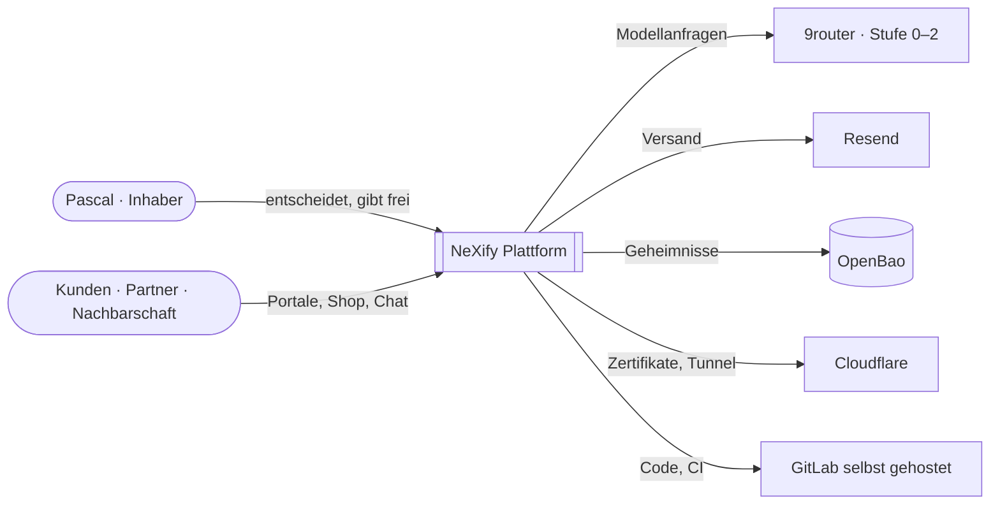
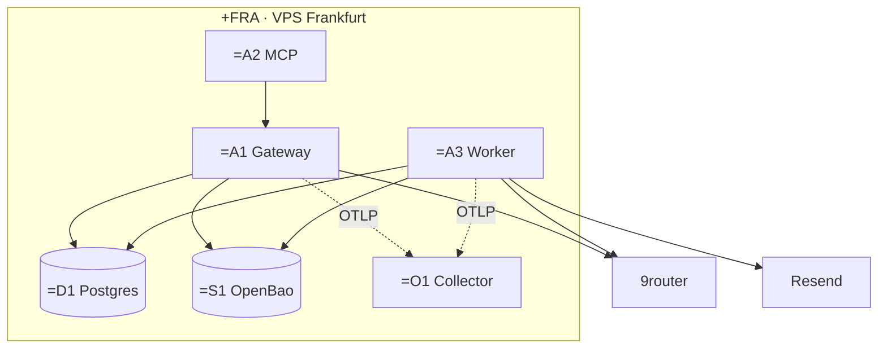
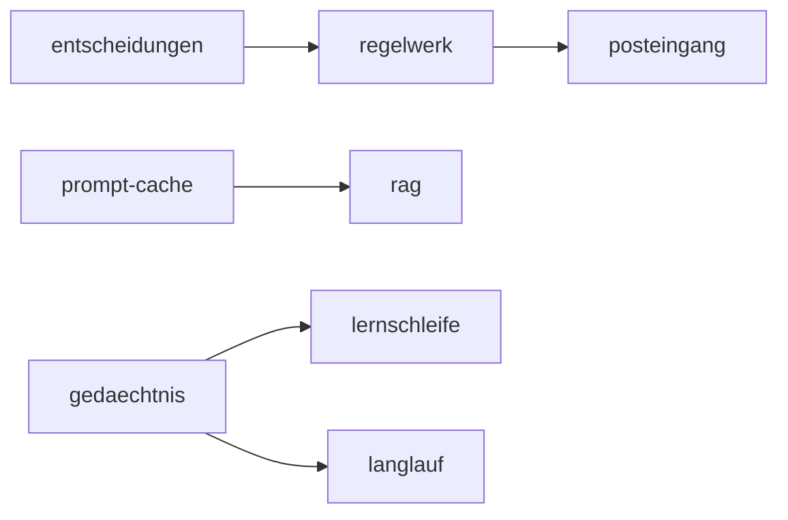
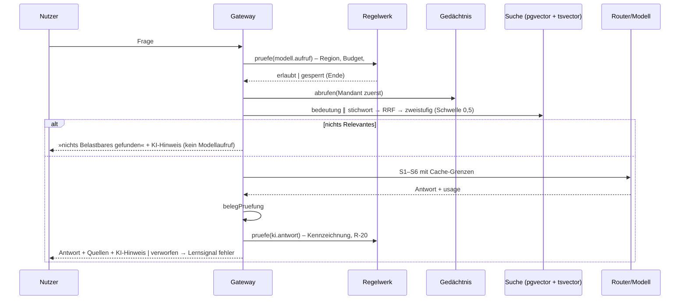

# Band 04 · Architektur

**Stand 28.09.2026 · Entwurf · Grundlage:** ADR 0001 (modularer Monolith), `api/openapi.yaml`, `deploy/compose.yml`, Abhängigkeitsanalyse `tools/abhaengigkeiten.js` (Rohdaten `docs_dev/abhaengigkeiten.json`).

Die C4-Diagramme in Mermaid-C4-Syntax (je Ebene eine Datei) stehen in `docs/architecture/`. Darstellung nach C4 (Kontext, Container, Komponenten). Kennzeichnung der Teile nach dem Aspekt-Prinzip von DIN EN ISO 81346-1: **=** Funktion, **-** Produkt, **+** Ort. Die Kennzeichen sind projektintern vergeben (keine Registrierung).

## 1 · Kontext (C4 Ebene 1)

## 2 · Container (C4 Ebene 2)

| Kennzeichen | Container | Technik | Ort | Port (nur 127.0.0.1) | Schnittstelle |
|---|---|---|---|---|---|
| =A1 -GW1 +FRA | Gateway | Node/Fastify, `lib/*` eingebettet | VPS Frankfurt | 8080 / 18080 parallel | REST `/v1` (`api/openapi.yaml`) |
| =A2 -MC1 +FRA | MCP-Server | Node, MCP 2026-07-28 zustandslos | VPS Frankfurt | 8090 / 18090 | `config/mcp-server.json` |
| =A3 -WK1 +FRA | Worker | Node, pg-boss (langlauf, posteingang, lernen, doku) | VPS Frankfurt | – | Warteschlangen in Postgres |
| =D1 -DB1 +FRA | Datenbank | Supabase-Postgres + pgvector, RLS | VPS Frankfurt | intern | Migrationen `db/migrations/001–005` |
| =S1 -BA1 +FRA | Tresor | OpenBao | VPS Frankfurt | 8200 | KV `nexify/` |
| =O1 -OT1 +FRA | Beobachtung | OTel Collector | VPS Frankfurt | 4318 | OTLP, Inhalte entfernt |
| =K1 -VL1 +FRA | Stufe-0-Modell | vLLM + LoRA (Profil `gpu`) | erst mit GPU-Knoten (A-04) | 8000 | OpenAI-kompatibel |

## 3 · Komponenten: die Kerne (C4 Ebene 3)

Alle Kerne sind **reine Funktionen ohne I/O** (keine Netzwerk-, Datei-, Browser- oder Umgebungszugriffe). Das prüft `tools/abhaengigkeiten.js` in CI; Stand 28.09.2026: **0 Zyklen, 0 fehlende Importe, 0 I/O-Befunde**.

| Kern | Aufgabe | wird genutzt von (Stand heute) |
|---|---|---|
| regelwerk | Schranke vor jeder Aktion | Gateway (B3), Leitstand, entscheidungen |
| entscheidungen | Postfach, genau einmal ausführen | Leitstand |
| posteingang | Einordnung, Zuordnung, KI-Hinweis | Posteingang, regelwerk |
| rechenkern | Preise, Steuer, Journal | Workspace, Gateway (B5) |
| tagrouter | #tag → Ablauf | Workspace |
| langlauf | Läufe, Lease, Budget, Kontext | Worker (B6), gedaechtnis |
| lernschleife | Signal → Lernform, Gate, Canary | Leitstand, gedaechtnis |
| gedaechtnis | Arten, Mandant, Konflikte, Vergessen | selbstheilung | Runbooks aus `config/runbooks.json` nach Modus | Worker (Auslöser der Wächter) |
| nachtlauf | tägliche Pflichten aller Kerne | Worker 03:00 |
| anfrage-pipeline |
| rag | Sync, Routing, Güte | prompt-cache |
| ki-muster | RRF, Belege, Prompt-Register | selbstheilung | Runbooks aus `config/runbooks.json` nach Modus | Worker (Auslöser der Wächter) |
| nachtlauf | tägliche Pflichten aller Kerne | Worker 03:00 |
| anfrage-pipeline |
| prompt-cache | Aufbau S1–S6, Breakpoints | selbstheilung | Runbooks aus `config/runbooks.json` nach Modus | Worker (Auslöser der Wächter) |
| nachtlauf | tägliche Pflichten aller Kerne | Worker 03:00 |
| anfrage-pipeline |
| betriebskennzahlen | DORA, Kosten, Schuldbuch | nachtlauf |
| einstellungen | Schema, Einwilligung | NX-Footer |
| normpruefung | Layoutprüfung gerendert | Leitstand |
| selbstheilung | Runbooks aus `config/runbooks.json` nach Modus | Worker (Auslöser der Wächter) |
| nachtlauf | tägliche Pflichten aller Kerne | Worker 03:00 |
| anfrage-pipeline | verbindet regelwerk → gedaechtnis → rag/ki-muster → prompt-cache → Modell → Belegprüfung → regelwerk | Gateway `/v1/requests`, Workspace, Posteingang-Entwurf (B7/B9) |

## 4 · Befund aus der Analyse

**Geschlossen 28.09.2026:** gedaechtnis, ki-muster und prompt-cache sind über `lib/anfrage-pipeline.js` verbunden (7/7 Prüffälle mit allen echten Kernen, Suche und Modell als Attrappen). **betriebskennzahlen** hängt am `nachtlauf` (6/6). Damit hat jeder Kern einen Verbraucher. Das ist kein Fehler im Code, sondern eine Lücke im Plan. Zuordnung im Backend-Auftrag:

| Kern | Anschluss | Schritt |
|---|---|---|
| gedaechtnis | Worker: vor jedem Modellaufruf `abrufen()`, danach `speichern()`; täglich `vergessen()` | B6/B9 |
| ki-muster + rag | Gateway `/v1/requests`: `routing()` → Hybrid-Suche → `rrf()` → `zweistufig()` → `ragPrompt()` → Antwort → `belegPruefung()` | B7/B9 |
| prompt-cache | Gateway: jede Modellanfrage über `aufbauen()`/`anthropicAnfrage()`; `trefferquote()` aus `gen_ai.usage.*` | B10 |
| betriebskennzahlen | Worker nächtlich: `dora()`, `kostenJeVorgang()` → Leitstand | B10 |

## 5 · Ablauf einer Modellanfrage

## 6 · Offen in diesem Band

- Sequenzdiagramm einer Freigabe (Karte → Entscheidung → Ausführung).
- Verteilungssicht für den frischen Server (zweiter Weg aus Band 01).
